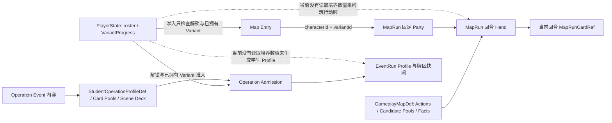

# 06-wiki/30-arona-clicker-domain/card-systems-and-cultivation-bridge — 卡牌系统盘点与培养接入边界

本文回答：项目里哪些机制被称为“卡”或“卡池”，它们目前怎样连接到角色身份与培养状态，以及未来培养数据进入结构向卡牌运行时需要经过什么边界。本页是跨领域导航和事实摘要；各机制算法仍以专门机制页和源码为准。

## 当前结论

目前存在三类不同的卡牌运行结构，以及一类名称相似但用途不同的抽卡池：

1. Gameplay B `MapRun` 每个 Encounter 回合为角色和敌人抽取短期 Action Hand；它不是构筑牌库。
2. Operation Runtime 同时支持学生的候选 Action Hand 与玩家的实体 Scene Deck；两者互不等同。当前 Gameplay B 第一方内容以 Map Entry 为准，通用 Operation Event Runtime 仍是独立机制。
3. 角色招募的 `GachaPoolDef` 是角色 / Variant 抽取表，与战斗 Action 池无关。

现有入口只把玩家角色的解锁和已拥有 Variant 用作队伍准入，并在 Run 中保存角色身份。MapRun 不读取 `VariantProgress` 来改行动候选、费用或效果；Operation 的学生行动候选来自 Event 内容里的 `StudentOperationProfileDef`、`OperationCardPoolDef` 和规则快照，也没有从玩家培养进度动态生成 Profile。培养状态目前还没有通往结构向卡牌 Run 的运行时适配层。

## 名称和运行时责任

| 名称 | 实际用途 | 生命周期与状态所有者 | 和培养的当前关系 |
| --- | --- | --- | --- |
| `GachaPoolDef` / 角色卡池 | 按稀有度、概率、Featured 和保底规则招募角色差分 | `GachaService` 结算；`PlayerState.roster`、`fragments`、`gachaState` 保存结果和抽取计数 | 抽到或重复抽到角色会影响持有 / 碎片等状态；它不是战术卡牌牌库 |
| Gameplay B `candidatePools` / MapRun Hand | 将 Map-local Action、Tag 或嵌套 Pool 展开为角色 / 敌人的回合候选 | `GameplayBHandResolver` 为 Encounter 回合抽取；`MapRunService` 保存本轮 Hand 和草稿；新回合产生新 Hand | 只按 Map 内容、Encounter 候选、MapRun Facts、角色身份和运行时费用规则决定；不读取等级、星级、技能培养或装备进度 |
| Operation `operationCardPools` / 学生 Action Hand | 为学生解析可用 Action 候选；可受 Location、Scene、事实、Profile、能力和 Strategy 权重影响 | `OperationCardCandidateResolver` 解析 Action IDs，`EventRun.characterHands` 保存运行期结果 | 候选由 Registry/Event 的静态 Profile 和规则提供；当前不按 `VariantProgress` 动态增删或调权 |
| Operation `playerSceneDeck` / Scene Deck | 有实体副本的玩家场景牌；牌引用 Operation Action，带 `copies`、`playerCost`、时机和表演者规则 | `OperationPlayerSceneDeck` 洗初始牌序并维护 `drawPile`、`hand`、`discard`；随 `EventRun` 存档；弃牌不回洗 | Deck 内容由 Event 静态声明；没有从角色技能、装备或等级自动生成牌的通路 |
| UI 卡面 / `MapRunCardInstance` | 将领域行动或场景牌以可交互卡面呈现 | UI 从 Runtime 投影读取；MapRun 使用带 Run / Node / Round 范围的 `MapRunCardRef` | 卡面、扇形或 DOM 节点不是玩家收藏卡，也不拥有培养状态 |

Operation Scene 中还有 `SceneAction` 批次：它组织玩家选择、固定选择、Scene 卡、购买项和费用结算。它是一次场景操作合同，不等同于学生 Action Hand，也不等同于卡牌定义本身。

## 角色身份如何进入卡牌 Run



### Gameplay B MapRun

`RuntimeGameInstance.startMap()` 通过 Map 的固定 `partyCharacterIds` 执行准入：角色必须已解锁，且至少有一个属于该 Character 的已拥有 Registry Variant。返回给 `MapRunService.start()` 的 Party 项只有 `{ characterId, variantId }`。MapRun 随后冻结这组身份，并从 Map 定义读取初始 HP、AG-1 敏捷补充、Actor / Team 资源与 MapRun Facts。

Map Action 的可用角色由 Action 的 `eligibleCharacterIds` 和 Encounter 的候选声明限定；Candidate Pool gate 读取 MapRun Counter / Flag。Entry 展示会投影名称、头像、准入状态和 MapRun HP / 资源，但不把等级、经验、星级、好感、技能或装备作为当前 Hand 解析输入。详细 Hand、PlayerCommand、卡牌目标、存档与 Ref 规则见 [[ai/archive/docs-829/04-mechanisms/arona-clicker/gameplay-b-cards]]。

### Operation Runtime

Operation 准入也会校验角色解锁和已拥有 Variant，并保存实际采用的 `characterId` / `variantId`。学生 `StudentOperationProfileDef` 是 Event 内容：其中候选 Action、优先级、`capabilityIds`、Card Pool、Strategy 和可选随机技能规则都由内容定义。Admission 将 Profile 与 Action / Pool 等定义解析为 detached 输入；`StudentOperationProfileResolution` 再生成并冻结 `OperationStudentProfileSnapshot`，存档恢复会按当前 Event 内容重算并对比该 Profile 快照。

这里的 `capabilityIds` 是 Event Profile 给出的战术准入能力，并非由玩家培养等级或已激活技能实时聚合出来。Operation 的玩家 Scene Deck 则是另一条静态内容路径：Entry 内容声明卡牌定义和副本，Run 保存物理实例分区；Scene 批次提交时，卡牌关联 Action 并参与费用、目标和效果结算。完整流程见 [[ai/archive/docs-829/04-mechanisms/arona-clicker/operation-runtime]]。

## 培养数据当前能提供什么

`PlayerState.roster[variantId]` 的 `VariantProgress` 包含 `level`、`exp`、`stars`、`affectionLevel`、`affectionExp`、色彩装备，以及可选的技能、三槽装备、爱用品、专武和特性进度。数据包的 `VariantProgressionDef` 声明这些成长轨道的可能性；玩家做到哪由 PlayerState 记录。

当前状态写入能力并不一致：等级经验与星级突破分别由 `StateMutationService.addExp()` / `breakthroughStar()` 写入；Gear 有装备、经验和 Tier 进度命令。`VariantProgress` 对 skills、favorite、uniqueWeapon、traits 的注释标为占位 / 无写入口。不要只因定义含有 `Effect` 或 `capability` 字段，就推断这些培养效果已经被 MapRun 或 Operation 读取并映射成卡牌规则。

角色 Roster 的 global / Init 归属由 `characterPersistConfig.roster` 等 Registry scope 决定；角色历史记忆另有跨 Init 的 `characterMemory`。这决定未来适配层读取“当前培养值”时必须明确使用当前 Init 还是跨线状态。状态生命周期见 [[ai/archive/docs-829/03-data-structures/player-state]]，当前招募和培养流程见 [[ai/archive/docs-829/04-mechanisms/arona-clicker/gacha-cultivation]] 与 [[ai/archive/docs-829/06-wiki/30-arona-clicker-domain/character-acquisition-growth]]。

## 为未来培养—结构向卡牌衔接预留的边界

以下是基于当前运行时合同整理的接入要求，属于未来服务设计方向，不代表已经实现：

1. **在 Run 准入时解析培养。**以通过准入的 `(characterId, variantId)` 为键，读取当前有效 `VariantProgress` 和对应 Registry 定义；由一个明确的 adapter 把成长结果翻译为结构向游戏可识别的战斗构筑输入。
2. **输出有限、可校验的战斗快照。**快照只携带本次 Run 需要的字段，例如有效属性、解锁能力、Action 候选及其权重 / 修正，不能把任意 PlayerState 或通用 `Effect` 对象直接塞进卡牌状态。MapRun 与 Operation 都已有有限 Action / 目标 / 效果合同，可以分别评估是否复用。
3. **固定本次 Run 的构筑语义。**准入后将适配结果冻结在 Run 快照里；在途培养变化影响后续 Run，不静默改变当前 Hand、费用或回执。Save / Resume 要保存并验证该构筑输入及其内容兼容版本，确保重载后不会因玩家状态或 Registry 后续变化而改抽牌。
4. **分开持久培养和局内状态写入。**卡牌结算写入 Run 自己拥有的 HP、资源、事实、牌区和历史；只有明确的结局奖励或培养入口才经 `StateMutationService` 写入 PlayerState。不要让卡牌 UI 或通用牌效直接修改 roster。
5. **逐项决定培养映射。**分别确定等级 / 星级、技能、装备、好感、特性究竟影响属性、候选资格、牌库构成、权重还是 Action 数值；尚无有效写入或效果消费路径的成长轨道，不能提前视为已接通。

最短的未来接入链可以表达为：

```text
当前 PlayerState + Character / Variant 内容
  → 培养到战斗构筑的 Adapter
  → Run 准入时冻结的有限 Build Snapshot
  → MapRun 或 Operation 的候选 / Action / 牌组规则
  → 局内 Runtime 结算与 Run 存档
  → 明确奖励经 StateMutationService 回写持久进度
```

当前 Gameplay B 内容中没有 Operation Event Scene Deck；Operation Runtime 的存档与行动结构可以作为研究参照，但不能据此认为 Gameplay B Map 已有实体牌组。Map 内容与 MapRun 的当前行为依据 [[ai/archive/docs-829/04-mechanisms/arona-clicker/gameplay-b-cards]]；Map Entry 和 Run 恢复路径见 [[ai/archive/docs-829/04-mechanisms/arona-clicker/operation-runtime]]。

## 从哪里继续核对

| 主题 | 当前权威入口 |
| --- | --- |
| Map Action、Candidate Pool、Hand、CardRef、Commit | `src/data-services/contracts/gameplay-map.ts`、`src/arona-clicker/services/map/gameplay-b-hand-resolver.ts`、`map-run-service.ts`、`map-card-catalog.ts` |
| Map Party 准入 | `src/arona-clicker/runtime/runtime-game-instance.ts`：`startMap()`、`admitMapParty()`、`resolveMapPartyAdmission()` |
| Operation Action Hand / Profile | `src/data-services/contracts/operation.ts`、`operation-participant-admission.ts`、`student-operation-profile-resolver.ts`、`operation-card-candidate-resolver.ts` |
| Operation 实体 Scene Deck | `src/data-services/contracts/operation.ts`、`src/arona-clicker/services/operation/operation-player-scene-deck.ts`、`operation-runtime-service.ts` |
| Gacha 卡池 | `src/data-services/contracts/gacha-pool.ts`、`src/arona-clicker/services/economy/gacha-service.ts` |
| 培养定义和玩家进度 | `src/data-services/contracts/character-progression-def.ts`、`src/arona-clicker/types/character.ts`、`src/arona-clicker/types/state.ts`、`src/arona-clicker/state/state-mutation-service.ts` |
| 当前 Gameplay B 内容装载 | `src/arona-clicker/content/gameplay-b/gameplay-b-map-datapack.ts` |

行为测试入口沿用专门机制页：[[ai/archive/docs-829/04-mechanisms/arona-clicker/gameplay-b-cards]]、[[ai/archive/docs-829/04-mechanisms/arona-clicker/operation-runtime]]、[[ai/archive/docs-829/04-mechanisms/arona-clicker/gacha-cultivation]]。本页未新增或运行测试。
