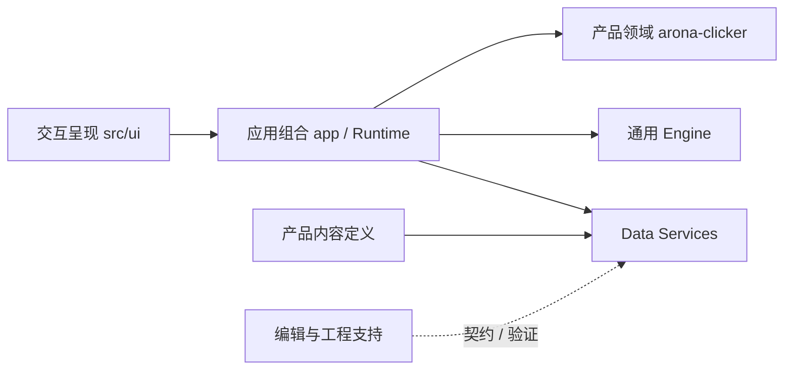
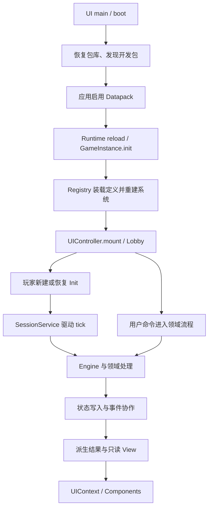

# 新 Wiki 结构研究

本文回答：如何按当前源码重新组织项目 Wiki，使读者能从系统组成进入运行顺序，再沿领域流程定位细节。

状态：结构研究，供后续 Wiki 设计使用。依据当前源码、测试与两条独立调查；不构成实现计划。

日期：2026-10-25。

## 1. 模块组成概览

建议用职责层作一级导航，领域流程作二级导航：

| 职责层 | 主要组成 | Wiki 关注点 |
| --- | --- | --- |
| 应用组合 | `src/app/`、`src/arona-clicker/runtime/` | 启动、Runtime 装配、包应用与生命周期 |
| 基础机制 | `src/data-services/`、`src/engine/` | 内容与 Registry、存储、表达式、事件、效果、Tick、统计和可见性 |
| 产品领域 | `src/arona-clicker/` | 状态、只读 ReadModel、内容定义；角色、经济、养成、世界、剧情、地图、作战与表现服务 |
| 交互呈现 | `src/ui/` | Controller 命令、组件、导航、Flow、工作区与表现 |
| 创作与工程支持 | `tools/datapack-editor/`、`src/data/`、`src/save/`、`tests/`、`scripts/` | 内容编辑、资源/示例、保存适配、验证与开发支持 |

图中主要表示组合与依赖方向。模块卡应按“职责、边界、输入/输出、关键源码”组织，不按每个目录机械拆页。

## 2. 顺序结构概览

启动与持续运行是一条读者主线：

另用小图说明数据流：`Datapack → Registry`；`PlayerState + 派生数据 → GameView / ReadModel → UIContext → Components`。状态命令经 Runtime 与领域服务进入 `StateMutationService`，相关事件再通知订阅者更新派生状态。Tick 内部应按主题拆流程，不将所有系统画成单一固定串行链。

## 3. 新 Wiki 的最小目录骨架

1. **入口与系统地图**：项目组成、模块边界、术语和阅读路线。
2. **启动与 Runtime**：包应用、Registry 装载、Lobby、Init、Tick、保存恢复。
3. **产品领域**：角色与养成、经济、世界与 Spot、剧情、地图与作战、主题与表现。
4. **跨模块流程**：状态写入与事件、内容定义到运行时、查询视图到 UI；每篇聚焦一条可追踪流程。
5. **界面与创作工具**：命令与只读投影、游戏内 UI、独立 Datapack Editor 和工程验证入口。

## 4. 关系表达约定与依据

页面和图示明确区分静态依赖、运行时调用、数据流、事件协作；一张图只表达一种主要关系。功能页从用户可观察流程切入，字段定义和算法细节链接到权威文档或源码，不在 Wiki 重复维护。

核对入口：`src/ui/main.ts`、`src/app/runtime-bootstrap.ts`、`src/arona-clicker/runtime/runtime.ts`、`runtime-wiring.ts`、`runtime-game-instance.ts`、`src/data-services/`、`src/engine/`、`src/arona-clicker/services/`、`src/ui/runtime/context.ts`。当前启动顺序由 `main.ts` 的 `boot()` 与 Runtime 包应用/初始化链核对；模块分组由源码目录和服务子域核对。
