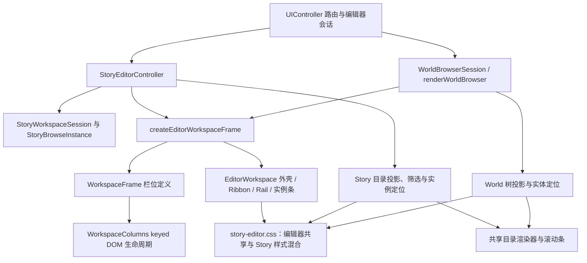

# 高级编辑器框架改造基线

状态：Stage 00 调查与设计裁定完成；等待 Stage 01 Prompt。本报告中的源码事实保留为基线，后续裁定是 Roadmap 的约束。

## 范围与入口

调查对象是游戏内 Story、StoryEntry、World 高级编辑器及公共 Workspace 服务；独立 Datapack Editor 不在范围内。事实以当前源码和本地浏览器为准。既有 Task [[ai/plan/task-0383-editor-session-and-review-tools]]、[[ai/plan/task-0384-editor-directory-navigation]] 提供设计历史，但其中的布局偏好和 World 实例约定允许后续重裁。

主要入口：`src/ui/workspace/editor-workspace.ts`、`editor-workspace-frame.ts`、`workspace-columns.ts`、`editor-directory.ts`、`editor-directory-scroll.ts`、`src/ui/story-editor/workspace-session.ts`、`story-editor/controller.ts`、`story-editor/view.ts`、`src/ui/runtime-editor/world-browser.ts`、`src/ui/controller/controller.ts`、`src/ui/css/story-editor.css`。

## 当前装配与调用关系

`createEditorWorkspaceFrame()` 将编辑器栏声明交给通用 `WorkspaceFrame`；实际挂载、更新、解绑和稳定栏身份由 `WorkspaceColumns` 管理。该类只负责 keyed DOM 生命周期，不调度业务命令。`editor-workspace.ts` 同时负责视图能力推导、Chrome/Ribbon 渲染、偏好读写和分隔线／Ribbon 拖动。Story 与 World 各自提供栏和操作绑定。

## 当前状态所有权基线

| 状态／职责 | 当前持有者与位置 | 当前行为 | 已裁定的目标归属 |
| --- | --- | --- | --- |
| 当前编辑器路由、外部返回点、主题会话 | `UIController.editorSession`、`workspaceNavigation`；`editor-workspace-appearance.ts`、`editor-return.ts` | Story ↔ World 互切复用一次编辑会话；真正退出时恢复原返回点并结束主题会话 | 由统一 Editor Workbench 持有整个编辑环境；左侧 Work Type 和活动 Browse Instance 不再充当彼此路由 |
| 通用 Frame 与栏 DOM 身份 | `editor-workspace-frame.ts`、`components/shared/workspace-frame.ts`、`WorkspaceColumns` | 栏 key/binding 变化时由列管理器更新挂载；实例更新 token 使旧更新失效 | 规整为 Workbench 栏位宿主；Column Manager 保持通用 DOM 身份/更新职责，不混入业务命令 |
| Advanced/Classic、布局、栏宽、公共 Ribbon 表现偏好 | `EditorWorkspacePreferences`，由 `editor-workspace.ts` 经 LocalStorageAdapter 保存 | key 为 `acprogram.editor-workspace.v1.<workType>`；Story 与 World 当前分别保存 mode、ribbon、left/right widths；布局 view 另由业务 session 持有 | Workbench 持有唯一全局布局偏好：三栏/双栏/专注、左右期望宽度、公共 Ribbon 表现。业务声明可用栏位；临时布局仅覆盖有效布局，不回写基础偏好 |
| 浏览布局 | Story：`StoryWorkspaceSession.sidebarVisible` + 活动实例 `inspectorVisible`；World：`WorldBrowserSession.view` | 三栏／双栏／专注不是同一个字段或统一持久化路径；World 初次以 browse 打开，Story 实例可单独保留属性栏可见状态 | 迁移至 Workbench 全局布局状态；切换 Work Type 或实例不能无故改变布局 |
| Browse Instance 集合与生命周期 | Story：`StoryEditorController.workspace`（`workspace-session.ts`）；World：`UIController.panelState.worldBrowser` | Story 管多实例快照和复用；World 是单实例 session，关闭即退出 Workbench | 建立公共 Browse Instance Manager，统一身份、集合、激活、关闭、创建、复制、复用。Story/World 提供业务快照、资源身份、恢复和保存门禁；World 可用单实例策略，但不保留独立实例系统。关闭遵循统一语义；关最后实例优先留下空 Workbench，退出为独立命令 |
| Work Type 与活动实例 | Story 由 `workspace.active` 同时驱动业务栏；World Rail 动作进入 World 路由并切换内容 | Work Type 目前近似整个编辑器内容路由 | Workbench 持有两者为独立状态。Story、StoryEntry、World 实例共存于同一 Manager 集合。Work Type 仅选择左侧 Explorer；活动实例决定中栏、右栏和顶部业务工具。左栏切 World 不应替换 Story 中右栏/Ribbon；实际打开 World 资源才创建/复用/激活 World 实例。激活实例不切 Work Type，只有显式定位可切至相应 Explorer |
| Story 目录数据、搜索与选择 | `story-editor/model.ts`、`sidebar-tree.ts`、`view.ts`、`StoryEditorController` | Story 域构建 Init/目录/Story/Entry 投影；来源、搜索、分类/Init 筛选、Entry 多放置优先级、折叠 map、临时 reveal 由 Story 域负责 | 域继续持有数据投影和过滤；公共导航服务只持有可见行交互，不拥有 Story 语义 |
| World 树数据、展开与实体选择 | `world-browser.ts` 的 `buildDefaultWorldTree`/`worldTreePath`、World session；交互绑定在 `UIController.bindWorldBrowser()` | Init→Area→Spot 树、默认项和缺失父项由 World 域构造；展开 key、所选实体/node key 属于 World | 域继续拥有树和选中语义；共同目录服务负责展开、选择投影、滚动、聚焦 |
| Explorer 搜索、展开、选择、滚动、定位、聚焦 | Story state/controller 与 World session/`UIController.bindWorldBrowser()` 各自持有 | 目录 DOM 和滚动外观已有共享实现，但完整浏览交互状态与控制逻辑分散 | 公共 Explorer 服务拥有通用浏览状态/交互及生命周期；多个 Explorer 状态互相独立。业务 Provider 负责真实数据、树投影、资源身份、筛选语义、多放置消歧和业务动作；Story 资料来源/草稿语义仍属于 Story |
| 目录行与展开 DOM | `workspace/editor-directory.ts`；调用方为 Story sidebar 与 World renderer | 共享 `li`/行、Chevron、折叠子树与展开 DOM 更新；域分别持有状态 | 纳入公共 Explorer 服务的交互与状态管理，不止渲染 helper；业务 Provider 保留资源投影和语义 |
| 目录滚动条与视口 | `workspace/editor-directory-scroll.ts` | 共享 scroll wrapper、thumb、ResizeObserver、pointer 拖动和清理；Story/World 绑定各自稳定 scroll key | 公共 Explorer 统一管理状态及生命周期，包括滚动位置、定位、展开祖先、显露和聚焦；沿用稳定 key 与资源身份 |
| Ribbon 命令与事件 | Story 命令由 `story-editor/view.ts::storyRibbonTools()`、`documentActions()` 编排，事件由 `StoryEditorController.bindWorkspace()` 及原业务 handler 执行；World 提供 `commands` 并由 `bindWorldBrowser()` 执行 | 外壳统一，业务操作仍分别来源于域 renderer/controller；临时视图隐藏部分快捷区/返回操作 | 分开 EditorChrome 渲染、命令描述与域动作处理；共享 shell 不拥有保存/发布/资料编辑逻辑 |
| CSS | 公共编辑器外壳、共享目录规则和大量 Story 样式目前集中于 `src/ui/css/story-editor.css`；由 `surface-styles.ts` 的 story surface 加载 | World 编辑器也依赖这份 Story CSS；`runtime-editor.css` 是独立运行时 Datapack Editor 样式 | 后续 Stage 02/07 按 Workbench/Explorer/领域内容职责拆分与迁移；判断标准是权威状态与通用职责归属，不以“新增公共文件”本身作为完成 |

## 本地浏览器行为记录

观察环境：Edge 中的本地 `http://localhost:5173/src/ui/index.html`，窗口约 1699×781。开始时高级模式、Story 的 Entry“欢迎来到夏莱”为活动实例、另有一个 Story 实例，布局为三栏。

| 操作 | 浏览器观察 | 现状含义 |
| --- | --- | --- |
| Story 切到 World，再切回 Story | 工作类型 Rail 切换内容；Story 的两条实例仍在，回切后 Entry 仍为活动项。World 显示一个“世界内容”实例 | 外层编辑器会话共享；域实例集合独立 |
| World 默认布局 | 双栏查阅；目录在左，摘要在中；三栏时显示空的“便捷信息”右栏。三栏采样几何约为左 263px、中 1058px、右 317px；可见 left/right 两个 splitter | `openWorldBrowser()` 新建 session 初值为 browse；World 有三栏能力但首入不是三栏 |
| World 的实例条 | 显示“世界内容”和关闭键；“新建实例”禁用 | 关闭按钮最终走 `closeEditorWorkspace()`，不是仅删除一个 World 子实例 |
| 切换 Story 实例 | 活动标签、正文/Entry 内容和目录选中随实例切换；共享目录呈现对应实例的项目 | Story 状态快照与目录定位由 Story controller 协调 |
| 布局切换 | Story 可选三栏、双栏查阅、专注正文；World 也可选这三种。World 专注隐藏左树，摘要链接可切实体；点“显示目录”后回双栏并显露选中节点 | view 切换同时改变栏可见性；World 的定位入口会让目录恢复 |
| Story 目录定位 | 在 Story 专注视图使用“在目录中定位”，浏览器回到含左栏的双栏查阅；目录搜索输入保持原值 | 该命令是显式定位入口，复用当前实例目标并恢复目录可见性 |
| World 节点链接 | 专注时点摘要中的子项链接，摘要内容改变；目录仍隐藏。之后点“显示目录”，左树恢复并定位到所选 Spot | 链接选中实体，但并不单独自动开启左栏；“显示目录”负责恢复路径。与 0384 所写“专注下链接先打开双栏定位”有行为差异，后续施工需先裁定并回归 |
| 栏宽拖动 | 本次没有实际拖动分隔线；屏幕可见三栏模式左右分隔线，双栏仅左分隔线。源码 pointerup 保存当前宽度，双击回默认 300px/320px；pointercancel 恢复原值 | 将拖动视觉反馈及偏好恢复纳入后续浏览器回归，不把未手测写成已验收 |
| 退出编辑器 | 本次未点击退出，以避免改变用户当前工作路由；源码显示通过 `closeEditorWorkspace()` 过 Story 保存门禁，再恢复单层外部返回点并结束编辑器主题会话 | 退出顺序和保存失败保持原路由需在后续阶段补浏览器验收 |

浏览器操作后已恢复到 Story Entry 活动实例、三栏；World 恢复至双栏查阅和原始选中 Area。未改业务内容。

## 结构问题与已裁定 Roadmap

当前边界可用，但较多职责挤在编排点：`editor-workspace.ts` 同时实现偏好、视图、Chrome 和 Resize；`story-editor/controller.ts` 同时编排实例生命周期、领域动作、目录定位和刷新；`UIController` 同时拥有路由/主题会话、World session 与 World DOM 绑定。CSS 也通过 `story-editor.css` 承担共享与领域两类责任。目标是建立统一 Editor Workbench，并把权威状态和通用职责迁至公共框架；拆文件/移动 CSS/提取 helper 本身不算成功标准。

后续施工顺序固定为：

1. **Stage 01：统一布局服务。** Workbench 单一持有全局布局偏好；业务仅提供栏位，临时布局覆盖有效值而不改基础偏好。
2. **Stage 02：公共框架表现与栏位宿主规整。** 收口 Workbench chrome、Ribbon 表现、rail、栏位装配、Column Manager 宿主契约。
3. **Stage 03：以 Story 为迁移对象，建立公共实例管理器。** 将 Story/Entry 的身份、集合、激活/关闭/新建/复制/复用及保存门禁迁入公共生命周期，Story 保留业务快照/恢复。
4. **Stage 04：World 接入公共实例管理器。** World 单实例成为 Manager 的策略；统一关闭语义，保留 World 的只读浏览状态。
5. **Stage 05：统一 Workbench，解耦左栏工作类型与活动实例。** Explorer 由 Work Type 选取；活动 Browse Instance 控制中右栏和业务 Ribbon；切换两者彼此独立。
6. **Stage 06：统一 Explorer 浏览服务。** 公共服务管理搜索、展开、选择、滚动、定位、显露、聚焦及状态生命周期；Provider 管领域数据与语义。
7. **Stage 07：移除过渡实现，完成文档及接入规范。** 清理旧 Controller/实例/Explorer 路径；更新机制文档、CSS 归属与 Provider/Workbench 接入说明。

单阶段可按源码细调，但不可重新打开以上已裁定的整体目标或将统一责任降级为可选项。

## 未做事项

- 未修改实际功能代码或布局行为。
- 未拖动分隔线，也未实际退出编辑器；这两项目前只按源码记录。
- 未运行测试。此阶段以源码追踪、现有 Task 对照和浏览器交互观察为交付。
