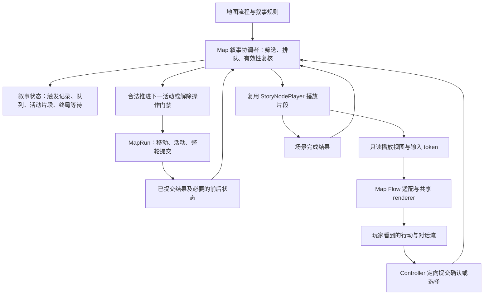

# 玩法 B：流内剧情、战斗短句与里程碑对话调查

日期：2026-10-29。性质：当前实现调查与玩法设计建议；没有实施新机制，也没有把建议作为已批准的架构决定。

## 1. 核心判断

玩法 B 接下来需要的是**一套随关卡运行的叙事编排**：作者能在同一个关卡视角下看到“到达这里说什么、战斗发生什么才说什么、说完之后做什么”。单独往信息流追加几种消息，会很快失去这种整体关系。

建议保留 MapRun 对地图、活动和战斗的控制，复用 Story 的内容节点与播放器，把叙事分成三个入口、交给一个协调者安排：

1. **顺序场景**：战前简报、调查对话、战后讨论、重要选择。加入节点活动顺序，明确什么时候阻塞后续操作。
2. **事件场景**：首次击倒、濒危获救、线索达到门槛等里程碑。根据已经提交的玩法事实触发，进入有优先级的播放队列。
3. **环境短句**：角色偶尔喊话、普通攻击后的感想。通过同一套规则筛选，但低优先级、有频率限制，通常不要求点击。

三者尽量引用同一种 Story 内容文档；“片段怎么演”和“片段何时有资格演”分别管理。玩家看到的是一条连续的行动与对话流，作者维护的是一份能读懂节奏的关卡叙事清单。

首期建议采用“**回合提交后，在相应结算位置穿插对话**”。当前战斗整轮原子结算，不支持在半轮中等待玩家选择；如果将来需要选项改变本轮后半段行动，那是战斗执行模型的另一项改造。

## 2. 调查范围与证据口径

本次核对当前工作区的源码、相关测试断言与 `docs/docs-830/`，范围包括 MapRun、AG-1 结算、Map Flow、Story 节点与会话、保存恢复，以及已有世界 Milestone 的边界。没有使用归档方案作为当前事实，没有做外部竞品调研，没有运行游戏或游戏测试。

工作区有其他任务的在飞修改，Story 的局部标记、Choice 绑定与编辑器也正在演进；以下事实以本次实际读取的文件为准。报告中的接口名、数据布局与参数值，凡标为“建议 / 示意”，均不是现有可用 API。

### 2.1 已核实的实现

| 编号 | 当前事实 | 对本需求的含义 | 源码与核对入口 |
| --- | --- | --- | --- |
| F1 | `GameplayMapNodeDef` 支持单个 Encounter，或固定顺序 `activities`；活动当前为 Encounter / Shop，Rest 通过无敌人的有限轮 Encounter 表达 | 已有“节点内按顺序运行”的骨架，但还没有 Story 活动 | [gameplay-map.ts](../../src/data-services/contracts/gameplay-map.ts)：`GameplayMapNodeDef`、`GameplayMapActivityDef`；[map-run-service.ts](../../src/arona-clicker/services/map/map-run-service.ts)：`openNodeContent()`、`advanceCompletedActivity()` |
| F2 | 第一方地图已有“战斗 → 两轮休整 → 补给”顺序活动，也有调查、分路、路线门禁和机器人战斗 | 可直接用现有内容验证叙事节奏，无需先造一套新地图语言 | [gameplay-b-map-datapack.ts](../../src/arona-clicker/content/gameplay-b/gameplay-b-map-datapack.ts)：活动室、现场调查与自主索敌样例 |
| F3 | `MapFlowModel` 只读 View，维护 UI 临时流；离开 Map 路由会 `dispose()`；观察到的旧回执在本次会话中保留，重新进入只重建有权威来源的内容 | 当前 Flow 不能担任必播队列、已触发记录或剧情游标的保存位置 | [map-flow-model.ts](../../src/ui/flow/map-flow-model.ts)：`sync()`、`recordMovement()`、`dispose()`；[controller.ts](../../src/ui/controller/controller.ts)：`enterWorkspaceRoute()` 的离开清理 |
| F4 | Flow 已与 Chat / Story 共用正文呈现能力，有 `talk`、`narration`、来源身份、实例键、替换策略；默认上限为 200 条 | 显示层已有复用基础，但条目回收和 UI 去重都不等于业务“一次触发” | [flow-entry.ts](../../src/ui/flow/flow-entry.ts)：`FlowEntry`、`FlowContent`、`FLOW_STREAM_MAX`；[flow-render.ts](../../src/ui/flow/flow-render.ts) |
| F5 | 预览与正式回合提交共用规划逻辑；正式提交校验 Run、草稿与版本，保留最近回执并识别最近请求重试；AG-1 有执行顺序与效果轨迹 | 叙事判断可利用结算证据；不能在预览中抽取喊话、消耗触发次数或播放剧情 | [map-run-service.ts](../../src/arona-clicker/services/map/map-run-service.ts)：`previewEncounterCommit()`、`prepareEncounterRoundCommit()`；[map-run.ts](../../src/arona-clicker/contracts/map/map-run.ts)：回执与执行序列 |
| F6 | `commitMapEncounterRound()` 先准备 MapRun 和 Item 扣除，两个 owner 安装之间没有事件、回调或等待；终局可直接清空活动 Run，只留精简结果 | 播放不能插进结算安装中间；终局对白也不能依赖“下一次查询还能拿到完整 Run” | [runtime-game-instance.ts](../../src/arona-clicker/runtime/runtime-game-instance.ts)：`commitMapEncounterRound()`；`map-run-service.ts` 的终局准备和安装 |
| F7 | MapRun 有局内 Counter / Flag；候选池门控冻结 Encounter 入场 Facts，路线边读取当前 Facts；Effect 内部有基于实际结果的 `damageApplied`、`healApplied`、`enemyDefeated` 等受限触发 | 条件有基础，但叙事应读取提交后的当前事实 / 有序结果，不读取手牌门控旧快照，也不把内部触发器当全局事件 | [map-effect-planner.ts](../../src/arona-clicker/services/map/map-effect-planner.ts)；[map-run.ts](../../src/arona-clicker/contracts/map/map-run.ts)：`MapRunFactState`、`MapRunCandidateSourceSnapshot` |
| F8 | `StoryNodeDocument` 的四类节点是 Talklet、Click、Operation、Transfer；播放器具备输入 token、交付确认、goto / insert、局部标记与等待点保存恢复 | 长对话、选择和片段复用已有执行基础；无需再写一套战斗专用对话解释器 | [story-node.ts](../../src/data-services/contracts/story-node.ts)；[story-node-player.ts](../../src/arona-clicker/services/story/story-node-player.ts)；[story-node-playback.ts](../../src/arona-clicker/contracts/runtime/story-node-playback.ts) |
| F9 | `StoryService` 在全局 / owner 会话上叠加 Entry 准入、奖励、日志与表现生命周期；owner key 目前采用 `variant:` 约定，默认交互门控可检查全部活动会话 | 不能仅把 `map:runId` 塞进现有 owner 参数就宣称 Map 会话隔离已经完成；也不应默认让每次战斗喊话都结算 Entry 奖励与历史 | [story-service.ts](../../src/arona-clicker/services/story/story-service.ts)：`ownerKey()`、`sessionsForInteractionGate()`、`snapshot()`、`ownerFromCursorKey()` |
| F10 | Story 本次 Entry 的 `localFlags` 只做键存在门控；即使值为 false 也算存在；不自动映射 MapRun Facts | “HP ≤ 30%”“本局首次救援”等判定不能直接交给 `requiresFlag` 完成 | `story-node-player.ts`、[story-run-flags.ts](../../src/data-services/validation/story-run-flags.ts)；机制见 [[story-and-effects]] |

测试依据包含 [map-flow-adapter.test.ts](../../tests/ui/map-flow-adapter.test.ts) 对重复刷新、requestId 去重、dispose 后重建的断言；[gameplay-b-map-source-transactions.test.ts](../../tests/engine/gameplay-b-map-source-transactions.test.ts) 对存档后重试不重复扣物品、统计、事件的断言；[story-service-node.integration.test.ts](../../tests/engine/story-service-node.integration.test.ts) 对 owner / token 隔离、奖励和恢复等待点的断言。这里记录的是**已阅读的覆盖意图与断言**，不是本次测试通过结论。

对应机制页：[[gameplay-maprun-overview]]、[[gameplay-maprun-encounters]]、[[gameplay-maprun-effects-and-facts]]、[[gameplay-maprun-save-and-workspace]]、[[story-and-effects]]、[[story-chat-and-theme-presentation]]。

### 2.2 当前缺口

缺的主要是以下联系，而不是画气泡的能力：

- 地图活动如何启动、等待并完成一段剧情。
- 哪些已提交事件有资格触发对话，多个候选如何决定先后。
- 一次机会被占用后是保留、替换还是丢弃，什么时候过时。
- 已触发、已入队、已开始、已播放完成如何分别保存。
- 剧情输入、战斗输入和地图移动的控制权如何交接。
- Run 已结束时，谁继续持有战后 / 失败对白和待确认的终局信息。

## 3. 玩法目标：让角色回应玩家真正做出的事

### 3.1 三类内容的节奏不同

| 内容 | 例子 | 典型长度 | 默认控制方式 | 错过的处理 |
| --- | --- | --- | --- | --- |
| 顺序场景 | 战前交代目标、战后发现证据、商店前商量路线 | 数句到一段完整 Story | 等待确认或选择，完成后推进活动 | 必须有明确完成 / 跳过结果，不能静默丢弃 |
| 里程碑场景 | 首次救起队友、首次突破护盾、累计取得三条线索 | 一组有前后关系的对话 | 在安全边界播放；少数可阻塞下一次提交 | 默认保留；失去上下文时按作者声明取消或改为总结 |
| 环境短句 | 普通攻击、轮间闲聊、重复动作的小感想 | 1–2 句 | 非阻塞，自动送达 | 可降权、合并或丢弃，不追着玩家补播 |

长度只是建议。决定是否阻塞的是内容意义和交互需求，而不是句子数量。

里程碑最好回应“行为—结果—关系”：玩家第一次用护盾成功保护芹香，白子提醒“躲在我后面”，芹香接一句“这次就听你的”。比单纯随机喊一句“加油”更能让角色进入玩法。

同时保留机械信息的确定性：伤害、倒地、费用与胜负必须有直接可读的结算记录，不能要求玩家从角色对白里推断数值。对白提供性格、因果解释和情绪变化。

### 3.2 把一局设计为几个可辨认的段落

建议每张正式地图先写一页节奏表：

| 段落 | 玩家在做什么 | 叙事承担什么 | 推荐投放 |
| --- | --- | --- | --- |
| 入场 | 了解目标、看队伍 | 交代目的和角色关系 | 一段顺序场景 |
| 试探 | 第一次战斗或调查 | 解释关键变化，建立可响应的行为 | 一个关键反应，少量短句 |
| 变化 | 路线分支、角色濒危、取得线索 | 对玩家实际经历作回应 | 条件里程碑；必要时阻塞选择 |
| 缓冲 | 休整、补给、汇合 | 让队员交流并提示下一目标 | 短顺序场景 / 非阻塞对话 |
| 收束 | 胜利、失败、离场 | 回收本局发生的事 | 与局内事实有关的结束场景 |

战斗不必每轮都说话。优先让关键变化拥有台词；普通轮次保持安静，也能让重要场景更显眼。

“时不时”首期建议以已提交轮次 / 行动机会为单位，而不是玩家停留的真实秒数。前者能稳定复现，也不会在玩家思考或切出窗口时把短句刷满。实时时间只适合控制已选片段的输入中、停顿等表现节奏。

## 4. 组织方案比较

| 方案 | 优点 | 代价与风险 | 本报告建议 |
| --- | --- | --- | --- |
| 在各 UI / Action 处理函数中直接追加对白 | 小样例最快 | 条件、去重、顺序和保存分散；预览、刷新与重试容易重复播放 | 仅适合不影响玩法的临时调试文字 |
| 每个节点 / 效果都加独立 `onX → story` 字段 | 有声明入口，局部可读 | 钩子越来越多；跨节点连续性、并发和优先级仍无人管理 | 钩子可以是输入，仍需统一规则与协调 |
| Story 作为整局总导演，在 Story 节点里启动地图并等待战斗 | 宏观线性剧情直观 | 需要新建地图启动、等待、取消、嵌套存档和回传合同；与现有 MapRun 活动形成双重控制 | 若未来有跨多张地图的章节层再评估 |
| MapRun 管活动；叙事协调者统一播放 Story 片段与事件场景 | 与现有地图 / 活动最贴近；顺序与反应可统一查看，战斗仍保持原结算合同 | 需补活动类型、触发规则、播放状态及保存边界 | **作为玩法 B 当前阶段的推荐方向** |

这里的统一是作者入口、触发调度与播放语义统一，不要求把所有游戏机制塞进同一解释器。若未来增加“章节 → 多张地图 → 回基地”的外层流程，可以在它上面再组织章节，而不必推翻局内叙事。

## 5. 推荐的内容与运行组织

### 5.1 内容分成三件可关联的东西

**关卡流程**声明去哪、做什么、哪些顺序场景必须完成。沿用当前节点与活动，建议新增 Story 场景活动，使“简报 → 战斗 → 战后讨论 → 休整 → 补给”能够直接读出来。

**场景文档**负责说什么、谁说、怎样呈现、何处选择。优先引用现有 `StoryNodeDocument`，长对话不塞进地图描述、Action 描述或事件条件字段。多个条件可复用一个片段；多个角色的一次接话作为一个连续场景播放。

**触发规则**负责何时、在哪个范围、多少次、以什么优先级请求某片段。建议在地图的叙事配置中集中管理，再引用可复用的角色短句池；不要在每个技能中散落剧情全文。

首期可以作为 GameplayMapDef 中的内聚配置和现有 StoryDef 引用实现，不急于新增一套顶级 Registry 实体。等跨地图复用和独立版本需求明确后，再决定是否抽出独立叙事定义。

| 建议的规则信息 | 用途 |
| --- | --- |
| 稳定规则 ID 与场景引用 | 作者定位、去重、存档绑定；显示文案变化不改变业务身份 |
| 作用范围 | MapRun、节点 / 活动、某个 Encounter 实例、指定角色或来源 |
| 触发时机 | 入场、合法移动完成、活动前后、回合提交后、最终结果形成 |
| 条件 | 有限的当前 Facts、HP 比例、结果变化、角色资格与前置场景状态 |
| 频率 | 每局一次、每次遭遇一次、冷却轮数、最大次数 |
| 竞争关系 | 优先级、互斥组、同一事件最多选几条、相同场景是否合并 |
| 播放策略 | 是否阻塞下一操作、能否跳过、能否被终局取消 |
| 有效期 | 只对本事件、当前回合、当前遭遇有效，或允许跨阶段等待 |

这些是所需语义，不要求第一版一次暴露全部可组合字段。先支持实际样例用到的有限组合，并让 Registry 拒绝不支持的组合。

### 5.2 一个作者应能读懂的示例

以下是**设计示意，不能直接放入当前 Datapack**。ID 和字段没有定义成正式 Schema。

```yaml
关卡: 现场调查
废弃活动室:
  顺序活动:
    - 剧情: 门口简报
    - 战斗: 清除巡逻机器人
    - 剧情: 战后确认
    - 休整: 两轮休整
    - 商店: 现场补给
  叙事规则:
    - 名称: 首次有效保护
      时机: 回合提交后
      条件: 本轮护盾实际吸收伤害，且受保护角色仍存活
      片段: 白子与芹香的保护接话
      频率: 本局一次
      优先级: 里程碑
    - 名称: 搜集到关键线索
      时机: 回合提交后
      条件: 本轮线索从不足三条变为至少三条
      片段: 线索交叉核对
      频率: 本局一次
      播放: 阻塞下一次玩法提交
    - 名称: 普通轮间短句
      时机: 非终局回合提交后
      候选: 当前存活且参与本次遭遇的队员短句池
      频率: 与上次环境短句至少间隔两轮
      播放: 非阻塞；存在重要对话时放弃本次机会
出口:
  顺序活动:
    - 剧情: 根据已取得线索选择结束段落
    - 完成地图
```

“至少两轮”是可试玩的起始值，不是已经确认的平衡参数。角色池可按参与者、性格 / 关系和当前情势扩展；第一版不需要实时生成文本。

### 5.3 作者工具应该展示一张关系表

同一关卡页面同时展示顺序场景和事件场景。选中战斗时，应能查看“会在这里触发哪些场景、前置条件是什么、哪些规则互斥、对白来自哪个 Story”。选中对白时能反查被哪些地图和规则引用。

具体工具可以从静态配置、校验报告与调试面板开始。现有 Story Editor 继续负责片段内部的对话和选项；未来在游戏内地图编辑入口增加编排视图。无需为了这项需求先建设独立 Datapack Editor 的全新工作流。

## 6. 运行结构：玩法结果到叙事，再到信息流

下面是建议结构，图中“叙事协调者”和“叙事状态”尚未实现。



### 6.1 明确控制权

- **MapRun owner** 持有活动顺序、HP、资源、Facts 和结算权；顺序剧情未完成时，不允许绕过 UI 直接推进下一活动。
- **叙事协调者** 持有本局叙事触发、队列和场景控制。可以是 MapRun owner 内的子状态机或其专属服务，但对外必须构成可保存、可一致提交的一个局内合同。
- **StoryNodePlayer** 解释场景文档并返回完成 / 失败 / 输入视图；地图宿主提供有限能力，不默认接入全局 StoryEntry 奖励与回放结算。
- **MapFlowModel / renderer** 只投影内容和阅读位置，不从 UI 刷新次数推断是否触发，不持有业务队列。
- **Runtime 组合层** 接线和协调跨 owner 提交；具体筛选规则留在叙事领域，避免把大量条件分支集中写进 GameInstance。

现有 StoryService 的 owner 与奖励、历史、表现接线具有产品语义；推荐优先复用底层播放器，建立显式 Map 宿主。如果决定扩展 StoryService，则必须一并设计 owner 类型、存档 key、门控范围、表现清理与 Entry 完成策略，不能只复用一个字符串参数。

### 6.2 三类片段共享文档，但能力分级

| 场景类型 | 建议首期允许 | 应拒绝的组合 |
| --- | --- | --- |
| 环境短句 | Talklet、自动节奏；可引用纯显示片段 | Click、奖励、地图改写、跳转到带副作用文档、清空整条流 |
| 只读里程碑 | 多句 Talklet、可选确认、受限纯显示 Transfer | 在播放到一半时直接调用通用永久奖励 / 旅行等动作 |
| 顺序剧情 | Talklet、Click、局部标记、经过验证的片段复用 | 任意访问 MapRun、隐式扣费、启动第二局、改变别的 owner 的会话 |
| 玩法选择场景 | 上述能力，加宿主已声明的有限结果命令 | 仅凭局部标记直接改 HP / Facts，或执行未重新核验费用的旧选项 |

这种分级需要遍历被引用文档的控制转移闭包，不能只检查入口文档。例如纯短句 insert 到一个含奖励 Operation 的文档，也必须在准入时拒绝。

玩法选择建议让宿主接收一个稳定选项结果，再按当前 Run、场景 token、版本、资格和费用提交有限命令。允许哪些选择结果先按内容需求定义；不必马上把 Map 命令全部变成 StoryAction。

Story 的 `localFlags` 可继续表达同一片段内部的选项接话；局内路线变化仍写 MapRun Facts；跨局 / 世界线进度仍走明确的 PlayerState 写入口。三个作用域保持显式，不自动镜像。

## 7. 里程碑判定与队列规则

### 7.1 使用真实结果，区分三类判定

| 判定方式 | 示例 | 必要输入 |
| --- | --- | --- |
| 状态成立 | 当前仍存活，HP 比例不高于 30% | 当前提交后状态；另配频率策略 |
| 跨过阈值 | 本轮线索由 2 变 3；HP 从阈值上方掉到下方 | 相应变化前后值，明确比较边界 |
| 本轮确实发生 | 实际治疗大于 0、护盾实际吸收、某敌人由存活变倒地、成功复苏 | 有序执行结果 / 效果轨迹，而非卡牌描述或请求量 |

HP 为 0 不应触发普通“快撑不住了”的存活台词；满血上的治疗请求不应触发“谢谢你救我”；被护盾完全吸收的攻击也不等于实际损失 HP。若目标在本轮稍后倒地，则“幸好撑住了”这类延迟播放内容还需要起播前复核。

当前 Effect 内部的结果触发有合同与来源限制，不是通用叙事监听接口。建议从已提交的有序证据归一化出有限的叙事事件，缺乏证据的条件先补契约，不能退回由 UI 猜测。

当前世界 `MilestoneDef` 面向 PlayerState / Init / Area 的条件与完成记录，其监听覆盖不等于局内战斗观察能力，见 [[world-reveal-and-milestones]]。本报告的“战斗里程碑”先作为本局规则；只有设计为长期成就的结果，才通过显式桥接写入世界进度。

### 7.2 评估和安装时点

建议采用有界、可重复验证的步骤：

1. 现有规划器完成整轮候选结算，形成事实与轨迹。
2. 叙事规划读取同一轮的必要前后输入，计算候选、频率变化与队列增量；此时不播放，不执行副作用。
3. 把叙事状态与 MapRun 结果一并纳入准备 / 安装合同；涉及 Item 时保留当前跨 owner 安装的无回调区间。
4. 所有权威状态安装后，才暴露可播放项、发必要通知并由宿主开始播放。

如果仅在提交后发一个内存事件再临时追加队列，保存可能拿到“战斗已完成、叙事尚未记账”的状态；必须消除这个窗口。EventBus 可作为唤醒通知，持久事实和待播项才负责恢复。若新增正式运行时事件，按架构约定登记 `EVENT_CATALOG`，不把内部 planner 触发事件直接外泄。

移动、入场、购买与活动结束也采用对应的已提交边界。不得只监听回合提交，否则非战斗节点的剧情会缺失。

### 7.3 并发、优先级与过时处理

建议默认次序：**终局场景 > 必要顺序场景 > 重要里程碑 > 环境短句**。同级先按因果事件次序，再按作者显式排序 / 稳定 ID 破同分。一个多角色场景整体占用一次播放，不在两句中间插入无关短句。

- 每个安全边界最多安排一个环境短句机会；有重要场景时放弃该机会。
- 同一行为产生多条相关里程碑时，使用互斥组或一段复合场景，避免“护盾、低血、治疗、反击”四组对话连续刷屏。
- 入队时保存必要事件上下文，如当时的来源和目标；起播前复核说话者、Run、活动和有效期。事件发生过这个事实保持不变，当前是否适合说这句话可以变化。
- 重要未播场景保留有限队列；环境短句不无限排队。队列满时先丢弃 / 合并短句；必播场景不能静默裁掉，应有定义限制与可见诊断。
- 场景正在等待玩家输入时，暂停后续玩法提交；非阻塞短句不应抢选卡焦点，也不强迫玩家等待输入中动画。
- 短句池使用独立叙事随机状态或稳定事件种子，不消费手牌与效果 RNG；选中的片段入队后固定，重新读取不重抽。

“一次”必须说明是在本局、某次 Encounter、某次节点访问还是世界历史内。现有 `visitedNodeIds` 只保留不重复节点，不能据此表示“本次访问编号”；需要重复访问计次时应显式建身份。`replaceSameId` 也只是 UI 回收策略，不能代替这些记录。

### 7.4 战斗内插话的两种含义

**首期：在表现顺序中插话。** 战斗仍整轮结算，再沿已提交的行动轨迹展示结果，在某次伤害 / 保护结果后插入片段。片段的锚点要能稳定指向本次事件；缺少轨迹的合同只承诺回合边界，不伪造精确的逐行动时序。若界面快进，可以直接呈现剩余记录，但不能重新提交行动。

**后续：中途改变战斗。** 例如第一枪后玩家选择谈判，导致后面的敌人停止行动。这需要把执行过程拆成可保存、可验证的等待点，重新定义费用、随机、重试、终局与回执，不能靠信息流播放延迟实现。没有明确玩法需求之前，建议保留整轮合同。

## 8. 存档、重试、终局与阅读体验

### 8.1 建议保存什么

| 状态 | 建议归属与保存语义 |
| --- | --- |
| 规则次数、一次性触发、冷却位置 | 本局叙事状态；随新 Run 重置，读取 UI 不修改 |
| 已接纳待播项 | 保存稳定实例 ID、规则 / 文档引用、事件身份、所需上下文与顺序 |
| 当前场景 | 保存与本局绑定的播放器等待点；恢复换发输入 token，避免旧界面命令重用 |
| 短句随机结果 | 保存已选片段；如使用顺序 RNG，保存独立随机状态 |
| 关键对话阅读记录 | 建议保存本局有界正文投递记录或可确定重建的检查点，使离开工作区后仍能回看 |
| 滚动、查看地图、展开结算、临时选中 | 保留现有 UI 会话边界，不作为剧情是否完成的依据 |
| 长期剧情完成与奖励 | 只有明确承诺为长期内容时才写对应持久状态，不由普通短句自动产生 |

明确区分“已触发 / 已入队 / 已开始 / 已完成 / 已取消”。例如重要场景入队时就预留本局一次资格，避免下一轮重复入队；取消是否释放资格由规则决定，不能从“完成记录还没有”倒推允许重触发。

投递稳定键建议包含逻辑 Run 身份、场景实例和节点交付序号。不要只用 UI 里新生成的条目序号，或恢复后会换发的输入 token 去重。重试同一回合不应创建新场景；恢复一个未完成场景不应重新执行它之前的玩法动作。

### 8.2 终局必须先设计

现有 Run 会在成功 / 失败时清理，精简结果不保存待播对白。建议分开表达“战斗或地图结果已经确定”和“叙事收尾已经完成”：

- 出口有战后剧情时，结果已不可逆，但宿主还持有一个可保存的收尾检查点，完成 / 合法跳过后再清理活动叙事。
- 队伍失败后取消不合时宜的胜利 / 普通短句，转入失败场景；失败结果确定后不再接受战斗命令。
- 重启 / 放弃清理旧局队列、播放器、主题临时层与输入票据；旧异步表现回调不得写入新局。
- 切出 Map 工作区只卸载显示；重要场景和业务队列继续存在，回到工作区恢复。不能因为当前 `disposeMapFlow()` 清空 UI 就丢失剧情。
- 终局待确认阶段仍需能够保存；不能只存一个 runtime-only 文本结果，就假定已支持退出后继续阅读。

首期最简单的落点，是让 Run 所属宿主持有一个“收尾中”阶段；具体是否扩展 MapRun status 或使用显式终局叙事快照，实施时需与现有 result / Save / restart 契约一起裁定。

### 8.3 跳过与日志

首期建议把快进定义为缩短纯显示节奏，保留必要选项；环境短句可整段省略。带费用 / 分支的场景不能用“直接标记完成”跳过。若以后要跳过已读顺序场景，需有显式、安全的结果策略。

现有 200 条 Flow 上限可以继续服务显示，但不得裁掉当前输入、必需锚点或唯一的关键剧情记录。建议普通结算保留摘要 / 展开形式，关键对话有本局回看入口；长期完整战报可在确有需求后另做，首期不要求保存所有 planner 轨迹。

## 9. 建议的实施顺序

下面是后续可拆分的工作包，不是本次已创建或已开工的 Task。

| 阶段 | 最小交付 | 验收重点 |
| --- | --- | --- |
| A：顺序场景闭环 | 一个节点支持“剧情 → 战斗 → 剧情”；复用 Story 文档 / 播放器；Map 专属宿主与门禁 | 能在地图流内选择 / 确认，离开重进和保存恢复不丢等待点；终局对白能读完 |
| B：里程碑闭环 | 有限事件事实与条件；一次性 / 冷却 / 队列 / 过时策略 | 有效保护、线索达标两个场景，真实触发且重试不重复；与回合结果一致保存 |
| C：环境短句与节奏 | 角色短句池、互斥组、独立随机、跳过 / 快进 | 无重要场景时适量出现；随机不影响战斗；倒地角色不会说当前不适用台词 |
| D：作者与诊断支持 | 关卡叙事表、反查、条件预览、触发原因与抑制原因 | 新增一段内容只改声明，不改 Controller；能解释为什么没播 |

每一阶段都同时补必要的定义校验、保存与行为测试，不能等全部内容铺完再补。第一版不做通用脚本、任意 Map 命令嵌入 Story，也不先做跨多地图的章节总控。

### 9.1 必要回归场景

1. 预览十次、重复刷新、调整草稿都不触发对白、不耗叙事随机。
2. 同一回合请求重试只保留一次叙事事件；过期 Run / 草稿 / 输入票据全部拒绝。
3. 一轮内跌破阈值后又被治疗：分别验证“曾濒危”和“轮末仍濒危”的语义；满血治疗、护盾吸收、复苏 no-op 不误判。
4. 同轮出现多个候选，稳定排序，整段对话不中途被低优先级短句穿插；过时场景按声明处理。
5. 入队未开始、正文待交付、选择待输入、完成后四种状态分别存读；不重复奖励 / 扣费 / 事件。
6. 遭遇结束、自动进入下一活动、出口成功、失败、重启 / 放弃，均不遗留队列和旧 token；终局保存后能继续收尾。
7. 关闭 Map 再打开、切换其他 Story owner、多显示刷新，不串流、不抢门禁、不丢关键正文。
8. 新增叙事前后，相同战斗种子与操作序列得到相同手牌、效果和最终资源；UI 快慢不改变玩法结果。
9. 短句引用闭包含非法动作时 Registry 拒绝；内容包缺失或叙事版本变化时恢复给出原因，不能卡在永久门禁中。
10. 达到显示裁剪 / 队列上限时，必需输入仍可操作，诊断与取消结果可见。

自动化测试统一通过 `npm test`，完整输出落 `.test-artifacts/latest.log`。修改契约时按 [[ai/guide/conventions/schema-sync]] 生成 Schema，禁止手改生成文件；按影响运行类型、架构和构建检查。涉及 UI 设计 / 实施时使用 `frontend-design` skill，并读 [[ai/guide/context-packs/ui-presentation]] 的视觉入口；本次没有设计或修改界面。

## 10. 建议默认值与需要试玩的选择

| 问题 | 本报告建议的第一版默认 | 何时重新评估 |
| --- | --- | --- |
| 整局由谁推进？ | MapRun 管局内流程，Story 负责场景内部 | 需要跨地图章节、回基地长流程时 |
| 战斗何时讲话？ | 在已提交结算的表现位置 / 回合边界 | 明确需要对话改变本轮后续行动时 |
| 什么对话阻塞？ | 顺序场景与显式重要里程碑；环境短句不阻塞 | 试玩发现关键信息被忽略或战斗停顿过多时 |
| 普通喊话依据什么时间？ | 已提交轮次 / 事件机会，附间隔和互斥 | 有明确的实时战斗或挂机陪伴玩法时 |
| 谁拥有战斗里程碑？ | 本局叙事状态，不默认写世界 Milestone | 设计明确的跨局成就 / 长期奖励时 |
| 是否给每句建 StoryEntry？ | 普通片段直接复用文档播放器；长期剧情才按需求接 Entry | 需要目录、奖励、重读和长期完成语义时 |
| 回看保存到哪里？ | 本局保存关键对白与当前等待点，普通结算可摘要 | 玩家确实需要完整长战报时 |

这里最值得先试玩的，是一次“简报 → 战斗 → 里程碑接话 → 战后讨论”的完整体验。它能同时检验对话是否打断操作、信息是否过密、角色是否回应了玩家行为。仅展示几句随机喊话，无法验证这套组织是否解决了内容零散的问题。

## 11. 本次交付与验证

- 交付本报告，并登记到 `ai/plan/00-index.md` 的调查资料。
- 只修改报告与索引；没有修改游戏源码、内容定义、测试或生成 Schema。
- `npm run check:docs` 通过：扫描 111 篇 Markdown，`errors: 0`；本次两文件的 `git diff --check` 没有报告空白问题。
- 地图只读复核已对本报告与索引分别执行 `graph_health(check="changed")`，均返回 `unreferenced_path`（无直接 Evidence 或 maps_to 关联），因此没有可继续核对的关联页；没有改图、刷新或写 freshness。
- 没有运行游戏测试或浏览器验收；本次只交付调查与设计报告，新增机制尚未实现。
- 后续施工需复核届时的 Story / Map / Save 契约，本报告不承诺当前在飞实现保持不变。
