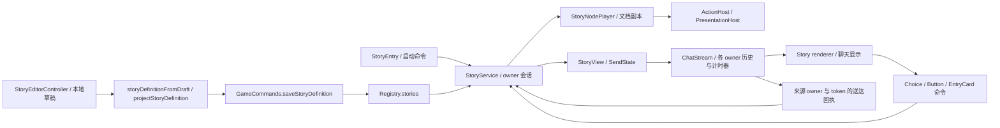

# StoryNode、Story 编辑器与演出链调查（2026-10-29）

本文为后续 bug 修复提供调用链、状态边界和验证入口。基于调查时的当前工作区，包含已有未提交修改；本次不修改产品源码或测试。现行机制仍以源码和测试为准，本报告不替代 Wiki。

## 1. 总体调用链

图表示运行时调用和数据流。编辑器中央流是静态作者预览，不接入玩家 ChatStream，也不执行 Click。`src/arona-clicker/runtime/story-node-playback.ts` 另提供独立内存 Player 装配，正式 UI 会话由 StoryService 管理。

| 层 | 主要入口 | 权威状态 |
| --- | --- | --- |
| 作者合同与校验 | `src/data-services/contracts/story-node.ts`；`story-node-actions.ts`；`validation/story-node-structure.ts:33`；`authoring/story-definition-projection.ts:62` | StoryDef 的有序 nodes、兼容 stages、动作与引用 |
| 编辑会话 | `src/ui/story-editor/controller.ts:102`；`model.ts:43`；`property-model.ts:94` | 草稿、分支缓存、原始输入、稳定行 ID、插入锚点 |
| 入口与领域会话 | `src/arona-clicker/services/story/story-service.ts:90` | owner → Session；入口资格、奖励、已读、完成与清理 |
| 节点播放 | `src/arona-clicker/services/story/story-node-player.ts:41` | 当前节点、token、waitSequence、局部 flags、insert 栈、多击计数 |
| 领域与临时表现 | `story-node-action-host.ts:276`；`story-node-presentation-host.ts:366` | 领域状态写入；按 run 隔离的主题、覆盖层、实体临时表现 |
| UI 演出 | `src/ui/presentation/chat-stream.ts:201`；`src/ui/controller/controller-actions-story.ts:39` | 各 owner 历史、去重指纹、typing/thinking、Operation 展示序列 |

## 2. 四类节点与推进节奏

`nodes` 数组是唯一执行顺序。`stageId`、`stages.advance` 仍需满足兼容合同，但不决定节点分组、自动推进或每阶段 Click 数量。

| 节点 | Player 到达时 | UI 与后续推进 |
| --- | --- | --- |
| Talklet | 进入 delivery，分配 token | 非右侧 talk 默认 typing 0.9 秒；正文送达后，仅当数组紧邻的下一节点是满足 requiresFlag 的 Click 才自动确认。其他情况等待自由继续。 |
| Click | 进入 input；button 多击工作量在到达时抽取一次 | button、choice、entryCard 分别提交；Choice 在提交时重查条件，多击每次有效点击更换 token；不会自动生成老师回复。 |
| Operation | 预检并执行动作后，进入 operation 等待点 | Service 补 operationCheckpoint/operationEffects；ChatStream 按序展示可读状态效果，最后自动确认。没有可读效果也会确认；连续 Operation 逐个经过此流程。 |
| Transfer | 立即 goto 或 insert 到目标文档开头 | insert 保存调用处的下一节点，目标结束后返回；goto 不新增返回点，也不清空已有 insert 栈。 |

证据：`story-node-player.ts:293-338`、`story-node-session.ts:87-125`、`story-service.ts:469-477`、`chat-stream.ts:435-451,485-524`。

Talklet 后隔着 Operation、Transfer 或被跳过的节点时，不属于“紧邻 Click”。`nextIsInput` 仅检查数组中的直接后继。连续 Click 允许逐个成为当前输入。老师回应需要显式的右侧 Talklet；分支回应使用 localFlag 与 requiresFlag。

Operation 首条效果立即展示，其后间隔 360 毫秒。展示时禁用底部推进按钮；动作此时已经执行，UI 不再执行它。底层 Player 的等待点需要 ack，正式 UI 会自动提供该 ack，不能将其误读为玩家必需额外点击。

## 3. 身份、隔离与动作边界

- StoryEntry 决定投放、资格和奖励；StoryDef 决定节点内容；目录分类只负责导航。对外参数中名为 storyId 的值可能实际是 Entry ID，排查时先区分 entryId、rootStoryId、当前 storyDefId、terminalStoryId。
- `owner=null` 是全局会话，字符串 owner 是独立对话会话；同 owner 最多一个 Session。启动先核对 Entry 类型、定义结构、Init、触发条件与完成状态，再按替换规则创建 run（`story-service.ts:480-564`）。card/replay 有各自跳过条件及强制策略。
- token 标识当前等待输入；runId 标识一次运行与临时演出归属；historyId 标识跨读档保持的逻辑历史；waitSequence 区分同一节点的多次到达。Service 对省略 token 的内部调用可回填当前 token，UI 异步回执则必须校验捕获的 token。
- 终止、取消、失败、替换会关闭旧 run 的临时表现。同步事件监听器可能立刻启动另一条故事，因此 Service 和 Player 都有当前会话/重入检查（`story-service.ts:546-559,649-681`）。
- 分支先静态预检所有 actions 和 transfer，静态错误不消费 token、不执行动作；之后按顺序执行，并在每个动作执行前重查动态资格。**整条分支没有事务回滚保证**，后段失败时，前段状态可能已写入（`story-node-player.ts:181-200,272-289`；`tests/engine/story-node-player.test.ts:142-156`）。
- ActionHost 将状态动作转交 EffectEngine/领域写入口；travel 的领域拒绝可按 applied 处理，applied 不保证发生数值增长。entryRequest 成功替换同 owner 返回 replaced，启动另一 owner 则不终止来源链。
- 转移次数最多 32，每次同步 drain 最多 256 个自动步骤；Operation 现在产生等待点，不能继续用“一次 start 同步跑完很多 Operation”测试这个上限。

### 三种 flag 不可混淆

| 状态 | 用途与生命周期 |
| --- | --- |
| `run.localFlags` | 每次 Run 独立 Map；requiresFlag 只用 Map.has，false/0/空串/null 仍算存在；goto/insert 共用，新 Entry 不继承；随等待点快照保存。 |
| `PlayerState.flags` | state/setFlag 产生的持久业务状态；普通条件系统查询这层。 |
| `session.flags` | 本次 Run 成功执行过的持久 setFlag 名称集合，用于结算回执；不是局部值表。 |

四类节点都可有 requiresFlag。缺键会跳过整个节点，包括随机抽取、动作和转移；已接受的等待点不在查询或恢复时重判条件（`story-node-player.ts:275-279,309`）。

## 4. 编辑、保存与读档是不同状态链

- Registry 来源深拷贝后进入草稿，浏览来源不写入。草稿单独保存在 `acprogram_story_editor_drafts`，不属于 PlayerState 或游戏存档。分支缓存、未完成数字输入和稳定 rowId 属于 editorState，不进入 StoryDef。
- 插入空位以节点 ID 锚定，只存在于内存；拖放带 draftId/nodeId，落下时重新检查。类型/分支切换保留休眠输入，保存到运行内容只投影当前启用分支。当前没有 Undo/Redo。
- 保存草稿允许内容不完整；存储失败保留内存并阻止离开/切换，损坏或不支持版本的存储被保留并阻止覆盖。
- “保存到运行内容”经 Controller → model 投影 → GameCommands → GameInstance → Registry 校验后一次替换，只影响当前 Registry，不保存到包、不创建 Entry、不启动播放。Runtime 写入成功后，本地草稿保存仍可能单独失败。
- 已启动 Session/Player 持有文档副本，继续播放旧内容；新启动才读取 Registry 新版。“读取本地/系统数据”恢复本次 init 加载的来源快照，并不重新读磁盘；运行期新增 Story 则被移除。
- Player 只允许在等待点保存；Operation 快照表示动作已经执行，恢复不重放动作、不重抽多击随机数。Service 读档先校验各 owner 游标，恢复后换 runId/token，保留 historyId（`story-service.ts:732-812`）。快照不保存整份作者文档，跨重载恢复仍需当前 Registry 中相关节点与引用有效。
- ChatStream 的去重指纹为 `[historyId ?? runId, entryId, storyDefId, nodeId ?? pageIndex, waitSequence]`；恢复历史时跳过 typing 占位，用新 token 重建门控。Operation 根据同一指纹已展示的效果行数续播。
- PresentationHost 快照保存可恢复的活动表现，不重放 openingTitle 或游戏动作。结束只清对应 run 的临时表现，保留正文历史。

编辑器证据：`controller.ts:116-149,291-300,324-420,565-614`、`model.ts:82-150,211-247`、`property-model.ts:125-150,284-338`、`persistence.ts:70-135`；运行保存见 `registry.ts:789-815`、`runtime-game-instance.ts:1698-1712,1750,1770-1771`。

## 5. 已确认的能力与说明差异

本次只调查和建立基线，以下未修复。

1. **Click 的 localFlag 动作缺属性字段。** `property-fields.ts:121-123` 只有外层为 Operation 才渲染 name/op/value；Click sharedActions/result.actions 可选择 localFlag，但对应字段不出现。Choice 自动绑定可以生成标准字段，不等于通用动作表单已经支持编辑它们。
2. **Choice 绑定卡的说明超过现有 UI。** `view.ts:177-182` 只输出 flag 名，没有绑定节点列表、逐项解除或改名按钮；模型已有 unbind/rename，Controller 没有解除接线。现行工具文档宣称卡片支持这些操作，后续应核对并修正。
3. **持久 flag 的文案容易误导。** `property-fields.ts:146` 将 state/setFlag 标成“写局部标记”，实际写入 PlayerState.flags；这与 localFlag 的本次 Run 作用域不同。
4. **部分测试仍使用旧推进语义。** Player 边界/快照测试仍假定 Operation 不产生等待点；UI delivery/history-resume 部分测试仍假定普通 Talklet 自动确认，甚至靠 stages.advance='auto' 控制播放。具体运行结果见末节。
5. **localFlag 名称的测试事件与接线不同。** `tests/ui/story-editor-workspace.test.ts:27-31,60` 只发送 input，但 `controller.ts:291-292` 的名称字段只在 change 时提交。随后合法数值保存仍因空名称被拒绝，导致 `:79` 取不到 Registry 节点。真实界面失焦通常产生 change；输入期间发生其他刷新是否丢失未提交名称，仍需单独复现。
6. **开幕横幅用例的按钮选择方式过时。** `tests/ui/story-gate.test.ts:152` 查询不到 data-send，因为羁绊故事首节点已是 openingTitle Operation（`content/character/bond-content.ts:12`）；`src/ui/columns/chat-content.ts:79-89` 此时有意渲染不带 data-send 的禁用按钮。按钮存在，测试应按当前 Operation 状态验证阻断，或用已到达正文的独立 fixture 检查横幅守卫。

## 6. 待复现的风险与后续测试入口

以下只是优先排查点，不作为已确认用户 bug：

| 现象或边界 | 首查位置与验证方法 |
| --- | --- |
| 点击没有推进、按钮状态错误 | 同时记录 owner、runId、historyId、storyDefId、nodeId、waitSequence、token、Player status、SendState、ChatStream gate；先区分 delivery/input/operation。 |
| 重复消息、旧动画推进新剧情 | `chat-stream.ts:536` 指纹；`controller.ts:474` 回执校验；换 owner、同 owner 替换、多显示和打开卡片确认后换 run。 |
| Operation 重复播报或停住 | 动作完成、逐条展示、最终 ack 三个边界；覆盖零效果、多效果、连续 Operation、展示中存档、恢复换 token、清历史。 |
| 离开工作区后演出继续或停住 | timer 本身不依赖 DOM，后续节点仍依赖 UI sync；编辑器 render 会跳过玩家 Story 同步。离开页面不等同于暂停领域 run。 |
| Choice 绑定失效或解释错误 | 绑定时检查目标在 Choice 后，之后重排、删除、手写 flag/transfer 是否改变语义；逐项比对 result.actions/sharedActions/requiresFlag。 |
| 属性值恢复到错误行 | `property-model.ts:314-320` 删除行未清 literalKinds，删除节点则清理；先构造增删换分支的实际复现。 |
| 保存成功但播放没变化 | 检查是否仅存草稿、是否显式写 Registry、是否仍在旧 Session 副本、是否随后重新加载包或恢复来源。 |

现有回归入口：`tests/engine/story-node-player*.test.ts`、`story-node-action-host*.test.ts`、`story-node-presentation*.test.ts`、`story-run-flags*.test.ts`、`story-service-node.integration.test.ts`、`story-node-save.integration.test.ts`；`tests/ui/story-node-*.test.ts`、`story-history-resume.test.ts`、`story-editor-*.test.ts`；`tests/data/story-*.test.ts`。

本次搜索未找到插入空位、节点拖放、Choice 绑定、flag reader 拖放、restore-source 的明确行为回归，也未找到以 operationCheckpoint/operationEffects 命名的 UI 回归；后续先补能复现具体问题的行为测试，避免只改断言迎合实现。

## 7. 本次验证

- 运行 `npm test -- story-`：40 个文件中 25 通过、15 失败；294 项测试中 266 通过、28 失败。运行耗时约 247 秒，2026-10-29 23:57 启动，跨日结束。
- 完整输出由统一测试入口写入 `.test-artifacts/latest.log`；另保留本次固定副本 `.test-artifacts/story-mechanism-baseline-2026-10-29.log`，避免后续测试覆盖调查证据。
- 失败集中在旧 stage 约束、Operation 等待点、普通 Talklet 自动确认预期；另两项为上述 localFlag 名称事件模拟差异及开幕横幅的按钮选择方式过时。不能把全部 28 项直接视为新增运行 bug，也不能把测试基线写成通过；下一轮按期望行为逐项修复并补新行为回归。
- `npm run check:docs` 已通过（115 个 Markdown、0 errors）；未进行浏览器交互验收。
- 对本次新增报告做地图 changed 只读检查，返回 unreferenced_path：新调查报告尚无直接 Evidence/maps_to 关联。本次未改图或刷新索引。
- 产品源码、测试及已有未提交修改保持原样，本次新增此调查报告。
