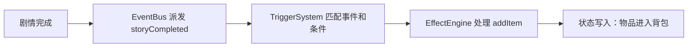

# 事件、Trigger 与 Effect：从发生到响应

> **试写样例 · 系统总览**：用于讨论分层 Wiki 的结构与写法，尚未接替现有正式页面。本文解释一件游戏内的事情如何引发后续效果；具体字段和使用示例分别见 [[ai/plan/wiki-trigger-samples/01-trigger-mechanism]]、[[ai/plan/wiki-trigger-samples/02-trigger-example]]。

## 先看一个例子

玩家完成欢迎剧情后，系统发出剧情完成事件。已经挂载、且监听该剧情的 Trigger 收到事件，随后请求执行 `addItem` Effect；Effect 经状态写入流程将能量饮料加入背包。这个规则由内容定义声明，并不是 EventBus 自己决定要发奖励。

这是**一次运行时调用链**，并非静态模块依赖图。完整例子见 [[ai/plan/wiki-trigger-samples/02-trigger-example]]。

## 三个系统各做什么

| 系统 | 回答的问题 | 主要职责 |
| --- | --- | --- |
| EventBus | “发生了什么？” | 按事件类型把 `GameEvent` 派发给订阅者，不决定游戏奖励。 |
| TriggerSystem | “这件事是否满足某条反应规则？” | 查找已注册的 Trigger，检查事件过滤、一次性完成状态和附加条件。 |
| EffectEngine | “满足规则后做什么？” | 执行 Effect；状态效果经写入端口处理，部分产品请求交给宿主。 |

三者的分界有助于定位问题：没有事件先查发布方和 EventBus；事件存在但规则没有命中，查 Trigger 的挂载、过滤和条件；规则已命中但结果不对，再查 Effect 及其写入或宿主处理。

## 一次事件如何经过系统

1. **发布**：领域服务或状态写入流程产生一个带类型的事件，交给 EventBus。
2. **派发**：普通情况下 `emit()` 立即派发；若正在 `flush()`，新事件先进入队列。
3. **筛选**：TriggerSystem 按事件类型找到候选，再核对具体 ID、完成记录和附加条件。
4. **执行**：普通 Trigger 命中后，TriggerSystem 把 `effects` 交给 EffectEngine。一次性规则先记录完成，再执行效果，以防效果产生的级联事件重复触发。
5. **落地**：EffectEngine 将状态类效果交给状态写入端口；某些产品表现请求由 Runtime 宿主处理。

TriggerSystem 还支持内部受限的 runtime action；这类注册由对应处理器执行，不走普通 `effects` 流程。本文聚焦普通内容 Trigger，不展开内部适配器。

## 与其他机制的关系

- 条件描述“事件到达时是否满足要求”；数值表达式负责提供数值。见 [[conditions-and-visibility]]、[[expressions-and-production]]。
- 玩家状态和事件的写入边界见 [[state-and-events]]。
- 本组试写从 [[ai/plan/wiki-trigger-samples/01-trigger-mechanism]] 深入 Trigger，再看 [[ai/plan/wiki-trigger-samples/02-trigger-example]]。

## 核对入口

源码：`src/engine/core/event-bus.ts`、`src/engine/effect/trigger-system.ts`、`src/engine/effect/effect-engine.ts`。测试：`tests/engine/event-bus.test.ts`、`tests/engine/trigger-system.test.ts`、`tests/engine/effect-engine.test.ts`。现有正式概览：[[event-effects-triggers]]。
