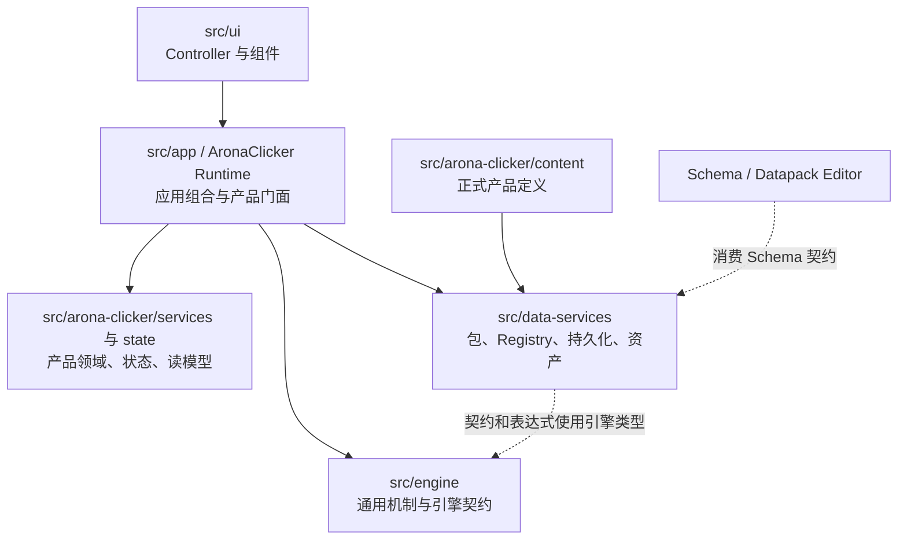
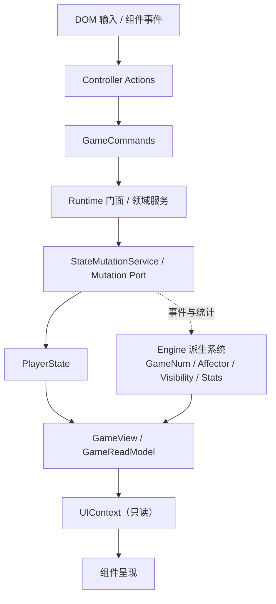

# 01-architecture/AC-outline-wiki — ACProgram 概念图与代码协作层级

> 本文回答：项目有哪些主要概念层、关键源码入口各做什么、层与层怎样协作。分层 Wiki 正文入口见 [[docs/archive/docs-828-snapshot/06-wiki/00-index]]；本文不代替源码、测试或机制文档。

## 阅读约定

- **职责树**按概念职责分组；它不承诺每个目录是严格独立的架构层。
- **依赖图**表示主要代码依赖方向；**运行流**表示一次启动、命令或状态更新如何穿过系统。两者不能混为一张图。
- 文件路径和符号是定位证据。跨多个入口的箭头描述代表性协作链，不代表每个用例都走完全相同路径。
- 本文基于 2026-09-28 工作区源码的定向探索。修改机制时仍按 [[docs/archive/docs-828-snapshot/00-INDEX]] 进入对应正文并核对当前源码与测试。

## 概念职责树

```text
ACProgram
├─ 应用启动与组合根
│  ├─ UI 启动：src/ui/main.ts
│  ├─ App bootstrap：src/app/runtime-bootstrap.ts
│  └─ 产品 Runtime / 包管理：src/arona-clicker/runtime.ts
├─ 声明内容与数据服务
│  ├─ 正式产品 Datapack：src/arona-clicker/content/
│  ├─ Datapack 契约、解析、包管理：src/data-services/contracts/、datapack/
│  ├─ 定义仓库：src/data-services/registry/
│  ├─ 持久化、图片资产：src/data-services/persistence/、assets/
│  └─ 定义编辑与解析支持：src/data-services/authoring/、definition/
├─ 运行时状态与产品领域
│  ├─ PlayerState / 快照 / 状态写入口：src/arona-clicker/state/
│  ├─ 世界、角色、故事、商店等领域服务：src/arona-clicker/services/
│  ├─ Runtime 门面和装配：runtime-game-instance.ts、runtime-wiring.ts
│  └─ ReadModel 与 GameView：src/arona-clicker/read-model/
├─ 通用引擎机制
│  ├─ Core / Contracts / Types：事件、ID、Tag 与跨层契约
│  ├─ Expression / GameNum：表达式、条件和数值求值
│  ├─ Effect / Trigger / Affector：效果执行与事件响应
│  ├─ Tick / Session：时钟与会话调度
│  ├─ Visibility / Stats / Extra：派生视图与通用计算
│  └─ 主要落点：src/engine/
├─ 玩家界面
│  ├─ Controller / Actions：输入、命令适配与页面协调
│  ├─ Components：DOM 视图和交互呈现
│  └─ Context / ReadModel：组件可消费的只读门面
└─ 工程支持
   ├─ tests/：机制、数据服务、Runtime 与 UI 验证
   ├─ tools/datapack-editor/：依据 Schema 的独立编辑器
   └─ scripts/：Schema、架构边界、文档等检查
```

正式默认内容由 `src/arona-clicker/content/default-datapack.ts` 组装。`src/data/base/` 和 `src/data/test-datapack.ts` 是测试/示例内容入口，不应在概念图中与正式产品内容合并成一个“引擎内置包”。

## 代码依赖层级



图中的箭头表示主要 import / 组合关系，不是对完整传递闭包的列举。`src/arona-clicker/runtime-wiring.ts` 是基础机制与产品服务的实际装配点；`src/data-services/registry/registry.ts` 使用 Engine 的类型、Tag、Extra 与解析机制。因此概念上的“数据服务”和“引擎”并非彼此没有契约连接。

架构纪律与静态检查维护若干硬边界：Engine 不反向依赖 UI、产品内容或 Data Services；基础 Data Services 不反向依赖 UI、测试数据、存档旧入口或 AronaClicker 产品领域。运行时宿主可以组合这些层，不能据此把依赖方向画成任意双向。检查入口见 `scripts/check-architecture-boundaries.mjs` 与 [[docs/archive/docs-828-snapshot/05-conventions/architecture-discipline]]。

## 代表性运行协作流

### 启动与内容装载

```text
src/ui/main.ts
  → createAppRuntime()                         src/app/runtime-bootstrap.ts
  → AronaClickerRuntime                         PackManager + 产品扩展
  → GameInstance / wireGameInstance()           创建并连接子系统
  → restorePackManager() / applyEnabledPacks()
  → Registry.load(Datapack...)                  Registry 建表、校验和索引
  → init() 后的跨表检查、派生索引与状态接线
  → UIController.mount()
```

`AronaClickerRuntime` 扩展 `GameInstance` 并持有 `PackManager` 与热内容协调器；`GameInstance` 通过 `wireGameInstance()` 组合 Engine 机制和 AronaClicker 服务。构造装配的先后顺序反映部分依赖顺序，但事件订阅、回调闭包和延迟连接也会建立跨阶段协作，不能把装配表直接读成完整调用时序。详细启动、Lobby、Init 和 Tick 时序见 [[docs/archive/docs-828-snapshot/01-architecture/run-logic]]。

### 玩家命令、状态与呈现



这是代表性命令链。Controller 持有 `GameCommands`；组件消费 `UIContext` / `GameReadModel`。领域服务执行门槛和业务顺序，再调用写入端口；`StateMutationService` 把状态改变、统计记录和事件发出收敛在写入口。事件订阅者维护缓存或派生系统，后续 UI 查询通过 `GameView` 获取只读投影。依据：`src/ui/controller.ts`、`src/ui/context.ts`、`src/arona-clicker/runtime-commands.ts`、`src/arona-clicker/state/state-mutation-service.ts` 与 `src/arona-clicker/read-model/game-view-builder.ts`。

玩家状态至少要区分 Global、per-Init 快照、per-Init 当前三种归属。定义（Registry）、玩家状态（PlayerState）和呈现投影（GameView）回答不同问题，不应合并成一个“运行时数据层”。详见 [[docs/archive/docs-828-snapshot/01-architecture/state-layers]] 与 [[docs/archive/docs-828-snapshot/01-architecture/data-flow]]。

### 领域服务如何协作

服务目录是多个领域实现的集合，不是单体服务。以 Spot 升级为例，`SpotService` 查询 Registry 定义、使用条件/数值服务做门槛判断，借助支付与效果/状态端口完成操作；Engine 提供可复用机制，产品服务负责该业务的流程。具体边界见 [[docs/archive/docs-828-snapshot/02-modules/world]]、[[docs/archive/docs-828-snapshot/02-modules/character]]、[[docs/archive/docs-828-snapshot/02-modules/story]]。

Effect / Trigger / Affector 与 EventBus 横跨多个领域：状态写入或其他机制发事件，注册的响应器按契约执行联动；主题、剧情、聊天等产品演出请求可由 Runtime 的 Reactor 转交给产品服务。事件链路细节见 [[docs/archive/docs-828-snapshot/04-mechanisms/trigger-effect]]。

## 阅读时不要折叠的边界

| 概念 | 它负责 | 不要与之混为一谈 |
| --- | --- | --- |
| Engine | 可复用的表达式、效果、事件、统计、可见性和 Tick 机制 | AronaClicker 的角色/商店/故事产品规则 |
| Data Services | Datapack 契约、包解析/选择、Registry、存储和资产能力 | 正式产品内容本身；默认内容位于 `src/arona-clicker/content/` |
| Registry | 定义表、引用检查、关系查询及有限的受控热 CRUD | 玩家进度；玩家进度归 PlayerState |
| PlayerState | 游戏运行状态及其持久归属 | Registry 定义或 UI 投影 |
| Runtime / wiring | 组合机制与领域服务并管理产品生命周期 | 单一业务机制实现 |
| Controller | 把界面操作路由到命令，并协调显示与交互 | 组件只读上下文或领域状态写入口 |
| GameView / UIContext | 为界面提供快照与只读查询 | Runtime 的写命令与生命周期管理 |

## 探索中待进一步核对

- `src/engine/system/tick-system.ts` 的 Tick 路径包含帧计数写入；其与“PlayerState 全部状态变更走 `StateMutationService`”的纪律边界需要结合接口契约和测试进一步确认。此处只登记代码入口，不判定为架构违规。
- `src/main.ts` 仍保留另一条非 UI 入口。本文以当前 Vite 游戏 UI 的 `src/ui/main.ts` 为主线，其他入口的用途按具体任务核对。
- 本文按主职责抽象目录，没有穷举每个服务、每个状态字段或每条事件订阅。细节文档仍由 [[docs/archive/docs-828-snapshot/00-INDEX]] 路由。

## 下一步阅读路线

1. 按职责层阅读概念正文：[[docs/archive/docs-828-snapshot/06-wiki/00-index]]。
2. 建立启动与 Tick 的时序模型：[[docs/archive/docs-828-snapshot/01-architecture/run-logic]]。
3. 确认状态归属与读写边界：[[docs/archive/docs-828-snapshot/01-architecture/state-layers]]、[[docs/archive/docs-828-snapshot/04-mechanisms/state-mutation]]。
4. 根据目标主题进入 [[docs/archive/docs-828-snapshot/00-INDEX]] 的模块卡片、数据结构和机制正文，再按 [[docs/ai/task-read-set-routing]] 核对相应源码与测试。

## 相关路由

[[docs/archive/docs-828-snapshot/00-INDEX]] · [[docs/archive/docs-828-snapshot/01-architecture/overview]] · [[docs/archive/docs-828-snapshot/01-architecture/module-dependency-baseline]] · [[docs/archive/docs-828-snapshot/01-architecture/run-logic]] · [[docs/archive/docs-828-snapshot/01-architecture/data-flow]]
