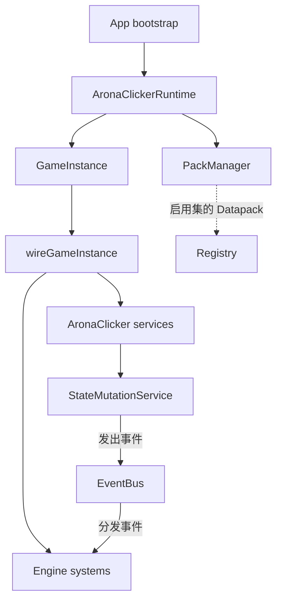

# 06-wiki/10-application-runtime — App Bootstrap 与 Runtime 组合根

> 本文回答：应用怎样从启动入口构造产品 Runtime、登记并应用数据包，再由运行时宿主把 Engine 机制和 AronaClicker 领域服务组织起来。

## 职责层级

```text
src/ui/main.ts                         当前游戏 UI 启动
  → src/app/runtime-bootstrap.ts       App bootstrap 工厂
  → src/arona-clicker/runtime.ts       产品 Runtime + PackManager
  → src/arona-clicker/runtime-game-instance.ts  运行时宿主 / 门面
  → src/arona-clicker/runtime-wiring.ts         Engine 与产品服务装配
  → Registry + PlayerState + 派生系统
```

`src/app/runtime-bootstrap.ts` 提供 `createAppRuntime()` 和 `loadDefaultDatapack()`。它不逐项装配子系统：创建 `AronaClickerRuntime`，再调用 `applyEnabledPacks()`。正式默认内容由 `src/arona-clicker/content/default-datapack.ts` 提供；`AronaClickerRuntime` 将它包装为内置包并交给 `PackManager` 管理。

`src/arona-clicker/runtime.ts` 扩展 `GameInstance`，持有包管理和运行时内容编辑协调器。`PackManager` 负责包记录、选择和启用配置；`applyEnabledPacks()` 将启用包形成有效 Datapack 集，调用 Runtime 初始化路径，并在可选包失效时尝试停用失效包后重新应用。包清单和配置的具体规则见 [[docs/archive/docs-828-snapshot/02-modules/registry]] 及代码 `src/data-services/datapack/pack-manager.ts`。

## GameInstance 与 wiring

`src/arona-clicker/runtime-game-instance.ts` 定义 `GameInstance`：它承载 Registry、状态、Engine 子系统、产品服务门面以及生命周期操作。构造器通过 `wireGameInstance()` 将装配委托给 `src/arona-clicker/runtime-wiring.ts`；wiring 按依赖关系创建 EventBus、Registry、表达式系统、StatsService、StateMutationService、效果系统、领域服务和派生系统，并以回调钩子提供状态读取、替换与可见性重算能力。

装配顺序不是完整运行时调用顺序。服务可通过构造注入、端口、回调或 EventBus 订阅形成协作；实际启动、Init 切换、Tick、保存与加载时序见 [[docs/archive/docs-828-snapshot/01-architecture/run-logic]]。`GameInstance` 的 `world` 是 Registry 查询端口别名，产品服务仍可按自身接口执行更高层业务。

## Pack 应用到运行时

```text
createAppRuntime()
  → AronaClickerRuntime / PackManager（内置 base + 已恢复包记录）
  → applyEnabledPacks()
  → init(datapacks)
  → Registry.load(datapacks)
  → 建立/重建表达式、派生索引和状态绑定
  → Lobby 或按选项进入 Init
```

包库和启用配置属于数据服务能力；Registry 是运行时有效定义的查询仓库；PlayerState 则保存玩家进度。包编辑/导入并不等同于应用启用集，运行时编辑也通过协调器和受控 Registry 接口提交。Registry 细节见 [[docs/archive/docs-828-snapshot/02-modules/registry-wiki]]，完整生命周期见 [[docs/archive/docs-828-snapshot/01-architecture/run-logic]]。

## 关系图应如何阅读

Outline 中的代码依赖图描述 import 与组合方向；本页的启动链描述运行时调用。它们不是同一张图：例如 `runtime-wiring.ts` 静态依赖多个服务模块，而一次 `applyEnabledPacks()` 的调用只沿当前启用包与初始化路径执行。



## 代码入口与进一步阅读

| 主题 | 代码 / 文档 |
| --- | --- |
| UI 启动 | `src/ui/main.ts`、`src/app/runtime-bootstrap.ts` |
| 产品 Runtime 与包应用 | `src/arona-clicker/runtime.ts`、`src/data-services/datapack/pack-manager.ts` |
| 宿主和装配 | `src/arona-clicker/runtime-game-instance.ts`、`src/arona-clicker/runtime-wiring.ts` |
| 启动、Lobby、Init、Tick | [[docs/archive/docs-828-snapshot/01-architecture/run-logic]] |
| Registry 与数据流 | [[docs/archive/docs-828-snapshot/02-modules/registry-wiki]]、[[docs/archive/docs-828-snapshot/01-architecture/data-flow]] |
| 当前事实地图 | [[docs/archive/docs-828-snapshot/01-architecture/AC-outline-wiki]] |

验证入口包括 `tests/engine/arona-runtime-pack.test.ts`、`tests/engine/runtime-hot-content.test.ts` 和 `tests/engine/runtime-world-hot-crud.test.ts`。
