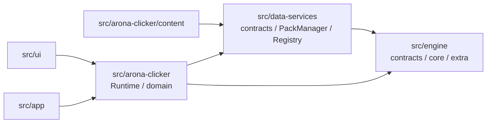
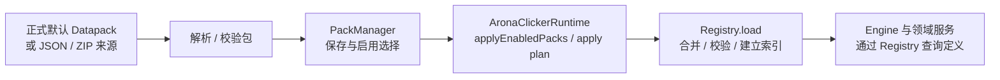

# 06-wiki/20-data-services — Data Services 概念层

> 本文回答：Data Services 如何接收、管理并提供声明数据，以及它与 Engine、产品 Runtime 的边界是什么。

## 在项目中的位置

`src/data-services/` 提供数据定义契约、数据包解析和选择、Registry、持久化及图片资产等通用服务。正式产品内容由 `src/arona-clicker/content/default-datapack.ts` 提供；玩家进度则由产品层 PlayerState 管理。项目总层级见 [[docs/archive/docs-828-snapshot/01-architecture/AC-outline-wiki]]。

## 职责树

```text
src/data-services/
├─ contracts/       Datapack 汇总契约及产品定义数据契约
├─ datapack/        Manifest、JSON/片段/ZIP 解析、PackManager 与包存储
├─ registry/        定义表、合并、查询索引、引用校验、受控热 CRUD
├─ definition/      定义来源、差异层、引用解析与诊断
├─ authoring/       内容字段编辑策略、字段校验与 mutation 应用
├─ persistence/     通用存档序列化与 StorageAdapter
├─ assets/          图片源解析、图片存储与 PicService
└─ archive/         ZIP 等归档文件写入工具
```

出口 `src/data-services/index.ts` 汇总公开能力。子目录并非完整独立层：Registry 使用 Engine 的通用类型、Tag 与 Extra 能力；产品 Runtime 把包选择结果应用到实际游戏实例。

## 代码依赖关系



此图只表达 import 和组合关系：`Registry` 与 Datapack 契约使用 Engine 类型/机制，AronaClicker Runtime 组合 Data Services 与 Engine；Registry 不会因静态依赖而主动把内容送给 Engine。工具侧 Schema 是生成文件边界，并不表示编辑器直接 import Data Services。Schema 驱动的独立编辑器与使用 `authoring/` 策略的游戏内 Runtime Editor 是两个入口。基础数据服务不能依赖 UI、测试数据、存档旧入口或 AronaClicker 产品领域；静态守护为 `npm run check:architecture`。

## 代表性运行协作流

### 数据包进入 Runtime



这是运行时数据流，不代表模块之间的 import 关系；正式默认 Datapack 会作为内置包登记，外部文件来源则经对应解析器进入 PackManager。`Registry` 保存定义并提供查询，玩家解锁、等级、资源等进度仍在 PlayerState。Init、Area、Spot 有受控热内容 mutation API，但不因此承接玩家进度。详细数据流和 Registry 表结构见 [[docs/archive/docs-828-snapshot/01-architecture/data-flow]] 与 [[docs/archive/docs-828-snapshot/03-data-structures/registry]]。

### 持久化与资产

```text
产品 Runtime 组装待存档快照 → SaveSystem / StorageAdapter 存取通用 JSON
Datapack PicDef + 图片来源 → PicService / ImageStore → UI 或 Runtime 取用解析结果
```

`src/data-services/persistence/storage.ts` 的 SaveSystem 负责通用序列化与存储适配，不负责 Runtime 生命周期或产品状态恢复。存档快照形状与恢复编排由产品层拥有。

## 边界与测试入口

| 概念 | 负责 | 不负责 |
| --- | --- | --- |
| Datapack 契约 | 定义包可声明的数据形状 | 决定产品默认包内容 |
| PackManager | 包记录、固定/编辑槽、启用选择与应用计划 | 执行游戏机制 |
| Registry | 定义表、跨表校验、关系索引与受控世界内容编辑 | 玩家进度与存档恢复 |
| Persistence | 通用存储接口和 JSON 快照读写 | 解释产品存档语义 |
| Assets | 图片定义和来源解析、存储服务 | 产品 UI 布局 |

测试入口：`tests/data/pack-parser.test.ts`、`tests/data/pack-manager.test.ts`、`tests/data/pack-storage.test.ts`、`tests/engine/registry.test.ts`、`tests/data/registry-spot-mutation.test.ts`、`tests/data/definition-resolution.test.ts`、`tests/data/storage-adapter.test.ts`、`tests/engine/pics.test.ts`。Registry 集成与热 CRUD 另见 `tests/engine/runtime-world-hot-crud.test.ts`。架构检查规范见 [[docs/archive/docs-828-snapshot/05-conventions/architecture-discipline]]。

## 继续阅读

- 总体职责、静态边界和运行流：[[docs/archive/docs-828-snapshot/01-architecture/AC-outline-wiki]]。
- Registry 模块卡片与 Wiki：[[docs/archive/docs-828-snapshot/02-modules/registry]]、[[docs/archive/docs-828-snapshot/02-modules/registry-wiki]]。
- 表、关系索引和引用校验：[[docs/archive/docs-828-snapshot/03-data-structures/registry]]、[[docs/archive/docs-828-snapshot/03-data-structures/id-reference-semantics]]。
- 数据进入 UI 的层次：[[docs/archive/docs-828-snapshot/01-architecture/data-flow]]；字段与 Schema 同步：[[docs/archive/docs-828-snapshot/05-conventions/schema-sync]]。
