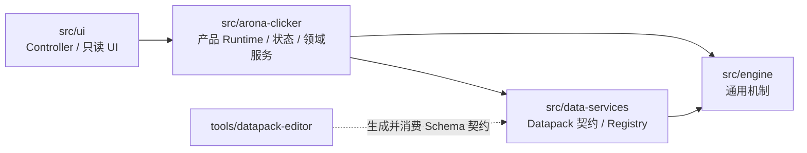

# 06-wiki/40-engine — Engine 概念层

> 本文回答：Engine 的概念分区是什么、机制如何组合、它与产品领域及数据服务如何交界。

## 在项目中的位置

Engine 位于通用运行机制层，定义可复用的契约并解释数据包声明；AronaClicker Runtime 负责把这些机制接到具体产品状态和领域服务。入口索引见 [[docs/archive/docs-828-snapshot/00-INDEX]]，全项目职责层级见 [[docs/archive/docs-828-snapshot/01-architecture/AC-outline-wiki]]。

## 职责树

```text
src/engine/
├─ contracts/       跨机制 DTO、查询与写入 Port
├─ core/            EventBus、Tag、ID、DevLog 等横切基础
├─ types/           通用机制类型及仍由 Engine 出口兼容导出的类型
├─ def-factory/     通用表达式、条件、Trigger、Extra 等定义构造器
├─ expression/      Value、Condition、Funclet、Stat DSL、GameNum 求值
├─ effect/          Effect 执行、Trigger 订阅、Affector 生命周期
├─ visibility/      Reveal 定义和可见性派生快照
├─ stats/            统计计数、Tag 统计与 World Tilt
├─ extra/            Extra 树构造、读取、合并与校验
├─ system/           基础 Tick 机制
└─ runtime/          Session 帧循环、离线推进
```

目录是职责导航，不表示每个目录只依赖相邻目录。`src/engine/index.ts` 是对外汇总出口；`src/engine/contracts/index.ts` 汇总跨层接口。具体定义由 `src/data-services/contracts/` 与 AronaClicker 内容/契约层提供，不能把 Engine 类型出口视作所有产品实体的唯一归属。

## 代码依赖关系



该图表达静态依赖与装配关系，不是执行顺序。`src/engine/` 不依赖产品 UI 或内容；基础 Data Services 也不依赖 AronaClicker 领域。边界约束与检查入口见 [[docs/archive/docs-828-snapshot/05-conventions/architecture-discipline]] 和 `scripts/check-architecture-boundaries.mjs`。

## 代表性运行协作流

### 声明定义到求值

```text
Datapack 定义 / Engine def-factory
  → Registry 提供已校验的定义查询
  → Expression / GameNum / Visibility 等机制读取查询与状态 Port
  → 派生系统缓存结果，并按事件更新或失效
```

### 一次 Tick 与事件响应

```text
SessionService（src/engine/runtime/session-service.ts）
  → 宿主 doTick 回调
  → TickSystem.tick（src/engine/system/tick-system.ts）
  → GameNumSystem 计算资源产出
  → StateMutationPort.changeResource
  → EventBus 发出 spotProduced / tick
  → 宿主 flush 事件队列，Trigger / Affector 等响应者处理联动
```

`SessionService` 管循环、离线推进和事件 flush；`TickSystem` 管每帧产出和 Tick 事件。具体产品每帧还包含持续效果、剧情推进等宿主编排，完整顺序见 [[docs/archive/docs-828-snapshot/01-architecture/run-logic]]。所有机制不能直接持有产品实现细节，跨层通过 Engine Contracts 中的 Port 协作。

## 边界与测试入口

| 概念 | 负责 | 边界 / 定位证据 |
| --- | --- | --- |
| Engine | 可复用计算、事件响应、派生视图、统计与会话基础机制 | `src/engine/index.ts` |
| 产品领域 | AronaClicker 的角色、商店、剧情等业务步骤和状态适配 | `src/arona-clicker/`；Engine 不替代这些规则 |
| Data Services | Datapack 载入、Registry、存储、资产 | `src/data-services/`；由宿主注入或组合 |
| UI | 输入路由和只读视图消费 | `src/ui/`；不直接调用状态写入实现 |

典型测试入口：`tests/engine/engine-contracts.test.ts`、`tests/engine/value-system.test.ts`、`tests/engine/game-num.test.ts`、`tests/engine/effect-engine.test.ts`、`tests/engine/visibility-hot-spot.test.ts`、`tests/engine/tick-system.test.ts`、`tests/engine/session-service.test.ts`。测试映射规范见 [[docs/archive/docs-828-snapshot/05-conventions/testing]]。

## 继续阅读

- 系统边界与跨层协作：[[docs/archive/docs-828-snapshot/01-architecture/AC-outline-wiki]]、[[docs/archive/docs-828-snapshot/01-architecture/data-flow]]。
- Engine 子系统卡片：[[docs/archive/docs-828-snapshot/02-modules/core]]、[[docs/archive/docs-828-snapshot/02-modules/expression]]、[[docs/archive/docs-828-snapshot/02-modules/game-num]]、[[docs/archive/docs-828-snapshot/02-modules/effect-trigger]]、[[docs/archive/docs-828-snapshot/02-modules/affector]]、[[docs/archive/docs-828-snapshot/02-modules/visibility]]、[[docs/archive/docs-828-snapshot/02-modules/stats]]、[[docs/archive/docs-828-snapshot/02-modules/extra]]。
- 算法与机制正文：[[docs/archive/docs-828-snapshot/04-mechanisms/00-index]]；状态写入口：[[docs/archive/docs-828-snapshot/04-mechanisms/state-mutation]]。
