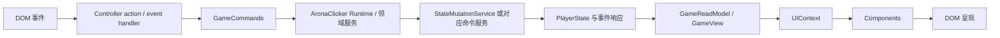

# 06-wiki/50-ui — 玩家界面的职责与协作

> 本文回答：界面输入如何经过 Controller 与命令端进入 Runtime，组件如何通过只读模型取得显示数据，以及 UI 子系统如何分工。

## 一句话概念

`src/ui/` 是无框架 DOM 表现层。Controller 协调生命周期、刷新和交互，把写操作委托给 `GameCommands`；组件以 `UIContext` 为渲染输入，并通过其中的 `GameReadModel` 查询游戏数据。状态规则归 Runtime、领域服务和状态写入口，组件不直接写 PlayerState。

## 职责树

```text
src/ui/
├─ main.ts                         应用 UI 的启动入口
├─ controller.ts                   UIController 门面、生命周期与刷新汇聚
├─ controller-actions-*.ts         各领域交互绑定与命令调用
├─ controller-events.ts            EventBus 订阅和 UI 响应
├─ controller-core.ts              刷新策略、销毁和面板状态辅助
├─ components/                     页面、工作区、面板和内容片段
├─ context.ts                      组件只读上下文 UIContext
├─ update/                         Workspace / Region / Element / Behavior 更新调度
├─ workspace/                      UI 路由及数据包工作区状态
├─ runtime-editor/                 游戏内内容编辑器
└─ css/                            主题、布局和组件样式
```

此树按当前职责概括，并不表示每个目录都能独立运行。拆分后的 Controller 子模块仍由 `UIController` 共享 Runtime、状态和服务实例。

## 数据读取与写命令



- `GameCommands` 是 UI 写操作的能力接口，定义在 `src/arona-clicker/contracts/runtime.ts`。`UIController` 通过 `createGameCommands()` 建立适配器；`src/arona-clicker/runtime-commands.ts` 将旅行、故事、物品、设施、角色成长、主题、存档和 Runtime Editor 等命令路由到 Runtime 的相应服务或 mutation 端口。
- 命令适配器只定义界面可调用的命令面，不把组件变成业务规则持有者。领域服务负责业务步骤，状态写入遵循 [[docs/archive/docs-828-snapshot/04-mechanisms/state-mutation]]。
- `GameReadModel` 是消费查询面，定义在 `src/arona-clicker/contracts/runtime.ts`。它提供只读 PlayerState、Registry / World 查询端口、表达式与条件查询、角色和剧情查询、图片查询及 `getView()` 等入口；它不提供 `GameCommands` 的写操作。
- `src/arona-clicker/read-model/game-view-builder.ts` 从状态、可见性、当前故事、活跃效果和统计构造 `GameView` 投影。`GameReadModel.getView()` 与查询端口供不同组件按需求读取，不应将 UI 投影当作另一个状态写入口。
- `src/ui/context.ts` 的 `createUIContext()` 把 `GameReadModel`、`GameView`、背景与表现查询及通用格式化函数组合成 `UIContext`。部分 UI 表现解析（例如 Host 背景和文字颜色）也在此层整理；它没有状态命令。

依赖箭头是代表性协作路径，不意味着每个组件都经过相同服务。某些更新由事件订阅触发，某些由用户命令触发；Runtime 事件响应可更新派生缓存，Controller 再按刷新策略更新呈现。

## Controller 与组件的边界

| 部分 | 负责 | 不负责 |
| --- | --- | --- |
| `UIController` | mount / destroy、页面与 Workspace 编排、状态与交互协调、刷新入口 | 具体领域规则和 PlayerState 直接写入 |
| `controller-actions-*` | 绑定各 UI 区域交互，将用户操作转为命令调用或 UI 状态变更 | 在组件内持有游戏状态写引用 |
| `controller-events.ts` | 订阅 Runtime 事件，并决定 UI 响应或刷新 | 取代 Runtime 的领域事件处理 |
| `components/` | 根据 `UIContext` 和局部 UI 状态生成 DOM 内容，提供语义节点 | 直接调用 Runtime 写服务或改状态 |
| `UIContext` / `GameReadModel` | 暴露组件显示所需的只读查询能力 | 生命周期、存档控制和写命令 |

组件常导出纯渲染函数，例如 `renderAppShell(ctx, state)`；Controller 组合组件输出、挂载事件处理器并选择刷新范围。更新基础设施见 `src/ui/update/`：`UISurfaceRuntime` 追踪当前 Surface，`UIUpdateDispatcher` 将请求分派到可支持的更新范围，behavior registry 提供局部行为更新。是否采用局部更新由 Controller 的具体入口决定，不能仅凭目录名推断任意刷新链。

## 典型交互路径

1. 用户触发 DOM 事件，相关绑定位于 `controller-actions-*`、`controller-save.ts` 或某个专用控制模块。
2. 需要游戏行为时，绑定调用 `this.commands` 暴露的 `GameCommands`；纯界面导航则更新 UI 的 `PanelState` / Workspace 状态。
3. Runtime 命令调用领域服务或 mutation 端口。状态变更及事件联动由写入口与订阅系统处理。
4. Controller 根据事件、命令结果或刷新请求更新合适的 Workspace、Region、Element 或 Behavior；具体更新由相应渲染与更新模块执行。
5. 渲染时重新创建 `UIContext`，组件读取 `GameReadModel` / `GameView` 并输出视图。

启动主线从 `src/ui/main.ts` 的 `createAppRuntime()`、默认包装载和 `UIController.mount()` 开始；Lobby、Init 及 Tick 细节见 [[docs/archive/docs-828-snapshot/01-architecture/run-logic]]。状态的三层归属见 [[docs/archive/docs-828-snapshot/01-architecture/state-layers]]。

## 主要阅读入口

| 要理解 | 入口 |
| --- | --- |
| UI 模块文件与页面概览 | [[docs/archive/docs-828-snapshot/02-modules/ui]] |
| UI 只读边界与架构约束 | [[docs/archive/docs-828-snapshot/05-conventions/architecture-discipline]] |
| Controller 与命令能力 | `src/ui/controller.ts`、`src/ui/controller-actions-topbar.ts`、`src/arona-clicker/runtime-commands.ts`、`src/arona-clicker/contracts/runtime.ts` |
| 只读上下文与投影视图 | `src/ui/context.ts`、`src/arona-clicker/read-model/game-view-builder.ts`、`src/arona-clicker/contracts/view.ts` |
| UI 行为和回归样例 | `tests/ui/context.test.ts`、`tests/ui/controller-events.test.ts`、`tests/ui/contacts-story-workspace.test.ts` |
| 刷新链路定位 | `scripts/ui-callgraph.mjs`、`npm run ui:callgraph` |

界面主题、Host、Workspace、Lobby 和 Runtime Editor 的专题规则仍以 [[docs/archive/docs-828-snapshot/02-modules/ui]] 与 [[docs/archive/docs-828-snapshot/02-modules/runtime-editor]] 为准；本文不重复其细节。

## 相关入口

[[docs/archive/docs-828-snapshot/01-architecture/AC-outline-wiki]] · [[docs/archive/docs-828-snapshot/02-modules/ui]] · [[docs/archive/docs-828-snapshot/05-conventions/architecture-discipline]] · [[docs/archive/docs-828-snapshot/06-wiki/60-engineering-support]]
