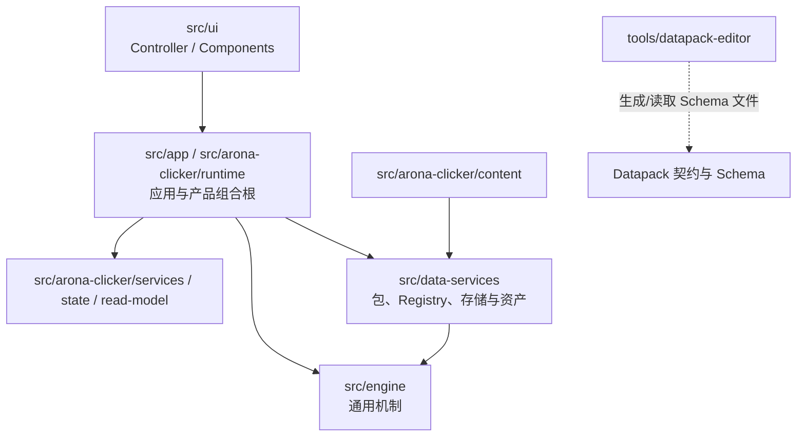

# 01-architecture/dependency-map — 代码依赖方向

> 本文回答：核心源码目录在静态依赖与运行时组合中的主要方向是什么。

## 静态依赖与组合



图中实线表示主要源码 import 或组合关系；虚线是通过生成 Schema 文件发生的工具协作，不表示直接 TypeScript import。Data Services 使用 Engine 的机制类型和基础能力；Runtime 负责将这些部分组合成具体产品。

## 代码边界

- `src/engine/` 不依赖 UI、产品内容、Data Services 或测试数据。
- `src/data-services/` 不依赖 UI、产品领域、测试数据或存档旧入口。
- `src/arona-clicker/` 可组合 Engine 与 Data Services，放置产品状态、业务服务和适配器。
- UI 命令经产品 Runtime 能力进入业务服务；组件消费只读读模型。

边界由 `npm run check:architecture` 扫描相对 import；检查器是静态规则，不等价于完整运行时依赖图。规则定义见 [[docs/docs-829/05-conventions/architecture-discipline]]，脚本为 `scripts/check-architecture-boundaries.mjs`。

## 运行时协作不是 import 图

```text
Datapack → PackManager → Runtime → Registry
  → Engine / 领域服务查询定义
  → 状态写入口发出事件
  → EventBus 订阅者更新派生系统
  → GameView / UIContext 提供只读结果
```

完整生命周期和命令链见 [[docs/docs-829/01-architecture/run-logic]] 与 [[docs/docs-829/01-architecture/data-flow]]。
