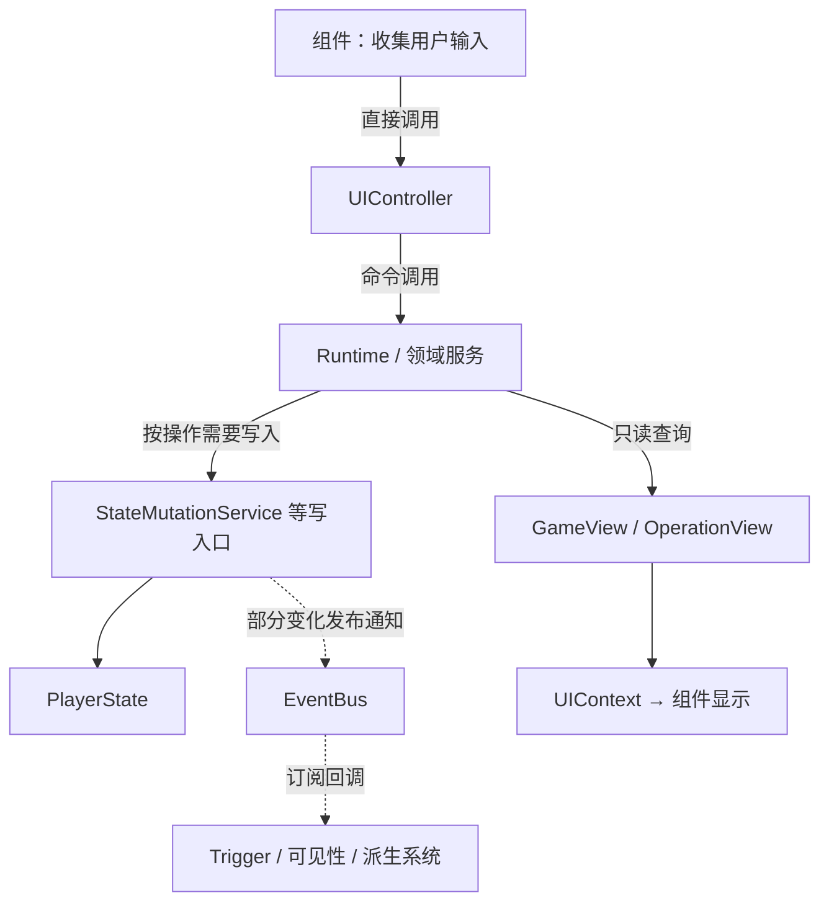

# first-read — 第一次了解 ACProgram

> 本文回答：这个项目从哪里启动、游戏内容怎样装入、状态由谁保存、界面从哪里读取，以及接下来该看哪些文档。

## 先记住这五件事

1. **Datapack 是内容定义。** 它声明游戏有哪些角色、地点、事件和规则；定义本身不是一次已经发生的玩家操作。
2. **Runtime 是运行中的产品。** 它把内容、通用 Engine、产品服务和存档生命周期装配在一起，并接收 UI 命令。
3. **Registry 是已启用内容的查询表。** Runtime 将启用包中的定义装入 Registry，服务再按 ID 查找和检查定义。
4. **PlayerState 保存产品进度。** 例如玩家资源、解锁和世界线进度；字段属于全局还是某条 Init，由状态契约定义。
5. **UI 主要发命令和读投影。** Controller 把用户操作交给 Runtime；GameView、OperationView 等只读视图把结果交给组件显示。

Gameplay B 战斗还有一份独立的局内状态 `EventRun`。它由 Operation Runtime 持有，不等同于 `PlayerState`；需要时可通过存档边界另行保存和恢复。详细归属见 [[docs/docs-829/03-data-structures/operation-view]] 与 [[operation-runtime]]。

## 从浏览器启动到界面

应用入口是 `src/ui/main.ts`。启动函数恢复本机包库快照，检查可选的开发包，然后调用 `loadDefaultDatapack()` 应用当前启用包，最后创建并挂载 `UIController`。产品第一次启动时有必需的 base 包和默认启用的 Gameplay B 示例包；用户保存的包配置决定之后实际装入哪些可选包。

```text
静态依赖 / 装配关系
src/ui/main.ts → src/app/runtime-bootstrap.ts → AronaClickerRuntime
                                  └→ PackManager → 当前启用的 Datapack

启动时的调用与数据流
main.ts → restorePackManager() → reconcileDevelopmentPacks()
       → loadDefaultDatapack() → applyEnabledPacks()
       → Registry.load() / Runtime 接线 → UIController.mount()
```

上图第一行表示代码组合和依赖；第二部分表示启动时实际发生的调用顺序。它们不是同一种关系。对应入口可从 [运行逻辑](run-logic)、[Runtime 模块卡](../02-modules/app-runtime) 和 [应用 Runtime Wiki](../06-wiki/10-application-runtime/00-index) 继续追踪。

## 一次操作怎样改变游戏

UI 输入通常由组件交给 `UIController`，Controller 再直接调用 Runtime 的命令接口或领域入口。需要更改产品进度的操作由相应服务执行；业务状态写入经 `StateMutationService` 等明确写入口完成。某些写入会发出事件，订阅者再更新触发器、可见性或其他派生结果。

事件不是通用命令队列：并非每个点击都会变成事件，也不是每种事件都会再次写入玩家状态。要判断具体先后顺序，需沿单个操作检查它调用的服务、Mutation、`EventBus` 发布点和订阅者。Tick、状态和触发器的详细路线见 [[docs/docs-829/04-mechanisms/arona-clicker/state-mutation]]、[[1-项目/ACProgram/docs/docs-829/04-mechanisms/engine/effect-trigger]] 与 [[docs/docs-829/06-wiki/40-engine/00-index]]。



实线箭头表示本图所说的调用或数据传递，虚线表示可选的事件通知和订阅响应；实际操作不一定经过图中每个节点。Engine 的 Tick 等机制通过它依赖的最小写入接口推进状态。`totalFrames` 等直接计数边界单独见 [[docs/docs-829/05-conventions/architecture-discipline]]。

## 状态为什么分开

| 你看到的东西 | 它是什么 | 从哪里继续读 |
| --- | --- | --- |
| 玩家资源、角色、解锁和世界线进度 | `PlayerState` 中的产品进度；字段还区分全局、Init 快照和 Init 当前值 | [[docs/docs-829/03-data-structures/player-state]] |
| 画面上的常规游戏信息 | 从定义、PlayerState 和派生系统构建的只读 `GameView` | [[docs/docs-829/03-data-structures/game-view]] |
| Gameplay B 当前战斗、干预和路线 | Operation Runtime 管理的局内 `EventRun`，由只读 `OperationView` 查询 | [[docs/docs-829/03-data-structures/operation-view]] |
| 组件要用的主题、图片或组合格式 | UIContext 等展示查询；它们不是玩家状态写入入口 | [[docs/docs-829/06-wiki/50-ui/read-model-context]] |

存档和重置由 Runtime 生命周期入口协调。`GameInstance.save()` 收集 PlayerState 与各自负责的存档片段，`load()` 和 `reset()` 重建或清理对应运行态；不要因某份数据被存档就推断它属于 PlayerState。入口见 `src/arona-clicker/runtime/runtime-game-instance.ts` 的 `save()`、`load()`、`reset()`，字段归属见上述结构页。

## 建议阅读顺序

以下是第一次系统学习的路线，不是日常任务的必读清单；已知领域的改动从 [[AGENTS.md]] 直达对应子题。

1. **先看整体：** [[docs/docs-829/01-architecture/overview]] 与 [[docs/docs-829/01-architecture/dependency-map]]。前者讲运行层次，后者讲源码依赖方向。
2. **再跟启动：** [[docs/docs-829/01-architecture/run-logic]] → [[docs/docs-829/06-wiki/10-application-runtime/startup-and-composition]] → `src/ui/main.ts`、`src/app/runtime-bootstrap.ts`。
3. **理解内容装载：** [[docs/docs-829/06-wiki/20-data-services/00-index]] → [[docs/docs-829/03-data-structures/registry]] → [[pack-loading]]。
4. **理解状态和事件：** [[docs/docs-829/03-data-structures/player-state]] → [[docs/docs-829/04-mechanisms/state-mutation]] → [[1-项目/ACProgram/docs/docs-829/04-mechanisms/engine/effect-trigger]]。
5. **跟一次玩家功能：** 从 [[docs/docs-829/06-wiki/30-arona-clicker-domain/00-index]] 选世界线、角色成长或剧情主题，再从页面链接进入源码和测试。
6. **看界面怎么输入和显示：** [[docs/docs-829/06-wiki/50-ui/00-index]]，再读 [[docs/docs-829/06-wiki/50-ui/controller-commands]] 与 [[docs/docs-829/06-wiki/50-ui/read-model-context]]。
7. **学习如何验证：** [[docs/docs-829/06-wiki/60-engineering-support/testing]]；工具能证明什么以及不能证明什么见同分区的检查页。

## 修改项目时怎样找到证据

先按问题选当前 Wiki，而不要从整个仓库盲目搜索：模块责任看 [[docs/docs-829/02-modules/00-index]]，字段与状态归属看 [[docs/docs-829/03-data-structures/00-index]]，运行步骤和事件看 [[docs/docs-829/04-mechanisms/00-index]]，跨功能解释看 [[docs/docs-829/06-wiki/00-index]]。然后沿页面给出的源码符号和测试文件核实。

常用验证命令的范围不同：`npm run check:docs` 检查文档链接和结构；`npm run check:architecture` 检查指定的静态依赖边界；`npx vitest run <测试路径>` 运行一组相关行为测试；`npm test` 运行全部 Vitest 测试；`npx tsc --noEmit` 检查 TypeScript 类型。通过一项检查不代表整个项目没有缺陷。工具限制与选择方法见 [[docs/docs-829/06-wiki/60-engineering-support/00-index]]。

## 相关入口

[[docs/docs-829/00-INDEX]] · [[docs/docs-829/01-architecture/overview]] · [[docs/docs-829/02-modules/00-index]] · [[docs/docs-829/03-data-structures/00-index]] · [[docs/docs-829/04-mechanisms/00-index]] · [[docs/docs-829/06-wiki/00-index]]
