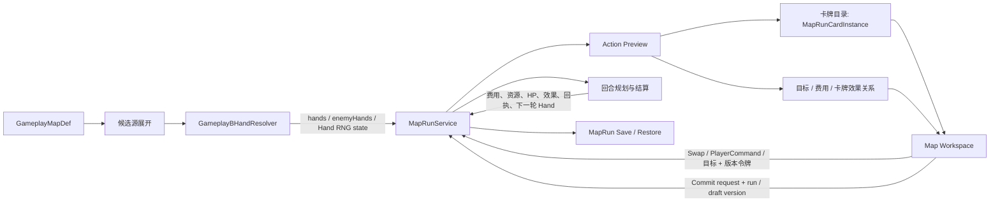

# 04-mechanisms/arona-clicker/gameplay-b-cards — Gameplay B MapRun 卡牌系统

本文回答：**Gameplay B 的 MapRun 遭遇战里，行动手牌怎样生成、玩家怎样准备行动、卡牌怎样互相作用，以及一轮如何提交结算。**内容依据当前 `GameplayMapDef`、`MapRunService`、卡牌解析器、运行时 UI 和回归测试；范围是 Map 模式下的 Encounter 卡牌。

## 一眼看懂

Gameplay B 每个 Encounter 回合为固定队伍的角色和敌人生成各自的短手牌。每个存活角色通常最多有 3 张行动卡；第一张是默认准备行动。玩家可以免费把本角色的默认行动换成手牌里的另一张，或支付 1 点 `PlayerCost`，命令角色使用当前手牌外的一项合法行动。选好角色行动、目标、Ability / Item 等回合输入后，玩家提交一整轮；运行时按行动计划结算，Encounter 若继续则生成下一轮新手牌。

```text
Map 内容定义 Actions / Candidate Pools / Encounter 候选
  → Encounter 入场或上一轮提交后，确定性抽取 Party 与 Enemy Hands
  → 第一张手牌成为各角色自然行动；生成只读 Action Preview
  → 玩家可免费 Swap、付 PlayerCost 发 PlayerCommand、选目标或设置其他来源
  → 纯校验 Commit Preview
  → 原子提交整轮、保存可验证结算回执、推进到新回合并重抽
```

本文中的“卡”是 MapRun 当前一轮中的**领域卡对象**。它是一个被引用的 Action 实例身份，并非 DOM 节点或单纯 UI 卡面。

## 先划清范围：它是什么、它不是什么

| 容易混淆的概念 | Gameplay B MapRun 的含义 |
| --- | --- |
| Map Encounter Hand | 当前 Encounter 回合抽出的有限 Action 候选；自然第一张会自动准备 |
| Swap | 从同一角色的当前 Hand 里免费改选一张，卡仍是原来的同一实例 |
| PlayerCommand | 从该角色合法候选中选择 Hand 外 Action；准备时生成一个当前回合的指令卡对象；Commit 时支付 1 点 `PlayerCost` |
| `MapRunCardRef` | 包含 Run、Map、Node、Activity、Round 范围的领域引用，供预览、选目标、结算和存档校验使用 |
| Operation Player Scene Deck | `src/arona-clicker/services/operation/operation-player-scene-deck.ts` 所属的另一套 Operation 场景卡组合同；不等同于 MapRun Hand |
| 抽卡 / 收藏卡牌 | 角色招募和培养系统；不是 Gameplay B MapRun 行动手牌 |

目前 MapRun Action Hand 是逐回合从候选来源重新生成的短期行动集合。没有常驻卡牌收藏、抽牌堆、弃牌堆、洗牌回收或跨 Encounter 保留手牌等模型。相同 Action 可在不同回合再次抽到；每次抽取只在**同一个角色/敌人本回合的一手牌内**不重复。

## 总体职责图



静态内容结构由 `src/data-services/contracts/gameplay-map.ts` 定义，候选池语义与引用由 Data Services 校验；运行时状态和命令由 `src/arona-clicker/contracts/map/map-run.ts`、`MapRunService` 管理；UI 读取 `MapRunActiveWorkspaceView` 的 `cards`、`actionPreview` 与关系投影。地图 UI 不拥有另一个平行的手牌状态。

## 内容作者声明什么

### Map 级声明

`GameplayMapDef` 提供整张地图可复用的行动定义与候选池：

| 字段 | 用途 |
| --- | --- |
| `actions` | Map-local `GameplayMapActionDef` 列表；含名称、可用角色、目标、费用、标签、Tendency Role 和有限 Effect Program |
| `candidatePools` | Map-local 有序候选池；可以引用 Action、Tag 或嵌套 Pool，可选由 MapRun Fact 开关 |
| `partyCharacterIds` | 新 MapRun 的固定 Party，整张 Map 的每次 Encounter 都从它开始 |
| `initialActorResources` / `initialTeamResources` | Party 角色各自及 Party Team 的 MapRun 资源余额；没声明的资源余额视为 0 |
| `executionContractId` | 选择 `E1-COMPAT-1` 或 `AG-1` 调度 / 费用合同；缺省 Map 仍保留 E1 兼容行为 |
| `resumeVersion` | 内容兼容版本；会影响在途 MapRun 恢复的规则修改应提高版本 |

### Encounter 级候选

`GameplayEncounterParticipantDef` 为固定 Party 中的一个角色声明：

```ts
{
  characterId: 'serika',
  actions: [
    { actionId: 'quick-shot', tendencyWeight: 3 },
    { actionId: 'cover', tendencyWeight: 1 }
  ],
  candidatePoolIds: ['basic-rifle-pool']
}
```

`actions` 是直接候选及其正整数 `tendencyWeight`；`candidatePoolIds` 是额外有序候选来源。未声明某个 Party 成员、候选列表为空或当回合没有合法候选，均可成立；不会塞入隐藏的默认攻击，角色可拿到空 Hand，准备结果显示为 `Wait`。

Enemy 在 `GameplayEncounterEnemyDef.actions` 和 `candidatePoolIds` 声明自己的候选来源，引用同一 Map 的 Action 定义；敌人手牌由运行时抽取，但不会提供给玩家编辑。

### Action 声明

`GameplayMapActionDef` 的卡牌相关字段包括：

| 字段 | 含义 |
| --- | --- |
| `id`、`name`、`description` | Map 内稳定的行动身份和面向玩家的说明 |
| `eligibleCharacterIds` | 哪些固定 Party 角色可以执行此 Action；不能靠 UI 伪造资格 |
| `target` | `none`、`self`、`partyCharacter`、`enemy` 或 `card` 目标合同 |
| `costs` | 执行者 Actor 资源或己方 Team 资源成本 |
| `tendencyRole` | 可选 `attack` / `recovery` / `defense`，只用于有限抽牌权重倾向 |
| `tags` | 用于 Tag Candidate Pool 的完整 TagRef |
| `effectProgram` | 有限、静态校验的 Action 效果；卡牌相关能力受 `prepare` / `resolve` 约束 |

候选 Action ID、行动定义、目标规则、成本和 `eligibleCharacterIds` 必须互相吻合。直接候选里的错误引用会成为内容校验或运行时诊断，不能依赖 UI 显示来兜底。

## 候选池：哪些 Action 有资格被抽

`GameplayMapCandidatePoolDef.entries` 可使用三种项：

| 项型 | 含义 |
| --- | --- |
| `{ kind: 'action', actionId, weight }` | 把一项 Map Action 以指定权重加入来源 |
| `{ kind: 'tag', tag, weight }` | 按 Action Tags 匹配一组行动，每个匹配项都得到该权重 |
| `{ kind: 'pool', poolId, weight }` | 把另一个候选池的贡献乘上此权重后合并 |

角色 / Enemy 的直接 `tendencyWeight` 与 Pool 来源展开后会按 Action ID 合并权重。相同 Action 若由多个合法入口匹配，其贡献累计为抽取权重；无效重复的直接声明、未知 Pool、Pool 环、自身非法权重由校验拒绝。Pool 可有一个 Gate：MapRun Counter 比较或 MapRun Flag 比较；Gate 仅用于 `AG-1`，而且读的是该 Encounter 已冻结的 MapRun Fact 快照。

```text
某角色直接候选: quick-shot × 2
Pool 入口: basic-rifle-pool
  ├─ Tag(action.attack) × 1 → quick-shot、piercing-shot
  └─ Action(cover) × 2

展开合并后:
  quick-shot       权重 3
  piercing-shot    权重 1
  cover            权重 2
```

上例的池子 Entry 权重和嵌套 Pool 入口权重相乘；同一个 Action 的不同路径贡献再相加。运行时 Gate 不会因为后续临时观察值变化而在同一次 Encounter 中忽隐忽现；MapRun 在进入 Encounter 时冻结用于候选 Gate 的 Fact 输入，以便回合和存档恢复得到同一来源集合。

候选来源解析位置：`src/data-services/validation/gameplay-map-candidate-pools.ts` 的 `resolveGameplayMapCandidateSources()`。作者合法性检查、运行时 Gate 求值是不同模式；不要用仅用于静态“所有潜在候选”的解析结果冒充实际当回合候选。

## 每回合怎样抽 Hand

核心实现是纯解析函数 `drawGameplayBHands()`；它接收当前 Encounter 定义、Party / Enemy roster、当前 HP、Actor / Team 余额、已冻结的 Gate Fact 和随机状态，返回 Party `hands`、Enemy `enemyHands` 和新的 Hand 随机状态，不直接写 PlayerState 或 MapRun。

### 抽取规则

1. **固定顺序。**Party 按 MapRun 固定 Party 顺序抽；随后 Enemy 按 Encounter roster 顺序抽。顺序对共享 Team 成本的自然行动预留有意义。
2. **倒地角色。**HP 为 0 的 Party / Enemy Hand 为空；没有合法候选的一方也得到空 Hand。
3. **当前合资格过滤。**候选引用需存在、Action 需允许该角色执行；会按当前 Actor / Team 资源检查 Action 是否付得起，也会剔除无合法单位目标的候选。敌我 Tendency Role 与目标方向也须匹配。
4. **权重抽第一张。**候选权重来自直接 `tendencyWeight` / Pool 合并结果，再乘可能的当下倾向系数；抽到的第一张就是 `naturalActionId`，即自然默认行动。
5. **预留自然行动 Team 成本。**先抽的自然行动会按固定顺序暂时预留己方 Team 资源，再影响后续角色 / Enemy 的自然行动候选，防止多个默认行动都把同一份共享余额算作可用。
6. **补足备选。**剩余候选按权重无放回抽取，最多让每个角色 / Enemy 的 Hand 达到 3 张。当前一手内不会重复同一个 Action ID；候选少时 Hand 可以短于 3 张。
7. **记住随机状态。**Hand 抽取推进独立的确定性随机流；`MapRunHandRandomState` 保存算法标识、seed 和 64-bit 原始字游标。效果程序另有独立 Effect RNG，不共享抽手牌游标。

### Tendency Role 的有限倾向

候选权重基础值始终是正整数。Action 声明了 Role 时，运行时只按下列有限规则把其权重乘 2，否则乘 1：

| Role | 权重乘 2 的条件 | 合法行动目标方向 |
| --- | --- | --- |
| `attack` | 抽取方还有存活对手 | Party Action 指向 Enemy；Enemy Action 指向 Party Character |
| `recovery` | 它可作用的至少一个恢复目标 HP 缺口达到最大 HP 的 25% | Party Action 指向 `self` / `partyCharacter`；Enemy Action 指向 `self` / `enemy` |
| `defense` | 该行动者当前 HP 不高于最大 HP 的 50% | 按 Action 的其他合法目标规则决定 |

Role 是抽取权重意图，不是效果强度或玩家承诺。结算时 Action 仍按自己声明的 `target`、`effectProgram`、成本和当前状态执行。

### 随机可复现性

一份 Encounter Hand RNG 使用带版本的 `gameplay-b-hand-splitmix64-v1`。新 Encounter 会初始化 32-bit seed 与 cursor 0；抽取时从 seed/cursor 定位 SplitMix64 64-bit 字，按权重范围采样，若样本落在不整除的拒绝区间则再取字重采，避免简单取模造成偏差。相同内容和相同起始状态会重现相同 Hands。

Hand RNG、AG-1 Effect RNG 与用户输入命令使用不同职责的随机 / 身份信息。UI 的预览和打开手牌不会推进抽取流；只有建 Encounter 或成功轮转到下一轮创建新 Hand 时才消耗 Hand RNG。读档恢复会核验保存的 Hand / 随机游标与内容定义一致，不能靠重新抽一副手牌“修复”存档。

## 自然行动、Swap 与 PlayerCommand

`GameplayBActionPreview` 是从当前 MapRun 快照重新计算的只读投影：含 Party / Enemy `preparedActions`、合法目标、当前 override 和 PlayerCommand 候选。它不会写回状态、消耗资源或抽随机数。

| 行为 | 选什么 | 是否立即扣费 | 对卡对象的影响 |
| --- | --- | --- | --- |
| 自然行动 | Party Hand[0] | Action 的 Actor / Team 费用在 Commit 规划时核对与支付 | 第一张 Hand 卡是 `prepared` |
| Swap | 同一角色 Hand 中非自然行动 | 不付 `PlayerCost`；替代 Action 自身的资源费用仍按 Commit 检查 | 只改变哪个现有 Hand 对象标为准备；不生成卡、不移走原卡 |
| PlayerCommand | 当前合法候选中、但不在该角色本轮 Hand 的 Action | 每名角色每次 `PlayerCommand` 在 Commit 扣 1 点 `PlayerCost`；该 Action 自身资源费用另算 | 选择写入本轮 override，并为生效指令派生 `playerCommand` 区对象；不是额外抽入或保留在未来回合 |
| 清除 override | 回到 Hand[0] | 不扣费、不返已扣费用（因为扣费只在 Commit） | 移除 PlayerCommand 临时对象并回到自然 Hand 准备 |

同一角色本轮最多有一个 override。Swap 只可选本手牌中另一张；PlayerCommand 只能选择 Hand 外的可用行动。两种选择都使用当前 `runId`、`nodeId/activityId/round`、`draftVersion` 校验。选择阶段只是改写 Encounter 草稿，不提前扣 `PlayerCost`、Actor 资源、Team 资源或随机状态；Commit 前随时可清除或改选。

PlayerCommand 候选会显示 `canPayPlayerCost` 与 `canPayActionCosts` 两类可支付状态。第一类看 MapRun 的 PlayerCost 是否足以覆盖其他已选择的 Ability 和 PlayerCommand，第二类看该 Action 的 Actor / Team 成本。卡牌扣费、Ability 的 PlayerCost 与其他成本在 Commit Preview 中合并核验。

若角色已选的 Actor / Team Action 成本在完整回合中变得不可支付，整轮 Commit Preview 会拒绝，MapRun 不会部分扣款或推进。`PlayerCost` 变化也只在成功安装的 Commit snapshot 中提交。

## Gameplay B 中“选卡/点卡”的身份

### Action 候选、Prepared Action、Card Instance 是三层东西

1. **候选 Action**：Map 内容声明可供角色 / Enemy 选择执行的一项定义，身份为 Map-local `actionId`。
2. **Prepared Action**：当前回合预览给某一执行者的有效行动，可能来自 natural Hand、Swap 或 PlayerCommand。
3. **Card Instance**：服务从已校验的当前 Encounter 与 Preview 派生的一张领域卡投影；它把“谁拥有哪张哪一轮的卡”编码为可核验 Ref。

卡牌目录 `catalogMapRunCards()` 只读取 owner 的当前 MapRun 快照与 Action Preview，返回冻结的 `MapRunCardInstance[]`。它当前列出：

| `zone` | 属主 | 例子与行为 |
| --- | --- | --- |
| `hand` | Party Character 或 Enemy | 当前回合实际抽到的候选；Party 可交互，Enemy 只读；被选中执行的 Hand 行动标记 `prepared` |
| `playerCommand` | Party Character | 仅存在于有效 PlayerCommand override；准备指令被标记 `prepared` |
| `enemyIntent` | 活着的 Enemy | 其 Enemy Hand 的已准备自然行动意图外观，`actionId: null`，始终只读，不是一个可被卡牌效果引用的 Action Hand 卡 |

未选中的 PlayerCommand offer 只是 `playerCommandOptions`，不是已经生成的域卡对象。免费 Swap 只是改变已有 Hand 哪张为 `prepared`，不会变造新 Ref。清除指令会让其 `playerCommand` Ref 立即不再被 owner 识别。

### 稳定身份与范围

`MapRunCardRef` 的概念结构：

```ts
{
  kind: 'card',
  scope: { runId, mapId, nodeId, activityId, round },
  id: '由卡区、owner 类型、owner ID、actionId 构成的域身份'
}
```

它不是 actionId 的别名：一个 Action 被 Party 不同角色抽到时是不同卡实例；同一张当前 Hand 卡的视觉扇形、目标选择按钮和预览关联仍指向同一个领域 Ref。Ref 会随 Run、Map、Node、Activity、Round 范围校验；离开本轮、换 Encounter、移除 PlayerCommand 或结束 MapRun 后，旧 Ref 不再解析为当前卡。

`MapRunService.getCards()` 只返回当前活跃 Encounter 且 Run ID 匹配的卡；`resolveCardReference(ref)` 会重新查询实时卡目录。由于 Ref 是结构化不可变对象，服务也能拒绝伪造、跨回合或跨活动引用。UI `mapCardInstanceKey()` 还会依据实际视觉宿主和布局区生成 DOM 展示实例键；这个键服务 UI 锚定 / 交互，不能替代 `MapRunCardRef`。

## 卡牌作用于卡牌：当前两种有限机制

只有 `GameplayMapActionDef.target.kind === 'card'` 才声明 Action 以一张当前合法卡为目标。`side` 是**相对 Action 发起方**的目标范围：

| `side` | 目标解释 |
| --- | --- |
| `self` | 发起者自己的卡 |
| `ally` | 同阵营卡，包含自己 |
| `opponent` | 对方阵营卡 |
| `any` | 任一阵营的合法卡 |

目前受支持的玩法集中在：**给真实卡的 `sCost` 成本打折**，以及 AG-1 下**修正另一个 Party 角色的一次伤害/治疗数值**。它不是开放的卡牌脚本系统。

### `prepare.discountSCost`：降低本轮真实卡成本

```ts
{
  id: 'discount', name: '后勤支援', eligibleCharacterIds: ['shiroko'],
  target: { kind: 'card', side: 'ally' },
  effectProgram: { prepare: [{ op: 'discountSCost', amount: 1 }] }
}
```

`prepare` 在规划阶段把折扣作用到所选目标卡的行动 `sCost` 上：

- 目标必须是当前 Encounter 中真实存在、满足 `side`、且符合此类效果要求的卡。
- 可选的目标在唯一时自动选中；有多个合法目标时需显式选择，UI 以目标关系提供选卡入口。
- `discountSCost` 只减少目标 Action 的 `actor/sCost` 成本，不抵扣 `team` 资源、其他 Actor 资源或 `PlayerCost`。
- 折扣值为正安全整数；多个来源可叠加，最终折扣最多减到原成本，不会生成负成本或额外资源。
- 选中了未准备执行的 Hand 卡，折扣不会转移给该角色最后执行的另一张卡；目标卡是“卡实例”，执行中仍以该身份匹配。
- 若不存在合法目标，该 Action 在预览中得到 `noLegalTarget` 并按无合法目标跳过，不会凭空选人或扣除该来源的卡牌资源。
- 关系投影展示声明折扣；成功提交回执 `scostCost` 记录原成本、实际折扣与实付成本。

### `resolve.cardEffectModifier`：修正另一张 Party 卡的实际数值

```ts
{
  id: 'aim-assist', name: '瞄准支援', eligibleCharacterIds: ['shiroko'],
  target: { kind: 'card', side: 'ally' },
  effectProgram: {
    resolve: [{ op: 'cardEffectModifier', path: 'resolve[0].amount', operation: 'add', delta: 2 }]
  }
}
```

这是受限的 AG-1 能力：

- 该来源必须在 `executionContractId: 'AG-1'` 的 Map 上；必须是 Party 可用的 `ally` 卡目标行动。
- `resolve` 必须恰有一条顶层 `cardEffectModifier`，且不能同时使用 `prepare` 折扣。
- 被指向的卡必须来自**另一名 Party Character**，对应 Action 恰好具有一个顶层 `damage` 或 `heal` Resolve 语句。
- 仅改 `resolve[0].amount`，以有符号整数 `delta` 相加；不开放改目标、资源成本、任意 Effect 路径或 Enemy 卡行动。
- 若目标来源因倒地、无合法目标、成本不可付或回合已结束而跳过，实际效果不会落到该目标身上。
- 成功 Commit 的 modifier receipt 记录 source / target CardRef、执行索引、变化量，以及实际 damage / heal hit 的请求值和 HP 结果；它是可验证回执，不是 UI 自己计算的动画结论。

Registry 的 `validateGameplayMapEffectContext()` 会在内容阶段检查这些 source/target 合同；运行时 Action Preview 与主回合 Planner 再核对当前 CardRef 与执行来源。给卡牌增添新效果需同时扩展类型、静态规则、规划 / 回执验证和 UI 关系投影，不能只在卡面写一个新标签。

## 单轮如何提交

### 输入草稿

玩家在 Encounter 中操作的每项内容都会绑定当前 `MapRunEncounterDraftToken`：

```ts
{ nodeId, activityId?, round, draftVersion }
```

这包含 Action override、单位或卡牌目标、附加目标，以及可选 Ability / Item 输入。写入有效草稿会提高 `draftVersion`；用旧版本执行会被拒绝。API 的 `runId` 还要求命令目标是当前 MapRun。

### Preview 与 Commit

1. **重新计算 Action Preview。**验证当前 Party / Enemy、手牌、override、目标是否合法；自动目标策略、费用可付状态及卡牌目标也由此得出。
2. **纯 Commit Preview。**汇总本轮角色行动、敌方行动、Ability / Item、费用预留、目标、Effects 和有限 scheduler 收据，回答 `canCommit`、诊断与各来源结算计划；不改 Run。
3. **检查并规划完整回合。**调用者提交 `runId + requestId + expectedCommitVersion + draft`。MapRun owner 复验 Commit 版本和 draft 令牌，并基于本轮起始余额规划完整 settlement。
4. **核对总费用和所有目标。**包含 PlayerCommand 的 `PlayerCost`、Action Actor/Team 资源、卡牌折扣和目标关系。一个费用不足、非法 CardRef 或错误来源让整轮拒绝；旧 Run 保留原样。
5. **执行有序效果计划。**按 Map 的 `E1-COMPAT-1` 或 `AG-1` 执行合同应用本轮来源；AG-1 有独立的确定性来源排序，敌我与卡 modifier 的实际效果按该计划及当前变化核验。
6. **一次安装结果。**成功后更新 HP、Actor / Team 余额、`PlayerCost`、Facts、Statuses、Effect RNG、Hand RNG 与 Commit 版本；记录可读 settlement / effect / modifier 回执；若 Encounter 继续，则创建下一轮快照、新 Hand 并清空本轮草稿。
7. **请求重试去重。**同一 Commit `requestId` 与完全相同版本 / 输入重试会返回之前的成功结果，不再次扣款、执行效果或重抽 Hand；相同 requestId 配不同请求会被拒绝。

一次角色的 Swap / PlayerCommand 不单独打出、不独立扣费或产生单卡结算；玩家提交的是整轮计划。Ability / Item 等 actorless Player Source 与行动手牌分开声明和呈现，但会参与本轮共同的预览和 Commit 成本校验。

### 执行结果怎样对应到卡

结算以 Action 来源与 `MapRunCardRef` / 来源键关联，不以 UI DOM 顺序为准。当前 settlement 会保留每名 Party 角色的行动 ID、目标、override 类型、是否用了 PlayerCost、资源变化与 HP 变化；Enemy action settlement 独立记录。卡牌折扣有 `scostCost`；卡牌 modifier 有专用 receipts。回执可跨离开当前 Encounter 留在 `lastEncounterCommit` 中，以支持最近成功提交重试和 UI 展示。

## UI 与交互路线

`src/ui/components/map/map-workspace.ts` 从 MapRun active workspace view 读取 `cards` 与 `actionPreview`：

- Party 当前行动显示为已准备行动卡；点击该卡可打开候选 picker，区分当前 Hand 可免费 Swap 的候选与需 PlayerCommand 的 Hand 外候选。
- Enemy Hand 以只读叠牌显示；Enemy 当前自然行动另有 intent 表现，不允许玩家改选。
- 卡牌目标 Action 的关系行提供合法卡目标选项；所选目标与成本折扣 / modifier 预览按 `MapRunCardRef` 关联。
- `map-card-host` 将卡视觉绑定标为可查看、可选目标或可替换；通用 `data-*` Flow mark 不能伪造保留的卡牌选择入口。
- UI 的浮层、卡牌扇形、重复贴图是同一领域卡的多个表现位置；删除或重绘 DOM 不会移除 MapRun 卡对象。

运行时命令统一经 Game / Runtime facade：`swapMapPreparedAction()`、`issueMapPlayerCommand()`、`setMapPreparedCardTarget()`、`clearMapActionOverride()`、`commitMapEncounterRound()`。这些命令需要当前 run / draft 标识，不能由 UI 直接改 `MapRunEncounterSnapshot`。

## 存档、恢复与 Ref 失效

Hands 和 card-target choices 属于 `MapRun.activeEncounter` 的状态快照：存档含当前 `hands`、`enemyHands`、overrides、targetSelections、round、`drawCursorStart`、Hand RNG state、candidate Fact 快照与最近 Commit 记录。当前 Hand 不需要通过重演已执行效果来复原。

读档时运行时使用当前 Registry 中的 Map 定义验证存档和在途 MapRun 版本；检查候选身份、当前 Action Preview、target CardRef 的范围和抽取状态。如果不一致，拒绝该 MapRun 恢复并保留明确结果；不得根据存档提供的任意视觉卡列表创建真实卡。

CardRef 的作用范围包括 Run / Map / Node / Activity / Round。因此新回合生成新 Hand 时，前一回合所有 CardRef 自动过期；新 Activity / Encounter 或换 Map 也会失效。targetSelections 里引用目标卡的草稿随 Encounter 保存，但目标卡离开有效范围后不能提交。Swap、PlayerCommand 清除或卡候选撤销会清理不再有效的卡目标选择。

卡牌 RNG 算法标识属于合同的一部分，Hand 随机流与 Effect 随机流分别保存。Map 内容中影响在途抽牌与候选解释的变更由 `resumeVersion` 控制；升级规则须回看 `tests/engine/gameplay-b-map-save-resume.test.ts` 和 Map Registry / schema 规则，不要轻率修改在途版本的解释。

## 和周围系统的关系

| 子系统 | 与手牌系统的连接 | 权威边界 |
| --- | --- | --- |
| Gameplay Map content / Registry | 提供 Action、Candidate Pool、Encounter 和 Party/Enemy 内容 | `GameplayMapDef` 是静态定义；数据校验先查引用与效果上下文 |
| `GameplayBHandResolver` | 纯函数展开、过滤、加权抽取 Hand | 返回结果；不拥有 MapRun，不写状态 |
| `GameplayBActionPreviewResolver` | 从当前快照计算自然行动、覆盖选择、合法卡目标和费用预览 | 只读；玩家命令仍回到 `MapRunService` 再核验 |
| `MapRunService` | 唯一持有当前 MapRun 与 Encounter Hand / draft / Commit | 拒绝 stale run / draft；规划成功才替换 Run slot |
| Map Effect Planner / AG-1 Scheduler | 计算成本、卡目标 prepare、命中修正和结算证据 | 受有限 Effect 类型与回执 validator 约束 |
| Map Workspace / Card Host | 显示卡和绑定交互意图 | 不创建牌库、不决定执行资格、不直接改 Run |
| Save / Runtime | 保存与恢复有界 MapRun checkpoint | 按当前内容版本核验，拒绝无效或不兼容恢复 |
| Operation Runtime | 另一套 EventRun / OperationScene 行为内容 | Gameplay B 当前以 Map-only bundle 提供 Map Entry；旧 Operation Scene Deck 不等于当前 MapRun Hands |

## 一个最小回合例子

假设 Encounter 为 `Serika` 抽到 `[quick-shot, guard, focus]`，`Shiroko` 抽到 `[support, rifle, evade]`：

1. Hand[0] 默认准备为 `quick-shot` 和 `support`。
2. 玩家把 Serika 免费 Swap 成同手里的 `guard`：Hand 卡身份都不变，只改准备行动与 `draftVersion`。
3. 若合法候选 `piercing-shot` 不在 Serika Hand，可以用 PlayerCommand 选它；草稿显示预留 1 `PlayerCost`，成功 Commit 才实际扣。
4. Shiroko 的 `support` 若声明 `target.kind: 'card'` 和 `prepare.discountSCost`，会从本回合其他合法卡里找到目标。唯一时系统自动选；若多张则玩家从关系目标选择器指定 CardRef。
5. Commit Preview 检查 Serika 指令和 Action 成本、Shiroko 的合法目标及折扣，并汇总本轮 Enemy / Ability / Item 成本。
6. Commit 一次规划和提交整轮，记录实际成本和效果回执；若 Encounter 继续，则为 Round 2 生成全新手牌。Round 1 卡 Ref 全部失效；Action 候选可以再次出现。

例子中“卡”是手牌中的行动来源；同一张 Action 定义可以被不同 owner 的不同实例引用；只选 PlayerCommand offer 而尚未提交时，也尚未发生现实费用支付。

## 常见误读

- **“Gameplay B 已有跨关卡构筑牌库和弃牌堆。”**当前 MapRun Hand 是每个 Encounter 回合重新从候选源抽取的最多三张行动候选。
- **“Swap 会丢掉原卡或把替代卡加到 Hand。”**不会；Swap 改的是当前 Prepared Action，Hand 内卡 Ref 不变。
- **“选 PlayerCommand 时就扣 PlayerCost。”**不会；草稿 / 预览只检查预算，成功整轮 Commit 才扣。
- **“PlayerCommand 是第二个追加行动。”**不是；它替代该角色本回合的自然准备行动，并占用 1 点 PlayerCost。
- **“每张 Hand 卡都一定可在当前剩余成本下使用。”**抽取与准备会过滤可付候选；但替换或整个回合组合仍需重新核对 Actor / Team 共享余额。
- **“未准备的卡不会成为卡效果目标。”**卡牌目标查找基于同一 Encounter 的合法当前卡；如果被打折的卡最后没有执行，该折扣不会跑到另一张执行卡。
- **“UI 的某个卡面消失就等于卡从状态移除。”**视觉宿主不是领域 owner；卡目录从 MapRun / Preview 重新派生。
- **“只凭 actionId 就能定位某张牌。”**同一 Action 可属于不同角色、卡区和回合；实际关联必须使用 scoped `MapRunCardRef`。
- **“Enemy 手牌也能改。”**Enemy Hands 可展示为提示，但 `controllable: false`；其行动只由 Enemy natural Action 和 Runtime 结算。
- **“CardRef 可以跨回合复用。”**Ref 含 round 与活动上下文，下一回合新 Hand 会让旧引用过期。
- **“Operations 的 Scene Deck 和 Map Hand 是同一套规则。”**它们属于不同的运行时合同、owner 与 UI；请按模块分别查阅。

## 当前源码入口

| 主题 | 入口 |
| --- | --- |
| Map、Action、CandidatePool、Encounter 作者类型 | `src/data-services/contracts/gameplay-map.ts` |
| Pool 展开、Tag 匹配、Gate 校验 | `src/data-services/validation/gameplay-map-candidate-pools.ts` |
| 卡牌 CardRef / CardInstance 类型 | `src/arona-clicker/contracts/map/map-cards.ts` |
| Hand / override / targets / snapshot / receipt 合同 | `src/arona-clicker/contracts/map/map-run.ts` |
| 加权 Hand 抽取 | `src/arona-clicker/services/map/gameplay-b-hand-resolver.ts`：`drawGameplayBHands()` |
| Prepared Action / target / PlayerCommand 只读预览 | `src/arona-clicker/services/map/gameplay-b-action-preview-resolver.ts` |
| CardRef 目录、解析与范围验证 | `src/arona-clicker/services/map/map-card-catalog.ts` |
| 卡牌折扣与 modifier source-target 关系 | `src/arona-clicker/services/map/map-card-effects.ts` |
| 唯一 MapRun owner、变更、草稿与整轮 Commit | `src/arona-clicker/services/map/map-run-service.ts` |
| MapRun 实际 Effect / resource / settlement 规划 | `src/arona-clicker/services/map/map-run-service.ts` 中的 `resolveEncounterCommitPlan()` |
| 卡牌修正语法与内容限制 | `src/data-services/validation/gameplay-map-effect-context.ts` |
| AG-1 source order | `src/arona-clicker/services/map/gameplay-b-ag1-scheduler.ts` |
| Map Workspace 的 Hand、picker 和 card-target UI | `src/ui/components/map/map-workspace.ts` |
| Map 卡片安全绑定与交互意图 | `src/ui/cards/card-host.ts`、`src/ui/workspace/map-relation-interaction.ts` |
| Runtime 暴露的 Map 卡牌命令 | `src/arona-clicker/runtime/runtime-commands.ts`、`runtime-wiring.ts` |
| 当前 Gameplay B Map 内容 / 示例 | `src/arona-clicker/content/gameplay-b/gameplay-b-map-datapack.ts` |

## 行为回归入口

- `tests/engine/gameplay-b-map-cards.test.ts`：领域卡身份、Hand 与 command 实例、Swap / PlayerCommand、目标卡、折扣、Modifier、序列化和新回合失效。
- `tests/engine/gameplay-b-maprun-fact-gated-pools.test.ts`：MapRun Fact gate 和冻结候选输入。
- `tests/engine/gameplay-b-effect-card-prepare.test.ts`：卡牌 prepare 折扣及其实际成本边界。
- `tests/engine/gameplay-b-map-run.test.ts`、`gameplay-b-map-save-resume.test.ts`：MapRun 行为与存档恢复。
- `tests/engine/gameplay-b-ag1-order.test.ts`、`gameplay-b-ag1-commit.test.ts`、`gameplay-b-map-ag1-restore.test.ts`：AG-1 顺序、提交和恢复。
- `tests/ui/gameplay-b-map-workspace.test.ts`、`gameplay-b-map-vertical-slice.test.ts`：游戏内 Map 卡牌 Workspace 与操作路径。
- `tests/ui/card-host.test.ts`、`tests/ui/map-location-card-render.test.ts`：卡牌 UI 身份绑定与视觉宿主。

继续查 Map Entry、MapRun 生命周期和 Map-only 内容装载读 [[docs/docs-829/04-mechanisms/arona-clicker/operation-runtime]]、[[docs/docs-829/06-wiki/30-arona-clicker-domain/world-lifecycle]]；通用状态和读写边界见 [[docs/docs-829/04-mechanisms/arona-clicker/state-mutation]]。
