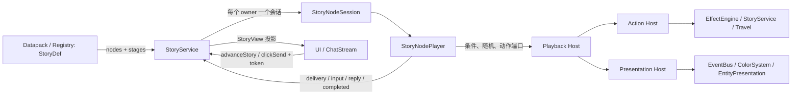

# 04-mechanisms/arona-clicker/story-node-playback — StoryNode 类型与播放引擎

本文回答：**当前 StoryDef 如何用 StoryNode 描述内容、输入、动作和跳转，以及运行时怎样按节点顺序推进、存档和交给 UI 呈现。**内容以现行类型、播放器、StoryService、动作宿主和回归测试为准。

## 先记住这五件事

1. **`StoryDef` 就是 `StoryNodeDocument`。**它的 `nodes` 是唯一执行顺序；`stages` 是对正文与输入点的结构声明，不是第二套顺序表。
2. **正式顶层节点只有四类：`talklet`、`click`、`operation`、`transfer`。**前两类会停下来等 UI/玩家确认；后两类由引擎自动执行。
3. **`StoryNodePlayer` 是同步、内存中的解释器。**它维护一条执行链、等待点、返回栈和防重入票据；它本身不写 StoryLog、不发完成奖励，也不保存。
4. **`StoryService` 才是产品剧情会话协调者。**它按 `owner` 隔离会话，把播放器等待点投影成 UI 兼容视图，并在送达、完成、重读、奖励与存档边界接入既有领域服务。
5. **`Talklet` 这个名字有两个当前用途。**StoryNode 中 `type: 'talklet'` 是正文节点；`data-services/contracts/story.ts` 的 `Talklet` 则是只读 UI 投影 DTO。旧 Talklet 作者格式和旧解释器已不再是生产 StoryDef 的执行格式。

## 总体关系



图中箭头描述运行时调用与数据交接：静态类型依赖从 `data-services/contracts/story-node.ts` 与 `story-node-actions.ts` 出发；播放器依赖 `StoryNodePlaybackHost` 窄端口，不直接依赖 `GameInstance`、UI 或具体领域服务。`StoryNodeActionHost` 把有界动作接到已有服务，`StoryNodePresentationHost` 管理本次运行拥有的临时演出。

### 一次等待点的循环

```text
StoryService 通过 Entry 准入并创建 owner 会话
  → StoryNodePlayer.start(rootStoryId)
  → 自动执行 Operation / Transfer，直到遇到 Talklet、Click 或链结束
  → 返回 delivery/input 视图与一次性 token
  → StoryService 转成 StoryView；UI 展示并回传 token
  → 正文送达确认 ackDelivery；输入提交 submit
  → 玩家从原节点后继继续，或进入 transfer 目标
  → 直到再次等待或完整调用链结束
```

`getView()` 是只读查询：它复制当前视图，不抽多击随机数，也不执行 Operation。随机工作量只在播放器实际到达对应 Click 时生成一次。

## 作者文档的外形

`StoryDef extends StoryNodeDocument`，核心字段如下：

| 字段 | 含义 | 运行时如何使用 |
| --- | --- | --- |
| `id` | StoryDef 身份，沿用 `StoryId` | Entry 指向它；transfer 也以它为目标 |
| `name` | 作者可读名称 | 可用于 UI/开幕标题默认来源 |
| `nodes` | 有序的 StoryNode 数组 | 唯一播放顺序；数组中的局部 `id` 必须唯一 |
| `stages` | `stageId → { advance }` 的记录 | 供作者明确阶段意图和结构校验；记录键顺序不控制播放 |
| `extra` | 可选附加数据 | 由 Extra 合同解释；播放器不把它当节点或控制流 |

局部节点名、阶段名和选项名均为 1–64 位 ASCII 名：首位字母，后续可用字母、数字、`_`、`-`。节点 ID 在单个 StoryDef 内唯一；选项 ID 在同一个 Choice 内唯一。跨 StoryDef 的转移以 `StoryId` 定位，不要求局部节点 ID 全局唯一。

工厂 `story(id, name).nodes([...]).stages({...}).build()` 只复制数组和阶段记录并生成声明。它不运行播放器，也不替代 `validateStoryNodeStructure()` 或 Registry 引用核验。

## 四类顶层节点

### Talklet：正文交付等待

```ts
{
  id: 'greeting', type: 'talklet', stageId: 'opening',
  content: { kind: 'talk', speaker: '老师', text: '早上好。' },
  presentation: { side: 'left', avatar: 'arona', avatarMode: 'show' },
  pacing: { typing: 0.6, thinking: 0.3 }
}
```

`content` 是有限联合：

- `talk`：对话文字，可带 `speaker` 与 `image`。
- `narration`：旁白文字，没有说话人或图片字段。

`presentation` 声明左右侧、对齐、头像资源和 `auto / hide / show` 显示策略。`pacing` 声明 `typing`、`thinking` 非负有限数值，仅允许非右侧 `talk` 正文；它不定义等待次数或自动推进策略。正文本身不能带分支、动作或跳转。

播放器遇到 Talklet 会创建 `delivery` 等待点并停住。`StoryService.advanceStory()` 确认当前 token 后才 ack，才会记录已送达正文的阅读序号并继续。文本“显示过”与“被引擎确认已送达”是不同时间点。

### Click：明确的输入点

Click 拥有一个 `interaction`，不是从相邻节点推断按钮或选择。三个形式如下：

| `interaction.kind` | 用途 | 成功提交后的行为 |
| --- | --- | --- |
| `button` | 单按钮；可带 `press`、`reply`、`result` | 完成指定按击工作后，动作、回复、转移按规则处理 |
| `choice` | 一组互斥候选；每项有稳定 `id` | 检查所选候选条件，只执行共同动作与该候选结果 |
| `entryCard` | 邀请玩家接取一个 Active Entry | 作为卡片意图向 StoryService 请求启动目标 Entry |

单按钮示例：

```ts
{
  id: 'confirm', type: 'click', stageId: 'confirmStage',
  interaction: {
    kind: 'button', text: '继续', press: { base: 2, rand: 3 },
    reply: { kind: 'talk', text: '收到。' },
    result: { actions: [{ kind: 'state', effects: [{ op: 'addResource', resourceId: 'credit', amount: 5 }] }] }
  }
}
```

`press.base` 是至少 1 的安全整数，`rand`（若有）是非负安全整数。工作量公式为 `base + floor(random × rand)`；`rand` 缺省或为 0 时不增加。比如 `base: 2, rand: 3` 实际总量为 2、3 或 4。每次未完成的按击都会换一个 token；达到总量才提交 `result` 和 `reply`。不会额外暗加一次“确认”。不带 `press` 的按钮一次提交完成。

Choice 的结构与选择顺序：

```ts
{
  id: 'route', type: 'click', stageId: 'routeStage',
  interaction: {
    kind: 'choice',
    sharedActions: [{ kind: 'state', effects: [{ op: 'setFlag', flagId: 'asked', value: true }] }],
    options: [
      { id: 'stay', text: '留下', condition: stayCondition, result: { actions: [/* 仅此分支 */] } },
      { id: 'leave', text: '离开', reply: { kind: 'talk', text: '那我们走吧。' }, result: { transfer: { mode: 'goto', storyId: 'next' } } }
    ]
  }
}
```

可选条件在呈现 `availableOptionIds` 时检查一次，并在提交时重新检查；提交时若条件已不成立，会拒绝且不消费输入点。选定后执行 `sharedActions`，再执行选项 `result.actions`，最后执行可选 `result.transfer`。未选候选的动作绝不执行。回复事件在所选动作成功后、转移后继视图之前发出。没有选项回复时不会凭空生成玩家回复。

`entryCard` 的请求合同必须是 `entryType: 'active'`、`intent: 'card'`；它是 UI 可呈现的邀请，资格和目标入口启动仍由领域宿主检查。它不是直接嵌入另一个 StoryDef 的 Transfer。

### Operation：有界自动动作

```ts
{ id: 'reward', type: 'operation', action: { kind: 'state', effects: [/* 有序状态动作 */] } }
```

Operation 不属于任何阶段，到达时立即预检并执行，然后播放下一节点。五类 `StoryAction`：

| `action.kind` | 载荷 | 接入位置与注意事项 |
| --- | --- | --- |
| `state` | 有序 `StoryStateAction[]` | 映射至现有 EffectEngine 和领域写入；动作使用具名参数，不开放通用 `target/value` 壳 |
| `travel` | `areaId`、可选 `notice` | 调用剧情移动路径；`notice` 仅在移动成功后发 `storyAreaTraveled` |
| `overlay` | 显示/清除覆盖内容或清空演出/聊天流 | 演出路径按 owner/run 管理；覆盖内容可为 text 或 message，入口卡有单独能力约束 |
| `presentation` | 临时主题、实体表现、清除实体表现、开幕标题 | 由 `StoryNodePresentationHost` 校验并管理生命周期/快照 |
| `entryRequest` | 普通、系统或卡片入口请求 | 静态检查 Entry 引用，执行时重查资格、完成状态与游标占用 |

状态动作具体 op：`setResource`、`addResource`、`setSpotLevel`、`addSpotLevel`、`setManager`、`addEnhancement`、`addItem`、`unlockInit`、`setFlag`、`setExtra`、`addExtra`、`removeExtra`、`grantCharacter`、`addAffectionExp`。数值型参数可为数字或 `ValueExpression`。`state` 批次先按声明顺序模拟若干动态门槛，再作为一个有序批次交给 EffectEngine；批次计算遵守现有引擎语义，不提供跨多个 Action 的事务或回滚保证。

`preflight` 主要解决静态可解析性与引用问题；需要依赖当前玩家状态的准入条件会在各 Action 执行前按最新状态复核。一个 Click 分支会先对目标 Transfer 和该分支全部动作做预检；只有都通过后才消费输入票据并执行动作。节点级 Operation 到达时也会先预检。若宿主执行阶段意外拒绝，链终止为 `failed`；已执行的先前动作不会由播放器自动撤销或重放。

### Transfer：StoryDef 之间转移

```ts
{ id: 'insertBriefing', type: 'transfer', transfer: { mode: 'insert', storyId: 'briefing' } }
{ id: 'replaceRoute', type: 'transfer', transfer: { mode: 'goto', storyId: 'alternate' } }
```

- `goto`：切到目标 StoryDef 的第一个节点，不保存调用点返回位置。
- `insert`：将当前 StoryDef 的“本节点之后”位置压入返回栈，运行目标文档；目标文档及其中的 `goto` 链走完后回到该位置。
- Transfer 节点本身不属于 stage，也不产生输入等待。
- 每次实际转移都把目标加入本链 `visited` 集；条件里的 `visitedStoryInChain` 查询这条执行链，不查询全局历史。
- 单链最多 32 次 transfer；连续自动步骤最多 256 个，超限失败以避免无限自动循环。
- 缺失目标、结构不合法、重读分支守卫拒绝会在转移执行前报错；由 Click 结果触发的转移在动作前完成预检。

完成回执的 `terminalStoryId` 表示链结束时最后一个正在执行的 StoryDef；回执同时保留原始入口 `entryId`、`rootStoryId` 和 owner。之后由 StoryService 按产品 Entry 语义做奖励与完成记账。不要把目标 StoryDef、来源 Entry 和顶层 StoryDef 身份混为一谈。

## Stage：作者的局部结构声明

`stageId` 只出现在 `talklet` 和 `click`。一个阶段成员必须在 `nodes` 中连续出现；在阶段之间插入 Operation / Transfer 会结束前一段阶段成员区间。

| `advance` | 结构要求 | 直观含义 |
| --- | --- | --- |
| `auto` | 至少一个 Talklet，不能含 Click | 一段正文节点自然按 `nodes` 顺序逐条送达；后面可接其他节点 |
| `input` | 恰好一个 Click，且它是该段最后一个成员；正文可为空 | 这段正文（如有）后在显式输入点等待 |

结构校验还要求所有声明阶段均有成员、每个成员引用已声明阶段、阶段不重复/不拆段；Talklet pacing 与内容类型和侧边匹配；Click press 范围合法；Choice 至少一个选项且 ID 合法、互异。

注意：执行器不会遍历 `stages` 来决定顺序或在阶段末额外自动确认。执行器沿 `nodes` 数组运行；Talklet 自己构成 delivery 等待，Click 自己构成 input 等待。`advance` 的责任是让作者关系明确并由结构校验拒绝不一致文档。

## 结构检查、引用检查与边界

`validateStoryNodeStructure(document)` 检查的是**已符合 TypeScript 形状的 StoryNodeDocument**中的局部结构。它不是任意 JSON parser，也不解析所有 Condition/Effect 参数，更不查 Registry 引用。播放器第一次打开每个 StoryDef 时会运行此结构检查，并缓存通过结果；引用和动作能力则由 Action/Presentation Host 预检。内容装载由 Data Services 读取 StoryDef 到 Registry，不能据此假设装载时所有结构问题都已由该 validator 报出。

因此作者/内容审查时应分别确认：

1. TypeScript/Datapack 字段形状符合 `StoryNodeDocument`。
2. `nodes` / `stages` 关系通过结构 validator。
3. Story、Entry、资源、区域、角色差分、主题和演出目标等引用存在且类型相符。
4. 依赖运行状态的条件与准入在执行时仍满足。

独立 StoryNode 编辑器目前未实现。`tools/datapack-editor/` 不是这个新作者格式的已完成编辑器；不要把编辑器存在写成现状。

## 从命令到 UI：投影与送达

### 播放器的公开视图

`StoryNodePlaybackView` 状态：

| 状态 | 含义 |
| --- | --- |
| `idle` | 当前无链 |
| `running` | 已开始但非对外等待边界的短暂状态 |
| `delivery` | 当前停在 Talklet，带 token、StoryDef ID 和 wait sequence |
| `input` | 当前停在 Click，带 token、可用选项 ID 与可选 press 进度 |
| `completed` | 链完整结束，带来源与 terminal StoryDef 回执 |
| `replaced` | 动作成功启动了同一 owner 的新链，旧链应关闭 |
| `failed` | 内容、预检或执行失败；包含错误说明 |

播放器命令事件是命令回执内的有序事件（`view`、`reply`、`completed`、`replaced`），不是自动发布到全局 EventBus 的 `GameEvent`。领域副作用是否发布事件由宿主调用的服务决定。

### StoryService 的旧形状显示 DTO

StoryService 将 `delivery/input` 等待点投影为 `StoryView`，其中包含来源 Entry、实际 StoryDef、`nodeId`、token、phase、run/history 身份、wait sequence、显示页索引和只读 `Talklet` DTO。这个兼容显示形状不意味着底层播放器按 Talklet 数组执行：

- `pageIndex/totalPages` 只用于当前 StoryDef 内显示顺序投影；不能当保存游标或稳定节点身份。
- `nodeId` 才是当前文档内等待节点身份。
- Choice 投影仅包含选项 ID/文案；条件与执行分支保留在输入视图/作者定义里。
- `entryCard` 投影成 `kizuna` 显示字段；执行请求本身仍由 Click 节点承载。
- UI 调用正式命令并携带 token。过期 token、旧按击、旧定时器或旧 DOM 事件不能推进新等待点。

UI 的 `ChatStream` 管文字排队、打字效果、消息历史和送达确认。StoryService 在当前送达等待点确认后才记录 Story 阅读序号并调用 `ackDelivery`。UI 历史与执行游标是两种状态：历史恢复不会靠文本内容猜 Story 当前节点。

## Action Host 与 Presentation Host 的边界

`StoryNodeActionHost` 只依赖 Registry 只读表和明确传入的领域服务：

- 状态批次转为既有 Effect 输入，最终走 EffectEngine / mutation。
- `travel` 走传入的剧情旅行函数。
- `entryRequest` 通过 StoryService 发起目标 Story；请求来源 owner 与目标 owner 相同时成功会标记旧链 `replaced`，不同 owner 则旧链仍可继续。
- 普通 / 系统请求的触发条件、Entry 已完成状态、被动阻断和游标占用按请求 intent 与现行服务重新判定。

`StoryNodePresentationHost` 负责覆盖文本、临时主题、实体表现和标题。运行级覆盖文本、临时主题与 `lifetime: 'story'` 实体表现按 `runId` 绑定；关闭会清理由该 run 拥有的临时表现。主题可为 ephemeral，也可显式定位 area / variant。UI 当前选择的联系人不会改写动作源 owner。

这两个宿主都是有限能力门面。作者可声明的 `StoryAction` 决定可执行的产品操作；不应把“EffectEngine 能表达的所有操作”推断成 StoryNode 已支持能力。

## StoryService：产品会话生命周期

StoryService 每个 `owner` 持有一个 `StoryNodeSession`：`null` 是全局会话，角色 ID 是各自聊天会话。核心入口包括 `startStory()`、`advanceStory()`、`clickSend()`、`getCurrentStoryView()`；入口资格、主动/被动调度、奖励与冷却仍归 StoryService / 对应选择与奖励服务所有。

1. 从 StoryEntry 找根 StoryDef，检查 Entry 类型、准入/替换规则和可用条件。
2. 创建 `StoryNodeSession`，生成 `runId` / 逻辑 `historyId`，连接当前状态条件、动作宿主和 Presentation Host。
3. `StoryNodePlayer.start()` 沿 nodes 自动跑到第一个正文、输入点或完成点。
4. 命令推进期间捕获 visited StoryDef；正文确认写阅读记录；选择成功写 Choice 记录；UI 收到投影后负责呈现。
5. 完整链完成时先移除/关闭当前会话，再处理奖励、完成记录、被动冷却/阻断与 FollowUp 相关事件，避免同步监听器启动的新链被旧链清理。

播放器可独立构造用于测试或明确的运行时桥接；`src/arona-clicker/runtime/story-node-playback.ts` 的 `createStoryNodePlayback()` 本身注释为显式内存播放器，调用方管理生命周期，不注册旧游标、UI 或存档。实际产品流程用 StoryService 会话协调器，二者不要混作一条完成语义。

## 保存与恢复

节点执行快照 `StoryNodeSnapshot` 格式标记为 `story-nodes`，仅在 Talklet / Click 等等待边界可保存。它记录：来源身份、当前 StoryDef 与节点 ID、`waitSequence`、terminal StoryDef、transfer 次数、visited 集、insert 返回栈、pending 类型和多击进度。

- `StoryNodePlayer.save()` 在动作执行中拒绝保存（`Busy`），在非等待边界也拒绝（`NotAtCheckpoint`）。这样不会从同步领域回调保存出“部分批次已写、节点还没消费”的快照。
- 恢复会验证格式、边界、当前节点、返回栈、转移范围和多击范围，然后原子替换等待点；不会在恢复时推进、执行 Operation 或重新抽随机数。
- 恢复等待点会生成新 token；旧 UI 提交失效。wait sequence 保持逻辑位置递增。
- StoryCursorSnapshot 还包裹 replay、Choice 记账、flags 和 StoryPresentationSnapshot。表现快照用于恢复运行临时表现，不重放 gameplay action。
- 产品 SaveData 当前检查版本 `2.0.0` 并要求 `storyPlayback`。旧页式播放格式不由此播放器解释；不要据此声称会自动迁移旧 Story 游标。

`storyLog`（完成进度）、阅读记录、聊天 UI 历史和 Story 执行游标职责不同：完成进度在 PlayerState；阅读记录由已送达正文/选择记录；历史由 UI 保存；当前节点游标随 Init / Save 的运行时快照恢复。

## Talklet 与 StoryNode 的术语对照

| 名称 | 当前含义 | 是否执行控制流 |
| --- | --- | --- |
| StoryNode `type: 'talklet'` | 一条正文/旁白交付节点，带稳定 node ID | 会暂停等送达确认，之后继续 |
| `contracts/story.ts` 的 `Talklet` | StoryView / UI 展示 DTO，可描述投影后的正文、按钮或选择外观 | 否；不含可信动作、条件或跳转 |
| `EngineTalklet` | `engine/contracts/talklet.ts` 中供通用 Effect 演出载荷消费的最小结构 | 否；与 StoryDef 播放器不是同一个内容系统 |
| 旧 Talklet 作者数组 / `.scene()` 工厂 | 已退役作者格式与旧解释器路径 | 当前生产 StoryDef 不执行它 |

同理，旧页面所谓 Talklet 同时容纳页面、选择和 Effect 的混合结构不代表当前类型。现在由独立 Click、Operation、Transfer 节点显式承接输入、动作与控制流。

## 常见误读

- **“stage 的 `auto` 会一次性跳过正文。”**不会；每条 Talklet 都是独立交付等待。
- **“一个 Choice 就是多个相邻按钮 Click。”**不是；一个 Click 内的 options 才构成互斥候选。
- **“所有分支动作都会先执行再选路。”**不会；只执行 sharedActions 与实际选项的 actions。
- **“insert 的子剧情完成就完成整个 Entry。”**通常不是；insert 回到调用点之后继；整条调用链结束后才产生完成回执。
- **“播放器 completed 就已经发奖励并写 StoryLog。”**独立播放器只返回本地完成事件；产品结算由 StoryService 接管。
- **“`Talklet` 类型还在，所以旧格式还可执行。”**UI 投影 DTO 保留只为显示，旧作者语义已不存在于新 StoryDef 合同。
- **“任何 Effect 都能写进 Story state batch。”**只能用 `StoryStateAction` 明列的 op 和其余有限 `StoryAction` 种类。
- **“保存的 pageIndex 可以恢复执行位置。”**必须用 `storyId + nodeId` 与快照返回栈；pageIndex 只是投影索引。

## 深入阅读与源码入口

| 要回答的问题 | 当前权威入口 |
| --- | --- |
| StoryNode / 内容和动作字段 | `src/data-services/contracts/story-node.ts`、`story-node-actions.ts`、`story.ts` |
| 结构关系如何校验 | `src/data-services/validation/story-node-structure.ts` |
| 节点顺序、等待点、票据和 transfer | `src/arona-clicker/services/story/story-node-player.ts` |
| 会话构造、StoryView 投影、阅读记录辅助 | `src/arona-clicker/services/story/story-node-session.ts` |
| Entry、命令、奖励、完成、存档恢复 | `src/arona-clicker/services/story/story-service.ts` |
| 状态/旅行/入口请求执行 | `src/arona-clicker/services/story/story-node-action-host.ts` |
| 覆盖文本、主题、实体表现和快照 | `src/arona-clicker/services/story/story-node-presentation-host.ts` |
| 通用 Engine 演出最小 Talklet | `src/engine/contracts/talklet.ts` |
| Save cursor 合同 | `src/engine/contracts/story-node-snapshot.ts`、`story-cursor.ts`、`story-presentation-snapshot.ts` |
| 产品说明、主动/被动 Entry 与聊天流协作 | [[docs/docs-829/06-wiki/30-arona-clicker-domain/story-and-chat]] |
| 领域模块边界 | [[docs/docs-829/02-modules/arona-clicker]] |

## 适用回归入口

- `tests/data/story-node-structure.test.ts`、`tests/data/story-node-authoring.test.ts`：stage、ID、Click 形状与作者能力边界。
- `tests/engine/story-node-player.test.ts`、`story-node-player.boundaries.test.ts`、`story-node-player.snapshot.test.ts`：等待、提交、动作预检、转移、边界、token 和快照恢复。
- `tests/engine/story-node-action-host.test.ts`、`story-node-action-host.admission.test.ts`：有界动作与入口准入。
- `tests/engine/story-node-presentation-host.test.ts`、`story-node-presentation-lifecycle.test.ts`：演出动作、运行生命周期与恢复。
- `tests/engine/story-node-playback.integration.test.ts`、`story-service-node.integration.test.ts`、`story-node-save.integration.test.ts`：实际 Runtime / StoryService / Save 路径。
- `tests/ui/story-node-delivery.test.ts`、`story-node-input.test.ts`、`story-node-routing.test.ts`、`story-node-card-routing.test.ts`、`story-history-resume.test.ts`：UI 命令、送达、路由和历史恢复。

## 与相邻机制的区别

StoryNode `operation` 是 Story 内容的有界动作；它不是 Gameplay B 的 Operation/EventRun 图。Story `state` action 经既有 EffectEngine / mutation 能力写玩家状态；它不表示 StoryNode 是通用 Effect 作者语言。继续查入口、奖励、冷却、聊天表现及交付策略时读 [[docs/docs-829/06-wiki/30-arona-clicker-domain/story-and-chat]]；通用 Event/Effect 运行机制见 [[docs/docs-829/04-mechanisms/engine/effect-trigger]]。
