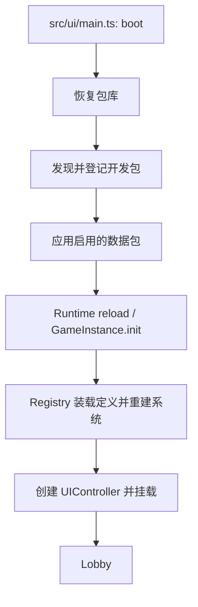

# docs-830/01-architecture/startup-and-runtime — 启动与 Runtime

本文回答：游戏从应用启动到可开始游玩，经过哪些步骤。

## 启动顺序



`createAppRuntime()` 创建 `AronaClickerRuntime`。启动流程恢复包管理器状态、检查开发数据包，再调用 `loadDefaultDatapack()`；该函数通过 `applyEnabledPacks()` 应用当前启用集。Runtime 为包管理器提供应用目标，负责重载游戏实例。内容装载完成后，`main.ts` 创建并挂载 `UIController`。

包应用由 `PackManager` 生成计划，Runtime 执行校验和应用。运行时目标会先保存当前启用数据包与游戏存档快照，再重载到目标数据包集，并更新对应图片资源。应用失败时，目标回调会重新装载快照中的数据包并恢复存档，使包配置与运行状态一并回退。

`GameInstance.init()` 先用临时 `Registry` 检查候选数据包，再更新当前 Registry、Affector 与 Trigger 定义，并在整包装载后核验跨包引用、构建数值系统。这个预检避免在发现定义关系错误之前先拆掉当前运行实例。

## Lobby 与 Init

首次应用数据包后，界面进入 Lobby。玩家选择新 Init 或恢复进度后，Controller 经 Runtime 命令进入 Init；开始会话后，`SessionService` 才启动定时 Tick。包应用与开始游戏是两个不同阶段。

```text
Registry 就绪 → Lobby → 新建 / 恢复 Init → 开始会话 → Tick
```

`InitService.startNewGame()` 创建新状态并进入所选 Init；`resumeInit()` 恢复该 Init 的存档快照，随后重设依赖玩家状态的统计、Affector 和 Trigger 系统。Controller 完成选择后调用 Runtime 的 `start()`。重新加载数据包时，Runtime 根据此前是否处于活动 Init 决定是否恢复进入状态；首次 UI 装载保持 Lobby。

关键入口：`src/ui/main.ts`、`src/app/runtime-bootstrap.ts`、`src/arona-clicker/runtime/runtime.ts`、`src/arona-clicker/runtime/runtime-game-instance.ts`。包与启动集成测试见 `tests/engine/arona-runtime-pack.test.ts`。

继续阅读：[[docs/docs-830/02-data-and-state/datapack-and-registry]]、[[docs/docs-830/03-runtime/session-and-tick]]。
