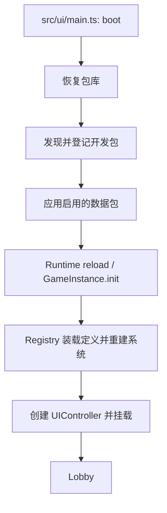

# docs-830/01-architecture/startup-and-runtime — 启动与 Runtime

本文回答：游戏从应用启动到可开始游玩，经过哪些步骤。

## 启动顺序



`createAppRuntime()` 创建 `AronaClickerRuntime`。启动流程恢复包管理器状态、检查开发数据包，再调用 `loadDefaultDatapack()`；该函数通过 `applyEnabledPacks()` 应用当前启用集。Runtime 为包管理器提供应用目标，负责重载游戏实例。内容装载完成后，`main.ts` 创建并挂载 `UIController`。

入口 `index.html` 的启动壳先于其内联脚本建立，计时、重试和复制按钮在 DOM 存在后接线。`main.ts` 按阶段动态加载 Runtime、数据服务、开发包加载器和样式，再依次创建 Runtime、恢复包库、发现并登记开发包、应用内容、加载并挂载 Controller。阶段开始前等待两帧，使浏览器有机会绘制更新后的状态。启动页右侧列出八个步骤的等待、处理中、完成、提醒或失败状态及完成耗时；进度条表示已处理步骤数，不表示耗时百分比。左侧显示当前阶段、总等待时间和当前内容。模块阶段列出真实就绪项与尚待就绪的模块；开发包阶段显示当前包、读文件 / 解析状态、具体路径及已读文件数。目录文件总数不等于解析器必须读取的文件数，ZIP 只报告归档读取与解析，不编造归档内部计数。

应用内容前通过 `startup-content.ts` 展示启用包的名称、身份、版本与应用顺序，并按本批声明累加剧情、入口、角色、地图、区域、物品、图片、主题等数量；这是待校验声明数，不是跨包覆盖后的 Registry 唯一实体数，也不表示同步校验已经逐条完成。内容应用仍走原有同步校验 / 回退流程，没有新增线程或逐定义进度承诺。`performance.measure` 保存阶段时长，开发模式同时写入 `[StartupTiming]` 控制台记录。启动壳在 Controller 首屏挂载且再让出绘制后移除。

产品 Base 内容由 `src/arona-clicker/content/` 的类型化定义与 `base-pack/content.json` 构建产物组成；`defaultDatapack` 是兼容读取该 bundle 的导出。Runtime 将内置 Base 注册为默认包，并与用户启用集一起交给 PackManager 计划应用。默认内容因此走常规包应用和 Registry 校验流程。

包应用由 `PackManager` 生成计划，Runtime 执行校验和应用。运行时目标会先保存当前启用数据包与游戏存档快照，再重载到目标数据包集，并更新对应图片资源。应用失败时，目标回调会重新装载快照中的数据包并恢复存档，使包配置与运行状态一并回退。

`GameInstance.init()` 先用临时 `Registry` 检查候选数据包，再更新当前 Registry、Affector 与 Trigger 定义，并在整包装载后核验跨包引用、构建数值系统。这个预检避免在发现定义关系错误之前先拆掉当前运行实例。

## Lobby 与 Init

首次应用数据包后，界面进入 Lobby。玩家选择新 Init 或恢复进度后，Controller 经 Runtime 命令进入 Init；开始会话后，`SessionService` 才启动定时 Tick。包应用与开始游戏是两个不同阶段。

## 开发启动与本地试玩

`npm run dev` 通过根目录的 `vite.config.ts` 服务门户、游戏、独立 Datapack Editor 和 Infinite Board。Vite 预打包清单显式包含 `jszip`，跳过启动时对四个入口的自动依赖扫描。文件监听排除 `.test-artifacts/` 中的测试报告、浏览器缓存和构建探针。新增或替换浏览器侧需要预打包的依赖（例如 CommonJS 包）时，同步调整 `optimizeDeps.include`，并验证使用它的开发入口。

进入游戏时由 `game.css` 一次交付大厅和公用样式，包括主题宿主、区域导航按钮和两个编辑器共用的条件引用选择器。`surface-styles.ts` 在用户打开 Story 编辑器、Runtime Editor、Operation、地图准备、地图探索、区域地图、主题编辑或图鉴时加载对应样式。样式就绪后才创建本局、切换工作区或打开弹窗。同页后续打开复用该样式。加载失败时保留当前页面，并提示刷新后重试。玩法 B 本地试玩台启用时同时加载专用演练面板和地图探索样式。

本地试玩可先构建，再用 Vite 预览构建产物。启动预览后访问 [AronaClicker](http://localhost:4173/game)。

```powershell
npm run build
npm exec -- vite preview
```

## 启动失败时如何判断位置

静态启动壳在主入口执行前建立 `window.__startupLog`。启动记录包括导航至启动壳、入口模块前序加载、八个正式阶段、阶段间隙、当前等待对象、页面可见状态，以及并行模块的完成或失败耗时。阶段占比以导航至当前采样或启动结束的总时长为分母；`beforeWorkMs` 是阶段开始到获得绘制机会的等待，`workMs` 包括该阶段的同步工作和异步等待，不等同 CPU 时间。并行模块耗时互相重叠，不能与阶段占比相加。

「装载游戏模块与样式」直接显示入口依赖等待、前后台状态、绘制等待和五项导入各自的状态及耗时。等待超过 3 秒时可以复制诊断；导入开始后，面板会显示阶段内最慢的已完成同源请求，列出发出前等待、等待首字节和接收耗时。`npm run dev` 下额外通过 Vite 的热更新连接向 `scripts/vite-startup-diagnostics.ts` 取样，展示服务端正在处理或近期结束的慢请求、样式转换、源码转换和模块依赖解析。服务端样本覆盖同一开发进程上的所有标签页，处理项可以重叠。复制报告中的 `moduleResources` 和 `moduleServerTiming` 分别记录浏览器已完成的请求和最近一次收到的服务端样本。

浏览器开发者工具控制台可在启动中或完成后执行：

```js
window.__startupLog.print(); // 耗时与占比表
console.log(JSON.stringify(window.__startupLog.report(), null, 2)); // 可发送的当前报告
console.log(JSON.stringify(window.__startupLog.report(1), null, 2)); // 上一次启动
```

诊断独立写入本机 `acprogram_startup_logs`，仅保留当前和此前两次启动，阶段边界及离开页面时保存；不保存游戏状态。启动未完成即刷新时记录为中断，正常完成或失败后耗时冻结，迟到的模块回调不改写现场。浏览器崩溃或强制终止时只能保留最后一次成功写入的快照；存储不可用时继续启动，当前内存报告仍可读取并包含 `storageError`。启动页的“复制诊断信息”同时包含警告、错误和当前耗时报告，无需依赖 DevTools 的 `copy()` 辅助函数。

`src/ui/main.ts` 的 `boot()` 将包库恢复和后续内容装载分开处理：包库恢复抛错时记录日志、显示可见警告并继续使用当前会话；坏开发包会继续按既有规则登记诊断并显示告警；模块加载、内容应用或 UI 挂载等阶段失败时，启动壳保留失败阶段和原因，提供展开 / 复制诊断信息与刷新重试。入口模块本身加载失败时由静态壳的错误处理器显示入口错误。于是“恢复本机包库失败”不一定等于“整个游戏不能启动”，而 Registry 校验或 UI 根节点失败则应查看对应阶段诊断。

包配置操作中，校验失败和应用失败也应区分：前者阻止进入 reload；后者发生在实际应用期间，由应用目标尝试恢复原有数据包和进度快照。恢复包库只处理已安装与启用选择，不等同于已经恢复玩家进度。

```text
Registry 就绪 → Lobby → 新建 / 恢复 Init → 开始会话 → Tick
```

`InitService.startNewGame()` 创建新状态并进入所选 Init；`resumeInit()` 恢复该 Init 的存档快照，随后重设依赖玩家状态的统计、Affector 和 Trigger 系统。Controller 完成选择后调用 Runtime 的 `start()`。重新加载数据包时，Runtime 根据此前是否处于活动 Init 决定是否恢复进入状态；首次 UI 装载保持 Lobby。

关键入口：`src/ui/main.ts`、`src/app/runtime-bootstrap.ts`、`src/arona-clicker/runtime/runtime.ts`、`src/arona-clicker/runtime/runtime-game-instance.ts`。包与启动集成测试见 `tests/engine/runtime-content/arona-runtime-pack.test.ts`。

继续阅读：[[datapack-and-registry]]、[[session-and-tick]]。
