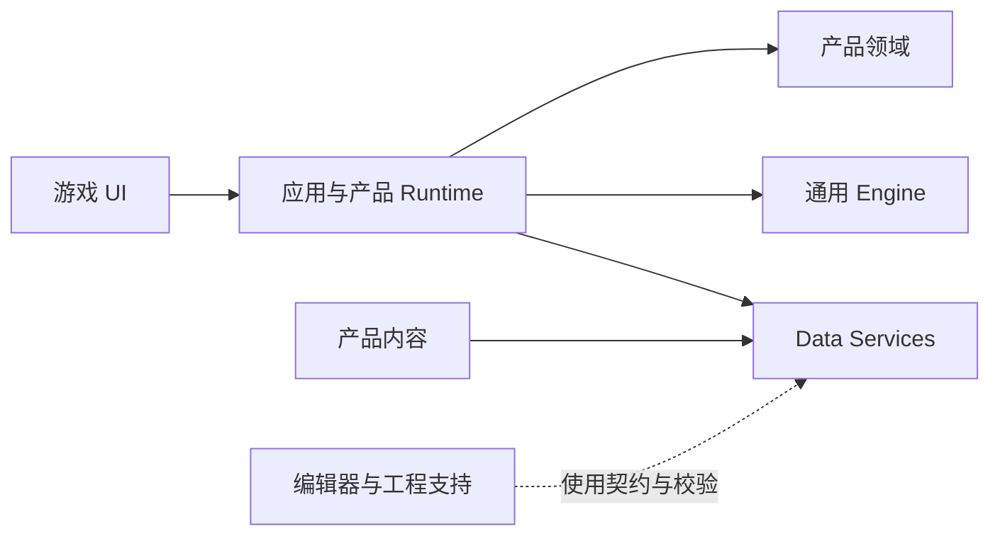

# docs-830/01-architecture/system-composition — 系统组成

本文回答：项目由哪些主要职责模块组成，它们如何配合。

## 模块概览

| 模块 | 主要职责 | 源码入口 |
| --- | --- | --- |
| 应用组合 | 创建产品 Runtime，协调包应用与游戏生命周期 | `src/app/`、`src/arona-clicker/runtime/` |
| Data Services | Datapack、Registry、存储、内容校验与资源服务 | `src/data-services/` |
| Engine | 通用表达式、事件、效果、统计、可见性与 Tick | `src/engine/` |
| AronaClicker 领域 | 产品状态、内容、业务服务与只读读模型 | `src/arona-clicker/` |
| 游戏 UI | Controller 命令、界面组件、导航、Flow 与表现 | `src/ui/` |
| 创作与工程支持 | 独立内容编辑器、示例资源、测试和工程脚本 | `tools/datapack-editor/`、`src/data/`、`tests/`、`scripts/` |

Runtime 是产品组合点：它装配 Engine、Data Services 和领域服务。UI 通过命令请求业务操作，并读取领域提供的视图。`src/data/` 中的资源和示例内容，与管理内容装载的 Data Services 分属不同职责。

## 运行时中的主要对象

| 对象 | 持有或协调的职责 |
| --- | --- |
| `AronaClickerRuntime` | 包库、启用包应用、内容重载，以及面向应用层的产品 API |
| `GameInstance` | 单个游戏实例的 Registry、状态、Engine 系统和领域服务组合；提供生命周期与查询门面 |
| `Registry` | 已加载的定义表与查询索引，不负责推进玩家流程 |
| `UIController` | 接收界面事件，将操作路由为 Runtime 命令，并组织视图刷新 |

`runtime-wiring.ts` 是领域组合根：它创建共享的 `EventBus`、`StateMutationService`、通用 Engine 系统与产品服务，并注册它们之间的协作。这样，领域服务共享同一状态写入口和事件总线；UI 不需要直接装配服务依赖。

## 从一个操作看模块如何协作

以使用资源为例，界面收集玩家操作并通过 Controller / 命令入口交给领域服务；服务读取 Registry 中的定义和当前玩家状态，判断该操作是否允许。允许后，领域服务调用状态写入入口提交变化；事件通知让需要响应的系统更新，界面再通过只读视图获取结果。Registry 中的资源定义和 PlayerState 中的当前余额是不同的数据：查询定义不会扣款，读取视图也不会提交交易。

这一段描述的是常见业务数据流，并非每个功能均有完全相同的调用链。可在 [[state-and-events]] 查看状态与事件，在 [[read-model-and-ui]] 查看界面读取和命令边界。

## 查找问题从哪一层开始

| 观察到的问题 | 先核对 | 再顺着边界追踪 |
| --- | --- | --- |
| 包里的定义没有出现 | 包启用集、Registry 是否装载并可查询 | [[datapack-and-registry]] |
| 操作成功但状态没有变化 | 命令是否到达服务、服务的校验和写入 | [[state-and-events]] |
| 状态正确但界面不更新 | ReadModel / UIContext 查询和刷新入口 | [[read-model-and-ui]] |

## 依赖与运行顺序

静态依赖说明代码可以引用哪些模块；它不代表对象每帧的调用顺序。运行顺序从 [[startup-and-runtime]] 开始，状态与 UI 数据流见 [[state-and-events]]、[[read-model-and-ui]]。

## 继续阅读

- [[startup-and-runtime]]
- [[datapack-and-registry]]
- [[read-model-and-ui]]
