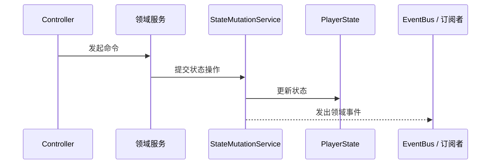

# docs-830/02-data-and-state/state-and-events — 状态写入与事件

本文回答：一次业务操作如何改变游戏状态，并让相关系统获知变化。

## 常见更新链

```text
UI 命令 → Runtime / 领域服务 → StateMutationService → PlayerState 更新
                                              └→ EventBus 通知订阅者
```

`PlayerState` 保存玩家进度和当前世界状态。UI 操作由 Controller 命令进入 Runtime 或领域服务；需要提交状态变化时，领域服务调用 `StateMutationService` 的具体写入方法。写入完成后，服务可发出如资源变化、角色获得或 Spot 等级变化等事件，订阅者据此更新派生系统或触发后续反应。

## 状态归属

`PlayerState` 同时包含跨 Init 进度与当前 Init 运行数据。切换世界线时，`InitSnapshot` 保存当前 Init 的一组状态字段；字段是否进入快照由 `per-init-fields.ts` 管理。常见字段如下：

| 范围 | 示例 | 生命周期 |
| --- | --- | --- |
| 全局 | `globalResources`、`unlockedInits`、`characterMemory` | 在不同 Init 间保留 |
| 当前 Init | `resources`、`spotLevels`、`inventory`、`currentAreaId` | 随当前 Init 运行 |
| Init 快照 | 当前 Init 的资源、据点、库存与阅读进度等字段 | 用于离开后恢复该 Init |

具体字段归属由 `PER_INIT_FIELD_SPECS` 和快照编解码逻辑决定。部分字段还按内容定义的 scope 分类：例如 Spot 等级可同时包含全局和 Init 局部条目，角色容器是否按 Init 保存取决于 Registry 的角色 scope。不能仅凭字段名判断整个容器的归属。新增字段时应核对状态类型、快照规范与保存恢复代码；存档结构改变遵循项目清档策略，不自行编写迁移兼容层。详见 [[init-state-snapshots]]。

## 写入与通知

`StateMutationService` 提供资源、物品、角色进度、Spot 和商店交易等有语义的写入方法。复合购买和 Spot 升级会先校验整笔变更，再通过单次事务提交成本与结果，避免部分扣款。写入方法同时记录统计需要的信息并发出对应领域事件。

`EventBus.emit()` 在通常情况下立即派发，包括普通派发过程中发出的嵌套事件；只有 `flush()` 正在执行时新发出的事件才进入队列，由当前 flush 的后续批次处理。订阅由 Runtime wiring 和领域反应器建立。事件代表已经发生的状态变化，不能替代状态写入本身。

### 例子：资源变化

`StateMutationService.changeResource()` 更新对应资源桶后发出 `resourceChanged`，事件中包含资源 ID、变化量和新值；订阅者据此更新派生结果或检查响应规则。测试 `tests/engine/state-mutation-service.test.ts` 中的 `mutates state and emits one resource event` 将状态结果与事件一起核对。`isGlobalResource()` 按产品侧全局资源 ID 集合选择 `globalResources` 或当前 Init 的 `resources`，因此调用前应区分资源 ID 和当前数量。



事件用于表达已发生的变化，订阅者负责对该变化作出反应。运行时调用与事件通知是两种不同协作方式。

主要源码：`src/arona-clicker/state/state-mutation-service.ts`、`src/engine/core/event-bus.ts`、`src/arona-clicker/runtime/runtime-wiring.ts`。写入和事件测试见 `tests/engine/state-mutation-service.test.ts`。

继续阅读：[[session-and-tick]]、[[read-model-and-ui]]。
