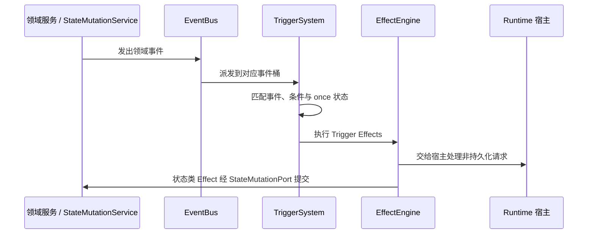

# docs-830/03-engine/event-effects-triggers — 事件、Effect 与 Trigger

本文回答：状态变化如何成为事件，声明式 Trigger 又如何在命中事件后执行效果。

## 三个职责

| 机制 | 输入 | 责任 |
| --- | --- | --- |
| `EventBus` | 带类型的 `GameEvent` | 向类型订阅者同步派发事件 |
| `EffectEngine` | Effect 列表与当前运行状态 | 求值数值参数，将状态效果交给写入端口，将运行时请求交给宿主 |
| `TriggerSystem` | TriggerDef、事件、条件状态 | 按事件类型筛选 Trigger，求值条件并触发其 Effects |

## 运行语义

`EventBus.emit()` 在普通情况下立即调用该类型的订阅者及通配订阅者；只有在 `flush()` 正在派发时再次 emit 的事件才进入队列，并在当前批次后继续处理。`clearQueue()` 仅丢弃待派发事件，`clear()` 才同时移除订阅者。

Trigger 按 `on.kind` 建立事件类型索引；收到事件后再检查事件字段、条件和 `once` 完成记录。注册具有 key、token 和可选 group，可按组撤回；匿名定义会依据结构和分组生成稳定 ID。`once` 完成记录与挂载周期分离，重挂同一已完成 Trigger 不会重放。

EffectEngine 先用 `ValueSystem` 解析表达式参数。宿主可接管演出或产品请求类 Effect；未接管的状态效果批量交给 `StateMutationPort`。AronaClicker Runtime 将 `setTheme`、实体表现、`triggerStory` 和聊天演出请求转成领域事件，再交由对应宿主服务处理。Engine 不解析这些产品事件应触发哪个业务动作；该路由在 `runtime-wiring.ts` 完成。

## 沿一条具体规则理解协作

基础内容中，欢迎剧情完成后发放能量饮料：`storyCompleted` 事件携带剧情 ID，TriggerSystem 按事件种类和 ID 找到匹配的规则，EffectEngine 再将 `addItem` 请求交给状态写入端口。EventBus 只派发事件，不自行决定奖励；Trigger 的定义只描述反应，不直接修改背包。

当结果不符合预期时，可依次检查事件是否发布、规则是否挂载并匹配、是否已经一次性完成、Effect 是否真正执行。完整定义和验证入口见 [[trigger-welcome-example]]。

## 继续深入

[[trigger-mechanism]] 解释 Trigger 字段、事件种类、条件和挂载生命周期。请特别注意：Builder 默认显式输出 `once: true`，但直接挂载的原始对象省略 `once` 时，当前执行器不会自动补成 `true`。

源码：`src/engine/core/event-bus.ts`、`src/engine/effect/effect-engine.ts`、`src/engine/effect/trigger-system.ts`、`src/arona-clicker/runtime/runtime-wiring.ts`。测试：`tests/engine/event-bus.test.ts`、`tests/engine/effect-engine.test.ts`、`tests/engine/trigger-system.test.ts`。

状态写入与事件边界见 [[state-and-events]]；Affector 的事件响应见 [[affectors-and-contributions]]。
