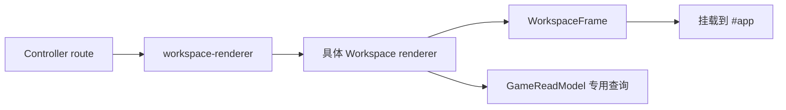

# docs-830/04-presentation/workspace-navigation-and-rendering — Workspace 导航与渲染

本文回答：界面如何选择当前 Workspace、组织其页面内容，并保留返回位置。

栏的独立复用、有序装配、自由列宽与实例更新见 [[workspace-columns-and-layout]]。经典 Game 通过有序数组装配 `area-navigation`、`activity`、`tools` 三个稳定展示组；left/center/right 仅保留为既有外观及 Controller 刷新适配别名。Workspace 动作按语义标识切换组内容或打开 Contacts / Story 路由，不再依赖 `data-tab="left/center/right:..."`。

## 路由拥有页面身份

`WorkspaceRoute` 是判定当前页面的 UI 路由联合类型，包含一般游戏页、服务页、商店、角色、通讯录、剧情、区域、地图准备页、地图 Run 与 Operation Run 等身份。需要区分实例的路由携带 `sessionId`、`variantId`、`areaId`、`mapId` 或 `runId`。`workspaceRouteKey()` 将路由压成稳定身份 key，`sameWorkspaceRoute()` 依 key 判断页面是否相同。

`WorkspaceNavigationState` 保存当前路由和可选的单层 `returnTo`。返回位置包含原路由与三个面板选项、选择角色和对话角色等 UI 位置；它不是无限历史栈，也不保存业务 Run。地图、商店、Operation 等业务过程分别由其 Runtime owner 和查询接口持有。

`workspace-renderer.ts` 按路由分派具体 `render*Workspace()`。复杂页使用 `WorkspaceFrame` 统一左右中列与宿主；Map 路由按 `runId` 查询 `MapRunWorkspaceView`，Operation 路由按 `runId` 查询 `OperationView`，路由只决定显示哪一页。

## 进入、替换与返回

Controller 的 `enterWorkspaceRoute()` 记录当前 UI 位置为返回点；`replaceWorkspaceRoute()` 在同一工作流程中切换子页时保留已有返回点；关闭 Workspace 调用返回逻辑并恢复原 UI 选择。进入或离开 Map、Area Map 等有临时订阅/信息流的页面时，还会创建或释放对应 UI 会话。

区域地图的公开投影、相机和会话释放条件见 [[area-map-projection-and-session]]；浏览与实际旅行是不同操作。

源码入口：`src/ui/workspace/workspace-router.ts`、`workspace-renderer.ts`、`src/ui/controller/controller.ts`、`src/ui/components/shared/workspace-frame.ts`。

相关测试见 `tests/ui/workspace-router.test.ts`、`workspace-lifecycle.test.ts`、`workspace-frame.test.ts`。刷新与位置保持见 [[ui-refresh-focus-scroll]]；查询读写边界见 [[read-model-and-ui]]。

## 如何判断是不是同一页面

`workspaceRouteKey()` 根据路由种类及其实例 ID 生成页面身份。例如两个不同 `runId` 的 Operation 路由是不同页面；同一 Run 的内容更新不应仅因数据变化而变成新路由。进入、替换和返回的区别，以及单层返回位置的实例见 [[workspace-route-lifecycle]]。
