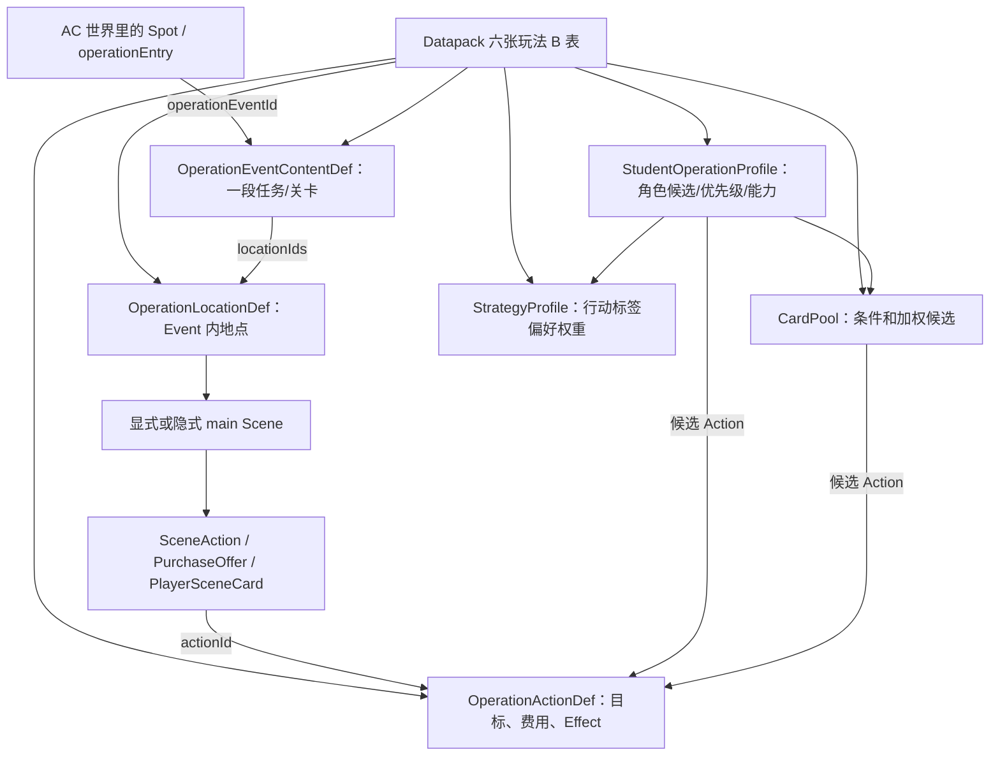
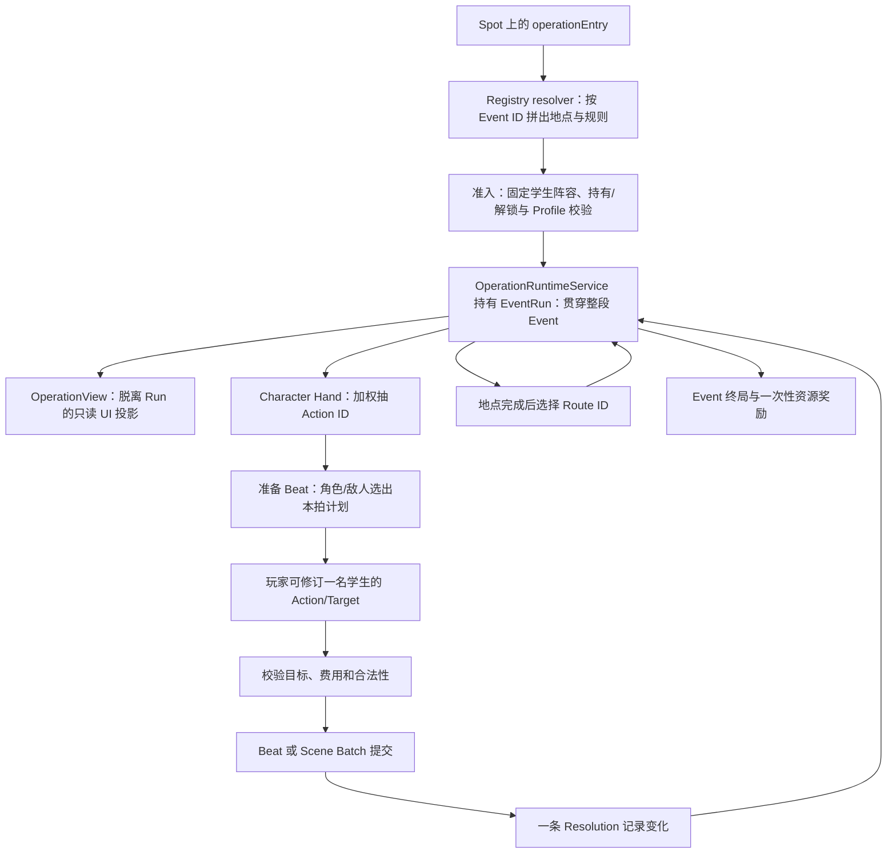
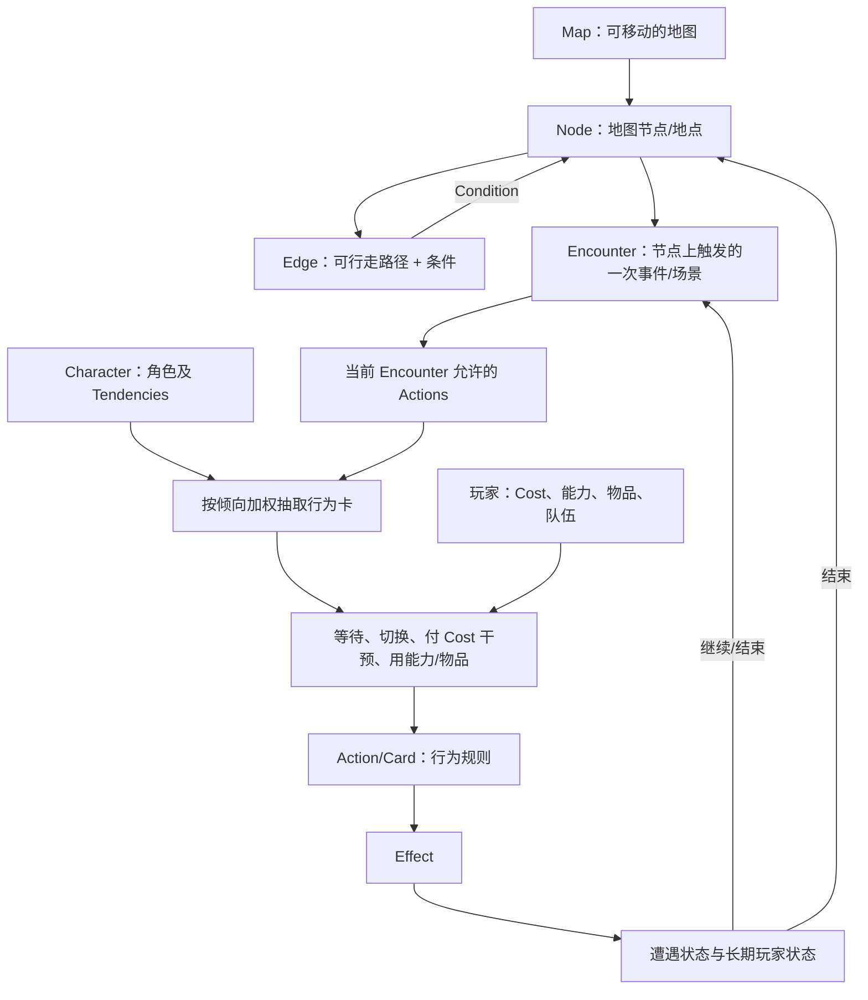

# 调查报告：玩法 B 核心语义缩减与定性

日期：2026-10-16  
对应 Task：[[task-0285-gameplay-b-core-semantics-reduction-investigation]]  
状态：调查完成 — 只读分析；未进行大规模施工。

> 阅读约定：本报告的“当前事实”来自当前源码、样例和测试；“目标基准”来自用户提供的 Task 中的原始玩法定义；“建议”是本调查结论，不是已经批准的改造要求。原始玩法基准按该 Task 提供的体验描述采用，本调查没有把现行 Operation 结构反推为原始设计。

## 结论摘要

玩法 B 的**目标核心**可以简化为：

```text
Map → Node → Encounter → Character tendency → Draw an Action card
                                ↑                         ↓
Player cost / item / ability ← Player observes and intervenes
                                                          ↓
                                                    Effect → State
```

最重要的调查结果如下：

1. **当前 `OperationEvent` 是整段任务/关卡的内容容器，`EventRun` 贯穿其多个 Location。** 它不是“地图节点上发生的一次小遭遇”。当前 Gameplay B 没有通用的地图节点内容表，让每个节点分别挂接一个 Encounter Event；入口由 AC 世界里的 Spot `operationEntry` 启动一个 Event ID。
2. **当前 Location 很接近 Map Node，但当前的移动语义是“地点达成后选择出口”，不是玩家在地图上自由移动。** Strategy Park 显示全图，但其运行时仍通过完成地点后提交 Route ID 推进。它的节点坐标、部分显示文案另外保存在样例专用的地图文件中。
3. **Scene 是作者可写的顺序阶段，Runtime 没有单独的 Scene 状态 Owner。** Scene 完成 ID 和批次计数放在 EventRun 的 LocationProgress 中。只有需要“同一地点先调查、再解除警报”或启用 Scene 自动角色行动等场景时，显式 Scene 才提供额外语义；普通地点可使用隐式 `main`。
4. **`SceneAction` 不是纯 ID 列表，但也没有独立生命周期。** 它是一条位置/场景上的可用行动入口：除 `actionId` 外还规定范围、玩家费用、执行者政策、固定/可选等。它可以在作者模型中改名/收敛为“行动选项”或“Offer”，运行时继续编译为现有结构。
5. **Character Hand、Profile 优先级、CardPool 和 Strategy Profile 分工不同。** Hand 抽取本身是带权、不重复、确定性的 Action ID 集合；它不是实体卡牌。Strategy Profile 影响抽取权重，并非自动 AI 策略；Profile 的 Action 优先级则影响抽到候选后的自动计划顺序。真正有物理实例、手牌、弃牌堆的 Player Scene Deck 是另一套系统。
6. **原始核心循环只实现了一部分。** 角色行为候选抽取、玩家切换/修订一名学生的行动或目标、Effect、成本校验和原子结算已经存在；但玩家干预没有 PlayerCost 成本，PlayerCost 只用于 SceneAction、SceneCard 和购买；没有通用玩家主动技能/物品使用命令；当前实体玩家卡只用于 Scene；没有“地图节点上的一个 Encounter 结束后回到地图”的独立运行层。
7. **复杂度判断：主要问题是作者语义和内容入口过重，不是 Runtime 保护层过多。** EventRun、版本校验、Preview、Commit、Resolution、Save/Resume、稳定 ID 和确定性随机数应留在内部。作者需要面对的 Event/Location/Scene/SceneAction/Profile/CardPool/StrategyProfile 层级应收敛并逐级揭示。

因此，不能简单得出“当前概念太多，所以删掉 Scene/Run/Resolution”。更准确的方向是：**先把 Encounter 与 Map Node 的语义分清；让地图—节点—遭遇—角色行为卡—玩家干预成为作者能直接理解的主模型；再把多地点任务、显式多 Scene、自动计划、组合技和实体场景卡组作为进阶配置，内部复用现有 Runtime。**

## 调查范围与证据方法

- 原始玩法定义使用用户提供的 Task 文本，不以现有代码命名推导设计需求。
- 核对了 `Datapack` 与玩法 B 领域契约、Registry resolver、入场准入、Character Hand 抽取、Beat 规划与干预、场景批次、路线、View 投影、存档和实际样例。
- 检查了 Engine 与 UI 定向测试的用例结构；本轮只读调查，没有运行测试，也没有改变产品代码。
- 调查问题是语义裁定，不评判 Runtime 代码长度或抽象数量本身。

## 1. 当前实现结构图

### 作者内容与当前数据对象



Datapack 顶层有六张玩法 B 表：Event、Location、Action、学生 Profile、Strategy Profile、Card Pool。Scene、Actor、Team、RouteEdge、Objective、Outcome、SceneAction、PurchaseOffer、玩家场景卡组定义等则嵌在所属 Event / Location 中。Event 用 `locationIds` 引用多个地点，并由 `initialLocationId` 指定起始点。

### 一次运行与 UI / Runtime 链路



当前每个 GameInstance 有一个私有 Operation Runtime Owner 管当前 EventRun。`OperationView` 只读投影，不是另一份可写状态。EventRun 含轨道、事实、物品、Actor / Team、PlayerCost、玩家实体卡区、地点进度、路线历史、干预、Resolution、计划版本和随机状态。每次有效命令以 `runId`、`planVersion` 防止过期提交；规划成功后一次性替换 Run 状态。

## 2. 原始玩法 B 最小模型图

下图是以用户 Task 的玩法体验为基准的**语义目标**，不是当前代码结构，也不预设一定要逐个新建同名 TypeScript Interface：



建议把“行为卡”理解为角色当前抽到的 Action 实例/候选，而不强制把它做成可持有、可弃置的通用卡牌对象。玩家自己的卡/技能/物品可保留独立来源，最后调用同一套 Action / Effect 规则，但它们不是角色 Hand。

## 3. 原始玩法 → 当前实现映射

| 原始体验 | 当前落点 | 差异和判断 |
| --- | --- | --- |
| 一张可走动的 Map | Gameplay B 的 Event 内 Location / RouteEdge 图；Strategy Park 另有 13 节点地图呈现 | 数据图与节点接近，但移动被限制在地点完成后的路线选择；没有通用 Map/Node 表或自由移动命令 |
| 地点触发一个事件/遭遇 | Spot 的 `operationEntry` 直接指向一个 `OperationEventContentDef` | Event 定义和 EventRun 覆盖整个任务及多个地点，不是地图节点上的一个 Encounter |
| 当前事件临时状态 | EventRun 的 eventState、actorStates、teamStates、locationProgress、routeHistory 等 | Runtime 正确需要完整状态；作者侧不需要理解所有 Run 字段 |
| 当前角色按倾向抽行为卡 | `StudentOperationProfile`、`OperationCardPool`、`OperationStrategyProfile`、Character Hand Resolver | 加权抽取存在；但抽出的是 Action ID 而非物理角色卡实例 |
| 玩家观察行为并切换/干预 | PreparedBeat 展示自动计划；UI 可展开行动替代项并修订最多一名学生 | 有单槽 Action/Target 修订；不是任意重排整队，也没有战斗干预 PlayerCost |
| 消耗自己的 Cost 要求角色做指定行为 | 当前 Action 的 Actor / Team cost 校验；独立 PlayerCost 仅 Scene 选择和玩家 SceneCard / Purchase | 玩家资源和角色/Team 战术资源不是同一个成本。不存在当前“付 PlayerCost 强制战斗行为”的入口 |
| 玩家主动技能 | Profile 上可引用随机 StudentSkillRule，由成功 Combat Beat 按概率自动触发 | 这是“角色的概率效果”，不是玩家选择并激活技能 |
| 玩家使用道具 | Action Effect 可增删 HeldItem；Route Gate 可检查并消费通行物 | 有任务物品和路线凭证；没有通用主动使用物品命令或 Inventory 牌区 |
| Effect 改变状态 | OperationActionEffectDef 与同一 Resolution 中的费用/状态变化 | 这是核心且值得保留的唯一行动效果来源 |
| 事件结束返回地图 | EventRun 形成 success / partialSuccess / failure 终局；UI 结束/返回沿 Workspace 路由 | 当前终局是整段 Operation Event 的终点，不是结束一个 Encounter 后回到可移动的 Gameplay B Map |
| A/B/C 奖励选择 | 当前 Event success / partialSuccess 可直接发白名单资源；购买项是 Scene-local 单次 offer | 没有通用 Reward Choice / Choice Effect；不得把 PurchaseOffer 当作奖励选择系统 |

## 4. 三种最小内容的实际实现调查

### A. 一个学生对一个敌人的简单战斗

最接近目标的低层结构是 `tests/engine/operation-runtime-service.test.ts` 中的 `unboundedCombatRunStartInput()` 测试夹具：一个 Event、一个活动战斗 Location、一个学生 Actor、一个对手 Actor、一个学生 Action 和一个对手 Action；学生 Action 每拍对敌人造成 1 点伤害。敌人有 3 点 HP，测试逐拍提交三次，确认其倒下后 Location/Event 成功结束。

这个夹具刻意很小：没有显式 Scene、Team、Combination、Strategy Profile、Card Pool、玩家物理卡组或多地点路线。角色 Profile 只有一个候选 Action，因此不能展示真正有选择的行为 Hand；它是 Runtime 结构测试，不是完整发布 Datapack 内容。

按当前正式内容通路，另有 Carousel Combat Safety Slice：一个战斗地点、三名学生、两个对手、一个环境 Actor，八个 Action、角色资格和 Combination / 随机 Student Skill 等。它证明真实战斗可以写入内容包，但已明显超过“一学生、一敌人、两三个行动”的最小例子。

**关键缺口：**两个战斗样例都不能实现“消耗 PlayerCost 来强制指定学生做某个行为”。当前玩家只能对一名学生的当前计划修订 Action 或 Target；Action 自己是否可支付由 Actor / Team 资源判断。`previewIntervention()` 的输入没有 PlayerCost，也不扣 PlayerCost。

### B. 一个角色的简单休息

当前实际休整样例 `rest-scene-demo` 采用：一个 Event、一个 `stage: scene` Location、一个显式“并肩休整” Scene、两名学生、每名学生三个候选行动、Character Hand size 2、自动角色行动、一个 fixed SceneAction、两张实体 Player SceneCard、PlayerCost 2，以及“整备度达到 4”的 track / Scene completion / Event objective。

所以目前“休息”不是一个专门的场景类型，而是 Scene + Character Action + 轨道 + 完成条件 + 可选实体玩家卡组合出来的。若只需要纯玩家选择的休整行动，可以省略显式 Scene，使用 Location 的隐式 `main` Scene；但若要本样例所示的自动角色计划，`autoCharacterActions` 目前定义在显式 `OperationSceneDef` 上，不能只写一个 Location 就得到相同语义。

这证明 Scene 对“一个休息地点”不是必需名词，但在当前内容合同中，某些扩展（例如自动行动）会要求作者显式建立 Scene。对新手层可把“一段事件/当前遭遇”自动编译为隐式 Scene；多阶段地点再暴露 Scene。

### C. A 到 B/C 的简单分支

当前最接近的是 Carousel Route Slice：一个 Event 引用平台、公共通道、维修通道和结尾等多个 Location。平台完成后显示三条路线（带维修证的员工门、公共通道、紧急出口）；后续 Location 再有返回和离开路线。测试验证路线在地点完成前锁定、门票缺失时显示锁定原因、转场消费指定物品且不会重复结算。

创建纯 A→B/C 的当前结构仍需要：一个 Event（初始地点和它能访问的 Location ID 集合），三个 Location 定义，A 的至少一个可判断完成出口，A 指向 B/C 的两条 RouteEdge，以及 B/C 的后续完成或终局出口。这里没有独立 Branch / Task Tree 系统；选择就是 Map 图中的 Edge。但当前 RouteEdge 只在地点完成后出现，Gate 仅支持已声明 HeldItem 的单项或 any-of 门槛；它不是一般意义的“玩家在地图上自由移动并随时进入节点事件”。

### 三样例的对象数与核心结论

| 示例 | 当前最小/实际结构 | 缺少或多出来的内容 |
| --- | --- | --- |
| 简单战斗 | 低层测试夹具：1 Event、1 combat Location、1 学生、1 对手、2 Action、1 学生 Profile | 满足战斗结算骨架；没有真正多候选抽取，也没有付 PlayerCost 干预 |
| 简单休息 | 真实样例：1 Event、1 scene Location、1 显式 Scene、2 学生、每人 3 Actions、固定 SceneAction、2 张玩家实体卡、轨道/目标/自动行动 | 比“几轮休息”需要的对象多；但自动学生行为是原始核心机制相关内容 |
| 简单分支 | 当前 Carousel 路线样例：1 Event、多个 Location、RouteEdge、目标/事实/门票 | Edge 足以表达分支；额外复杂来自地点完成、终局条件、有限访问和通行物消费，而非需要一个 Branch 系统 |

## 5. 角色倾向、Character Hand 与抽取复杂度

### 当前抽取实际做什么

1. 把 Event、当前 Location、学生 Profile 引用的 Card Pool 合并；同一 Action 出现在多个匹配池时权重累加。
2. 池的 selector 可检查 Scene ID、Activity ID、位置、武器、已知 Fact；同一个筛选字段内列表为任选其一，不同字段之间同时成立。
3. 将 Action 是否允许学生、能力是否满足、地点是否启用、Action 自身 CardCondition、合法目标与当前 Actor/Team 费用等检查后，筛掉不可用候选。
4. Action 的 `strategyTagIds` 与角色 StrategyProfile.biases 匹配，修改该 Action 的最终权重。
5. 按权重不放回地抽出 Character Hand；默认大小 3，可配置为 1–10。抽取受 seed、角色 ID、Combat Beat 或 Scene 批次数影响，可确定性重建，不推进战斗 Tactical RNG cursor。
6. 自动规划器将 Hand 与 Profile 的 `actionPriorityIds`、候选顺序结合，挑出一条当前可支付且有合法目标的行动；失败则尝试后续候选，最终可能 Wait。玩家可用单槽干预改写一名学生的行动/目标。

### 语义裁定

- **角色倾向 + 加权 Action draw 是原始玩法的核心语义。** 当前 Strategy Profile 的“对标签加权”可以保留为 Tendency 的一种数据表达，但它不需要成为玩家必须理解的一套“策略 AI”。
- **CardPool 当前没有独立的局内生命周期。** 它不被持有、不消耗、不弃置；只是不同作用范围下组织候选 Action 和权重。核心版可由“当前地点允许的 Action + 角色倾向”直接形成加权候选；复用池、条件筛选和多人共享可作为高级作者工具或编译期内部结构。
- **自动行动优先级是抽卡之后的额外自动规划。** 它不是 StrategyProfile 本身。它能保证无人为干预时每名 Actor 都有 PreparedBeat，也支持 Scene 自动行动；但原始核心的“抽到卡—玩家观察—选择是否干预”不要求完整 AI 自动找最优动作。应把主动控制与无人干预的自动计划分开评估。
- **当前 Character Hand 不是实体卡堆。** `EventRun.characterHands` 保存角色 ID 对应的 Action ID 列表与候选诊断；没有卡实例 ID / 抽牌堆 / 弃牌堆。只有玩家 Scene Deck 保存真实 cardInstanceId 与 drawPile/hand/discard。

## 6. 复杂度来源矩阵

分类使用 Task 要求的五类：Core（玩家/作者必须有的语义）、Internal Infrastructure（运行保障，作者不必当玩法名词）、Merge / Simplify（保留意义但收敛表达）、Advanced / Deferred（已有或有用，但不挡最小闭环）、Remove / Replace（应替换明确重复/误导的表达）。

| 当前概念 | 当前实际职责 | 原始玩法是否直接需要 | 独立生命周期/状态 | 更简单表达 | 调查定性 |
| --- | --- | --- | --- | --- | --- |
| AC World Spot / Operation Entry | 从世界现有地点启动 Event ID | 需要一个入口；不等同 Gameplay B Map | Spot 隶属通用世界运行状态 | Map Node 触发 Encounter，或明确 Spot 与关卡入口关系 | **Merge / Simplify**：入口可复用，但需分清“AC 办公室入口”和“玩法 B 地图节点” |
| `Operation` | 当前系统/API/Workspace 的总称，不是单独 Datapack 表 | 玩法不需要理解这个工程名称 | 无独立 Event 内容表 | 使用 Encounter / Gameplay B Event 等玩家语义名 | **Merge / Simplify**：不能根据名称把它误认为一次遭遇 |
| `OperationEventContentDef` | 一个固定阵容的完整多地点任务定义 | 事件/遭遇需要，但未证明原始遭遇要包整张地图 | 规则定义，无局内生命周期 | 地图图定义 + 节点Encounter引用；或者保留一个高层 Scenario wrapper | **Merge / Simplify**：当前对象兼有任务容器与遭遇内容的责任，优先拆清语义 |
| `EventRun` | 整个 Event 的独立局内状态 Owner | 玩家不必理解 | 有，贯穿各地点和续局 | 内部 EncounterRun；若跨节点长任务则另有 MapRun/Scenario progress | **Internal Infrastructure**：保留状态隔离；需要 Encounter 分离时再拆内部状态所有权 |
| `OperationLocationDef` | Event 的地图地点、战斗/场景阶段、行动、目标、路线、费用 | Map Node 是核心；地点就是Node的强候选 | 每访问一次有运行进度 | `MapNode` + 可选 Encounter 引用/节点状态 | **Merge / Simplify**：作者层 Location 与 Node 应统一；但自由移动规则需单独裁定 |
| `RouteEdge` | 地点完成后提供转场、持有物 Gate、门票消费 | Map Edge 是核心；仅通行物 Gate 是可选 | Route history 在 Run 内记录 | Edge + Condition/Effect | **Core + Merge**：Edge 保留；高级转场规则不需另建任务分支系统 |
| `OperationSceneDef` | 一个 Location 内有序的阶段、完成条件、Scene 行动和可选自动计划 | 一次遭遇未必需要；多阶段同地点才需要 | 无独立 Owner；进度嵌入 `locationProgress` | 简单 Event 自动含一个当前阶段；显式 Scene 仅用于多阶段 | **Advanced / Deferred（作者可见）+ Internal**：保留表达力，但新手不应先创建 |
| implicit `main` Scene | 让没有 `scenes` 的旧 Location 仍可投影成一个主 Scene | 玩家不需要知道 | 不单独持久化 | 作者只看到当前 Event / Encounter | **Internal Infrastructure**：当前良好兼容手段；后续作者模型应隐藏 |
| `SceneAction` | 某 Scene/Location 中展示一个 Action offer，并附 scope、PlayerCost、执行者/固定策略 | 可用行动必须存在；独立包装不一定需要 | 无独立状态；被选择后进入临时批次 | `availableActions[]` / `ActionOffer`，字段只在需要时出现 | **Merge / Simplify**：不是纯 ActionRef，但可以作为 Offer metadata，不必作为新手概念 |
| `OperationActionDef` | Action 的资格、目标、行动费用与 Effect 唯一来源 | **是** | 静态定义，Run 中冻结 | 保留 Action + Effect | **Core**：不要因作者流程收敛而重复/丢失行为规则 |
| `StudentOperationProfileDef` | 把角色身份与候选 Action、优先级、能力、倾向来源等绑定 | 角色特征/倾向是核心；这个表形状未必核心 | 每局快照冻结 | Character Tendency + 当前 Encounter 可用 Action | **Merge / Simplify**：核心语义留在角色/行动关系中，减少多跳绑定 |
| `OperationCardPoolDef` | 按上下文筛选和加权一组 Action；多源合并 | 可直接用可行动作列表实现抽取 | 无，派生候选时消费 | 角色偏好下的加权 Action 列表；复杂池转为进阶快捷复用 | **Merge / Simplify / Advanced**：不是当前核心的一等玩法对象 |
| `OperationStrategyProfileDef` | 对 Action 策略标签施加权重因子 | 倾向是核心，通用策略 Profile 不是 | 无运行时状态 | Character 的 Tendency biases | **Merge / Simplify**：把概念并入角色倾向；多角色复用仍可在内容编译层支持 |
| `characterHands` | 每拍/场景批次的 Action ID hand 快照 | **行为抽取是核心** | Run 内重建/保留的派生快照，不是独立卡堆 | Drawn Action cards with actorId, optionally internal action IDs | **Core semantics + Internal form**：作者/玩家看到抽到的行为卡，内部可继续存 ID |
| Profile `actionPriorityIds` /自动 PreparedBeat | 无玩家干预时按优先级挑行动并安排所有 Actor | 不是原始唯一机制 | Beat 计划按版本重建 | 玩家选择当前抽到的行为；自动行动作为可选助手 | **Advanced / Deferred**：与“倾向抽卡”分开，不要默认为玩法核心 |
| `OperationPlayerSceneDeckDef` | 真正的实体玩家场景卡组，按 copies 生成实例，消耗后进弃牌堆 | 玩家确有自有卡的可能；实体牌组不是角色 Hand 必需条件 | 有 drawPile/hand/discard | Player ability / item / one-shot Action source；仅当牌组有构筑玩法再保留 | **Advanced / Deferred**：Scene-only 卡组不应定义核心角色行为循环 |
| `OperationObjectiveDef` | 展示目标说明和 primary/secondary 进度 | 玩家目标需要；该包装语义有用 | 进度由 Run 状态推导 | Condition + goal text/importance | **Merge / Simplify**：保留目标 UX；底层共享同一 Condition 语法 |
| `OperationOutcomeConditionDef` / Result | Location/Event 成功、部分成功、失败与终局 | 结束状态是核心；现有包装有不同层级 | Location result / Event result 写入 Run | EndCondition + ResultKind + 可选 Effect | **Merge / Simplify**：共享 Condition 表达式，但不能混掉 Scene完成/Location结果/Event终局的语义 |
| Track / Fact / Held Item | 承载行动影响的局内事实与资源 | 条件/状态是核心 | 存在 EventRun 内 | 保留明确、少量状态类型 | **Core**：分别服务数值、已知事实、持有物/门禁，第一版限制数量 |
| Route Gate | Route 可用条件；当前基于 HeldItem 单项/any-of | 条件路径是核心，可选 | 不是独立实体 | Edge.condition | **Merge / Simplify**：语义并入 Edge Condition；现行 held-item 规则是子集 |
| `OperationScenePurchaseOfferDef` | 有一次性 Fact 防重复、价格和既有 Action 效果的购买项 | 购物/交换是可选场景；“offer”类型不必是基础概念 | 购买 Fact 在本 Run 内持续 | Action/Choice + Cost + Effect + once-only Condition | **Merge / Simplify / Advanced**：保持一次性交易语义，暂不做通用商店框架 |
| Event Reward | 终局成功/部分成功后一次性发受限资源 | 事件结果奖励常见；当前通用选择奖励不是 | `rewardClaimed` 状态存 Run | End → Reward Effect；A/B/C 需显式 Choice 才支持 | **Core basic + Advanced choices**：当前有基础资源奖励，没有任意 Effect 或选项奖励 |
| Team / Team resource | 共享 Actor 战术资源与效果目标 | 多角色协作是潜在核心；共享池是额外复杂度 | Team resource 在 Run 内 | 固定队伍容器；只有 Action 需要时才打开团队资源 | **Advanced / Deferred**：普通战斗可先用 Actor 资源，显式 Team 资源按需求添加 |
| Combination | 两名学生 Action tag 配对，替换效果 | 原始最小循环不直接需要 | 作为 Location 规则，不单独状态 | 普通 Action / Effect | **Advanced / Deferred** |
| StudentSkillRule | Action 触发的概率角色效果 | 玩家手动使用技能未由它表达 | 规则静态，roll 进入 Resolution | 玩家 Ability Action 或暂缓概率被动 | **Advanced / Deferred**；不可把它称作现有玩家主动技能 |
| Party roster admission | 固定参与者/Profile 入场；校验角色已持有且已解锁 | 当前持有角色参与是核心 | 入场时创建身份快照；本 Run 不变 | Map/Encounter roster selection | **Core boundary + Simplify**：资格规则保留，固定阵容编辑/换队目前没有 |
| Party add/remove/swap | 运行中加入、离队、换角色 | 高级行为 | 当前 Action Effect 没有此类 Effect | 先不支持，未来明确语义后再扩展 | **Advanced / Deferred**：当前没有被行动表达，不要假装已有 |
| `OperationPredicateDef` | Track / Fact 的有限比较与 all/any | **Condition 是核心** | 静态谓词；结果由 Run 状态评估 | 共享 Condition DSL | **Core + Merge**：可统一语法，不宜立即扩成任意脚本 |
| OperationView | UI 安全的 detached 展示模型 | UI 需要信息；作者不需了解投影实现 | 每次从 Run 和规则派生，无写入 | 内部 ReadModel | **Internal Infrastructure** |
| PreparedBeat / InterventionDraft | 规范计划和单槽可撤销的学生干预 | 玩家计划修订是核心体验的一部分 | 按 Run 版本暂存 | Internal Plan + 玩家只见“当前行动/改动” | **Core intent + Internal representation**；现行只允许单一学生槽是当前限制 |
| Preview / Plan / Commit / Resolution | 校验并原子处理行动批次 | 玩家不需要理解这些词 | 规划纯计算；Commit 原子换 Run；Resolution 留历史 | Internal transaction pipeline | **Internal Infrastructure**：保留，不因玩法想简化而拆掉原子边界 |
| `runId` / `planVersion` / stable IDs | 识别运行与规则版本，阻止 stale 命令 | 不属于玩家玩法 | 每次运行/修改都有 | Internal IDs/versioning | **Internal Infrastructure** |
| Tactical RNG + Save/Resume | 确定性战斗技能抽样和 Run checkpoint | 玩家需要可复现/可续局，但不需理解算法 | 明确存档与恢复生命周期 | 内部 seed/cursor/checkpoint | **Internal Infrastructure**：保留当前正确性保证 |
| Strategy Park 样例专用 MAP presentation | 存 13 个节点位置、分区、显示文案和部分当前场景副本 | 地图可视化需要布局；样例专用重复文案非核心 | 与样例内容并行静态维护 | 一份作者内容来源 + 通用地图布局字段/编辑层 | **Remove / Replace（定向）**：替换双份演示文案来源，保留布局能力；先迁移再删除副本 |

## 7. 关键问题逐条回答

### Event / Operation

- 当前不存在一个单独的 `Operation` Datapack 表。Operation 是命名空间/系统。内容表是 `OperationEventContentDef`；Runtime Owner 持有一个 EventRun。
- **当前 Event 实际是完整任务容器。** 它含全部 Location ID、起始地点、参与者和整个 Run 的目标/结局；Run 转 Route 后仍然是同一个 EventRun。
- 原始玩法中“一个地图节点上的一次事件”不需要天然包含整张多地点地图。当前模型若要支持它，需要把 **Map/Node** 与 **Encounter Event** 从语义上分开，或明确增加一个任务/Scenario 层包住多个 Encounter。
- “Operation 能力过多”不能单凭 Event 有多个地点判定。现有内容确实支持一个 Event 跨地点路线；问题是它把节点、场景和整个任务都放在同一 Run 边界，和原始模型的 Map → Node → Encounter 顺序不同。

### Location / Scene / SceneAction

- **Location 与 Node：可以作为作者侧同一个概念。** 当前 Location ID 用作地图节点身份，RouteEdge 是边，Location progress 对应访问/完成进度。若要自由移动，需改变路线开放/完成语义；简单改名不能做到。
- **Scene 不是所有简单事件都需要理解的一等概念。** implicit `main` 已证明单场景可以由 Runtime 默认承接。显式多 Scene 才是同地点有顺序门槛、阶段完成、Scene 专属 Action 或自动角色行动时需要的额外表达能力。可作为内部默认/进阶 author mode。
- **SceneAction 是“可用行动入口”的包装。** 它没有单独的 SceneAction Run 状态，但其 scope、playerCost、performerPolicy、selectionPolicy 和 wrapper copy 是实际玩家语义；不适合直接删成裸 Action ID。建议把它降级/改名为 ActionOffer（可用行动），只在有差异时显示高级字段。

### Character / Tendency / CardPool / Strategy

- Character Hand 是随机抽出的一组当前 Action ID，抽取确实受条件候选和倾向影响，满足“角色倾向 → 抽取行为卡”的核心方向。
- 当前倾向的两层应分开评估：StrategyProfile 调整权重，是抽卡倾向；Profile `actionPriorityIds` 是抽卡后的自动选择顺序。后者属于自动计划策略，不应包装成同一个“角色倾向”概念。
- CardPool 可被多个作用范围复用，但本身没有持有、消耗、修改、构筑、继承等 Run 生命周期。当前有 legacy fallback：没有匹配池条目时，Profile candidate IDs 作为等权池。简单版本可让作者直接写带权 Action 列表，池对象作为复用快捷项。
- StrategyProfile 的**偏好语义应保留**，其独立顶层表不一定需要进入第一层作者 UI；合并到角色 Tendencies 是一个可验证的收敛方向。

### Player Deck / Character Hand

- Character Hand 是每拍派生的 Action ID 候选列表；没有实体卡身份，不进玩家手牌区，不进入 discard。
- Player Scene Deck 是物理卡组；有副本数、实例 ID、初始/地点进入抽取、手牌上限、discard；打出后不回洗。它目前只允许 `timing: 'scene'`。
- 两者生命周期明显不同，因此不应强制变成同一个运行状态。可共享 `ActionDef`，但把 Character 行为卡与玩家资源牌分开命名和显示。
- 核心闭环先证明 Character Hand + 玩家干预即可。玩家 Deck 构筑、Scene-only实体卡和 Purchase 作为高级来源，不应阻塞基础玩法。

### Objective / Outcome / Track / Fact / Gate

- Objective 与 Outcome 共用 Track/Fact 的谓词语法，但不是完全重复包装：Objective 有玩家可见描述和 primary/secondary 进度；Outcome 条件参与 Location/Event 的 success/partialSuccess/failure 归类；Scene completion 又是一个可选阶段门槛。
- **底层 Condition 可以统一，顶层结果用途不能混掉。** 比较式、Fact 检查、all/any 可以共用一个窄 Condition。Objective/EndCondition 由使用位置、描述和结果类型区分。不要把 secondary objective 错当成地点完成条件，也不要把 Scene completion 当作 Event end。
- Route Gate 当前只检查 held-item；Action target、CardCondition 和 Objective predicate 各有不同过滤语义。不能声称已经有一个能表达 Action / End / Edge 的通用 Condition DSL。建议先统一可比较的表达式语法，再决定是否允许各位置使用同一个 Condition 子集。

### Purchase / Reward / Party / Branch

- **Purchase：** 当前是一种 Scene 一次性 offer，指定价格、一次性事实标记和已有 actorless Action 效果；不是通用经济系统。基础购买可以作为 Cost + Action/Effect + once 条件，暂不需独立 Shop 系统。
- **Reward：** 当前 Event 终局成功/部分成功只能发受限 AC 资源；没有 A/B/C 选择、Effect 奖池或奖励定义的通用引用。可用 End + RewardEffect + Choice 表达未来选择，但现状不能称为已支持。
- **Party：** 固定 roster 来自 Event participants/Profile；准入会校验持有和解锁。Action Effect 没有新增/移除/替换参与者的 membership 变更，因此运行中 Party Change 目前不支持。
- **Branch：** RouteEdge 图已经能表示分支、回环、持有物 Gate 和消费凭证，不需要再造 Branch Task 系统。当前它实现的是“地点完成后选一条出路”，而不是自由在地图节点间移动。
- **高级行为：** 加/离队、换人、使用一次性物品、使用玩家主动技能只有在明确状态和 UI 语义之后才扩展；已有 Effect 或学生技能规则不能推断这些机制已经存在。

## 8. 五类目标模型结论

### A. Core

目标玩法需要由玩家/作者理解的语义：

- Map、Node、Edge 和 Edge Condition；
- Node 上的 Encounter，以及 Encounter 的参与角色和临时 State；
- Character Tendencies、当前可用行为与按倾向抽取行为卡；
- 玩家等待、切换/替换、付自己的 Cost 干预，并按范围使用能力或物品；
- Action/Card、统一 Effect、必要的 Condition、资源 Cost；
- Encounter 继续/结束及回到 Map 的结果。

其中“玩家主动能力/物品”和“Combat PlayerCost 干预”是目标核心里**当前缺少的机制**，不是当前可删的旧结构。

### B. Internal Infrastructure

应保留在 Runtime，但不暴露为新手的玩法对象：

- `EventRun`（后续若拆 Encounter/MapRun，可调整内部 Owner，但保留状态隔离）；
- OperationView / detached read model；
- PreparedBeat、Scene Plan、preview、validation、commit、Resolution；
- `runId`、`planVersion`、稳定 ID、Registry / admission、引用闭合校验；
- 原子状态替换、固定费用与目标重新校验、失败不留半状态；
- 确定性随机和 Save/Resume / resumeVersion。

这些结构不是语义过度复杂的证据。可改名和封装，不能只因玩家不该看见就删除。

### C. Merge / Simplify

- `OperationEventContentDef` 的“整段任务”和“单次 Encounter”责任拆清楚；目标方向是 Map Node 可关联一次遭遇，复杂 Scenario 可在更高层组织多个节点/遭遇。
- `OperationLocationDef` 作者语义统一为 Map Node / Location；内部可继续用现有 Location 以兼容。
- Profile 候选/倾向、StrategyProfile bias 与 Action 条目可向“Character Tendencies + 当前场景允许 Action”收敛；CardPool 只作为重复内容引用的高级快捷功能。
- Scene 降为单阶段默认值和多阶段高级能力；SceneAction 收敛为 ActionOffer/可用行动，保留必要的费用、执行者和目标元数据。
- Objective / Outcome / Scene completion / Edge Gate 共用一套受限 Condition 表达语法，但保留其各自的显示/结果角色。
- PurchaseOffer 可先表示为 Cost + Effect + 一次性条件；不引入比玩家体验更大的经济子系统。

### D. Advanced / Deferred

核心闭环完成前，不把下列功能列入新手第一屏或基础内容必填项：

- 多层 Scene、Scene 自动学生行动与可无限批次；
- 自动 Actor planner / Profile Action 优先级 AI；
- 复杂 CardPool 继承、上下文 selector 和多池权重合并；
- 多层 StrategyProfile 复用、Combination；
- 共享 Team 资源池、任意协同；
- 玩家物理 Scene Deck 构筑、复制卡和跨地点抽取；
- M-of-N 场景选项、临时 PurchaseOffer、一次性购买历史；
- 概率学生技能、复杂奖励选择、队伍中途变更。

“Deferred”表示不阻挡最小玩法，不等于必须从当前运行时删除。只有验证玩家侧价值很低、且替换路径安全后，才裁定 Remove。

### E. Remove / Replace

- **没有证据支持删除 Preview、Commit、Resolution、EventRun 或 Save/Resume。** 它们解决状态一致、有效性和续局问题，应保留为内部基础。
- **已确认需要替换的表达重复：** Strategy Park 的作者展示文案/节点坐标等保存在样例专用 `gameplay-b-strategy-park-map.ts`；Action 文案本身又在 OperationAction 数据中；SceneAction 显示文案也可能各处复制。建议在后续作者模型里确定单一文案来源，把节点坐标等放在通用的可选地图布局数据中，不让业务代码按某个 13 节点样例识别内容。迁移完才移除重复副本。
- **不建议当前直接删除：** explicit Scene、CardPool、Player Scene Deck、PurchaseOffer 等功能都已有样例与定向测试。先把其作者侧降级/隐藏并验证最小循环，再决定数据迁移或移除。

## 9. 后续施工边界建议

以下是调查建议的阶段边界，不是已授权实施的 Task。

### P0：先冻结新的最小语义模型

1. 明确 **Map Node 与 Encounter Event 的分界**：地图自由移动、地点入口、遭遇生命周期、回图时机、一次任务跨多个节点是否保留为独立高层容器。
2. 明确一拍原始行为合同：何时抽卡，玩家能等待/切换/指定谁，付哪种 PlayerCost，干预失败/撤销如何处理，角色自身 Actor/Team cost 如何显示。
3. 明确玩家 Skill、道具/持有物使用的第一阶段最小操作形式；不要借用概率 StudentSkillRule 代称主动技能。
4. 以“一个学生、一个敌人、两个可抽 Action、一次付费干预、击败后回 Map”作为可观察验收故事。
5. 用休息和 A→B/C 路线各验证目标模型不要求另一套 Scene / Branch 引擎。

### P1：不破坏 Runtime 的作者侧收敛

1. 提供最小 Encounter/Node 作者路径，默认一个当前阶段、固定参战者、可用 Actions、Tendency 和一个结果条件。
2. 让单阶段 Scene、Profile/Pool/Strategy 的默认值由作者工作流隐藏或生成；高级编辑时再打开。
3. 用 ActionOffer 表达场景选项，保留现有 ActionDef 为行为权威来源。
4. 将 Objective/Outcome/Route 条件底层表达统一为窄 Condition DSL，并保留描述、目标类型和终局结果的使用差异。
5. 合并 Strategy Park 样例的重复 UI 文案来源；可选地图坐标成为可复用 Presentation 配置，而不是按 sample ID 写 UI 分支。
6. 将简单 Rest、一次购物、基础奖励选择各做一个最小示例，用它们验证作者一步步增加复杂度是否成立。

### P2：保留为进阶能力或内部实现

- 多 Scene、有序阶段、不同阶段不同 Action 与完成条件；
- CardPool 复用、场景 selector、角色偏好权重；
- 自动 Action Planner、Combination、Shared Team Cost；
- Player Scene Deck、PurchaseOffer、多目标/多选批次；
- Preview / Commit / Resolution、Save/Resume、RNG、版本校验等正确性机制。

### Deferred：等核心循环验证后再决定

- 通用角色招募/离队/换人和队伍构筑；
- 玩家全局主动 Skill / 道具系统与其他 AC 系统如何复用；
- 任意 Reward Pool、Choice + Effect、多商品商店经济；
- 可脚本化的通用地图、复杂任务树/分支编排和无上限开放探索；
- 把所有 Card / Item / Skill / Action 统一成单一通用对象。

## 10. 验收问题逐项答复

| 验收问题 | 调查结论 |
| --- | --- |
| 当前玩法 B 实际由哪些核心对象组成？ | 六类顶层定义表加上 Event 内 Actor/Team/Track/Fact/Item/Objective，Location 内 Scene/Action Offer/Route/Outcome，以及 Runtime EventRun、Hand、PreparedBeat、Resolution、OperationView。 |
| 当前 Operation 到底是 Event 还是整个任务容器？ | Operation 不是单独数据对象；`OperationEventContentDef` 加 Locations 定义整个多地点任务，EventRun 跨全任务。 |
| Location 可以与 Map Node 合并吗？ | 作者语义可合并；当前 route completion 语义与自由移动不同，须一起裁定。 |
| Scene 必要吗？ | 单阶段不需要理解；多阶段地点需要阶段语义。Runtime 目前无 Scene Owner，Scene进度嵌入 LocationProgress。 |
| SceneAction 只是 Action 包装吗？ | 是场景入口包装但附加真实使用政策/费用/范围，没有独立生命周期；可收敛为 ActionOffer。 |
| Character 行为可以 Tendency + Action Draw 表达吗？ | 可以表达目标核心。当前手牌已实现加权抽取；Profile优先级/Planner是抽取后的高级自动决策。 |
| StrategyProfile 是核心吗？ | 行为倾向权重是核心；StrategyProfile 独立对象不是。它只改抽取权重，不是 AIPlanner。 |
| CardPool 必须独立存在吗？ | 基础闭环不需要；它是条件加权候选的复用/组织对象，没有独立 Run 生命周期。 |
| Character Card 和 Player Card 差异？ | 前者是 Run 内按拍派生的 Action ID hand；后者是有实体 ID 的 Scene-only 牌组，抽/弃牌并消耗 PlayerCost。 |
| Objective / Outcome 可收敛为 Condition + Effect 吗？ | 表达语法可共享；Objective 进度、Scene 完成、Location结果、Event结局不可合并成一个无角色条件。 |
| Purchase / Reward / Party / Branch 真要各自系统吗？ | 基础 Purchase 可是 Cost+Effect+once condition；基础 Reward 是 End+Reward；Party Change 当前未支持；Branch 已由 Edge 表示，不需 Branch系统。 |
| 哪些复杂度是 Runtime 基础设施？ | EventRun/View/Preview/Plan/Commit/Resolution、ID/version、原子替换、Save/Resume、RNG、Admission/validation。保留在内部。 |
| 哪些当前复杂度过早暴露给作者？ | 多 Scene、SceneAction字段、Profile/Pools/Strategy分层、自动规划优先级、Team/Combination、Scene实体卡、M-of-N和Purchase组合。应逐级开放。 |
| “一个地点 + 一个事件 + 一个角色 + 一张地图”能完整跑通吗？ | 当前可跑一个单地点、单学生/单敌人的 Combat Runtime fixture；但不满足完整目标，因为无地图自由移动层、无付 PlayerCost Combat 干预、无主动玩家技能/道具操作。 |
| 缺的不可替代核心语义是什么？ | 不是更多 Runtime class，而是把 Map Node / Encounter 分开、明确角色抽卡之后的玩家选择流程，并补齐付费干预及玩家能力/物品操作合同。 |
| 后续应缩减什么？ | 作者必须认识的层级数、跨表绑定、Scene默认暴露、重复 Presentation 文案、把自动 AI/物理玩家卡组当角色 Hand 同一机制的误解。 |

## 最终目标一句话

> 玩法 B 的复杂性应来自角色、行为卡、倾向、玩家干预和 Effect 的组合；Map Node 与 Encounter 的边界必须清楚，Runtime 的 Preview/Commit 等正确性基础留在内部，作者不必先学习一整套任务编排体系才能做出一个简单、好玩、能回到地图的遭遇。

## 事实证据与代码落点

| 事实 | 当前证据 |
| --- | --- |
| 六类 Datapack 表及主要定义字段 | `src/data-services/contracts/datapack.ts`、`src/data-services/contracts/operation.ts`；[[docs/docs-829/03-data-structures/datapack-contracts]] |
| Operation Event 关联 Locations；Entry 直接从 operationEventId 启动 | `src/data-services/contracts/operation.ts`、`src/arona-clicker/content/def-factory/spot.ts`、`src/arona-clicker/services/operation-entry-service.ts`、`src/arona-clicker/services/registry-operation-content-resolver.ts` |
| 一个 EventRun 跨地点、由私有 Runtime Owner 持有；每次状态替换/路径转场 | `src/arona-clicker/runtime-game-instance.ts`、`src/arona-clicker/services/operation-runtime-service.ts`、[[docs/docs-829/04-mechanisms/arona-clicker/operation-runtime]] |
| Character Hand 加权候选、Strategy weight、no-replacement抽取、Profile priority planner | `src/arona-clicker/services/operation-card-candidate-resolver.ts`、`src/arona-clicker/services/operation-plan-preparation.ts`、`tests/engine/operation-card-candidate-resolver.test.ts`、`tests/engine/operation-plan-preparation.test.ts` |
| 玩家单槽干预不接受 PlayerCost；Combat 和 Scene 使用不同命令 | `src/arona-clicker/contracts/operation-beat.ts`、`src/arona-clicker/services/operation-intervention-preview.ts`、`src/arona-clicker/services/operation-entry-service.ts`、`src/arona-clicker/services/operation-runtime-service.ts` |
| Scene completion / Location completion / Route transition 分开 | `src/data-services/contracts/operation.ts`、`src/arona-clicker/services/operation-runtime-service.ts`、`tests/engine/operation-scene-actions.test.ts`、`tests/engine/gameplay-b-multiscene-location.test.ts` |
| 玩家牌组有真实 physical instances，玩家卡仅 timing scene；无回洗 | `src/arona-clicker/services/operation-player-scene-deck.ts`、`src/data-services/contracts/operation.ts`、`tests/engine/operation-player-scene-deck.test.ts` |
| Event奖励有限；PurchaseOffer是一次性Scene offer；通行物门禁 | `src/data-services/contracts/operation.ts`、`src/arona-clicker/services/operation-route-evaluator.ts`、`tests/engine/gameplay-b-route-sample.test.ts`、`tests/engine/gameplay-b-scene-offer-purchase.test.ts` |
| 最小战斗夹具 | `tests/engine/operation-runtime-service.test.ts` 的 `unboundedCombatRunStartInput()` 与 `continues an uncapped combat across explicit Beats...` |
| 真实休整样例 | `src/arona-clicker/content/operation-samples/rest-scene-demo.ts`、`tests/ui/gameplay-b-rest-scene-ui.test.ts` |
| 真实分支与策略园地图 | `src/arona-clicker/content/operation-samples/carousel-route-slice.ts`、`src/arona-clicker/content/operation-samples/gameplay-b-strategy-park.ts`、`src/arona-clicker/content/operation-samples/gameplay-b-strategy-park-map.ts`、`tests/engine/gameplay-b-strategy-park-sample.test.ts`、`tests/ui/gameplay-b-strategy-park-map.test.ts` |
| Strategy Park 展示表是样例专用，与Operation内容并行 | `src/arona-clicker/content/operation-samples/gameplay-b-strategy-park-map.ts`、`src/ui/components/operation-workspace.ts` |

## 调查限制与后续确认

- 本轮把用户提供的玩法基准作为目标语义。若负责人希望追溯更早的设计记录，可单独核对历史 Draft；不会改变当前代码事实。
- 本轮只读检查了测试结构，没有运行测试；调查报告不含行为修改，因此定向测试通过/失败不是本次结论依据。
- 是否将当前全任务 Event 拆为 Encounter + MapRun 是影响范围最大的设计选择，需要负责人确认目标体验和对现有 Strategy Park / Carousel 续局兼容的接受度后，再建立实现 Task。

## 相关文档

- [[task-0285-gameplay-b-core-semantics-reduction-investigation]]
- [[draft-0284-gameplay-b-current-system-and-improvement-discussion]]
- [[docs/docs-829/04-mechanisms/arona-clicker/operation-runtime]]
- [[docs/docs-829/03-data-structures/datapack-contracts]]
- [[docs/docs-829/03-data-structures/operation-view]]
