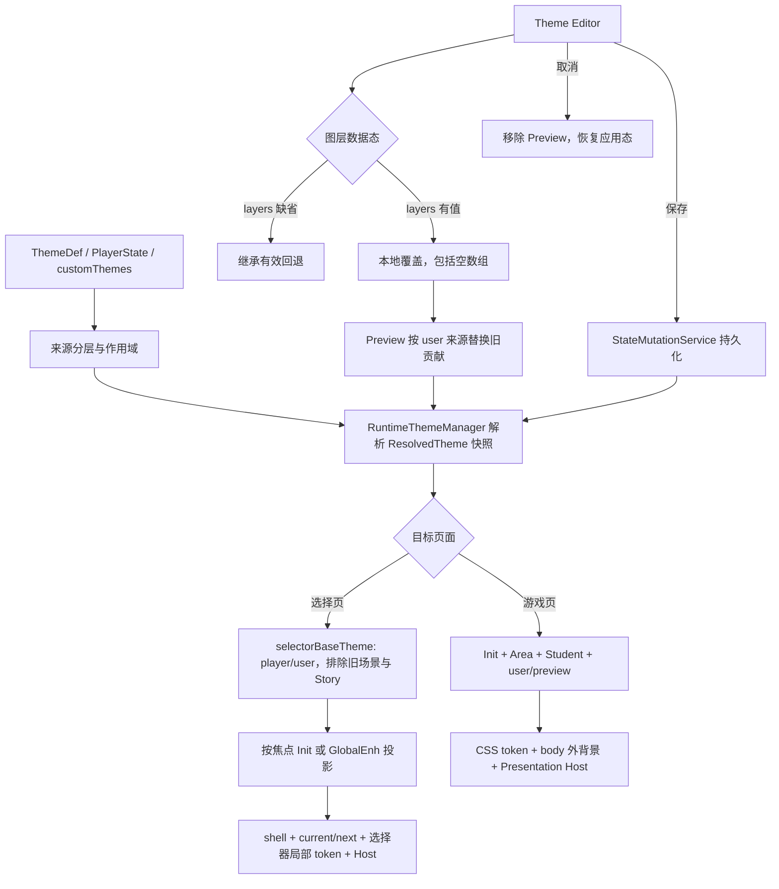

# Task：主题背景图层的数据归属、世界线切换与渲染管线收敛

状态：done — 2026-09-30；用户确认任务完成并要求归档；浏览器视觉核验未执行，作为归档限制保留

## 目标

梳理并收敛 Theme UI 从自选主题数据与图层继承、运行时解析、Init/Area 生命周期切换、选择页局部投影到 DOM/CSS/宿主渲染的完整管线。修复离开一个 Init 后，其场景专属图层被另一个选择页焦点或世界线继承的问题；为主题编辑明确表达“继承回退”与“本地覆盖（包括空图层，仅保留系统颜色层）”；同时保留按设计应跨世界线生效的全局用户主题、系统颜色层和 UI 宿主配置。

完成后应能从单一契约回答：每层由谁持有、属于哪个范围、当前是继承还是本地覆盖、何时解析/合并、进入与离开场景时如何处理、投影到哪个背景宿主，以及颜色 token 与背景图层分别何时更新。

## 设计边界

- 本 Task 包含：图层来源与持久范围盘点；继承/本地覆盖/空覆盖语义；运行时合并、预览替换与图层身份规则；New / Resume / Restart / Hard Restart 与 Init 选择、GlobalEnh 选择、返回游戏之间的主题生命周期；选择页焦点主题投影；全局外背景、选择页 current/next 场景槽、UI Host/面板背景及 CSS 变量的落点与同步顺序；相关回归验证和稳定机制文档更新。
- 必须保留当前声明为全局的 `activeTheme`、已应用自定义主题、`system-color-background`、用户图层顺序和合法 UI Host 层；不能以清空所有 ThemeRuntime 层或背景 DOM 的方式掩盖来源/作用域错误。
- 不重做主题编辑器整体信息架构、不调整颜色设计或默认主题、不扩展 Datapack Schema、不改无关 UI 刷新架构。只实现编辑器表达和保存既有继承/覆盖状态所需的最小交互与运行时语义；只有核验确认必要时才改公共运行时类型或 CSS。
- 当前实现与既有文档事实以源码、测试和 `docs/docs-828/` 为准；已将 Task 0158 的全部用户观察、核验结果、验收矩阵及未完成项移入本 Task，不再等待或依赖 Task 0158。

## 承接 Task 0158 的用户观察与验收范围

- 手工验收已确认：主题预览点“取消”后颜色恢复；点“保存并应用”后弹窗关闭，实际渲染与预览一致。
- 手工验收已确认：离开 Schale_Office 到 Init 选择页时保留此前特色背景；选择并进入 Init 后旧场景背景消失。
- 后续观察补充：离开其它 Init 也会把离开前的全部色彩要素带到选择页；疑点是进入 Init 选择页时的主题重建/投影不完整，而非只针对 Schale_Office。
- 最新观察补充：从 Init 内使用“结束游戏并重新选择世界线”撤离时，选择页初始聚焦的 Init 自身主题被该 Init 当前 Area 的主题成分覆盖。撤离页应展示 Init 主题快照，不应把留在运行快照里的当前 Area 当成 Init 的主题；游戏中途打开选择面时保留显式允许的当前 Area 预览。
- 浏览器已复现：Schale_Office 的 `Hoshino.png` 与两层 `background-triangles.svg` 留在 Init 选择页 current scene DOM，聚焦“主题系统展示”后其渐变叠加在旧背景上；选择页局部主色改变而 document root 仍有 Schale 值。
- 已定位选择页链：离开按钮先设 `started=false`、`pendingRestart=true` 并直接渲染选择页；`renderSelectorPage()` 从当前 Runtime 构建上下文而不重建场景主题；`projectSelectorTheme()` 把非空 `ctx.background` 当全局底层，再与当前焦点 Init / Area 背景合并。进入目标 Init 才执行重启/恢复并同步场景，故“进入后正常”不能证明选择页投影正确。
- 已定位主题图层编辑链：管理器对继承层首次修改时物化当前有效层；删除最后一层会自动清除本地覆盖，重新进入继承态，因而默认层/设计重现。当前 runtime preview 只追加或按 ID 替换，不移除已应用用户主题的其它层，空覆盖不能即时预览成只有 `system-color-background`。
- Task 0158 中未完成的完整往返矩阵（普通游戏/选择页/Workspace；多层与无额外层主题；Preview 保存和取消；Init / GlobalEnh 轮换、返回游戏、Host/CSS/外背景）全部并入下方实施和验收范围。

## 当前事实与代码落点

| 已核实事实 | 源码/测试依据 | 对本 Task 的影响 |
| --- | --- | --- |
| 玩家全局主题、已保存自定义主题与实体 Init/Area 主题槽分别由 PlayerState、Registry 定义和 ColorSystem 解析；用户主题的全局背景层会进入独立 `user` 主题层。 | `src/arona-clicker/types/state.ts`、`src/arona-clicker/services/color-system.ts`、`src/arona-clicker/services/user-theme-layer-service.ts` | 先明确持久事实、运行时派生和场景临时层的边界，不能把它们统称为“当前背景”。 |
| ThemeRuntime 将 `player/init/area/student` 按用户层级顺序合并，另叠加 user、preview 和最高优先级 ephemeral；背景有稳定 ID 时后层替换同 ID，匿名层追加。 | `src/engine/core/theme-runtime.ts`、`src/arona-clicker/services/color-system.ts` | 颜色层级和背景图层堆栈要分别描述；离开作用域必须移除旧来源，单纯换 token 不会自动删除 ID 不同的图层。 |
| 普通 Controller render 在生成上下文前执行 `syncRuntimeTheme()`；Init 选择页由独立入口重建 DOM，另行同步 body 外背景与选择页局部投影。 | `src/ui/controller.ts`、`src/ui/controller-theme.ts`、`src/ui/controller-panels.ts` | 需把普通游戏页、选择页、服务 Workspace、主题 Preview 的刷新入口放入同一生命周期矩阵。 |
| “结束当前游戏并重新选择世界线”按钮只设置 `started/pendingRestart` 后直接渲染选择页；实际 `restartInit()` 在选择目标 Init 时才执行。选择页使用非空 `ctx.background` 作 base，再合并焦点主题背景。 | `src/ui/controller-actions-inventory.ts`、`src/ui/controller-panels.ts`、`src/ui/selector-theme.ts`、`src/arona-clicker/services/init-service.ts` | 现有设计会让旧活动场景继续成为选择页输入；应按图层所有者投影全局/焦点来源，并确认切换事务与运行时清理的先后关系。 |
| 浏览器复现中，Schale_Office 的 `Hoshino.png` 和两层三角背景在 Init 选择页切到“主题系统展示”焦点后仍留在 current scene DOM；展示 Init 的渐变层叠加其上。焦点局部主色已改变而 document root 的主题色仍是 Schale 值。 | 2026-09-27 本地浏览器 DOM/画面；`tests/ui/selector-theme.test.ts` 仅覆盖独立投影与 ID 合并，未覆盖该完整生命周期 | 回归验收必须检查每个图层的身份/来源以及作用域颜色值，不能只看最终渐变或一次截图。 |

## 目标管线

| 转场 / 操作 | 输入来源 | 预期可见结果与保留边界 |
| --- | --- | --- |
| 游戏页 → Restart / Init 选择页 | player + user 全局快照；不读上一 Init / Area / Student / Story 结果 | body 外背景与选择页基底只保留全局来源；焦点只加入目标 Init，不让活动 Area 覆盖 Init 主题 |
| Init 焦点 A → B | 同一 global base + B 的主题；旧焦点槽只作为 outgoing 动画 | `next` 用 B 的 snapshot 和 transition key；动画收敛后 A 独有层从双槽 DOM 移除 |
| Init 选择 → New / Resume | 玩家/用户全局主题 + 已解析的新 Init / Area | 返回游戏页的 CSS、Host、body 背景和场景层均属于目标 Init；不残留旧场景来源 |
| 游戏页 → GlobalEnh → Back to Game | GlobalEnh 选择页使用 global base；返回时重建原游戏 snapshot | GlobalEnh 焦点主题只影响选择页局部，不覆盖当前运行时 Init / Area 或游戏 CSS |
| 编辑用户主题 → Preview / Cancel | 应用 user 来源 + 草稿替身 | 本地覆盖即时撤换旧 user 图层；Cancel 移除 preview 并恢复应用主题，scene 来源不变 |
| 删除用户主题最后一层 → Save / Reopen | 显式 `global.layers: []` | 全局只显示系统颜色层；空覆盖保存后继续为空。只有“恢复继承”才回到默认设计层 |

## 施工切片

### P0：冻结来源、生命周期和渲染契约

- 以一张矩阵记录每类图层的来源、持久范围、优先级、ID 冲突/匿名行为、有效宿主、进入/离开处理和预期保留性：系统色层、玩家色彩组、用户全局/Host 层、Init、Area、Student、Preview、剧情临时层、选择页焦点背景。
- 复核 Restart 与 Hard Restart、Start New Game、Resume Init、Init selector / GlobalEnh selector、Back to Game、用户主题 Preview 保存/取消、Story 结束各路径。标注当前事实、用户可观察结果和待裁定点。
- 明确颜色/token 合并、背景层合并与 DOM 宿主更新的独立契约；确认 `enabled=false`、系统色层 ignore、稳定 ID 替换、匿名追加、fallback 和 backgroundVariants 的语义。
- 如果发现现有项目文档与源码/测试不一致，先区分真实事实与旧建议，再确认需更新的单一事实源。
- 主题目标采用两态来源契约：字段/层数组缺省表示“继承有效回退”；字段显式存在（即使 `layers: []`）表示“替换为本地配置”。对全局目标，空覆盖的有效用户背景只包含系统色层；“清除覆盖”是显式返回继承，不得由删除最后一层隐式触发。
- Preview 是当前编辑主题对已应用同一用户主题的替身：替换同一来源的旧用户背景贡献，但仍与 player/Init/Area/Student 等独立来源按契约合并；取消时移除 Preview 并恢复已应用快照。
- Init/GlobalEnh 选择页输入必须是排除上一活动场景/剧情临时层的全局主题快照，再按当前焦点身份投影 Init/Enh 与焦点 Host；仅游戏中途打开选择面且策略允许时，焦点为活动 Init 才可叠加当前 Area。Restart/撤离模式只投影 Init 自身主题，不得让残留活动 Area 覆盖 Init。

### P1：收敛图层组合与选择页投影

- 选择页只继承按契约应全局生效的底层及当前焦点 Init 图层；游戏中途预览可按明确策略合并活动 Area。Restart/撤离模式不能把当前活动 Init 的 Area/Student/Story 层当成 Init 主题的一部分。
- Init 选择页聚焦另一 Init 时，基底层、焦点层、有效区域层和局部主题 token 必须使用同一焦点身份；切换焦点后移除上一焦点独有层，并保持稳定图层排序。
- 统一或显式区分 RuntimeTheme 与 selector 投影的合并/替换/回退规则，避免两个入口在同一层输入上给出不同所有权结果。
- 图层管理器须区分“继承回退（只读展示，可通过编辑/排序/增删建立覆盖）”“本地覆盖有层”与“本地空覆盖”；显示本地空覆盖时不得描述为将回退到父级默认层。全局目标仍独立显示不可删除的系统色层及其 ignore 开关。
- 对已应用自选主题的层修改，预览快照必须撤下同一用户主题来源中被删除的旧图层；不移除其它来源的 Init/Area/Student 层，也不以清空整个 Runtime 栈达成替换。

### P2：收敛场景转场和 DOM/CSS 应用

- 在进入选择页、提交 Init 切换、返回游戏和清理剧情/Preview 层时明确状态转换顺序与刷新代次，避免读取上一场景的 theme snapshot 或将过期回调写入当前 DOM。
- 明确 `body` 外层背景、`.selector-shell` 局部 CSS 变量、`.selector-super-background` current/next 双槽、Presentation Host/面板背景各自消费的数据快照；选择页子树和 body 直系背景宿主都应携带自身快照变量，一次转场完成后所有可见表面对应同一场景身份。
- 保持现有 Host 安全过滤、背景 fallback、hover/active 状态和焦点/滚动连续性；不因全量重建而引入新的交互中断。
- 离开游戏到选择页时，清理/隔离活动场景主题的方式必须保留玩家全局主题和用户自选主题；选择页 shell/轮盘、`current/next` 双槽、body 外背景、选择器作用域变量与顶栏 Host 全部来自同一目标主题快照/转场代次。

### P3：回归验收与稳定文档

- 为来源/优先级、场景移除、选择页焦点切换、global/user 层保留、preview/ephemeral 清理和 fallback 增补定向测试。
- 在浏览器复核 Schale_Office → Init 选择页 → 聚焦另一个 Init → 进入/恢复该 Init，并覆盖其它 Init 离开、普通页返回、GlobalEnh 翻面及主题 Preview 保存/取消路径。
- 覆盖继承默认目标首次编辑、删除部分和删除到零层、再次打开后的持久空覆盖、显式清除覆盖恢复继承，以及保存/取消 Preview；验证运行时/DOM 中用户旧层、系统色层、场景层的来源边界。
- 机制稳定后更新 `docs/docs-828/04-mechanisms/color-derivation.md` 和必要的 UI 模块说明；Task 仅记录施工/验收，不取代机制事实源。

## 测试与验收

- [x] 图层来源矩阵和转场状态矩阵完整，区分持久数据、运行时投影、DOM 缓存及其有效期；任何 global 保留或 scene 清理均能指向现有契约或本 Task 新定的实现契约。
- [x] 重现的 Schale_Office → Init 选择页路径中，聚焦另一 Init 后不得残留 Schale_Office 专属 Area/Init/Student/Story 图层；焦点自身的图层与颜色投影同步更新。
- [x] 从活动 Init 点击“结束游戏”进入 Restart 选择页时，活动 Area 的颜色与背景不覆盖焦点 Init 自身主题；游戏中途打开选择面仍按策略预览当前 Area。
- [x] 选择页、切换后的游戏页与 body 外背景使用一致的目标场景；Init 进入/恢复后不存在上一世界线的图层、Host 背景或 CSS 变量。
- [x] 选择页 shell 及其轮盘行读取焦点局部 ThemeTree；body 直系外背景持有 global base 的变量表，不再从离开前 document root 间接读取 `--bg` / `--ac-*`。
- [x] 全局用户主题、自定义 global/Host 图层、系统颜色层及用户顺序按既有语义跨 Init 保留；无效焦点、空图层和 `enabled=false` 路径使用已声明 fallback，不残留旧 DOM。
- [x] Theme Preview 取消后无预览残留，保存后只保留应用主题；剧情结束/离开故事后 ephemeral 层不渗入 Init 选择页。
- [x] 用户主题图层目标的缺省/本地状态语义明确：删除最后一个用户图层保留显式 `layers: []` 本地覆盖；全局背景只显示系统颜色层；重新打开编辑器仍为空；按“清除覆盖/恢复继承”后才重新显示基准设计图层。
- [x] 编辑器 Preview 对已应用主题执行用户来源背景替换，删除到系统色层时已应用的旧用户图层立即消失；Init/Area 等独立场景来源仍按定义保留；取消恢复原已应用用户主题。
- [x] 覆盖同 ID 替换、匿名层追加、禁用层、system-color ignore、backgroundVariants 与无有效层 fallback；断言使用来源/层 ID/作用域，不以像素比对作为唯一证明。
- [x] Task 0158 的剩余转场矩阵已转入本 Task 并由 U01–U06 实施收敛；定向自动化回归通过。
- [ ] 浏览器视觉核验未执行；用户于 2026-09-30 确认任务完成并接受以此已知限制归档，不声称画面验收已通过。
- [x] 稳定行为写回当前机制事实源，`npm run check:docs` 通过。

## Patch Unit 预算

按 [[docs/ai/PROJECT-CONSTITUTION]] 执行。每个 Unit 限制 3–5 个修改文件、约 300–500 行净改动，可独立验证。本 Task 的完整用户范围横跨 Runtime、选择页、主题编辑和机制文档，因此拆为六个 Unit，详规与执行收据见 [[task-0161-units-index]]。若单个 Unit 超出预算，继续拆分 Unit，不将文件堆入既有白名单。

## 历史核验（2026-09-27）

- 已将 Task 0158 归档，其全部用户观察、已有证据、剩余验收与修复范围移入本 Task；本 Task 现在是唯一活跃入口。
- 已完成 Schale_Office 离开到 Init 选择页的源码链核对，并在本地浏览器确认旧背景层进入另一 Init 的焦点投影。
- 已核对 `docs/docs-828/02-modules/color.md`、`docs/docs-828/02-modules/ui.md`、`docs/docs-828/04-mechanisms/color-derivation.md` 和 `docs/docs-828/01-architecture/data-flow.md`。
- 当日已有测试覆盖局部图层合并、选择页投影、背景安全渲染及选择页轮盘刷新；当时尚未覆盖完整往返与空覆盖预览替换。
- 新发现的图层缺陷可由现有实现直接解释：`controller-modals.ts` 删除后自动 `clearTargetOverride()`，把显式空覆盖变回继承；Runtime 的背景合并只按 ID 覆盖/追加，Preview 没有表达替换已应用 user 来源的能力。
- 已落地实现：Runtime 提供排除 scene / ephemeral 的选择页基底；selection page 与 layer manager 改读此基底；用户 Preview 可替换应用 user 背景贡献；删除最后一个 global 用户层保留 `layers: []`，并明确区分恢复继承操作。
- 已补齐选择页局部变量：`.selector-shell` 接收焦点 ThemeTree，使轮盘等同级区域不再依赖旧 document root；body 外背景节点写入其 BackgroundView 所属 themeVars。
- 已复现并修复新的撤离缺陷：Init 重选模式会显式关闭活动 Area 主题叠加，选择页初始焦点恢复为 Init 自身主题；游戏中途打开选择面仍保留当前 Area 预览策略。
- 当日定向验证第一轮通过：Runtime、层状态服务、选择页控制器和编辑器管理器相关测试合计 100 项通过。

## 新发现与定向验证（2026-09-28）

- 用户检查发现：从 Init 内撤离到 Init 选择页时，当前 Area 的主题成分会覆盖该 Init 自身主题。
- 根因已由源码与回归定位：重选按钮只设置 `started=false`、`pendingRestart=true`，保留活动运行快照；选择页默认焦点为当前 Init，`projectSelectorTheme()` 因而把该快照的当前 Area 合并到 Init 主题。普通游戏中途打开选择面也使用同一投影函数，仍需要保留其当前 Area 预览语义。
- 已新增选择页上下文策略：Restart/撤离模式令 `includeResumedArea=false`；初始渲染与后续轮盘焦点刷新均读取该策略。普通游戏选择面继续启用当前 Area 投影。
- 已新增控制器回归：活动千禧年撤离后选择页主色由 Area 的 `#6366f1` 回到 Init 的 `#4f46e5`；Schale 撤离后焦点切换的 current/next 槽不带旧 Hoshino/triangles；恢复千禧年后再使用千禧年 Area 主题。
- 来源替换覆盖同 ID 遮蔽后恢复低层贡献；GlobalEnh 中途往返保留既有当前 Area 预览行为。
- 最新验证：`npm test -- --silent` 201 个文件、1847 项通过；`npx tsc --noEmit`、`npm run check:docs` 通过；选择页/来源相关定向测试 4 个文件、61 项通过。
- 仍未完成浏览器画面验收：当前 CUA 状态接口返回 `nodeRepl.fetch request failed`，无法访问可操作的本地浏览器 surface。

## 归档状态

- Task 0158 已归档，U01–U06 均有执行收据；用户确认 Task 0161 完成并要求归档。
- 归档时仍未执行可访问浏览器环境下的视觉核验，覆盖 Schale_Office → Init 焦点切换、Restart 撤离、GlobalEnh 往返及 body 外背景/Host；此项是已知限制，不代表自动化回归已验证画面。
- `git diff --check` 全仓库结果只剩既有 AOCI Volume 末尾空行；主题任务受管文件范围检查通过。除非正式 AOCI 管线处理该行，不得手改 Volume。

## 归档时的验收依据与限制

- 自动化覆盖与 `npm run check:docs`、`npx tsc --noEmit` 已通过；本任务受管文件的 `git diff --check` 通过。全仓库 `git diff --check` 仅报告既有 `aoci.code.txt:702` EOF 空行，本 Task 未直接修改 AOCI Volume。
- 2026-09-28 本地浏览器核验因 CUA 返回 `nodeRepl.fetch request failed` 未完成。2026-09-30 用户确认任务完成并要求归档；本记录保留该未验证项，不将其描述为已通过。
- U04/U05 的遗留未勾选项已依据对应执行收据核实：文档与受管文件差异检查通过；U05 定向控制器回归包含选择页焦点颜色和外背景变量来源断言。
- 本文及 U04 的机制文档路径记录为施工时的 `docs/docs-828/`。当前 `AGENTS.md` 已将 `docs/docs-829/` 指定为现行事实源、`docs/docs-828/` 指定为历史快照；未来机制文档更新必须按现行路由处理。

## 相关路由

- [[task-0158-ui-theme-workspace-transition-refresh-audit]] · 已归档的证据来源；工作与验收均由本 Task 承接
- [[docs/docs-828/00-INDEX]] · [[docs/docs-828/02-modules/color]] · [[docs/docs-828/02-modules/ui]]
- [[docs/docs-828/04-mechanisms/color-derivation]] · [[docs/docs-828/01-architecture/state-layers]]
- [[docs/docs-828/07-audit/presentation-editor-consistency]] · [[docs/docs-828/07-audit/dom-refresh-chains]]
- [[docs/ai/PROJECT-CONSTITUTION]] · [[docs/ai/task-read-set-routing]]
