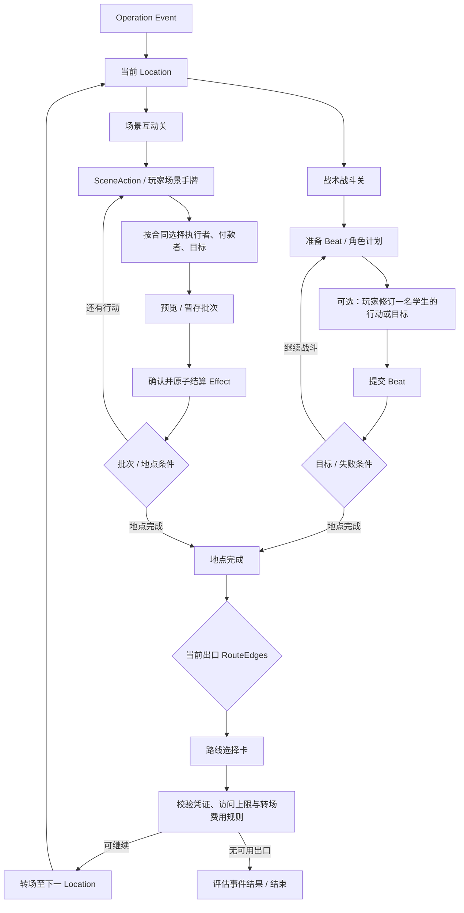
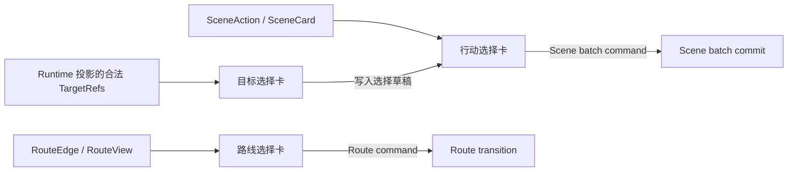

# Task 0245：Gameplay B 场景选项、目标与费用模型

状态：completed — Runtime、Datapack 内容、UI 与文档实现验收通过。

## 目标

将 Operation 的非战斗场景选项改为卡牌式呈现，并修正“无目标仍强制指定学生执行”的模型缺口。选项分别表达：是否需要执行学生、是否需要玩家选择作用目标、由场景 PlayerCost 或现有 Actor/Team resource 支付，以及由哪个既有事务提交。

首期至少支持无执行者 / 无目标的直接 Scene Effect、需要一名学生执行的行动，以及现有 Scene 合同允许的 Actor 目标选择；既有 PlayerCost 和 Action Actor/Team resource 要区分，不把 payer 与 performer / target 混同。目标为 none 时不得暗设学生。复用现有 `OperationActionDef` / Effect，不引入卡牌实体或并行 Effect DSL。

本 Task 同步整理当前把行动小卡放在每名学生卡上的 Individual 场景，以及要求玩家选执行者的 Global 场景和玩家场景手牌。用户面向的目标选择统一为卡牌式选项，包含战斗 Action 的目标托盘；不重做战斗行动牌主体、自动选定目标的展示或既有 Hover/拖放关系线，只重构玩家明确选择目标时呈现的目标列表。

同一交互语言还应覆盖**岔路和作用对象选择**：可走路线以及合法目标均以卡牌/选择卡呈现，而不是路线行按钮或散落的小型目标按钮。这里只统一可读、可选、选中、锁定的表现，不把地点转场与 Action 结算合并为同一种 Runtime 命令。

### 首期边界裁定（吸收 SolChat 建议并经源码核验）

| 纳入 0245 首期 | 留为扩展候选 / 后续 Task | 当前不采纳的直接改造 |
| --- | --- | --- |
| 免 performer 的直接场景 Action；显式 performer none/one；作者文案进入 OperationView；场景卡、路线卡、目标卡的共同表现；保留 Battle / Scene / Route 各自事务；Scene PlayerCost 与 Action Actor/Team cost 语义分离。 | 固定 team/frontline/backline 群体 Effect fan-out；自定义 M 选 N；Option stock / repeatable 商店；EventRun 临时 Resource；任意第三方 payer；多个费用源的普遍混付。先用具体验收例验证再拆 Task。 | 一次性把所有地点替换成 SceneOffer/Option 全新状态机；移除 Individual/Global 语义却不保留旧批次行为；新建 RunResource 与货币/商店系统；将 Battle、Scene、Route 合并成万能 Choice commit。 |

首期现有 Global Scene 对 Actor target ID 数组可多选，应保留并明确验证；这不等于已经有独立的 `student-many` TargetSpec、固定群体目标或战斗多人目标。首期不把“通用群体目标”列为完成门槛。

**Scene 卡选择必须区分“固定包含”和“玩家必须选”。** 固定包含项进入事务，UI 显示已选且不可取消；它不计入玩家需要完成的必选数。玩家选项由现有 Global/Individual 规则规定数量，未满足时不能 Commit。UI 为方便预先高亮一个候选，只是可替换的推荐值，不是固定包含。U0 必须按来源冻结固定项计数：Location SceneAction 的 `scope=global` 候选自然至多一项/批，`scope=individual` 需要逐名存活学生各一项；物理手牌固定项按其卡实例一次；不能无说明地按队伍人数复制费用或效果。

### 本轮施工前冻结的合同决策

- `performerPolicy` 属于 Scene Action / 玩家 SceneCard 的调用入口（建议 `selected-student | none`），不是移除 `OperationActionDef.allowedParticipantKinds` / capability；旧内容缺省按需要学生 performer 处理，保持存量语义。
- `performerPolicy:none` 的 Action 可无 actorId 直接执行；若 target 是 Actor，必须有不依赖 performer 的绝对 ID/type filter，由 Runtime 投影当前合法 Actor。关系型 `self/sameTeam/otherTeam` 无 source actor 时无效。首期不增加固定群体 target。
- `ActionDef.cost` 仍是执行费用，只能在有 performer 时从该 performer 的 Actor 或 Team resource 支付。SceneAction/SceneCard 的 PlayerCost 是场景费用。二者可同时出现，但必须在同一 Scene transaction 联合预览并原子提交；不新增 target payer / 第三方 payer。
- SceneAction 按当前 `actionMode` 继续要求玩家选择：Global 每批恰好一个 selectable action，Individual 每名存活学生恰好一个 selectable action。`fixed` SceneAction 自动进入同一批，不计入上述 required choice 数；Global fixed 每批一次，Individual fixed 每名存活学生一次。actorless SceneAction 只允许在 Global scope，避免同一无主效果因 roster 人数重复触发。
- 固定玩家 SceneCard 若在当前 Hand，则每个物理 cardInstance 自动纳入本次 Scene batch 且不可取消，计一次；普通手牌仍可加入/取消。UI 默认预选 SceneAction 只是可替换的默认值，不是 fixed。
- 这轮暂不实现任意 min/max、M/N、repeatable offer、stock、RunResource、固定前排/后排/Team fan-out；Event Track 是否支持场景价格由 Runtime Unit 验证，可不纳入首个 engine slice。

## 已核实的当前事实

| 事实 | 证据 | 影响 |
| --- | --- | --- |
| 地点用 `actionMode: individual/global`、`sceneActionBatches` 与 `sceneActions[]` 声明地点行动。SceneAction 只有 `id/actionId/scope/playerCost`；场景玩家卡只有 `actionId/playerCost/timing/copies`。 | `src/data-services/contracts/operation.ts`；Registry / 定义校验 | 当前声明无法表达免执行者、支付来源或执行者/效果目标的分离。Schema 若改动须按既有流程生成。 |
| 批次请求的 SceneAction 和 SceneCard selection 都强制 `actorId`、`targetActorIds`。Planner 对两者都要求存活且有资格的学生；Global 只把选择数限制为 1，仍然需要一名学生执行。 | `src/arona-clicker/contracts/operation-scene-action.ts`；`src/arona-clicker/services/operation-resolution-planner.ts:planSceneBatch` | `global` 是全队共选一项，不等于无需角色主体。 |
| `OperationActionDef.allowedParticipantKinds` / `requiredCapabilityIds` 是 Action 可由哪些参与者执行及其资格条件，不等同于“玩家必须选一个 performer”。现有场景 Planner 把“可执行类型”和“必选执行者”绑在一起。 | `src/data-services/contracts/operation.ts:OperationActionDef`；`operation-resolution-planner.ts:planSceneBatch` | 新合同须单独表达 performer none/one；无 performer 不得因此绕开其它 Action legality。战斗计划继续用自己的 Actor 计划语义。 |
| Action `target.kind: 'none'` 已要求目标数组为空，并将 Effect 按一次 `null` target 执行；但这不免除学生执行者，也不表示可取消。 | `src/data-services/contracts/operation.ts`；Resolution Planner | 必须把“无目标”与“无执行者”作为两个独立维度。 |
| ActionDef 已有 Actor / Team 的资源费用合同，但 SceneAction 与 SceneCard 的 Planner 目前拒绝带 Action cost 的行动，只累计并支付各自声明的 PlayerCost。 | `operation.ts`；`operation-resolution-planner.ts`；`operation-action-content-validation.ts` | sCost / Team resource 不能仅靠 UI 增加按钮，须定义支付来源、扣费主体及原子结算规则。 |
| Operation Action Effect 已覆盖 Actor HP / 资源 / 位置、Team resource、Event track / fact、held item。Target contract 目前仅支持 none 与受 relation 限制的 Actor；没有通用 Team / Location / arbitrary object target。 | `src/data-services/contracts/operation.ts` | 已有 Event / Team 效果应能在无 Actor 执行者时表达；不要承诺无界的世界对象目标系统。 |
| `OperationActionDef` 不包含作者可见的名称/说明；场景行动名也不在 `OperationSceneActionDef`。Operation UI 通过 Carousel presentation 表、Strategy Park map sidecar 和 ID-keyed map 查找行动文案。 | `src/data-services/contracts/operation.ts`；`src/ui/components/operation-workspace.ts` 的 `ACTIONS`、`SCENE_NAMES`、`PARK_MAP`、`sceneActionLabel()` | 单有选择/flag 的结构仍不足以让普通 Datapack 作者交付自描述内容；须把作者文案随内容定义投影，不可要求额外维护 UI 文案映射。 |
| Route 定义已有路线 ID、目标地点、标题、说明、凭证门槛；Route View 已投影当前出口的开放状态与阻塞原因；UI 当前以文字条目和独立“前往”按钮渲染。 | `src/data-services/contracts/operation.ts:OperationRouteEdgeDef`；`src/arona-clicker/contracts/operation-view.ts:OperationViewRouteOption`；`src/ui/components/operation-workspace.ts:renderRoutes` | 路线卡不需要另建作者实体；现有 Route DTO 足以形成第一类选择卡。 |
| 合法 Actor target 列表按具体 performer 计算：同队/敌队等 relation 需要执行 Actor 作参照；Actor DTO 有姓名、头像、HP、Team 和自由字符串 `positionId`，但没有固定 group target 投影。 | `operation-view.ts` 的 Action/Scene Action/SceneCard DTO；`operation-view-projector.ts:projectSceneActions/projectSceneCardCandidates`；`operation-workspace.ts:renderActionTargetTray` | 可复用“合法 Actor 候选→目标卡”的表现和 ID；不能推导为 actorless Action、前/后排 group 或任意非 Actor target 已可投影。 |
| EventRun 已有声明式有界 `tracks`，当前值保存在 `eventState.tracks`，可由 `eventTrackDelta` 改变并通过 track objective/condition 读取；EventRun 快照恢复时按 Event 声明和边界校验。held items 则是 ID 集合，不是可叠加货币。 | `src/data-services/contracts/operation.ts:OperationTrackDef/OperationEventContentDef/OperationActionEffectDef`；`src/arona-clicker/contracts/operation.ts:OperationEventState/EventRun`；`operation-runtime-service.ts` Save/Resume validation | 若后续临时补给只需数值货币，可先评估把 Track 作为 SceneCost 来源，避免新建 RunResource；若需要独立库存语义，再另立机制。 |
| 目前 Scene batch 已有纯预览、显式 stage/clear/commit、重算预览后原子提交；提交可同时写 Action Effect、扣 PlayerCost、弃置 SceneCard、递减 SceneAction batch 并检查地点完成。它拒绝 `Action.cost`，也没有 Option stock 或 RunResource mutation。 | `operation-runtime-service.ts:previewSceneActionBatch/stageSceneActionBatch/commitSceneActionBatch`；`operation-resolution-planner.ts:planSceneBatch` | 可以在现有 Scene 事务边界扩 SceneCost / Action 执行成本；M/N、重复 Offer、库存与新资源会额外改变其 Run 状态、Save/Resume 校验和事务计划，不是现成能力。 |
| 当前 UI 默认 global 选第一个有合格学生的 SceneAction；Individual 按 actor 顺序为每名存活学生默认映射一个选项。提交时 `defaultSceneDraftFromView()` 会把这些默认值变成完整选择；Planner 强制 Global 恰好一项、Individual 每名存活学生恰好一项。默认选项可换成 alternative，但不能把所需选择清空。 | `src/ui/components/operation-workspace.ts:renderSceneControls`；`src/ui/controller-actions-operation.ts:defaultSceneDraftFromView`；`src/arona-clicker/services/operation-resolution-planner.ts:planSceneBatch`；`tests/ui/gameplay-b-operation-controller.test.ts` | 这是“玩家必选”的默认行为，不是内容声明的“固定包含、不可撤销”。0245 要新增/明确二者语义，不能把当前 UI 的默认勾选直接解释成锁定项。 |
| `OperationActorDef.positionId` 是不设枚举的 Operation 局部字符串；示例使用 `front` / `back`，但没有角色群组成员解析/空组规则。 | `operation.ts:OperationActorDef`；Strategy Park actor declarations；Operation validation | 前排 / 后排是可以构造的目标筛选提案，不是可直接复用的标准 Group。要纳入时需明确事件 roster、Team、存活条件、动态解析和空组行为。 |
| Strategy Park 西门的首节点是 `global + 1 batch + brief-team + 0 PlayerCost`。其 Action target none、写入 `team-briefed`，但通过 `studentAction()` 带入 `allowedParticipantKinds: ['student']` 与霰弹枪 capability；Planner 仍要求选一名合格学生。该 Fact 只写入、未被路线读取；路线在批次耗尽、地点完成后开放。 | `gameplay-b-strategy-park.ts`；`operation-route-evaluator.ts` | 最小验收案例：同一场景选项不提交任何默认/隐式 `actorId`，免 performer 后设置 Fact 一次并完成批次；移除无用 capability 绑定或将其改为明确资格需由内容核对。 |
| Individual 场景把卡放进每名学生的 `operation-student-card`；Global 把卡放在全队区域并隐藏执行者按钮，但默认第一个合格学生。行动替代项另有“其他行动牌”展开按钮。 | `src/ui/components/operation-workspace.ts`；`src/ui/controller-actions-operation.ts` | 统一呈现时需迁移旧场景小卡及其学生提示；不能改变战斗人物卡和战术牌布局。 |

## 适用样例与回归边界

当前正式场景行动样例集中在两个内容文件：

- Strategy Park：西门、连廊、服务亭、电玩馆、急救点、迷宫、摩天轮、后台、出口、控制室；覆盖 Global / Individual、免费和 PlayerCost、Actor 无目标与 Actor 目标、单/多候选选项。
- Carousel 场景切片：游客通道 Individual 调查/引导，出口 Global 急救；保留已有玩家手牌/费用流程。

相关测试入口：`tests/engine/operation-scene-actions.test.ts`、`tests/engine/gameplay-b-scene-action-sample.test.ts`、`tests/engine/gameplay-b-operation-sample.test.ts`、`tests/ui/operation-workspace-view.test.ts`、`tests/ui/gameplay-b-operation-controller.test.ts`，以及 Operation schema / Registry 校验测试。

## SolChat 指导的事实核查与取舍

两名只读子 Agent 分别核对 Runtime 合同和 Datapack/编辑体验；以下是吸收意见，不是将粘贴稿逐项视为现状或首期要求：

| SolChat 主张 | 核查结论 | 0245 取舍 |
| --- | --- | --- |
| `actorId` 是场景动作的主要限制。 | 准确，但其根源不只是字段必填：`allowedParticipantKinds` / capability eligibility 与“这个 Scene 使用是否需要玩家选执行者”目前耦合；Action Target relation 也以执行者为参照。 | 分离调用层 performer policy 与 Action 的执行资格；无 performer 不提交隐式 actorId。行动资格/能力门槛不能在战术候选路径中消失。 |
| Route 与合法 Actor target 已有足够投影基础。 | RouteView 已足够提供出口卡内容。Actor target View 已可按 performer 投影合法候选，但 actorless target 与 group target 需要新的候选合同/解析。 | Route 卡直接复用现有 RouteView；目标卡首期复用现有合法 Actor 列表。actorless student target 和固定 group 需在 U0 冻结选择参照与校验后再做，不假称为现成能力。 |
| `SceneOffer + Option` 替换 `sceneActions + actionMode`，支持 M/N、once/repeatable、stock。 | 这是独立 Offer 状态机，不是改名：还须保留或重新表达 Global“一项/批次”、Individual“每名存活学生各提交一项”、地点剩余批次、Option 去重、空选择语义和保存恢复。 | 首期保留目前批次计数和 Individual/Global 行为，先迁 UI/performer 语义；M/N 与库存/可重复 Offer 暂不设为完成门槛，等有具体补给/选卡用例另立后续 Task。 |
| Actor / target / executionCost 由 Action 声明，SceneOffer 另有 SceneCost。 | Actor资源与 Team resource 的 `OperationActionDef.cost` 已用于战术；Scene Planner 目前明确拒绝该字段。Scene wrapper 的 PlayerCost 是另一种费用。若同一 Scene 使用同时带两种费用，必须一个 Scene plan 联合校验余额和 Effect。 | 保留两种明确来源：场景 Option 的 PlayerCost（可评估 Event Track cost）与 Action 的 Actor/Team execution cost。首期付款仅 performer 或其 Team；禁止 target payer 和第三方 payer。若两种费用同用则必须原子预览/提交，不做隐式双扣。 |
| 前排/后排/全队使用固定 `student-group`，RunResource 支持临时商店。 | Team ID 和 `positionId` 可供选择器核验，但固定群体缺少成员范围、死亡成员、空群体、动态位置、逐成员 Effect 和一次费用还是逐人费用规则。EventRun 没有 RunResource map，但已存在有界且持久的 Event Track。 | 固定群体 Effect 与空组规则延后；先验证无 performer 和单 Actor target。临时数值货币优先评估 Event Track + SceneCost；若有独立库存/数值资源需求，再设计 RunResource。首期不实现 Shop/stock/merchant。 |
| Selection 与 Scene Effect 原子提交。 | 现有 Scene batch 已有预览、暂存、清空、复核费用、一次性替换 Run；新增执行资源、选项库存、RunResource、牌区奖励都会扩大交易计划与存档校验。 | 复用现有事务边界；扩展内容需同批次全量 preflight，禁止只提交费用或部分群体 Effect。不要新建泛型 Choice commit。 |

**首期 Scene 选项采用既有入口，不立刻增加完整 SceneOffer 状态机。** 若 U0 证明要支持“玩家从多个不同 Option 里选择 M 个”且现有 Global/Individual 无法表达，再把 Offer/selection rule 单独提为阶段或 Task；不能默默用 M/N 覆盖 Individual 的 per-student 行为。

## 设计原则与建议方案

1. **执行资格不等于执行者选择。** `allowedParticipantKinds` 与 capability 描述 Action 可以由谁使用；新增的 performer policy 单独表示 `none` 或 `one student`。首期不加入 `each/group performer`。保留 Location 当前 Global/Individual 批次覆盖语义，施工时不得只改名就改变每批需要提交的人数。
2. **Action target 与 no-target 分开于 performer。** `target: none` 只表示无目标，不自动取消执行者。首期支持无目标；由一名学生执行、选择一个/多个合法 Actor 目标；以及不选执行者、按明确 actor type/ID filter 选择一个/多个 Actor 目标。Target relation 依赖 performer 时继续使用现有 relation 规则；actorless target 必须用独立的过滤条件，不能假造 `actorId`。Action Effect 中 `recipient: actor/actorTeam` 必须有 performer，`recipient: target/targetTeam` 可由已选 target 解析。固定 `team/frontline/backline` group target 需解决成员解析、阵型标识、存活/空组和 effect fan-out，列入后续扩展，不作为首期验收。
3. **分开 Scene Cost 与 Action execution cost。** Scene Cost 属于 Location SceneAction / 场景牌（PlayerCost；是否首期支持 Event Track cost 在 U0 核验），execution cost 属于 Action（复用现有 Actor/Team resource）。明确有 performer one 的 Action resource 从执行者或其 Team 扣除；首期不支持 target 付款者或独立第三方 payer。若 Option price 和 Action execution cost 同时声明，两者在一次 Scene batch transaction 中分别汇总、联合预览并原子扣款；现有 Planner 禁止 Action.cost，必须显式补齐场景侧付款规划，不能声称已有支持。Event Track 是优先评估的临时数值支付源，不新增 RunResource；除非事实用例证明 Track 不足，才另立 RunResource Task。
4. **选择与取消分层。** 场景手卡不再附着在每张学生身份卡上；通过 performer selector 选择行动者，通过独立 target selector 选作用对象，两个选择有清晰标签。选择卡取消、清空目标、清空待提交批次是 UI / draft 操作；真正取消已有游戏状态必须由单独的 Action Effect 表达。保留并重用现有 stage/clear/commit 与 Save/Resume 语义，除非施工证明 UI-only draft 足够且行为兼容。
5. **选择卡类型闭合、目标扩展有界。** `OperationChoiceCard` 只作只读表现，`kind` 限定 route/action/target；Runtime 命令保持分立。目标首期仍为现有 Event Actor 候选，不开放任意 Team/Location/Event object target；非 Actor 的 Event fact / track / item 是 Action 的 Effect，不应伪装成可被玩家选取的 target。
6. **岔路和作用对象共用“选择卡”呈现，不共用业务动作。** 建议 UI 使用一个轻量且纯表现的 `OperationChoiceCard` 判别联合：

   ```ts
   type OperationChoiceCard =
     | { kind: 'route'; id: string; title: string; detail: string; enabled: boolean; reason?: string; targetLocationId: string }
     | { kind: 'target'; id: string; title: string; detail?: string; enabled: boolean; target: OperationTargetRef }
     | { kind: 'scene-action'; id: string; title: string; detail?: string; enabled: boolean; actionId: string; cost: OperationCostView };

   type OperationTargetRef =
     | { kind: 'actor'; id: string }
     | { kind: 'team'; id: string }
     | { kind: 'event'; id: string };
   ```

   `route` 卡直接由现有 RouteView 派生，`target` 卡只从 Runtime 投影的合法目标派生，`scene-action` 卡来自选定手牌/地点行动。统一部分只包含稳定 ID、标题/说明、可选/锁定状态及显示信息；控制器仍按 `kind` 调用既有转场、批次暂存/提交或目标修订命令。`team/event` target ref 是未来拓展形状，只有 Runtime 明确支持校验与结算的对象类型才能成为可选卡。
7. **路线选择与目标选择的时序不同。** Route 卡只列当前地点出口；选择后走既有 route command 并执行转场。目标卡属于已选 Action/SceneCard 的局部选择区，可单选或多选，保存在批次/干预草稿里，最终由既有原子 Commit 应用。不要把“选目的地”写成 Action.target，也不要把“选行动目标”写成 Route。
8. **小按钮升级为带身份信息的卡。** 原有“每名学生卡内嵌一张场景行动”的模式迁移为场景手牌区；需要执行者/付款者/目标时，在所选卡片附近展示小型选择卡，显示头像/名称和按钮语义。无 performer / target 的卡不显示学生选择卡。路线卡显示去向、门槛与锁定原因；可用与锁定样式一致，但锁定路线不可点击。
9. **Datapack 作者声明玩法语义，不声明卡牌外观。** 卡片是 AC Runtime 根据 Route / SceneAction / Action / 合法目标投影生成的 UI。作者不创建 `CardDef` 或手工写卡片位置、牌面类型和目标按钮。常见选择继续用 Location `sceneActions[]` 引用 `ActionDef`，flag 结果写在 Action `effects`；分支继续用 `routeEdges[]` 声明目标地点和门槛。复杂自定义行为引用已有/新增的类型化 ActionDef 能力，由 UI 自动生成同一选择卡样式。

## Datapack 作者数据体验

目标是让作者围绕“选项及其结果”工作，卡牌只作为游戏中的呈现形式：

| 作者要表达 | 推荐声明方式 | 运行时自动表现 |
| --- | --- | --- |
| 做选择后记录剧情/地点 flag | `Location.sceneActions[]` 配置场景选项标题/说明；`actionId` 指向只写 `eventFact: reveal/forget` 的 Action；SceneAction 使用无 performer、无目标、免费定义 | 显示一张可选行动卡；玩家选择并确认后写入 flag，不显示执行者/目标选择 |
| 自动附带、玩家不能移除的一项场景操作 | Scene option 声明 fixed inclusion；固定项之外的选择仍按 Location/Offer selection rule 校验 | 固定卡显示锁定的已选态并进入同一事务一次；不能通过取消按钮绕开 |
| 玩家必须从卡牌中作出选择 | selectable options + selection minimum（沿用或显式映射当前 Global / Individual 规则） | UI 可提供默认推荐，但必须能改选；少于最低选择数时不允许提交 |
| 选择下一地点 / 通道 | 继续声明 `routeEdges[]` 的目标、描述、凭证条件与访问规则 | View 派生路线卡；根据 Runtime 合法性显示可用或锁定 |
| 调查、治疗、交涉、使用物品等较复杂内容 | 选项引用 `ActionDef`；ActionDef 使用既有 Condition、Cost、Target 与 Effect 合同，必要时只扩展有具体用例的类型化字段 | View 投影合法执行者、费用与目标选择卡，Runtime 预览并原子提交 |
| 一组选项有复杂前置条件或互斥 | 使用既有 predicate / fact 与有限 Action 条件；若地点选项级条件不足，再为 Option 增加单一、结构化的 `when` 字段，而不是在 UI 文案或自定义自由脚本里编码 | 只呈现当前可选项；不可用项可按产品语义隐藏或显示禁用原因 |

作者工具应将简单 flag 选项呈现为易懂的表单控件（选项文案、选择后设置/清除哪个 Event Fact、费用和执行者方式），不要求作者编辑嵌套的“卡牌视觉定义”。ActionDef 应具备作者可读的标题/说明；SceneAction 可选提供场景内的标题/说明覆盖；RouteEdge 继续使用现有 label/description。高级模式可以选择 `actionId` 并配置/跳转到 ActionDef 编辑；校验错误应定位回 Location、SceneAction 或 Action 的实际字段。OperationView 应携带显示所需文案，使 UI 不再靠事件 ID 和 action ID 查找打包在 AC 内的文案表。导入/导出仍保存普通 Datapack 数据，不保存运行时 `OperationChoiceCard`。

**数据形状建议：** 首先扩展现有 `SceneActionDef` / `OperationActionDef` / `OperationRouteEdgeDef`，只添加免 performer、作者文案、固定包含/可选选择语义及经裁定的 Scene Cost 字段；保留 finite deck 的来源/副本语义。固定项与必选项是 Runtime selection contract 的一部分，不能只做 CSS / `aria-pressed`。具体字段用 `inclusion: fixed | selectable` 或等价的闭合联合表示；不要让“默认 UI 高亮”隐式成为作者规则。不要首期新建 Shop / Resource Registry、`OperationCardDef` 或并行 Effect DSL。简单 flag 表单可以是 `SceneAction` 指向 ActionDef 的易用创建器；若它需要在 Datapack 中直接写内联 `result`，须证明这比共用 ActionDef 更清楚，并确保 Registry、测试与 round-trip 仍只有一套权威 Effect。不得在编辑器中静默转换成导入后无法稳定 round-trip 的数据。

## 底层可合并边界与关卡类型

本 Task 统一玩家对“可选内容”的认知与呈现，但保持各类玩法状态转移的边界。Operation 不是一种通用卡牌游戏；卡牌是选择项的显示形式，不是每个玩法实体都必须拥有的作者数据类型。

### 建议合并的底层语义

| 可共用部分 | 建议形状 | 适用处 |
| --- | --- | --- |
| 可选项的只读呈现 | `kind + stable id + title/detail + enabled/reason + selected`；通过 `OperationChoiceCard` 判别联合投影 | 路线、场景行动、玩家场景手牌、目标选项 |
| 行为定义与效果 | 引用单一 `OperationActionDef`，复用 Condition / Cost / Target / Effect；flag 仍是 Event Fact Effect | 场景行动、玩家场景手牌、战术行动 |
| 选择角色 | 分开定义 performer（谁执行）、target（谁/什么受影响）、payer（从谁的资源扣费），不得以默认 Actor 混代 | 无角色直接效果、学生行动、队伍行动、角色资源费用 |
| 费用验证 | 共用余额解析、聚合、预览、可支付校验与原子提交代码；费用源继续 typed（PlayerCost / Actor resource / Team resource） | 场景批次与行动费用；路线携带上限和入场收益仅复用数值工具，不改成行动付款 |
| 作者文案 | 由作者内容/Route 定义携带并投影到 OperationView；避免 UI 用 event/action ID 查写死的演示文案 | 所有关卡选择项和卡面 |

可考虑的最小可复用内容子结构是 `OperationActionUse`：表示“某个 Action 在当前入口怎么被提供、是否需要玩家选执行者”。Location 的 SceneAction 和 PlayerSceneCard 可在证明确有重复字段后复用它；两种入口仍分别保留地点批次与牌组抽弃的字段。Target 合法性与 Action Effect 继续以 `OperationActionDef` 为权威；SceneCost 属于当前 option/card 的供给入口，不能跟 Action execution cost 混成一个金额。战斗 PreparedBeat 继续以 Actor 计划为单位，不必为迁就场景手卡而改成同一种选择请求。

**performer policy 的归属待 U0 裁定。** Sol 将 actor 放在 Action 上，但 Action 可同时用于战术候选与场景；更保守的实现是在 SceneAction / PlayerSceneCard 的 Action-use binding 声明 `none | selected-student`，不影响战斗的隐式计划执行者。只有若证据表明 Action 全局执行语义恒定且复用不存在冲突，才把该字段提升至 `OperationActionDef`。`allowedParticipantKinds` 与 capability 仍是 performer 资格约束，不与 performer 是否存在合并。

### 不应强制合并的事务

| 事务 | 独有责任 | 不应并入通用 Choice Commit 的原因 |
| --- | --- | --- |
| Battle Beat commit | 对全部 Actor 的 PreparedBeat、单槽干预、Actor/Team resource、Combination、技能 RNG、Resolution history 作一次原子结算 | 同时选择和结算跨多 Actor、随机游标及当前 Beat；它不是单张选项卡的立即效果。 |
| Scene batch commit | 结算一批 SceneAction 与零到多张玩家 SceneCard，扣玩家费用/支持的行动费用、移动牌区、递减本地点批次并检查地点完成 | 有 Individual/Global 基数、暂存/恢复及有限牌组生命周期；费用不足或效果错误都必须整批失败。 |
| Route transition | 校验当前地点已完成、出口归属、Route gate、Event/Location 访问上限；消费凭证、套用离场 carry cap、入场 costGain/抽牌并进入目标地点 | 它移动 EventRun 的 Location 与访问历史，不是 Action Effect 或场景批次。 |
| Target selection | 把合法 target refs 写入行动草稿、intervention draft 或 Scene batch draft | 单独选择目标不应结算效果；它依附于某个行动及其提交入口。 |
| Outcome evaluation | 按 objectives / partial outcomes / failure conditions 判定 Location/Event 结果 | 是状态判定，不是玩家选择。 |

如果把它们硬并为万能 `CardDef + ChoiceResolution`，每张内容都要解释是否推进 Location、是否消耗 batch、是否扣 PlayerCost/角色/Team 资源、是否移牌、是否应用 RNG、是否写 RouteHistory、是否抽牌，以及失败时如何回滚。编辑表单同样会充斥其它类型选项不使用的字段，作者和 Runtime 都必须处理大量无效组合。收益只有共享卡面，成本却蔓延到定义、校验、投影、命令、存档恢复和测试。因此优先复用只读卡面、Action/Effect、target refs 与数值校验，不合并业务事务。

### 当前关卡类型



战术战斗关、场景互动关和路线选择是三种主要流程；目标选择是依附行动的子步骤，结果判定是系统检查。探索、交涉、简报、急救和休整目前可以是场景互动关中的不同 Context / Action 配置，不必另建不同 Runtime。一个 Event 可以串联这些地点类型。



`OperationChoiceCard` 是运行时/UI 派生层，只统一可读信息、状态和卡面行为；`kind` 决定调用哪条既有命令。它不写进 Datapack、EventRun、SaveData，也不作为作者要创建的实体。

## 文本 — 潜在解决方案 / 待裁定

- “取消”分成三个明确概念：取消/撤销未提交的卡选择；清空整个 staged batch；已结算后由一张 Action 产生逆向游戏效果。首期只保证前两种草稿操作；第三种必须有具体解除内容，另写 Effect 规则。
- performer policy 首期候选为 ActionUse binding 上 `none | select-one-student`，不写 `each/group`。需确认一个 Action 同时被 Battle 和 Scene 引用时，场景免 performer 是否会错误放宽战术合法性；首选在 SceneAction/SceneCard binding 约束，而非全局修改 `allowedParticipantKinds`。
- actorless + target Actor 的关系规则首期候选：必须声明 `allowedActorIds` 或 `allowedActorTypes` 作为绝对过滤；Runtime 投影活着且存在的匹配 Actor。无过滤的 `relation:'any'` 不得在缺少 source Actor 时自动变成“所有人”。
- 同一 Scene batch 中，SceneCost + Action execution cost 可以并存，但必须先按费用池汇总，再用提交开始时的余额校验；同池费用不得由其它所选 Action 的正向 Effect 预付。预览与 Commit 使用相同的可信计划，失败不写费用、Effect、batch、牌区或库存。
- target payer / 独立第三方 payer 不进入首期；actor resource 由 performer 承担，team resource 由 performer 的 Team 承担。目标学生不会因成为 target 自动替卡付款。
- 固定 `team/frontline/backline` 群体、空组、组内部分 Effect 失败与一次费用/每人费用是后续设计点。首期允许玩家在已有 Scene Global 目标路径中多选合法 Actor，不把多个手动选择误称为固定 Group Target。
- 通用 M/N SceneOffer、repeatable、Option stock、临时商店和 RunResource 不作为 0245 首期验收；固定包含项 + 最低必选项是首期所需的最小选择模型，不等于开放任意 M/N / 空选项提交。当前 Location batch 已有次数上限；Event Track 可先用于 bounded 临时数值，不先增加另一份 Run currency 状态。若后续商店需要 per-option stock 或允许 0 选项提交，必须另定义退出/推进规则，避免空提交无限停留。
- Route 仍是 RouteEdge / route command；路线卡仅派生自 RouteView。目标卡从 Runtime 投影的合法 Actor 产生。`OperationChoiceCard` 留在 UI/View，只统一卡面，不进 EventRun / SaveData / Registry。
- Datapack 内容继续使用 SceneAction + ActionDef、RouteEdge、有限玩家牌组；Action/SceneAction 作者文案随内容投影，淘汰 UI 对演示 ID 的静态文案映射。Schema 按 canonical contracts 生成；编辑器表单、交互与专用 authoring preset 不在本轮范围。
- Task 0240 继续掌管战术行动牌本体和 Hover/focus/拖放关系线；0245 只改战斗中显式目标列表的卡片表现，不改变 PreparedBeat、干预槽或关系线提交规则。
- 无 performer 但有 Actor target 时，目标列表不可按 Action relation 相对执行者筛选；U0 必须决定首期 target 候选的独立来源（建议 `allowedActorIds` / `allowedActorTypes`，由 Runtime 结合当前 HP 状态投影）。该场景不要求执行者资格/capability。Action 的非 target Effect 若依赖 source Actor，则禁止用于该调用方式。

## 建议施工单元

- **U0 合同与迁移核验**：冻结 performer policy 放置位置、actorless Action 可用 Effect 限制、actorless target filters、SceneCost/执行费池优先顺序、固定包含项与用户必选项的区别，以及 fixed inclusion 在 Global / Individual 下的基数；明确 UI 迁移保留现有 Individual/Global 语义。重要测试先描述现有行为，避免改数据后才发现语义丢失。
- **U1 免执行者直接场景行动**：更新 SceneAction / SceneCard 的 invocation selection、Action 文案、Registry/Schema/OperationView；让无 performer + target none 的 Scene Action 不发 actorId，仍走现有 Scene stage/commit 和 Save/Resume。Park 西门作为首个样例。
- **U2 分离目标选择与选择卡 UI**：对需要执行者的 SceneAction 由 Performer selector 选择学生；目标列表根据 Action target 投影。随后扩展无 performer + 明确 Actor target filter，必要时使 Resolution source actor nullable；统一 Route / action / target 卡面，但保留三种命令。固定项锁定选中、必选候选允许改选；一旦计数不满足便禁止提交。同步重排按学生卡渲染的 Individual 场景操作入口，不改变其每名存活学生一项的既有语义。
- **U3 Action execution cost 与 SceneCost 原子计划**：允许 Scene 使用现有 Action Actor/Team cost；PlayerCost 保留为 SceneCost。核查 Event Track 能否安全作为一种 SceneCost，优先复用现有 track state；不建立 RunResource / stock。费用池、效果、批次和牌区变更由同一批次计划原子处理。
- **U4 样例与作者文案迁移**：迁移 Park / Carousel SceneAction 和场景玩家牌；作者文案随 OperationView 投影，移除对应的 ID-keyed UI copy dependency。支持鼠标/键盘、取消选择/草稿恢复与选项卡目标选择。
- **U5 Schema、文档和收尾**：按实际合同生成 Schema；不施工编辑器表单、交互或 round-trip 专项。更新 operation contracts/view/runtime/UI 文档、测试、GALHCG 和 Task 归档。

**明确后续候选，不在 0245 验收：** 固定群体 Target（team/frontline/backline）与 multi-target fan-out 规则；M/N Offer/Option/stock/repeatable 商店；独立 RunResource；target/third-party payer；Option-level复杂条件与独立 SceneOffer Editor。若 U0 核验发现某项是完成免 performer 核心切片的必要依赖，先记录证据和新增预算，再另立 Patch Unit 或 Task。

## 验收

- [x] Park 西门“领取巡查任务”0 PlayerCost SceneAction 使用 no-performer policy；命令无 actorId、Runtime 不选默认学生；Scene batch commit 后 `team-briefed` 恰好 reveal 一次，推进一个既有 SceneAction batch 并按当前完成规则开放出口。
- [x] fixed 与 required 具有独立定义和 Runtime 语义；fixed 按 SceneAction scope / 手牌实例纳入，不计入 Global/Individual 必选数；UI 锁定显示且不能取消，用户必选可改选，Runtime 不接受绕过必选数的批次。
- [x] 现有推荐默认项仍可替换；Global/Individual 必选数保持原语义。UI 行为测试覆盖 Individual 选择草稿、重选与重渲染恢复。
- [x] actorless Action 的 Actor 目标通过绝对 actor ID/type 过滤投影；Runtime commit 重新校验目标，失效候选整批拒绝。
- [x] 需要 performer 的 Action 只允许合格活跃学生；participant kind / capability 检查保留，执行者与目标是独立选择。
- [x] actorless Action 无虚构 source actor；actor-relative Effect / Actor 或 Team 执行费要求实际 performer。直接 Event Fact / Track / item Effect 通过现有 Resolution 原子提交。
- [x] Scene PlayerCost 与 Action actor/team resource cost 分开投影，并在同一事务联合预览、原子结算；对应失败路径由 planner / save-resume 回归覆盖。
- [x] Global 每批一项、Individual 每位存活学生一项保持不变；Individual 行动卡已从学生身份卡移到场景行动区，草稿按学生独立保存。
- [x] 路线、场景行动、玩家场景卡与显式目标统一为卡片式选择表现，仍调用既有 Route、Scene batch 或 Battle 命令；战斗关系线和 0240 干预规则未更改。
- [x] Action / SceneAction / SceneCard 标题说明由 Operation 内容与 View 投影，UI 不再按 event/action ID 查询演示文案表；Registry 与生成 Schema 同步。
- [x] 暂存、重选、清空、提交和 Save/Resume 的新 performer/target/cost 字段经过行为覆盖；取消草稿不写费用或 Effect。
- [x] 定向 Engine、Content、UI 测试，`gen:schema`、类型检查、`check:docs` 与 `check:architecture` 均通过。编辑器表单与专项 round-trip 留后续 Task。

## 调查结论与委派复核

- 首轮 SceneAction/SceneCard 与相似关卡调查、SolChat 合同核对和 Datapack/editor 范围核对均为只读；未使用浏览器、未改源码。独立复核确认本 Task 必须保留的事实：无目标并不免 performer；Global 是一条选择、Individual 是每个存活学生一条；Scene PlayerCost 与 Action Actor/Team cost 当前被分开且 Action.cost 被 Scene planner 禁止；Scene staged batch 已有重算后原子提交。
- 修订吸收：Scene 免 performer；actorless target 必须由独立过滤得到，不能套用需要 source actor 的 relation；SceneCost 与 execution cost 分离；Route/View、Action/Effect 及现有原子命令复用；ChoiceCard 只在投影/UI 层；作者文案来自 Datapack/View 而非静态 ID copy map。
- 修订排除首期：完整 SceneOffer / M-of-N、repeatable/stock、小商店、RunResource、target/第三方 payer 和自动 fan-out group Effect。它们都要求新 Run 状态/成员解析/空集合/存档验证/退出规则； Event Track 已是 bounded persistent Run value，可先作为临时数值成本候选。群体和 Offer 方案保留为具体用例出现后的后续 Task，不伪称现成机制。
- 新增选择锁定事实：UI 当前有 Global/Individual 默认选项，并在未创建 UI draft 时由 `defaultSceneDraftFromView()` 于提交前构造完整选择；替代项可改选，但所需选项不能清空，Scene Planner 再按 scope 检查 cardinality。当前机制表达“玩家必须提供一项选择”，不表达“作者定义不能撤销的固定项”。0245 因此把 fixed inclusion 与 required selection 拆开，固定项的 Global/Individual/手牌实例计数需在 U0 冻结并写行为测试。
- 特别注意：旧 Individual / Global 选择基数是可观察行为。未来 SceneOffer 若替代它，必须显式能表示“每名存活学生各提交一项”与“全队提交一项”，否则只迁 UI 并保留旧合同，或另设 Task 裁定内容玩法变化。
- 作者侧事实：当前 Operation 表进入 Datapack / Registry / generated schema，但没有 Operation 专属编辑器表单配置；Action/SceneAction 缺少作者标题/说明。0245 只更新 canonical 数据合同、Registry 校验、生成 Schema 并将内容文案投影到 View；不改编辑器体验，也不要求编辑器专项 round-trip。后续如需数据包作者的专用 UI，再另立 Task。

## 相关记录

[[task-0240-gameplay-b-operation-card-presentation-and-action-targeting]] · [[archive/task-0236-gameplay-b-typed-action-cards-and-target-layers]] · [[archive/task-0224-gameplay-b-scene-actions-and-route-cost]] · [[archive/task-0225-gameplay-b-finite-player-scene-card-deck]] · [[docs/docs-829/03-data-structures/operation-view]] · [[docs/docs-829/04-mechanisms/arona-clicker/operation-runtime]]

## 完成验收

- Engine Agent 对照冻结合同复核无重大偏离；定向 6 个 Engine suites / 63 tests 通过。
- Datapack Agent 对照内容范围复核无重大偏离；Park / Carousel 内容与虚拟玩法 4 个 suites / 14 tests 通过。控制室 fixed `controlRecord` 仅保证揭示不作为路线门槛的 `powerPanel` 观察事实，不改变凭证出口或战斗入口。
- UI 定向 suites / 28 tests 通过，覆盖 Operation Workspace、命令保持和 13 地点地图 UI；Individual 场景选卡位于场景行动区，不再嵌在学生身份卡。
- `npm run gen:schema`、`npx tsc --noEmit`、`npm run check:docs`、`npm run check:architecture` 均通过。未运行浏览器；编辑器体验与专用 round-trip 明确留后续。
