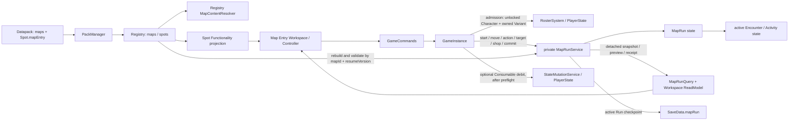
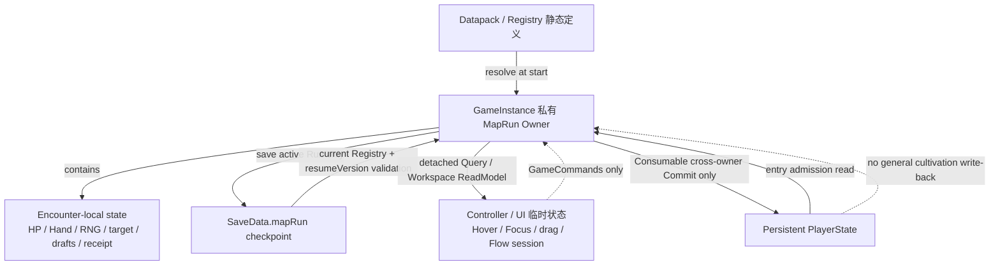
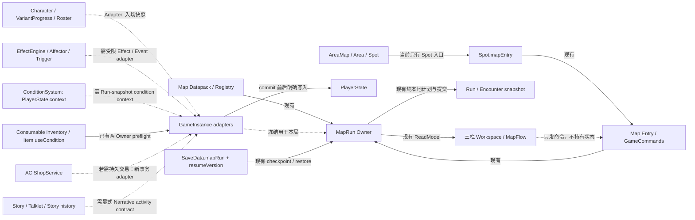
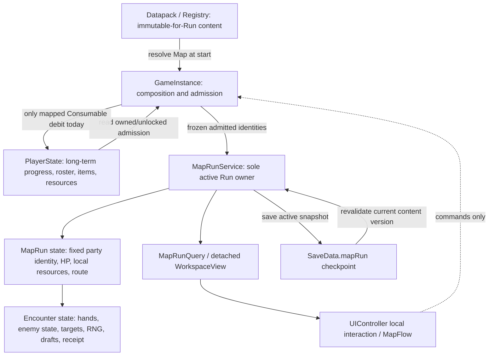
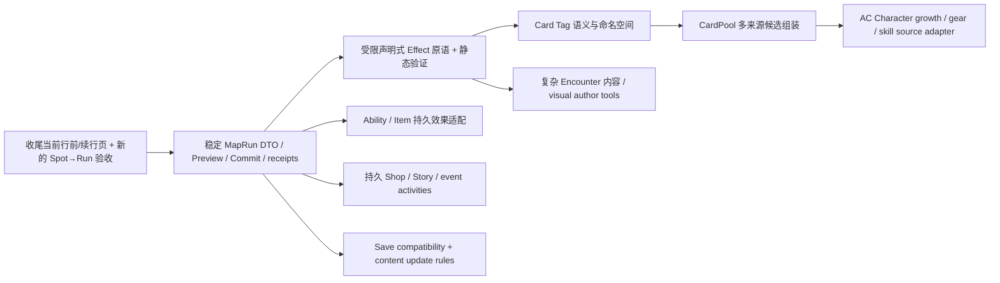

# Report 0311：Gameplay B / MapRun 现况与外部引擎接线调查

调查日期：2026-10-21  
调查对象：当前检出工作树中的 ACProgram / Gameplay B `GameplayMapDef / MapRun` 及其 AC 外部接线  
关联 Draft：[[docs/plan-work/draft-0311-gameplay-b-maprun-engine-integration-investigation]]

> 本报告是当前工作树的源码调查快照，不是玩法合同、架构批准或实施授权。重要判断区分源码事实、测试事实、推论和建议。按用户要求，未查阅 `docs/plan-work/archive/**`，也不以历史 Task 作为实现证据。

## 1. 执行摘要

当前 MapRun 已有独立于旧 EventRun / Operation 的完整局内 Owner 和一套可实际运行的有限地图玩法：固定角色队伍准入、Map / Node / directed Edge、Encounter、加权 Hand、玩家替换行动和目标、有限的 HP / 资源效果、敌方自主行动、整轮 Commit、固定顺序的 Rest / Shop 活动、活动 Run 存档恢复及三栏 Workspace。测试中也有从 Datapack / Spot、战斗、胜利到 Map 出口的产品切片。

它已经可以支撑简单战斗、局部路线探索、休息回合和本局资源商店；仍不是通用战斗或剧情引擎。当前作者合同把 Action 候选逐角色／敌人列出，效果仅有有界 HP 变化、Actor / Team 本局资源变化和真实回合卡牌上的 `sCost` 折扣。没有 CardPool、统一 Card Tag、AC 角色培养快照、通用条件／复合效果、持续状态、故事活动或奖励发放合同。

当前工作树正在把 Map Spot 入口改成先打开行前／续行准备页。准备页路由与 Runtime 投影已经出现在工作树，但现有两组 UI 竖切片仍查找 Spot 上的旧“直接开始”按钮：本轮合计 7 个 UI 测试因此失败。另有一条旧 Engine 测试将未配置 Actions 的 Enemy 当作会攻击，与当前 Datapack 合同“未配置 Enemy Actions 即 Wait”相矛盾。核心 MapRun、Registry、Save/Resume、卡牌目标及 Workspace 定向测试通过；新准备页没有独立行为测试，也未做浏览器视觉验收。

AC 外部系统中，目前真正跨 Owner 接入的是 Encounter Consumable：它映射为 Map-local Action，Commit 时由 `GameInstance` 同时预检 MapRun 与 PlayerState 库存扣除，再安装并发布库存事件。Character 成长、EffectEngine、Affector、Trigger、GameNum、AC Shop、Story/Talklet、Tick 和 Area-Map 均没有直接参与 MapRun 局内结算。Spot 条件仍使用 AC ConditionSystem；MapRun 边门使用自己的简单本局资源条件。

## 2. 调查基准与范围

| 项目 | 调查时记录 |
| --- | --- |
| 分支 / HEAD | `main`，`9e2c85f beforeHover`，相对 `origin/main` ahead 10 |
| 工作树 | 已有大量未提交源码、测试、Schema、计划索引和 Task 单元变更；MapRun Service、GameInstance、Runtime Commands、GameplayMapDef、Map Workspace、Controller、Map Entry Workspace 等均处于变更状态。报告结论只适用于这一检出，不能视为干净 HEAD 或已验收合同。 |
| 关联活动工作 | 非归档 Task 0309 提出 MapRun 行前／续行准备页，状态仍是 proposed；当前工作树已有对应 Route / Controller / UI 代码。Task 0310 处理独立 Area-Map，和 MapRun Map 分属不同定义与 Registry 表。二者不替代本调查。 |
| 归档材料 | 按用户要求未读取；Q9 仅检查当前非归档材料。 |
| 调查方式 | 查当前源码、`docs/docs-829/`、定向测试定义；只运行现有定向 Vitest / 文档检查。未改源码、测试、Datapack 或生成 Schema。 |
| UI 验收 | 做了 DOM / Runtime 测试；没有做浏览器真实视口、鼠标流程或视觉截图验收。 |

### 当前来源分类

- **新版 MapRun 正式运行面**：`src/data-services/contracts/gameplay-map.ts`、`src/arona-clicker/contracts/map-run.ts`、`services/map-run-service.ts`、`runtime-game-instance.ts`、`runtime-commands.ts`、Registry Map resolver、`src/ui/components/map-workspace.ts` 和 MapRun 相关测试。
- **当前 Datapack 内容包**：`src/arona-clicker/content/gameplay-b-map-datapack.ts`，Runtime 以 `gameplay-b@1.0.0` bundle 装载。它含 8 个 Map 定义和一个 Map Entry Spot，文件注释明确为 Map-only，不包含旧 Operation 样例。
- **旧 Operation**：`OperationRuntimeService / EventRun / operationEntry` 仍在同一个 GameInstance 和 SaveData 中，但使用单独 Owner、合同与 checkpoint；其技能、场景、卡牌或奖励不能算作 MapRun 已实现能力。
- **文档现状**：`docs/docs-829/06-wiki/50-ui/refresh-update.md` 含当前 MapRun Workspace 片段；多篇 Operation Runtime / PlayerState / Data Flow 页面仍以 EventRun 为 Gameplay B 主模型。`pack-loading.md` 已说当前 bundle 为 Map-only，但引用的 Datapack 源文件路径已经过期。实施事实以源码和本轮测试为准。
- **样例与正式路径**：八张 Map 随实际 `gameplay-b@1.0.0` bundle 注册；测试既有纯 `MapRunService` 单测，也有 `GameInstance`、真实 Registry / Spot 和 DOM Workspace 覆盖。单测不自动证明 UI 浏览器闭环；旧 UI 入口测试当前失败。

### 功能完成度矩阵

状态定义沿用 Draft：**完整可用、部分可用、仅测试或样例可用、已设计未实施、未实现、无法确认**。这里的“完整”只针对明确写出的当前合同，不代表已经覆盖复杂战斗或所有视觉验收。

| 能力 | 状态 | 源码 / 测试证据与边界 |
| --- | --- | --- |
| `GameplayMapDef`、Registry `maps` 与 Spot.mapEntry 引用校验 | **完整可用** | `gameplay-map.ts:4-350`、`registry-validate.ts:63-194,227-431,501-666,790-810,1068-1086`；135 个 Map Registry 定向测试通过。 |
| Directed Node / Edge 移动、出口和重访 | **完整可用** | `map-run-service.ts:3468-3514`；只支持离散有向节点与有限本局边条件，不含坐标和可见性规则。 |
| 固定队伍 Character / Variant 准入 | **部分可用** | `runtime-game-instance.ts:808-858`；校验 unlock / owned Variant 并冻结身份，不导入角色培养属性或自动编队。 |
| Encounter Battle / Enemy Hand / party defeat | **完整可用（当前窄合同）** | `map-run-service.ts:959-1493`；`gameplay-b-map-run.test.ts` 覆盖战斗、Enemy 顺序、败北与重放。没有位置、状态、范围、相位合同。 |
| Rest / 手动完成 Encounter | **部分可用** | `GameplayEncounterDef.rounds / completion`；仅有限回合无 Enemy 的 Rest 或显式 manual completion。 |
| MapRun-local 固定 Offer Shop | **部分可用** | `map-run-service.ts:3551-3661`；Map Team 余额、局内资源奖励、单队员治疗和幂等购买，不连接 AC Shop。 |
| Hand、TendencyRole、Wait、PlayerCommand / Swap | **部分可用** | `gameplay-b-hand-resolver.ts:152-267,348-560`；Encounter 必须枚举候选，没有 CardPool；倾向角色仅三种乘数规则。 |
| Unit / Card Target 与行动关系投影 | **部分可用** | `gameplay-b-action-preview-resolver.ts`、`map-card-catalog.ts`；单目标、指定偏好、当前回合真实卡牌身份，不支持范围目标。 |
| Preview / 整轮费用与 Commit 原子计划 | **完整可用（当前效果合同内）** | `map-run-service.ts:2800-3057`；stale / 非法输入在安装前拒绝；整轮费用聚合，receipt 支持重试。 |
| MapRun Action Effects | **部分可用** | `GameplayMapActionDef` / `map-card-effects.ts`；HP、Actor/Team 数值、回合 `sCost` 折扣。无通用 Effect 组合、Condition、状态或触发。 |
| Encounter Consumable 外部接线 | **部分可用** | `runtime-game-instance.ts:1012-1043`；只覆盖映射 Action + 库存扣一件 / useCondition，未执行通用 ItemDef.useEffects。 |
| 活动 Run Save / Resume | **完整可用（非终局 checkpoint）** | `map-run-service.ts:3391-3466`、`SaveData.mapRun`；测试覆盖 Hand/RNG/draft/receipt/版本拒绝。终局记录不持久化。 |
| Map Workspace 三栏 / DOM 交互 | **部分可用** | `gameplay-b-map-workspace.test.ts` 27 项通过；当前入口竖切片失败，且无浏览器视觉验收。 |
| 新 Spot → Map Entry → fresh / resume 路由 | **无法确认完成度** | 当前代码有 `map-entry` route / page，但本轮两个旧 Spot 直启动 UI slice 的 7 项失败，未执行新的浏览器闭环。 |
| MapRun Datapack 独立 Schema | **部分可用** | `Datapack.maps` 与生成 Schema 有 `GameplayMapDef`；游戏内 Runtime Editor 的内容策略不包括 Maps，Schema 存在不等于作者 UI 验收。 |
| AC Character 成长 Adapter、统一 Card Tag、CardPool | **未实现** | 当前 MapRun contract 无成长快照 / 标签 / 多来源池；Party 固定 IDs、Encounter 手工枚举候选。 |
| AC Effect / Affector / Trigger / Story / Tick / Shop 融合 | **未实现直接 MapRun 接线** | 已确认的例外是 Spot/Item 条件读取及 Consumable 库存消费；MapFlow 是 UI 读模型。 |
| MapRun 起止历史 / 奖励 / 持久战果 | **未实现** | success/failure 为运行时最小展示结果；abandon 清除 Run，未发现跨 Run result owner。 |

## 3. 系统全貌与实际调用链

`Datapack.maps` 经 PackManager / Registry 注册。Spot 的 `mapEntry` functionality 以 `mapId` 引用 Map；Registry 验证 Map ID、固定队伍、Node / Edge、Action / Encounter / Item 引用。Map 内容通过 `createRegistryMapContentResolver()` 提供给 GameInstance。

每个 `GameInstance` 私有持有一个 `MapRunService`。公开 `mapRun` 是冻结的只读 Query facade；写命令通过 `GameCommands` 转接到 GameInstance，再进入唯一 MapRun Owner。当前行前入口在 Spot 上只打开 `map-entry` route；页面“开始”才调用 `startMap()`，“继续”仅把 UI route 切回同一个活动 Run。GameInstance 负责入场准入；MapRunService 负责 Run / Encounter / Shop 局内状态。

关键入口证据：`GameInstance.#mapRunOwner` 与 `replaceMapRunOwner()`（`src/arona-clicker/runtime-game-instance.ts:226,307-313`）；冻结查询 facade（`:242-278`）；`startMap()` 与准入（`:673-677,808-858`）；命令转接（`src/arona-clicker/runtime-commands.ts:34-50,102-124`）；MapRun 真正开局（`src/arona-clicker/services/map-run-service.ts:2594-2657`）。

### Owner 与状态写入

- **唯一活动 Run**：每个 GameInstance 的 MapRunService 只有一个 `slot`；另有短暂 success / failure 结果和 Commit replay receipt。并行开始会被拒绝。不同 GameInstance 各有独立 Owner。
- **Run 创建**：GameInstance 先读取 Registry Map，验证固定队伍每名 Character 当前已解锁且至少有一个已持有、已注册的 Variant；再把 `{characterId, variantId}` 快照交给 Owner。MapRunService 分配 runId、复制 Map 声明的初始 HP / PlayerCost / Actor / Team resources，并打开起点内容。
- **运行状态**：Owner 持有 MapRun、Map 声明的 resolved definition 和活动 Encounter / Shop。UI、查询对象和 MapFlow 不持有领域可写状态。
- **输入命令**：移动、自然行为替换、PlayerCommand、单位／卡牌目标、Ability / Item 草稿、Commit、Shop purchase / leave 均经 GameCommands → GameInstance → Owner。`MapRunQuery` 只读。
- **重置与恢复**：GameInstance `init/load/reset/dispose` 等生命周期路径会替换或清理 Owner；SaveData 另存 `mapRun` checkpoint，不把 MapRun 变成 PlayerState 或 InitSnapshot 字段。

## 4. Map / Node / Encounter / Run 状态

### Map 与路线

`GameplayMapDef`（`src/data-services/contracts/gameplay-map.ts:4-350`）声明 Map 名称、`resumeVersion`、起点与出口、固定队伍、本局初始 HP / PlayerCost / Actor / Team resources、Map-local Action、Nodes 和 directed Edges。Node 没有坐标、Fog / Visibility、地图移动事件或 Run 内路线历史字段。运行进度主要是 `currentNodeId`、去重 `visitedNodeIds`、完成 Encounter / Activity ID 和活动状态。

Edge 单向；移动前拒绝活动 Encounter / Activity、不相邻目标和不满足边条件。当前仅有 MapRun 自己的 `teamResourceAtLeast` 非消耗条件。达到出口且没有内容阻塞时成功；重访已完成 Node 不重开其内容。空间展示和 Visibility 不是当前 MapRun 玩法合同。

### Encounter 与活动

- 单个 Node 可包含一个 Encounter，或一个固定顺序 `activities` 列表；Activity 只有 Encounter 或 Shop，顺序由 Datapack 固定，玩家不能选择顺序。
- Encounter 没有 Scene / Phase 通用模型。Battle 由非空 Enemy roster 表达；非 Battle 可声明手动完成动作，或声明有限 `rounds`。Rest 当前是无 Enemy、有限 rounds 的 Encounter，不是独立结算引擎。
- Shop 是 MapRunService 内的固定、不刷新的 Offer 列表；付本局 Team resource，可授予本局 Team resource 或治疗一个队员。治疗不复活倒地队员。
- Battle 中角色和敌人各有 Hand / Prepared Action；一次玩家 Commit 规划固定队伍整轮、然后处理敌方行动。敌方按 Encounter 声明顺序行动并读取当前回合快照。
- 结束条件：所有敌人 HP 到 0 为 Encounter 胜利；全队 HP 为 0 为 `partyDefeated` 失败；有限回合 Rest 到轮数后结束；非战斗 Encounter 只有显式 `completion: { kind:'manual' }` 才能手动完成。Battle 不能手动完成。MapRun 成功还要求到达出口。
- `abandon()` 只清除活动 Run，不留下失败结果；当前没有通用撤退、结算奖励或 MapRun 游戏历史合同。

地图定义和运行状态分离证据：`GameplayMapDef / GameplayEncounterDef / GameplayMapActivityDef`（`gameplay-map.ts:4-350`）；Run / Encounter / Result / Save DTO（`src/arona-clicker/contracts/map-run.ts:130-426`）；移动与活动结束（`map-run-service.ts:3468-3661`）。

### Run 与 Encounter 状态边界

| 状态域 | 当前内容 | Owner / 生命周期 |
| --- | --- | --- |
| Datapack / Registry 定义 | Map、Node、Edge、Action、活动、敌人、候选与初始本局数值 | PackManager / Registry；静态内容，按 Datapack 启停与版本校验 |
| MapRun | runId/mapId、固定队伍身份、队伍 MapRun HP、PlayerCost、Actor/Team 本局资源、当前位置、visited、完成记录、active Activity / Encounter | GameInstance 私有 MapRunService；Run 到成功、失败、放弃或 Runtime 重建为止 |
| Encounter | 回合、单位 HP、Enemy Actor/Team resources、Hand、RNG seed/cursor、target selection、Swap/PlayerCommand override、Ability/Item 草稿、draft/commit version、最近回执 | 嵌在同一个 MapRun Owner；离开 Encounter 后清除，部分 receipt 继续留在 Run |
| Persistent PlayerState | Character / Variant 长期进度、库存、资源、解锁、剧情等 | 产品 PlayerState / StateMutationService；MapRun 不复制整份角色成长 |
| UI 临时态 | Hover/Focus/拖拽/目标编辑焦点/滚动及当前 MapFlow 展示历史 | UIController / 交互模型；离开页面或读档时可清理重建 |
| SaveData | PlayerState、`mapRun?` checkpoint、`operationRun?` checkpoint 等 | Save 编解码保存 DTO；不负责按业务规则重建 Map 内容 |

## 5. Character、Action、Card、Hand、Tendency、Target、Cost

### Character 与单位

入场固定队伍来源是 Map 的 `partyCharacterIds`。准入查询 AC 的 Character unlock 和 roster 的 owned Variant，再冻结 Character / Variant ID；不复制 `CharacterData`、`VariantProgress` 或其派生战斗数值。Map 作者而非 AC 角色成长决定 MapRun 初始 HP cap / initial HP / Actor / Team resource。

AC 侧已有长期数据模型：VariantProgress 记录等级、经验、星级、好感、技能进度、gear 等（`src/arona-clicker/types/character.ts:45-79`）；`RosterSystem` 查询拥有状态（`roster-system.ts:19-54`），培养 / 突破与 gear 写入由相应服务和 StateMutation 管理。MapRun 当前不读取等级、技能等级、gear、专武、好感、颜色装备或动态 Buff 来改行动、伤害和属性。MapRun party 的 `variantId` 是准入身份校验，不是成长适配器。

Enemy 是 Encounter-local 的 ID、HP、MaxHP、Actor resources 和 Hand candidate pool；没有 AC Character ID / Variant / 培养关系合同。中立单位或可交互角色没有独立 faction / allegiance 模型。当前没有前后排、攻击距离、姿态、异常状态或护盾字段。

### Action 与效果作者语法

`GameplayMapActionDef` 由一个 Map 定义，包含：ID/文案、`eligibleCharacterIds`、唯一 target rule、可选 `tendencyRole`、Actor/Team costs、Actor/Team resource effects、signed HP effects 和 Map card effects。

当前真实可结算的作者原语：

1. 一个目标规则：`none`、`self`、`partyCharacter`、`enemy` 或 `card`。
2. 固定整数 Actor / Team resource 成本；同一回合合并预检，余额不足整轮不能 Commit。
3. Actor / Team 的整数正负变化；Actor 可作用自身或目标，Team 作用团队池。
4. 一个选定单位的整数 signed HP 变化，damage / heal 都夹在 `0..maxHp`；HP 已为 0 的角色或敌人不能被普通正数 HP effect 复活。
5. 对真实 MapRun Card 实例施加回合内 `scostDiscount`，只减 Actor 的 `sCost`，不改 PlayerCost；本轮多个折扣可相加并 clamp 到 0。

这些是受限、可序列化的 TypeScript 合同，不是任意 Handler。当前 Map Action 没有 ValueExpression、Condition、目标集合 / AoE、伤害类型、状态、持续时间、Buff/Debuff、叠层、元素、路线变量、Track/Fact 操作、触发、重复、随机效果、Effect 创建／变形或通用序列组合。多个相同类型数值变更数组并不等于通用 Effect DSL。

### Candidate、Hand、Tendency

- Candidate 来源是每个 Encounter participant 和 Enemy 定义中的显式 `{actionId, tendencyWeight}` 列表；Action 另要求当前 Character 合法。当前不存在从 Character、装备、武器、环境或 MapRun 状态自动合成来源的 CardPool。
- `drawGameplayBHands()` 按权重无放回抽取，每人最多 3 张。空候选或倒地单位是真 Wait / 空 Hand；不插入虚构 Wait Action。
- 每个 Encounter 初始化 seed；初次 seed 使用 `Math.random`，后续使用 `gameplay-b-hand-splitmix64-v1` 与可保存的 cursor。Party 按 Map 固定顺序处理，Enemy 按声明顺序处理；自然 Team 成本有虚拟余额预留。
- Tendency 是 Action candidate 的静态权重乘数，不是 Character Tendency 属性系统：Recovery 在合法对象缺 HP 至少 25% 时权重 ×2；Defense 在自己 HP ≤50% 时 ×2；Attack 在有可打对象时 ×2。没更多条件 DSL。
- MapRun `previewActions()` / `previewActionReplacement()` 纯解析当前 Encounter，不改 Run、不抽新 Hand、不推进 RNG。

### Prepared Action 与玩家干预

- `Hand[0]` 是自然 Prepared Action；Wait 没有 Action ID。每角色一个 `swap` 或 `playerCommand` override，其他角色的天然行为保留。
- 同一 Hand 的其他卡牌 Swap 免费；Hand 外 Encounter candidate 通过 PlayerCommand 选择，每名角色每轮多付 1 `PlayerCost`；同一回合可有多个 PlayerCommand，费用在整轮聚合校验。
- Encounter 可暴露至多局内 Actorless `abilityActionIds`；它仍是当前 Map 的 Action，Ability Draft 是独立槽，Commit 额外花 1 PlayerCost。这不是 AC 角色 Skill runtime。
- Encounter 可把现有 Consumable Item ID 映射到一个 Map Action。Item 是单独槽，同回合可同时有角色 actions、Ability、Item；Inventory 扣除走跨 Owner 协调。

### Target 与卡牌对象身份

- 单位 Target preview 过滤零 HP 对象；显式策略有 stable order、lowest HP ratio、highest missing HP ratio。普通单位选择在唯一候选时自动确定；目标失效时按是否是玩家手动确认目标选择重选或要求再选。
- `MapRunCardRef` 身份包含 runId / mapId / nodeId / activityId / round；同一逻辑卡牌的 Hand、Prepared 展示和目标代理共用一个领域引用。进入下一轮后卡牌引用过期。
- Domain CardCatalog 从当前 party Hands、当前 PlayerCommand、Enemy Hands / Intent 构造 detached live card instances；并不表示永久牌组、可编辑 Deck 或 AC Inventory Card。Enemy 卡只读，未被选中的 PlayerCommand candidate 不创建实体卡。
- Card Target 可选 self / ally / opponent / any；目前只用于 `scostDiscount`。没有技能牌/装备牌构成的多来源卡组，也没有 Tag 条件合成。

## 6. Preview、Commit、Effect、Cost、Resolution、Result 与 Save

### Preview 与完整回合 Commit

`MapRunService.previewActions()` 派生动作和候选目标；`previewEncounterCommit()` 复用同一个纯 `resolveEncounterCommitPlan()` 计算完整整轮可支付状态、资源 / HP settlement 与敌方回合。草稿有 node/activity/round/draftVersion；提交命令有 runId/requestId/expectedCommitVersion，stale/伪造/不合法输入会在安装前拒绝。

`prepareEncounterRoundCommit()` 构造 detached 下一状态、Commit receipt、敌方结算和终局结果；`canInstallPreparedEncounterCommit()` 检查预备对象仍对应当前 slot，`installPreparedEncounterCommit()` 不再解析、不回调，只装入预计算状态。无 Item 时 MapRunService 可单独提交；有 Item 时会拒绝，强制走 GameInstance 协调器。

### AC Effect 与 MapRun Effect 的边界

| 能力 | MapRun 当前实现 | AC 其他系统 | 当前接线 / 判断 |
| --- | --- | --- | --- |
| 瞬时 Effect | 本局 Action 的整数 HP / resource / `sCost` deltas | EffectEngine 将声明效果交给 StateMutationPort 或受控 Runtime handler | MapRun Service 不调用 EffectEngine，状态目标不同 |
| 持续规则 / 数值修正 | 无局内 Affector、duration 或 Zone modifier | AffectorEngine 管 Latent/Active/Removed、condition、perTickEffects / flows / zone modifiers | 需要投影和作用域 Adapter；不能直接在 PlayerState 安装给 MapRun 单位 |
| 条件效果 | action 无 Condition；Edge 只有自有 `teamResourceAtLeast` | ConditionSystem 以 AC PlayerState 求值；Spot 门控和 Consumable `useCondition` 使用它 | 仅入口门控与 Item useCondition 当前可用；没有 MapRun snapshot context |
| Trigger | MapRun 无专用事件类别 | TriggerSystem 按有限 EventBus event kind 匹配过滤、Condition 与 once | MapRun Start / move / round / result 没有通用 AC 事件桥 |
| 表达式 / GameNum | Map action 费用和效果是整数；本局资源为 owner 内余额 | ValueSystem / GameNum 与 Product mutation 对持久资源或状态求值 | 不能把同名资源键或数值表达式视为同一帐户 |
| 组合 / 随机 | 多个局部数值数组；Hand draw 是唯一本局随机流 | AC Effect/Trigger 有受控声明组合和事件执行 | 当前没有作者可用的条件序列、重复器、随机效果或效果生效果 |

AC `EffectEngine.applyEffects()` 对状态效果走 Mutation Port，`AffectorEngine` 管生命周期，Trigger 依赖事件，均不是 MapRun 状态解释器（`src/engine/effect/effect-engine.ts`、`affector-engine.ts`、`trigger-system.ts`；当前语义见 `docs/docs-829/04-mechanisms/engine/effect-trigger.md`）。MapRun 的外部 Item 只共用消费条件和库存扣除，不执行 ItemDef 的通用 `useEffects`。

### 跨 Owner Item 事务

1. MapRun 先纯计划整轮行动和 mapped Item Action；不直接扣 AC 库存。
2. GameInstance 在 Commit 前检查 Item 仍存在、type 为 Consumable、`useCondition` 仍通过、PlayerState 库存有量，并取得 detached consumption plan。
3. 再同时重核 MapRun plan 和 Item plan 均可安装，连续安装 MapRun 下一状态及库存扣除，之后发布 Item 事件。

证据：`runtime-game-instance.ts:1012-1043`、`map-run-service.ts:2838-2848`、`tests/engine/gameplay-b-map-source-transactions.test.ts`。测试覆盖条件变化／缺货时零写入、重放幂等、保存后消费一次、失败仍保留已提交 Item 费用以及拒绝绕开 GameInstance 的服务直提。这个事务只处理本局 Commit 对 Consumable 数量的一个外部写入；不能推导任何 AC `ItemDef.useEffects` 或培养结果也已被计划/回滚。

### Save / Resume / 终局

- `SaveData` 有独立可选 `mapRun?: MapRunSaveSnapshot`，和旧 `operationRun?` 分开。
- Checkpoint 只保存一份活动 Run：`mapId + resumeVersion + run`，Run 含当前节点、资源、HP、Encounter Hand / RNG / draft / target / receipt 等，不存 Map 定义。
- 加载时 MapRun Owner 清空后，从当前 Registry 重建 Map 内容并验证 `resumeVersion` 相等、身份/参与者/资源/Encounter snapshot 与当前定义相容；未知 Map、版本不符或非法运行拒绝恢复并写 DevLog。不能用旧包内容继续新版本，也不通过重播 start 消除开局副作用。
- 活动 Run 可以续存；terminal success/failure result 不是持久任务记录。失败 reason 目前只有全队倒地；胜利结果只含 Map/出口标题等显示摘要，无奖励结算。
- Owner slot 缓存开局解析后的 Map 定义；存档恢复重新解析当前 Registry。因此 `resumeVersion` 是内容兼容合同。当前游戏内 Runtime Editor 没有 Maps 内容策略，Pack / GameInstance 重建会清 Owner；若未来支持运行中原位替换 Map 内容，必须重新裁定活动 Run 与 ReadModel 使用哪版定义。

证据：`map-run-service.ts:3391-3466`、`runtime-game-instance.ts:1320-1365`、`contracts/save-data.ts:31-33`。MapRun checkpoint 测试见 `tests/engine/gameplay-b-map-save-resume.test.ts` 与 `tests/engine/gameplay-b-map-runtime-integration.test.ts`。

## 7. UI / Flow / 目标交互

MapRun 有三栏 Map Workspace；GameInstance 基于 Run + 当前 resolver + Map Action preview 装配 detached `MapRunWorkspaceView`，UI 组件不直接读写 Run。地图导航、Encounter、队伍行动、敌人、局内资源、回执、终局分别由区域化 ReadModel 投影。卡牌单位交互通过 Controller / GameCommands 回写领域草稿，不把 hover DOM 或视觉卡牌当成 Run Owner。

Map Flow 由 UI 的 `MapFlowModel.sync(view)` 从 Map / Node / Encounter / Commit / Shop / Result 投影出工作区信息流条目，并共用 story.ts 的 Flow renderer。这是 Flow 呈现复用，不是 StoryService / Talklet / Story Trigger 接线；`GameplayMapDef` 没有 Story/Talklet 活动字段。

当前工作树 Map Entry 转换：Spot 上 `data-map-entry-open` 打开 `map-entry` route；准备页内 `data-map-entry-start` 或 `data-map-entry-continue-run` 才真正开始／续行。Controller 仍会重核设施身份、Map、当前 Run 和入口门控。对应代码在 `src/ui/components/map-entry.ts:6-39`、`map-entry-workspace.ts:98-167`、`controller-actions-operation.ts:1394-1496`。但两个仍在使用旧 Spot 直启动按钮的端到端 UI 测试组没有同步，导致当轮 7 项失败；当前没有直接以新 entry route 完成开始／续行/返回/视觉验收的专门测试。

MapRun UI 已有 DOM 测试覆盖路线条件和过期移动、完整 Hand 与 Wait、PlayerCommand / Swap / 单位和 Card Target、Ability / Item Draft、整轮提交、Shop、敌方与失败展示。DOM 测试未检查真实浏览器主题、布局、滚动、触屏或完整鼠标体验；本轮没有视觉结论。

## 8. AC 外部系统接线目录

| 外部能力 | 当前 Owner / API | MapRun 当前用法 | 接线需求 / 建议边界 | 状态 |
| --- | --- | --- | --- | --- |
| Condition | `ConditionSystem` 查询 AC PlayerState / Registry 条件 | Spot mapEntry 门控可用；Consumable `useCondition` 在 Preview / Commit 复核可用。Map Edge 自己只看 Team resource。 | 若条件要读 MapRun HP/资源，应提供明确定义的 Run snapshot 条件环境；不要直接把局部余额塞进 AC PlayerState Condition。 | 局部门控可复用；局内 Condition Adapter 未实现 |
| EffectEngine | Engine 解释受限 Effect，ValueSystem 解析表达式，再交 StateMutationPort / RuntimeHandler | `MapRunService` 不导入、不调用。 | 只能用新 Adapter 把许可的 Effect 转为 MapRun detached plan；不能在 Preview 写 PlayerState。 | 未接线 |
| Affector / Passive | AffectorEngine 管挂载、条件、每 Tick、zone modifier / flow 消费者 | Run 没有 Affector instance、MapUnit tag / status 或每 Tick 更新。 | 若被动效果影响 MapRun，应明确是入场冻结为静态投影，还是局内事件；不能在 MapRun 中安装一个仍写世界状态的 Affector。 | 未接线 |
| Trigger / EventBus | TriggerSystem 订阅已注册 GameEvent 类别 | MapRun 行动没有通用 Trigger event；Item 库存消费会发布 AC Item 事件。 | 如需节点/回合触发，只通过提交后的明确 Run 事件出口，处理保存、幂等、once 和重放顺序。 | Item 事件桥存在；Run 事件缺合同 |
| Character / Variant | Registry Character / Variant；CharacterSystem 与 RosterSystem 查询；PlayerState 持久化 VariantProgress | 入场只检查 Character unlock + owned Variant，保存 ID。 | 应从 GameInstance 适配器只读生成入场快照；MapRun 只持有其规则需要的冻结部分。长期开关变更不应在一次 Run 中随机改变。 | 身份准入存在；培养适配未实现 |
| 培养 / Skill / Gear / 星级 / 好感 | `VariantProgress`、Cultivate / gear / affection 服务与 StateMutation | 不进入 MapRun 战斗 stats、Action Pool、HP 或倾向。 | 明确哪些字段能映射战术效力及刷新时机；Run 里仅复制投影，不另造可培养第二 Owner。 | 未接线 |
| Inventory / Consumable Item | PlayerState inventory、Registry ItemDef、ConditionSystem、StateMutationService | Encounter Item ID → Map-local Action；Commit 时只扣一件消费品并发布库存变化。 | 现有 GameInstance 两 Owner coordinator 可作为明确接线点；如要执行 `ItemDef.useEffects`，须另做全量跨 Owner plan / receipt。 | 有限接线已实现并有事务测试 |
| Ability / 技能 | AC Character Variant progression 可声明技能及进阶效果 | Map `abilityActionIds` 选的是 Map-local Action，actorless，当前每次 Commit 用 1 PlayerCost；不读持有 Skill。 | 需要显式 Skill→Map Action Adapter、冷却 / 费用 / 角色资格映射时再接入。 | 同名领域能力，不是 AC Skill 接线 |
| Resource / GameNum | `ResourceSystem` / `GameNum` / StateMutation 管 AC 资源与表达式 | Map Actor / Team 资源及 PlayerCost 是 run 内普通整数余额，提交只改 MapRun。 | 兑换、入场预算、结束奖励需清晰 conversion / transaction boundary。 | 无直接接线 |
| Shop / Transaction | AC `ShopService` 处理 Spot、费用、AC 持久资源 / Item 交易 | MapRun 内购买固定 Map Shop offer，只用 Map Team resource、加本局 Team resource 或治疗本局队员。 | 不能因都叫 Shop 就直接调用；外部支付会新增跨 Owner 事务和回执。 | 两套独立 Owner |
| Area / Spot / Area-Map | SpotFunctionality 与 `mapEntry`；AreaMap 在独立 `areaMaps` registry | Spot 可打开 MapRun；AreaMap 节点不含/不持有 Run 状态。 | AreaMap 可作为导航到 Spot 的上层路径，不共享 MapRun Node / Encounter ID 或 Owner。 | 入口有接线；地图模型独立 |
| Story / Talklet / Flow | StoryService、Talklet / Flow renderer、MapFlowModel | MapFlow 把 Run 事实投影成聊天样式条目；Map Action 不启动剧情，不写 Story history。 | 如需交涉/约会/剧情活动，需规定 Narrative activity 的状态 Owner、提交、Story history、Run Resume 关系。 | 表现层复用，不是剧情接线 |
| Tick / 时间 | SessionService / TickSystem / Affector | GameInstance Tick 路径不调用 MapRun Owner；MapRun 只由显式命令与 Commit round 前进。 | 暂停、离开 Workspace 和存档期间的连续效果目前无语义。未来若加入 duration，要先选统一时间单位。 | 未接线 |
| Save / Snapshot | SaveSystem 保存 SaveData；GameInstance 组装各 Owner checkpoint | active MapRun 独立 checkpoint，Registry 重建定义，resumeVersion 校验。 | 只读续存，不是终局奖励、跨 Run History 或当前 Map 内容快照。 | 活动 Run 接线存在 |
| PackManager / Registry | `Datapack.maps` 表由 Registry merge / resolve / validate | 当前 gameplay-b bundle 的 8 个 Maps 与 Spot.mapEntry 经真实包加载。 | 维持包名空间、Map-local id、跨包 Character / Item 引用验证；更新 active content 需遵守版本。 | 直接支持 |
| Runtime Editor / Datapack Editor | 游戏内 `CONTENT_POLICIES` 支持 Init / Area / Spot / Enhancement；独立编辑器使用生成 Schema | 游戏内 Runtime Editor 无 Map CRUD；生成 Schema 含 `Datapack.maps: GameplayMapDef`。 | Schema 能表达字段不等于 Map 表单、作者流程、验证和真实运行反馈都已验收。 | 独立 Schema 存在；游戏内编辑缺支持 |
| Theme / Presentation | Presentation / Theme Host、UIContext | Workspace 卡牌、栏位和 Map Entry 复用通用主题投影；主题不负责玩法判定。 | 视觉资产 / 卡面只读呈现，不能作为 Action、Target 或状态权威。 | 表现接线；无领域 Effect |

## 9. 五项专项审查

### 9.1 Effect 系统

已具备一个范围明确、可成功 Commit 的 MapRun 本地效果结算器；AC 已有 EffectEngine / Affector / Trigger 体系，但各自由 PlayerState、EventBus、Tick 和 StateMutation 驱动。可复用的是 AC 声明式表达式/Condition 语法部分思路、事件类别治理经验和受控 DataPack 验证模式；不能直接复用 `EffectEngine.applyEffects()` 去写 MapRun 单位，因为那将跨入 AC StateMutation，而 Preview / Commit 又以 MapRun 私有 snapshot 为真相。

最小共用边界建议：先保持 MapRun Plan / Receipt / HP / resources 为独立 Owner；只在 GameInstance adapter 经明确事件或入场快照接入 AC 数据；局内 Condition / status / modifier 有需要时再定义面向 Run Snapshot 的有限输入合同。不要把所有 AC Effect、Tick 和 Affector 特性合并成一个大执行器。

### 9.2 声明式效果原语

已经存在的是 target + 固定整数 costs + signed HP/resource deltas + 一种 Card effect。实际还缺条件表达、Multi-target、伤害／治疗类别与顺序、effect sequence/choice、有限重复、效果修正/生成、随机内容、状态添加 / 解除、装备／Track / Fact、环境目标以及静态依赖和结算诊断。真实 Datapack 作者应可声明这些受限数据并被 Registry 静态校验，仍不需要任意 TS Handler。实施先确定哪些运行时状态将被读写、如何在 Preview 聚合，以及怎样保证整轮原子写回，再开放更多原语。

### 9.3 Card Tag

Map `GameplayMapActionDef` 没有 tags；`eligibleCharacterIds` 是资格字段，`tendencyRole` 是有限逻辑分支，它们不等于一般 Card Tag。AC Tags 可命名实体或参与 Spot/Affector 等机制，但没有 Map Card Tag 的筛选 / 枚举语义。建议若采纳，先设静态、命名空间化 Map Action metadata 和 Registry 验证；局内动态增删另作 Run 状态合同，不从 UI badge 倒推领域标记。

### 9.4 CardPool

当前每个 Encounter Participant / Enemy 手工列候选 ActionId 和 weight。没有共享池、多来源、条件过滤、去重合并或来源权重。候选组装应发生在 `drawGameplayBHands()` 之前，并清晰区分：静态 Action 定义、来源 Candidate、抽取 Hand、Prepared 行动、当前回合卡牌身份、UI 视觉副本。不要建第二份手牌权威。建议先用一张 Map / 一个真实 Datapack 的两个明确来源证明来源去重、权重和资格顺序，再扩展为角色、装备或环境合并。

### 9.5 外部角色培养 Adapter

当前 AC 成长源有 VariantProgress：等级／经验、星级、技能进度、gear 进度、专武星级、affection level/exp 等；这些写入由 Roster / Cultivate / StateMutation 等持有。MapRun 只接收已经选定的 Character / Variant ID，HP / 资源由 Map 自己提供。建议适配器属于 GameInstance Runtime 边界，不属于 MapRunService 或 UI：入场只读解析身份和一份明确定义的战术投影，MapRun 冻结该投影；局内 HP / resources / 战斗状态仍只由 MapRun Owner 管。是否写回经验/好感/成长，必须由显式结算合同决定，不能顺带把 MapRun 变成第二套角色进度系统。缺失 Variant / 数据不完整 / 版本不匹配时需要由正式准入合同选拒绝、默认值或玩家提示。

## 10. 当前接线、未来候选与状态边界图

图例：**实线已有调用**；虚线为建议接线；`Adapter` 表示必须增加窄边界；图中候选方向均是建议而非已实现事实。

State mutation boundary: Run / Encounter updates only install to private MapRun Owner; UI reads detached projection and holds only temporary interaction. PlayerState is read for admission and Item use/consume; it is not automatically overwritten by HP, Team resource, Shop, victory, or Map completion. Datapack / Registry is static content during the Run; SaveData stores active checkpoint, not ownership transfer. A broader cross-domain effect requires a new explicit plan and commit boundary.

## 11. 风险与缺口矩阵

| 观察 | 证据级别 | 影响范围 | 最小方向 |
| --- | --- | --- | --- |
| MapRun effect 和 AC Effect / Affector / Trigger 写入不同状态 Owner | 已确认的模型差异，不等同缺陷 | 将通用 EffectEngine 直接用于 Run 会使 Preview 对 PlayerState 有副作用或导致两个 Owner 状态不一致 | 先定 Actor/Run snapshot + mutation adapter；Effect Plan 必须能在 detached state 上预演 |
| Map Edge 与 AC Condition 重复但上下文不等价 | 源码事实 | 同一条件公式复制后可能分别读取 PlayerState 或 MapRun balances | 明确 Condition source/context 类型；不要用相同 `ConditionGroup` 形状暗示语义相同 |
| Item 接线只有消费量的 GameInstance 双 Owner commit | 有真实事务实现和测试 | 未来执行 ItemDef.useEffects、持久奖励或多 Item 时，原子写入 / replay / event publish 将扩大 | 每个外部 effect 都进入 prepare/preflight/install/receipt；安装之后才发布副作用事件 |
| Run Map content 与 Save content 的读取时机不同 | 当前设计事实；原位热更问题是条件风险 | active slot 保留解析内容；resume 用当前 Registry + resumeVersion。当前 Runtime Editor 不开放 Map CRUD | 任何 live reload/editor map 更新前明确 pin 内容版本或阻止活动 Run 中更新 |
| 当前 UI entry 转场改变但旧竖切片未迁移 | 本轮行为验证失败 | 直接 Spot 开始 selector 已移到 Map Entry Workspace；7 项旧 UI slice 无法证明新入口路径 | 更新或替换端到端路径验收，增加 fresh/resume/leave/re-entry 与失效门控用例，再做浏览器验收 |
| 一条 Engine 测试假设空 Enemy Action 自动攻击 | 测试定义与当前 Datapack 合同冲突 | 会误报败北机制失败或诱导加入未裁定隐式敌方攻击 | 修正测试 fixture 显式配置 action，或明确并实现新合同；当前不应从该失败推断 Runtime 缺陷 |
| `resumeVersion` 依赖内容作者按规则提高 | 已确认合同 | 不 bump 时 changed Action / HP / Target 仍可能使用同版本恢复 | Registry 静态检查无法证明作者 bump 正确；作者流程需版本说明或生成 fingerprint 机制（建议，非现状） |
| Save 只保存活动 Run，terminal result 不保存 | 已确认 | 关页或 Runtime 重建后无历史记录 / 奖励回执 | 若需要历史，应定义独立持久化目标；不要扩大 checkpoint 职责 |
| UI Flow 与 Story/Talklet 共用渲染 | 已确认呈现复用 | 易把聊天样式误认为剧情系统接线 | 报告 / API 保持 Query Projection 与 Story command 分别命名 |
| MapRun Map 与 AreaMap 都有“节点/边” | Registry / contract 已明确分开 | 命名相似易导致 ID/Owner 混用 | AreaMap 导航只找到 Spot；由 Spot mapEntry 单独新建或续接 MapRun |
| Card Candidate 与 Card instance / Flow UI 卡片易混淆 | 有独立身份合同；遗漏仍是设计风险 | 把候选 Action、Hand、实体回合卡与视觉副本合并会导致 stale target / Save 错误 | 保留 CardRef scope 和 owner；Pool 来源不直接产生实体实例 |
| Tick 时间与回合时间目前无共享语义 | 目前无 MapRun Tick caller | 加持续 Buff / 限时条件时，离开、暂停、存档是否流逝不清楚 | 先定义基于 MapRun round 的时间或禁止 World Tick effects 作用于 Run |
| 机制文档仍把 EventRun 当主要 Gameplay B 描述 | 当前文档与源码范围不匹配 | 新维护者会把旧 Operation capabilities 错计给 MapRun | 有稳定现行 MapRun 合同后补专页、分开路由旧 Operation 和新 MapRun；本轮不改机制正文 |

## 12. 施工依赖建议

### 分阶段施工单位候选

| 阶段 / 优先级 | 前置与复用 | 新增的最小能力 | 可能模块 | 独立验收 | 风险 |
| --- | --- | --- | --- | --- | --- |
| **P0：闭合当前 Map Entry 转场与正式 UI slice**（继续 Task 0309，不另造重复目标） | 已有 `map-entry` route、MapEntryView、固定队伍/HP/资源投影、MapRun Owner 和 Save/Resume；Spot mapEntry 原合同保留 | 更新 Spot→Entry→start/continue→Map→return/re-entry 的正式 controller / integration 测试；补 fresh/resume/other-map blocked/stale source；浏览器宽屏验收 | `src/ui/controller-actions-operation.ts`、map-entry / map-workspace、workspace router、UI tests | 正常 Datapack 从 Spot 打开准备页→开始→离开再续行→战斗→出口成功；不重建 runId / HP / Hand / RNG；浏览器确认三栏和返回焦点 | 当前测试读取已撤下的 Spot `data-map-entry-start`；不更新旧测试可能继续出现表面失败或误删新路径 |
| **P1：扩展受限声明式 Action Effect 原语** | 复用纯 Preview / Commit plan、Run snapshot、Registry 校验、Settlement receipt 和当前 Item coordinator 经验 | 选择最小可组合原语：表达式/条件/target set/顺序组合中的经裁定子集；类型可序列化且全在 Run Plan 内模拟。先只做可由一个 Datapack 演练证明的效果 | `GameplayMapDef` schema、MapRun planner / effect resolver、Registry validation、MapRun tests、独立 Schema | 同一回合多 Action 的合法/非法目标、总费用、HP/资源、失败零写入、Preview 不变、Save/Resume 回放一致 | 若直接走 AC StateMutation，跨 Owner 事务不再原子；若过早支持任意 TS，失去作者可验证性 |
| **P2：引入 Map Action Tag 与 CardPool 候选组装** | 依赖稳定 Action IDs、候选权重 / 资格与 Hand RNG；可沿用当前抽牌后才生成真实 CardInstance 的边界 | 用受限 Tag 做分类；从至少两个声明来源组候选，明确去重、来源权重、资格/条件顺序。先不让每个角色继续手工重复列出整组 Action | `gameplay-map.ts`、Map candidate resolver、Registry/schema、author tooling | 一个真实 Datapack 两来源组合，重复 Action 处理确定，Tag 筛选/序列化/跨包引用静态验证，Hands deterministic 且 Save/Resume 不变 | Tag 语义过载成抽牌规则；重复来源重复抽到同一 Action；来源权重缺失稳定性 |
| **P3：外部角色成长 Adapter** | 依赖明确的 Map Action / target / stat 使用合同；复用 GameInstance admission 和 roster query | 选最少一项实际成长字段建立只读入场投影；冻结版本与来源；可在 MapRun 中稳定恢复；任何写回另行设计 | GameInstance adapter、Character / Variant / Roster / progression ports、MapRun party snapshot、schema/save tests | 同一角色不同等级/星级的稳定入场对照；入场后 AC 培养变化不改变运行中快照；重载和不同 Variant 失败策略明示 | 把 PlayerState 进度复制成第二 Owner、映射规则未经玩法裁定、保存版本漂移 |

推荐前三项为 P0、P1、P2。培养 Adapter 虽为重点能力，但若候选来源和 Action/Tag 合同仍未定，先决定哪些培养字段会产生什么战术内容，容易制造第二个候选系统。Ability / Item 效果、外部 Shop、Story 活动、持续效果和作者工具高级体验属于其后的独立范围，不应挤进同一 Task。

## 13. 未决合同

以下问题有源码证据，但仍需要项目决定，报告不替项目作玩法裁定：

1. Map action 的 hp/resource 数值未来是否继续使用常量，还是允许数值表达式、角色成长和外部修正？
2. Action 效果按角色声明顺序逐个影响后续目标，还是应同时读取同一开局快照？当前 Planner 要作为既有合同还是待重新裁定？
3. 是否需要多目标／目标集合、连锁目标、前后排、范围、状态、护盾、反应、持续效果或随机效果？各自的视觉表示和 Save 模型是什么？
4. Condition / Trigger 将如何读取 MapRun snapshot、如何按回合执行、如何同一次 Commit 原子结算？是否需要 MapRun 专用事件目录？
5. 成长值具体映射到何种 HP、Action Pool、skill / tag / tendency；是否只入场读取，结局是否写回经验／好感或奖励？
6. Tag 是作者静态分类、局内可变状态，还是两者并存？命名空间和跨包关系如何验证？
7. CardPool 的来源优先级、重复项合并、权重组合、条件过滤和同一 Action 从多来源出现时的来源记录是什么？
8. MapRun 的 Shop / Ability / Item / Story 是否要读取 AC 持久库存和技能效果；外部扣款／奖励怎样和 Run Commit、终局及存档保持一次性？
9. MapRun success/failure 是否应写持久结果或 history？是否有奖励、撤退、允许放弃后的回归、重复 Map 的规则？
10. 活动 Run 遇到 datapack 热更新时，是 pin 旧定义、拒绝更新，还是要求新 Registry 也匹配一份定义快照？
11. 当前样例 Map 是否代表产品作者合同，还是仅作为工程回归样例？最低“正式视觉验收”有哪些设备与主题状态？

## 14. 测试与源码证据索引

### 本轮实际验证

| 命令 | 结果 | 含义与限制 |
| --- | --- | --- |
| `npx vitest run tests/data/gameplay-b-map-registry.test.ts tests/engine/gameplay-b-map-id.test.ts tests/engine/gameplay-b-map-resolver.test.ts tests/engine/gameplay-b-map-run.test.ts tests/engine/gameplay-b-map-runtime-integration.test.ts tests/engine/gameplay-b-map-save-resume.test.ts tests/engine/gameplay-b-map-source-transactions.test.ts tests/engine/gameplay-b-map-cards.test.ts tests/engine/gameplay-b-map-relations.test.ts tests/ui/gameplay-b-map-workspace.test.ts tests/ui/gameplay-b-map-vertical-slice.test.ts` | 11 files：10 pass、1 fail；259 tests：256 pass、3 fail。失败均在 `gameplay-b-map-vertical-slice.test.ts`，查找 Spot 上已经迁往 entry workspace 的 `data-map-entry-start`。 | 大部分 Runtime / Registry / Save / Workspace 行为通过；新准备页路径自身未由此命令验证。 |
| `npx vitest run --silent --reporter=dot tests/ui/workspace-lifecycle.test.ts` | 1 file / 18 tests pass。 | 通用 Workspace 生命周期测试，不含新 Map Entry 流程的行为断言。 |
| `npx vitest run --silent --reporter=dot tests/engine/gameplay-b-basic-map-p0-p3.test.ts tests/ui/gameplay-b-basic-map-p0-p3.test.ts` | 2 files；13 pass、5 fail。4 个 UI 失败因仍查找 Spot 直启动按钮；1 个 Engine 失败为无 `actions` 的 Enemy fixture 仍预期造成 HP damage。 | UI 入口合同未同步；Engine 失败与 `GameplayEncounterEnemyDef.actions` “omitted/empty = Wait”合同冲突。`gameplay-b-map-run.test.ts` 中明确 Enemy attack/party defeat 测试通过。 |
| `npm run check:docs`（报告写入后扫描） | 扫描 1046 篇 Markdown，26 errors：18 个当前 Task 0309 / 0310 Unit 和 Receipt 重名；8 个已有 docs-829 对旧 Operation 测试／内容路径的失效引用。未报告本 Draft、报告或索引行的问题。 | 不是 MapRun 行为测试；这些检查错误位于并行 Task 单元与现有 docs-829 引用，不在本次调查报告范围内。 |

未运行浏览器视觉验收、全量测试、全量类型检查或架构检查；不据此推断未运行项通过。

### 重点源码与测试

- 内容合同与验证：`src/data-services/contracts/gameplay-map.ts:4-350`、`src/data-services/contracts/datapack.ts:87-90`、`src/data-services/registry/registry.ts:381-388,822,1306-1316`、`src/data-services/registry/registry-validate.ts:63-194,227-431,501-666,790-810,1068-1086`。
- 内容 bundle 与装配：`src/arona-clicker/content/gameplay-b-map-datapack.ts:8-145,154-249,255-430,431-753,754-984`、`src/arona-clicker/runtime.ts:937-953`。
- 运行状态和 Owner：`src/arona-clicker/contracts/map-run.ts:4-426`、`src/arona-clicker/contracts/map-cards.ts:2-27`、`src/arona-clicker/runtime-game-instance.ts:220-278,307-313,673-858,860-1043`、`src/arona-clicker/runtime-commands.ts:30-50,102-124`。
- 抽牌 / Preview / Targets / Effect：`src/arona-clicker/services/gameplay-b-hand-resolver.ts:152-267,348-560`、`gameplay-b-action-preview-resolver.ts`、`map-card-catalog.ts`、`map-card-effects.ts:29-120`、`map-run-service.ts:959-1493,2582-2852,3032-3322`。
- Save / movement / activities：`src/arona-clicker/services/map-run-service.ts:2594-2758,3369-3686`、`src/arona-clicker/contracts/save-data.ts:31-33`、`runtime-game-instance.ts:1320-1365`。
- UI：`src/ui/components/map-entry.ts:6-39`、`map-entry-workspace.ts:98-167`、`controller-actions-operation.ts:1177-1297,1394-1496`、`src/ui/components/map-workspace.ts`、`src/ui/flow/map-flow-model.ts:318-337,443-636`。
- 外部系统：`src/engine/effect/effect-engine.ts`、`affector-engine.ts`、`trigger-system.ts`、`src/engine/expression/condition-system.ts`、`src/arona-clicker/services/roster-system.ts:19-54`、`cultivate-system.ts`、`state/state-mutation-service.ts:779-830,928+`。
- Editor 区分：`src/data-services/authoring/content-policies.ts:370-376`、`tools/datapack-editor/schema/engine-defs.gen.json:21-22,4091+`。
- 当前非归档关联工作：`docs/plan-work/task-0309-maprun-staging-and-reentry-workspace.md`；区域导航与 MapRun 分离见 `task-0310-area-map-navigation-service-v1.md`。
- 行为覆盖：`tests/data/gameplay-b-map-registry.test.ts`；`tests/engine/gameplay-b-map-run.test.ts`；`gameplay-b-map-runtime-integration.test.ts`；`gameplay-b-map-save-resume.test.ts`；`gameplay-b-map-source-transactions.test.ts`；`gameplay-b-map-cards.test.ts` / `gameplay-b-map-relations.test.ts`；`tests/ui/gameplay-b-map-workspace.test.ts` / `gameplay-b-map-vertical-slice.test.ts`；`tests/engine/gameplay-b-basic-map-p0-p3.test.ts` / `tests/ui/gameplay-b-basic-map-p0-p3.test.ts`。

## 15. 最终问题逐项回答

### Q1. 当前 MapRun 已经能完整完成什么样的一次游戏过程？

以固定 Character 队伍通过 Spot `mapEntry` 准入；开始后生成本局 HP、PlayerCost、Actor / Team resources；在 directed Map 上走到包含 Encounter 的 Node；队员根据显式候选加权抽 1–3 张 Hand，每名角色自然准备 Hand[0]，玩家可以免费换 Hand 卡、花 PlayerCost 扩展选牌、选单位或真实回合卡牌目标，也可以使用 Map 内 Ability 或 Inventory Consumable 映射；整轮 Preview 检验并一次 Commit，Enemy 按固定顺序行动；胜利后按 Node 固定活动继续，Rest 可按 rounds 完成、Shop 可花本局 Team resource；移动至出口返回 Success Result。Run 可中途保存并由当前 Registry 版本恢复。

这是 Runtime / GameCommands / Workspace 的核心可玩过程。当前工作树完整 Spot→MapRun 测试因入口工作区转场改动未同步而失败，所以“新版 Entry route 视觉验收完成”不能一起宣称。

### Q2. 当前最简单的一张数据包卡牌可以执行哪些真实效果？

`gameplay-b-map-datapack.ts:107-122` 的最小战斗 Action 可声明对一个合法敌人做 `hpEffects: [{amount:-2}]`；正值可治疗一个合法队员或敌人但不复活。也可消耗并改变自己／目标 Actor resource 或本局 Team resource；若 Target 是 `card`，可以声明当前唯一 `scostDiscount`，降低被选 Action 的 Actor `sCost`。每个 Action 有且只有一个 Target rule，费用 / 效果在整轮 Commit 的受限计划内结算。

### Q3. 复杂战斗、爆破、治疗、环境、交涉与休息还缺哪些基础原语？

最先缺的是声明式条件、范围 / 多目标和有序 effect composition；其上才有多段打击、溅射 / 爆破、状态 / 护盾 / 持续、目标条件、反应 / 触发、环境地形变化、技能修正和复杂治疗。当前休息可由无敌人、有限 rounds 的 Encounter 表达；单目标 heal 已有。当前没有剧情对话/交涉 activity、友好度判断、Story 投递或多条件谈判结果。是否需要这些是未来玩法裁定，不应预设某个具体动作。

### Q4. AC Effect / Affector / Trigger / Condition 哪些可复用、哪些不应直接复用？

可参考受限声明语法、Event kind 目录、Condition 依赖以及一次写入／提交之后发布事件的治理方式。AC ConditionSystem 可继续用于 Spot 入口和 Item `useCondition` 的 AC PlayerState 条件。EffectEngine / Affector / Trigger 不能在 MapRun Preview 内直接运行，因为它们读写的是 AC PlayerState/Mutation、EventBus 和 Tick 生命周期；需要 Adapter 将明确子集转换为 MapRun snapshot plan，并保证同一 Owner、保存和重放行为。MapRun 当前边条件应保持 MapRun-local 或定义新的有类型 ConditionContext。

### Q5. Card Tag 与 CardPool 有哪些基础，合理新增位置在哪里？

目前只有 Action ID、角色资格、Candidate weight 和有限 `tendencyRole`；没有 Card Tag 或 CardPool。适合的初始落点是 `GameplayMapActionDef` 的静态标签声明与 Registry 校验，以及 Hand draw 前的 Candidate resolver；CardPool 负责汇聚来源，Hand draw 仍由当前 resolver 确定抽取，CardCatalog 只生成当前回合实例。标签用途、命名空间、动态修改、去重和来源权重都还需裁定。

### Q6. 如何从 AC 角色养成数据导出稳定 MapRun 初始角色状态并避免双 Owner？

由 GameInstance 入场适配器只读 Character / Variant / Roster / Cultivate / gear / skills 等权威数据，将规则明确需要的一份不可变 tactical projection 和版本/source token 交给 MapRun Owner；Run 中只持有冻结快照与局内 HP / resources / 状态，不再实时询问成长服务、不持久重写同一培养字段。若需要结束奖励，单独设计 GameInstance 结算 Adapter 和幂等 receipt；当前 MapRun 没有该写回路径。字段映射、数据缺失策略和奖励规则均待产品裁定。

### Q7. Ability、Item、Shop、Story 与 MapRun 当前有哪些真实接线？

Ability 是 MapRun 自己的 Map-local actorless Action + 1 PlayerCost，不是 AC Character Skill；Item 是 AC Consumable 身份和库存条件映射到 Map Action，当前仅跨 Owner 消费库存；Shop 是 MapRun-local Team resource 的固定交易；Story/Talklet 没有领域入口，MapFlow 只是 ReadModel 的信息流外观。

### Q8. MapRun 与主世界 Area / Area-Map 应共享和隔离什么？

可共享 AC 现有 Spot 入口、PackManager/Registry、GameInstance、SaveData、UI Theme/Flow renderer 和 History / presentation primitives。`areaMaps` 与 `maps` 分表、不同 DTO、不同 Resolver 和 Owner：AreaMap 描述主世界导航并最终可导向 Spot；MapRun Map 描述一次活动中的位置、Encounter 和 Run 状态。不能共享节点进度 ID、Run 状态或把 MapRun Edge 当作主世界 Area Travel。

### Q9. 哪些已完成 Task 功能仍缺正式路径或视觉验收？

按用户要求不追查 archived Task，因此不能逐项给历史 Task 完成与否结论。当前相关非归档 Task 0309 仍标 proposed，代码处于未提交状态；新的 Entry route / 返回 / 续行没有独立可见测试，旧竖切片仍失败。没有依据说它已经完整验收或视觉确认。

### Q10. 接下来只施工三个独立 Task 时优先做什么？

1. **继续完成 Task 0309 的入口闭环验收**：调整正式入口/旧竖切片测试，让真实 Datapack 从 Spot 打开准备页、开始、退出到准备页、继续同一 Run、提交战斗并走到出口；补失效入口与不同活动 Map 门控，再做浏览器宽屏视觉验收。最小结果是新路径的真实 Runtime/UI 测试通过且保留 runId、HP、Hand/RNG、草稿。
2. **受限声明式 Effect 原语 + 原子整轮规划**：先在不接 PlayerState 的前提下，选定一种确实需要的复合效果能力；补静态验证、Preview、冲突处理、失败零写入、receipt 和 Save/Resume 证据。最小结果是一张真实 Datapack 能表达原有 HP/资源能力以外的一种新动作，并证明预览纯读、错误提交零写入、恢复可重复。
3. **Card Tag + CardPool 最小候选组装**：用两个明确候选来源、一个可验证 Tag 子集和一张 Map 做端到端；定义来源去重、权重、资格和条件筛选顺序。最小结果是可复现 Hand，Pool 来源不变成额外牌权威，Save/Resume 维持同一 RNG 行为。

角色成长 Adapter 排在这三项之后；在 Candidate Pool / Tag 意义稳定前先定“等级、星级、技能或装备到底改变什么”容易形成第二套候选规则。以上仅为报告建议，不创建 Task，也不替项目决定玩法数值和成长公式。

## 16. 结论边界

本轮验证支持“MapRun 的基础回合与路线 Runtime 已真实存在，且大部分定向行为在当前检出中通过”。它不支持“MapRun 已是可扩展的通用战斗系统”“AC Effect/角色培养/剧情/Shop 都已可直接复用”或“新准备页已经完成正式视觉验收”。下一步若要施工，优先闭合当前 Entry route 测试缺口，再讨论受限 Effect 与候选池合同；任何培养写回、持久交易、剧情事件和通用 Affector 接入都应另有明确 Adapter 和事务定义。
