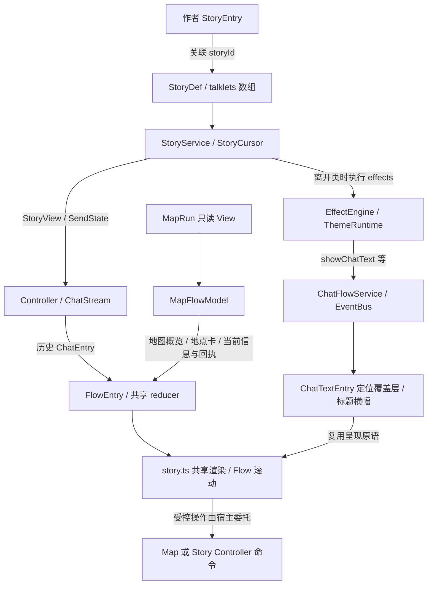

# docs/plan-work/report-0321-story-talklet-capability-investigation — Story–Talklet 全能力调查与整改交接

本文回答：项目里被称为 Talklet 的全部相关能力分别落在哪些作者契约、运行时和 UI 路径中；单 Story/单 Talklet 实际能表达什么；未来 Story 编辑工具应考虑哪些现状、缺口和待决问题。

状态：调查报告，供上层 chat 设计推演；不代表整改方案或实施任务已经批准。

日期：2026-10-22。三位子 Agent 分别负责运行时、Flow/地图/卡牌、定位/ID/演出，主 Agent 负责作者入口与校验、交叉核查和汇总。依据为当前磁盘源码与测试；HEAD 为 `36f1b1018bb72ab79845093b41c99166f207a58d`，工作树含大量并行开发修改。报告中的行号是定位提示，后续修改后以符号为准。

## 1. 给上层 chat 的首读结论

用户关于 Talklet 有地图、卡牌、可定位置与 ID 等丰富能力的记忆有明确代码依据。此前只按 `data-services/contracts/story.ts` 的 Talklet 接口概括，范围不足。现状是一组相互连接但语义不同的机制：

1. **作者 Story Talklet**：有顺序的页面，携带发言、图片、回复、选择、点击工作、效果、跳转、羁绊入口。
2. **Flow 呈现条目**：有流身份、实例身份、可选逻辑 ID 与回收策略；还支持地图概览、纯文本附加行、受控动作和业务附件。
3. **定位演出覆盖层**：通过 `showChatText` Effect 按临时 ID 放置、覆盖或擦除文本/嵌入 Talklet；支持 x/y、模板、字体、字号、颜色和背景。
4. **业务宿主与投影**：MapRun 负责地点和卡牌等领域事实；MapFlow 与宿主把一部分事实接入共享渲染与命令。UI DTO 有字段，不等于 Story 作者已可直接声明。
5. **主题与背景演出**：通过 Effect 和 ThemeRuntime 改变周围呈现，不是每条 Talklet 自身的样式字段。

有三个必须保留的精确限定：**地点卡已有产品接线；`mapCards` 行动卡附件有类型和渲染器，但当前 MapFlowModel 不生产它。** **定位覆盖层内嵌 Talklet 复用显示，不会递归执行其中 effects/choices/jump/clickWork。** **带 ID 的 `flowEntryFromTalklet()` 适配器也只有定义和测试，当前普通 Story 没有调用它。**

## 2. 交接材料与推荐阅读顺序

总报告可单独阅读，详细字段与证据分四篇附件。上层 chat 若需要提出整改模型，应至少读取总报告与三个能力附件，不应只凭首读结论直接定新 Schema。

| 顺序 | 文件 | 回答的问题 |
| --- | --- | --- |
| 1 | 本报告 | 全貌、能力归属、身份与状态、整改决策议题 |
| 2 | [[docs/plan-work/reports/story-talklet-investigation/runtime]] | 单 Story/单页的完整字段、推进、效果、选择、跳转、入口、重读、完成与保存 |
| 3 | [[docs/plan-work/reports/story-talklet-investigation/position-id-presentation]] | 定位置/临时 ID/替换擦除/模板与样式/嵌入 Talklet/主题和横幅 |
| 4 | [[docs/plan-work/reports/story-talklet-investigation/flow-map-cards]] | Flow 全字段、地图、地点卡、行动卡基建、宿主命令、回收与历史 |
| 5 | [[docs/plan-work/reports/story-talklet-investigation/authoring-and-validation]] | Builder、JSON、独立与游戏内编辑器、手写 Schema、校验、内容统计 |

这些附件是同一调查的一部分，不是另立四套权威机制文档。持续维护入口仍为 [[docs/docs-829/06-wiki/30-arona-clicker-domain/story-and-chat]]、[[docs/docs-829/06-wiki/50-ui/refresh-update]]、[[docs/docs-829/03-data-structures/datapack-contracts]]。

## 3. 实际链路与层次

图中箭头表达调用或数据投递，不代表静态依赖全图。尤其 `MapRun → MapFlow` 不是 `MapRun → StoryService`。定位覆盖层也没有取得一个独立的 StoryCursor。

## 4. 能力总矩阵

状态用语：**已接线**为存在当前生产调用链；**基建**为有类型/渲染实现而缺少当前业务生产者；**待定**为本轮提出的设计问题。测试和具体限制见附件，表中“可用”不等于任意字段组合均合法。

| 能力 | 声明/来源 | 现行处理 | 状态/重要限制 |
| --- | --- | --- | --- |
| 角色发言与纯文本 | Talklet.text/speaker | ChatStream 投递并渲染 | 已接线；speaker 是显示字符串，不自动等于角色 owner |
| 旁白及对齐 | kind=narration、align | 旁白 renderer | 已接线；align 也被当前选择卡使用，需按位置识别 |
| 左右气泡 | side | talk renderer | 已接线；右侧不自动等于玩家身份 |
| 头像与隐藏/强制显示 | avatar、noAvatar、showAvatar | 头像解析、连续发言分组 | 已接线；普通流与嵌入覆盖层透传字段有差异 |
| 图片 | image | Pic 索引或直连资源解析 | 已接线；不是任意 HTML |
| 玩家回复与静默推进 | sendText、muteReply | clickSend 决定是否回显 | 已接线；click 页不回显普通回复 |
| 点击工作量 | kind=click、clickWork.base/rand | 游标保存 total/done | 已接线；click 页本身不进入普通消息历史 |
| 选择与可用条件 | choices、choice.condition | 文本确认、选项显示与执行前重验 | 已接线；选择不是多个独立 Story 入口 |
| 页面/选项效果 | effects / choices.effects | advanceStory 执行 | 已接线；通常在离开页面时执行 |
| 跨 Story 转移 | jumpToStory、goto | 更换实际 StoryDef | 已接线；入口身份保持，目标从第一页开始 |
| 子 Story 插入返回 | jumpMode=insert | insertStack 保存下一页返回点 | 已接线；不是当前 Story 的页内标签跳转 |
| 羁绊卡片 | kizuna | 当前页/覆盖层卡片与 ActiveStoryEntry 启动 | 已接线；不是 goto StoryDef 的同一操作 |
| 输入与思考节奏 | typing、thinking | ChatStream 的 typing/pause/thinking 门控 | 已接线；UI 计时，非所有页种类适用 |
| 自动连发 | 由页面无交互需求推导 | UI 送达后经 Controller 继续推进 | 已接线；不是 StoryDef 独立 autoplay 字段 |
| 开幕/幕间标题 | showOpeningTitle Effect | beginStory 首页特例与事件横幅 | 已接线；展示期间有推进门控 |
| 定点文本 | showChatText.value.text/x/y | ChatTextEntry 与绝对定位覆盖层 | 已接线；聊天窗格归一化坐标，不是世界地图坐标 |
| 定点嵌入 Talklet | showChatText.value.talklet | talk/narration/kizuna 显示复用 | 已接线；不会执行嵌入页的流程与状态效果 |
| 临时 ID 替换 | showChatText.target | 同流同 ID 原位替换覆盖层对象 | 已接线；与 Flow replaceSameId 的尾插不同 |
| 按 ID 擦除 | clearIdChatFlow | 从当前演出文本集合删除 | 已接线；不等于删除任意历史消息 |
| 清除全部覆盖层 | clearAllChatText | 保留普通聊天历史 | 已接线 |
| 清除聊天流 | clearAllChatFlow | 清历史及覆盖层、取消相关门控 | 已接线；当前事件路由依赖活跃流 |
| 模板与字体/字号/颜色/背景 | ChatTextKind、ChatTextStyle | 覆盖层样式 | 已接线；不是普通 Talklet 同名通用字段 |
| 主题与表现切换 | setTheme、setEntityPresentation 等 | 临时主题、实体主题槽、内存表现覆盖路径各异 | 已接线；作用域与生命周期应逐种区分 |
| Talklet Theme Lite 生命周期 | TalkletThemeSpec / setTalkletTheme | fulltime/areatime/seconds/step 与 targets | 基建；未找到当前 Story 播放调用，不是现行作者开箱即用字段 |
| 流中逻辑身份 | FlowTalkletInput.id → contentId | 类型化投递 adapter | 基建；当前无生产调用，尚未进入 StoryDef Talklet 契约 |
| 条目回收 | append / replaceSameId | 同一流先回收再追加、上限 200 | 已接线；需非空逻辑 ID，不能用它代替页已读身份 |
| 地图概览 | FlowContent.kind=map / mapOverview | MapFlowModel → 共享地图 renderer | 已接线；来源是 MapRun View |
| 地点选择卡 | mapLocations | 当前 Node 候选卡、选择后由统一 Click 提交移动 | 已接线；有来源复核，失败不消费条目 |
| 行动卡附件 | mapCards | 有 FlowMapCard 与 renderMapCards | 基建；当前 MapFlowModel 没有生产 mapCards |
| 流内按钮 | actions / marks | 白名单属性输出、宿主事件委托 | 已接线；不接受作者任意 HTML/JS，不自带业务权限 |
| current 与 observed | lifecycle、业务投影 | 当前态更新与会话内观察历史 | 已接线；不等于持久存档事件日志 |
| 稳定滚动与条目更新 | streamKey / instanceKey | FlowScroll 与宿主 DOM 协调 | 已接线；与作者节点 ID 属于不同身份层 |

## 5. “ID”至少要区分这些身份

| 身份 | 用途 | 不能替代的身份 |
| --- | --- | --- |
| StoryEntry.id | 入口准入、owner、奖励、后续触发来源 | 实际正在播放的 StoryDef |
| StoryDef.id | 演出定义、跳转目标、阅读/完成身份 | Entry 来源 |
| Talklet 数组页码 | 当前页、返回点、读过的页、分支前置 | 稳定作者节点 ID，目前没有此 ID 字段 |
| choice 数组索引 | 当前选择及历史选择记录 | 稳定选择节点 ID，目前没有此 ID 字段 |
| storyPageKey | Entry + 实际 StoryDef + 页码，防重复投递 | 文本内容或消息实例 ID |
| ChatEntry.id | 数值消息实例 ID，恢复时继续递增 | 作者逻辑 ID |
| Flow streamKey | 流实例隔离 | 角色定义 ID 或 Story 定义 ID |
| Flow instanceKey | DOM 协调、阅读锚点、实例存续 | replaceSameId 的逻辑身份 |
| Flow contentId | 显式回收的逻辑槽 | 作者页进度和已读身份 |
| showChatText.target / ChatTextEntry.id | 当前流覆盖层的临时命名对象 | 普通聊天历史条目或剧情节点 |
| Map objectKey / CardRef / NodeRef | 领域对象、交互来源与时效复核 | 呈现实例键或作者字符串标记 |

未来编辑器若提供一个笼统“ID”输入框，很容易把这些身份合并。应先确定它编辑的是哪个命名空间，以及复制、引用、删除和存档恢复分别遵循什么规则。

## 6. 单页与单 Story 的执行事实

一页 Talklet 可以同时声明显示内容、玩家等待条件和离开页时的效果。当前通过字段检查决定交互行为；并非互斥的严格节点联合类型。例如 choices、kizuna、kind=click 与 clickWork 并存时，`getSendState`、`renderCurrentStory`、`advanceStory` 各有判断优先级，不能假定一种统一自动组合。

单 Story 是有序数组。跨 Story 图来自页和 choice 的跳转，insert 用临时栈记录返回到调用 Story 的下一页；没有现成的作者页标签、页 ID 或任意页号跳转字段。跳转链有深度上限；它是运行时防御，不是作者图的预先验证。

完整播放链保留 Entry 身份，但 actual StoryDef 会改变。Entry 完成、Story 完成、visitedStoryIds、已读页面、UI 消息送达分别有不同记录时机。`beginStory` 已记录首页面阅读，而消息可能仍在 UI typing 阶段，**已读记录不是“已经真实显示”的确认回执**。

`replayStory` 会设置 isReplay，链完成时跳过完成奖励/完成记录等；页面和 choice 的 effects 仍在 `advanceStory` 执行。因此重读不是天然隔离的编辑器预览。`startCardStory` 又是另一种入口：skipConditions + force、isReplay=false；它与 `clickSend` 内部 kizuna 分支的选项不完全相同。

## 7. 状态与保存矩阵

| 数据 | Owner/保存位置 | 本轮核实的恢复语义 |
| --- | --- | --- |
| 当前 Entry/StoryDef/页/选择 | StoryCursorState → snapshot context | 全局和按 owner 的聊天沙盒分别捕获/恢复 |
| clickWork.total/done | StoryCursorSnapshot | 可以继续已滚出的工作量，不是只保存作者 base/rand |
| insertStack / visitedStoryIds / isReplay | 游标快照 | 保存后恢复；jumpDepth 和 choiceTextConfirmed 属于运行时瞬态 |
| 完成与页/选择已读记录 | PlayerState | 与 UI 消息历史分开；页码重排会影响语义 |
| 普通 ChatEntry 历史 | UI withHistories/restoreHistories → SaveData | 按页指纹避免当前页重复，继续唯一消息 ID |
| typing 临时气泡 | UI 门控瞬态 | 不保存为送达历史，恢复后按当前页重新送达 |
| 已送达连发页 | UI 历史 + 当前游标 | 恢复去重并继续节奏链 |
| 定位演出文本覆盖层 | PanelState chatTexts / studentChatTexts | 不在 chatHistories 中保存 |
| 开幕横幅、节奏计时器 | ChatStream 运行时集合 | 不作为完整时间轴保存 |
| Map observed 条目 | MapFlowModel 会话观察 | 不等于完整的 MapRun 领域日志，读档不伪造以前的观察历史 |

上述矩阵不表示整改必须维持所有限制。它说明：若新工具支持任意拖动、热替换、倒带、跳到某页或重排，必须明确如何处理这些不同 Owner 的数据。

## 8. 作者能力与编辑入口存在落差

- 正式 TypeScript Talklet 没有 x/y/id/mapCards 字段，但它能通过 effects 调用演出覆盖层；单纯查看顶层接口会漏掉能力。
- 定位演出内嵌 EngineTalklet 允许领域附加字段，UI 会以更丰富 Talklet 解释一部分字段；类型最小面与实际显示面并不完全等宽。
- Flow 中有地图和卡牌相关字段，但它们是 UI 投影，不是目前可从 Story JSON 自动接入的组件声明。
- Talklet Builder 缺少 choice.condition 的设置方法，直接对象可以表达它。
- 独立编辑器 stories 整表是手写 custom Schema，未列出 kizuna；Schema 自动生成和同步测试不能完整兜住 custom 表字段覆盖。
- 游戏内 Runtime Editor 可以浏览和导出 Story 来源数据，但正式草稿/Apply 作者策略当前只闭合四种实体，不能把内容浏览器当成已有 Story 编辑工具。

详细证据、未知字段保留的限定、引用候选与校验差异见作者与校验附件。

## 9. 真实内容与验证证据

正式 `src/arona-clicker/content/base-pack/content.json` 中有 **43 个 StoryDef、118 页 Talklet、14 个主动入口、25 个被动入口**。页/choice 的直接 effects 中已有 12 次 showChatText、6 次 setTheme、3 次 clearIdChatFlow、2 次 clearAllChatFlow、2 次 showOpeningTitle、1 次 clearAllChatText。坐标、ID 和演出能力有正式内容声明，不能都归为历史设想。统计范围和完整字段计数见作者附件。

### 9.1 本轮实际执行

2026-10-22 根 Agent 运行以下 9 个既有定向测试文件，**9 个文件、120 项测试全部通过**，耗时 14.96 秒：

| 文件 | 核验主题 |
| --- | --- |
| `tests/engine/def-factory/talklet.test.ts` | Builder 输出与辅助字段 |
| `tests/engine/story-flow.test.ts` | click/goto/insert/选项文本确认 |
| `tests/engine/story-replay.test.ts` | 重读准入、分支守卫、完成奖励不重复 |
| `tests/engine/chat-flow-service.test.ts` | 演出事件桥与不直接改 PlayerState |
| `tests/ui/flow-entry.test.ts` | 逻辑身份透传、回收、跨流隔离、上限与序列化 |
| `tests/ui/chat-typing.test.ts` | typing/thinking/连发、加速、头像分组和临时条目 |
| `tests/ui/story-history-resume.test.ts` | 读档去重、同文不同页、实际 StoryDef、消息 ID 与连发恢复 |
| `tests/ui/components/chat-text.test.ts` | 定位覆盖层、模板、样式、内嵌显示与操作 |
| `tests/ui/components/chat-image.test.ts` | 图片与头像解析/呈现 |

执行命令为 `npx vitest run` 加上述 9 个精确路径。测试运行产生了 Node localStorage experimental warning，退出码 0；不影响通过结论。没有新增测试或修改运行代码，没有运行全量套件、没有做真实浏览器验收。通过这些测试不证明所有作者字段组合、非法输入或未来工具交互已经完整覆盖。

### 9.2 事实、差异和设计建议应分开使用

附件记录了数处注释与当前行为不一致、仅有 renderer 的能力，以及不同入口的语义差异。这些是整改需要知晓的现状，不在本轮自行修复，也不直接定性为已批准 bug。需要改变行为时，应另立明确目标和行为测试。

地图与卡牌子 Agent 另运行 5 个不重复的定向文件：`tests/ui/map-flow-adapter.test.ts`（19）、`map-location-card-render.test.ts`（2）、`card-host.test.ts`（5）、`map-relation-interaction.test.ts`（20）、`scroll.test.ts`（16），共 **62/62 通过**。本轮合计 **14 文件、182/182 项通过**；两个批次的证据范围分别保留，不扩大为全量通过。

### 9.3 值得优先讨论的实现差异

| 现行观察 | 影响 | 证据性质 |
| --- | --- | --- |
| clearAllChatFlow 的 target 在实际转发中丢弃，事件无 owner | 不能向作者承诺可定向清除任意学生流；后台 Story 与活跃 UI 流可能不同 | 源码链已核实，未新做跨流复现实验 |
| startCardStory 传 force，clickSend 的 kizuna 路径不传 | 已完成目标的两种启动结果不同，不能视为同一入口 | 源码参数已核实 |
| replay 的 page/choice effects 仍执行 | 不能直接拿重读做无副作用编辑预览 | 源码已核实，现有奖励测试只证明完成奖励 |
| 初始 StoryDef 用于完成准入，终端实际 StoryDef 用于链尾完成 | Entry、跳转、FollowUp 与奖励的完成身份有不对称 | 源码已核实，尚未构造新回归 |
| beginStory 只呼出首页第一个标题；jump 不调用 beginStory，离开首页仍过滤标题 op | 跳转目标首页的标题语义与普通启动不同 | 源码路径已核实 |
| 横幅实际为 3000ms，TSDoc 写 30 秒 | 工具提示与预览时长不能照抄旧说明 | 常量与 CSS 已核实 |
| 标题缺省回退拿 Entry ID 查询 StoryDef | 不应假设缺省标题回退已按三层身份正确闭合 | 源码已核实，缺省路径未新做测试 |
| click+choices 组合的输入模式与 advance 校验不一致 | 类型可表达的组合不一定可通过普通按钮完成 | 源码观察，未复现为独立 bug |
| flagsSetThisStory / lastRewarded 服务级共享，visitedStoryInChain 读全局游标 | 不能把全部临时演出状态都视为 owner 隔离 | 源码已核实，并发影响待测 |
| current/observed 由 MapFlow sync 解释，reducer 不解释；缺省与注释有差异 | 新生产方需显式声明生命周期，不能只复用类型名 | 源码已核实 |
| custom Story Schema 跳过一般生成字段覆盖检查 | Schema 同步测试通过仍可能缺少作者控件 | 源码已核实 |

详细行为及限定见对应附件。这里记录的是整改议题，不是要求上层 chat 全部按 bug 修复，也不是本轮已经完成修复。

## 10. 给上层 chat 的整改推演清单

### 10.1 先决定编辑对象与身份

1. “Story”在工具中指单 StoryDef、Entry 关联的完整播放链，还是一个创作项目？一个文件中能否含多个入口？
2. Talklet 是否继续是一个可以混合显示/效果/交互的对象，还是分为呈现块、控制节点、等待输入和状态操作？
3. 是否引入稳定页 ID 和选择 ID？旧页码日志、游标、insert 返回点和 branchGuards 如何迁移或明确失效？
4. 角色显示、头像索引、主题来源、对话 owner 和玩家身份要不要结构化？它们当前并不自动绑定。

### 10.2 再决定丰富呈现的接入方式

5. 定位覆盖层继续作为 Effect，还是成为工具里的显式场景对象？ID 的作用域是流、Story、Entry 还是演出会话？
6. 覆盖层同 ID 原位替换、Flow 同 ID 回收尾插、普通消息追加是否都需要保留为可选操作？
7. 地图/卡牌等能力是纯展示快照、受控宿主组件，还是可以直接操作业务的作者节点？来源与过期校验如何传递？
8. 当前 mapCards 基建要接入什么真实来源？不能直接把旧类型字段当成已批准的卡牌产品模型。
9. 样式允许范围、资源选择和主题作用域如何在工具内准确表达？普通 Talklet 和定位层是否共用一套属性面板？

### 10.3 最后决定播放、预览与迁移承诺

10. 预览是否必须完全隔离 PlayerState、移动、奖励和事件？现有 replay 不满足这项默认假设。
11. 支持暂停、逐页、倒带、跳页、模拟选择、随机种子与点击工作量到什么程度？若倒带，是否需要状态快照或事务？
12. 编辑时是否允许更换正在播放定义？Save/Init 恢复、UI 历史、未知字段与旧包如何兼容？
13. 验证是否涵盖完整跳转图、不可达页、循环/深度、资源和 Entry 类型错引、组合冲突与死锁页？
14. 先制定“保留/替换/退役”的能力清单，再拆实现阶段；避免只实现一个新的对话文本表单后丢掉已有定位和宿主能力。

上述问题用于设计讨论，不预设答案。尤其不预先决定使用节点图、时间轴、脚本 DSL 或某种通用 Widget 系统。

## 11. 上层 chat 可直接采用的任务说明

> 请将本报告及四篇附件作为当前事实输入，设计 Story–Talklet 大整改和后续 Story 编辑工具。先区分作者内容、领域播放、Flow 呈现、定位演出与业务宿主，提出保留/重塑/退役的能力矩阵、身份和状态 Owner、预览隔离与存档策略，再讨论编辑界面。不要把 UI DTO 字段误当成现有作者能力，不要把历史方案当成实现；不要默认 replay 无副作用。遇到报告中未验证的问题，请列为待决项并指定需要补查的证据。

## 12. 调查范围与后续核验

本轮限于 Story–Talklet 及其直接呈现、作者和持久化连接；MapRun 战斗/结算、主题系统、包生命周期等只核查与该主题直接相关的边界。没有全项目代码审计，也没有批准任何产品重构。

项目身份已通过 GALHCG 核对；查询未改图、未刷新。交付时已对本次文档范围做集中只读检查，不因地图未索引新报告而扩展改图授权。

交付检查记录：

- `npm run check:docs`：通过，扫描 1222 篇 Markdown，errors=0。
- 本次文档范围 `git diff --check`：通过；索引原有 CRLF 转 LF 提示属于换行提示，没有空白错误。
- 本报告与四分册合计约 1354 行、121KB；登记至 `docs/plan-work/00-index.md`，未改产品源码。
- GALHCG 的新总报告与分册目录返回 `unreferenced_path`，表示没有直接 Evidence/maps_to；不把它当作语义检查通过。索引返回 content_changed，已读完全部 9 项 owner/Evidence/导航关联；其中 6 项既有 Evidence 的捕获内容与当前索引不同。该索引在本任务前已有并行修改，不能把所有差异归因于本次新增入口。未回填图、刷新或写 freshness。
