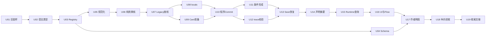

# Task 0312：Gameplay B Effect Program E1 正式施工

状态：ready-for-implementation — E0合同及人类批准已核实，19个有依赖的产品Unit已定义；全部Unit尚未执行。本次只更新施工规划，不授权把“计划完成”写成“产品已实现”。

本文回答：如何把已批准E1-COMPAT-1落成合法Datapack可装载、可准备、可Preview/Commit、可保存恢复且可由作者参考的产品能力。

## 1. 准入依据与范围

唯一玩法语义依据是 [[docs/plan-work/archive/task-0313-gameplay-b-e0-contract-freeze-and-admission]] §9.2/§9.3/§10及回写后的 [[docs/plan-work/draft-0312-gameplay-b-card-and-effect-primitives]] §11；其§13 AG-1为独立后续合同，**不是本Task执行政策**。

已阅读E0 U1–U5实际Receipt、current-behavior-evidence和behavior-cases；Receipt内“待批”是执行当时历史，最终§10用户2026-10-21“全部按推荐”已经批准P1–P8。E1必要P1条件时点、P2 Counter饱和、P3 non-battle整轮后完成全部获批，无剩余人类玩法审批。D06/D07/D08及实现字段/函数名为工程合同，不逐项重开审批。

- **E1交付**：有限顺序/when/else、HP/局内Actor与Team资源、Encounter Counter/Flag、已有CardRef sCost减费、non-battle condition完成；五个真实作者样例A/B/C/E/F，完整保存与界面反馈。
- **非目标**：Scheduler/敏捷字段/AG支付与折扣、TargetSet/随机/通用Value、Card Tag/CardPool、Status/Shield/复活、成长Adapter、跨Owner奖励/Story写回、全局Action模板、任意Datapack TS Handler。
- 已完成0309准备页直接复用。E1验收后才解除独立AG Runtime的实现前置；不同时改同一planner/restore。
- 本Task延续0312编号，无平行产品Task。Draft保留设计理由，本文只保留施工所需合同摘要、接线边界、Unit与验收。

## 2. 原Task审阅结果

| 处理（包含创建轮已由E0修订项） | 原0312内容 | 正式施工Task处理 |
| --- | --- | --- |
| 保留 | 独立E1目标、声明式约束、唯一Owner、旧格式规范化、A/B/C/E/F、完整Save与UI闭环 | 继续作为总验收，不扩大E2–E5 |
| 修正/消歧 | 各节“推荐/待E0冻结”、Counter越界拒绝、F用大上限绕过越界 | 改以E0最终批准为准：安全整数加法后饱和，信任2/3两次+1→3、actual+1/0 |
| 修正/消歧 | 泛称所有效果按顺序、所有来源起始余额聚合 | 新program逻辑HP/locals与资源账本双通道；Enemy仍逐源当时余额；Actorless不得额外Action cost；Command skip仍收选中费 |
| 修正/消歧 | Actorless/prepare只笼统复用、Receipt建议、预算待批 | 明确unit primary及source禁用；两处cardEffects专属预览检查须改；D07/D08工程规格直接实施 |
| 拆分 | 原P1合同/Registry/Schema、P2全部运行时、P3恢复/投影/演示 | 下列19个Unit；每个有局部全绿测试，不等所有E1完成才验证 |
| 移出 | 已批准但属于AG的逐源支付、高速补给/击杀、双方统一折扣与即时停战 | 不进E1成功断言或叶子语义；只在敏捷交接列已批准后续 |

原创建轮167项及E0四文件78项均为各自历史基线，不是本轮或新功能实测。历史设计/核验记录仍在Draft §12和归档0313，本文不重复维护平行合同。

## 3. 已核实源码落点与主要风险

本轮基线HEAD `dff0061`，源码未出现effectProgram/locals/executionContractId接线；工作树已有E0文档、协作协议及其它测试改动，均保留。以下符号已回当前文件核对，开工按实际工作树重核差异。

| 当前接线 | 文件/符号 | 本Task风险与处理 |
| --- | --- | --- |
| Action旧数组与manual completion | `src/data-services/contracts/gameplay-map.ts` | 类型、Registry和Schema一起交付，不能只扩interface |
| 作者引用/字段白名单 | `src/data-services/registry/registry-validate.ts`：validateMapActionContent/validateEncounter | 逐node/activity/source验证所有分支；resourceId是局内字符串键，不查AC Resource替代余额 |
| 只读数据包映射 | `src/arona-clicker/services/registry-map-content-resolver.ts`：createRegistryMapContentResolver | 真实Registry→Owner输入；自定义resolver仍不能绕过运行时校验 |
| 权威计划 | `src/arona-clicker/services/map-run-service.ts`：resolveEncounterCommitPlan | 保持C0–C6旧调度；只抽单source效果核，外层管支付/目标/终局 |
| 准备资格/真实卡 | `src/arona-clicker/services/gameplay-b-action-preview-resolver.ts` card分支；`src/arona-clicker/services/map-card-effects.ts` | 两处还强制旧cardEffects；复用真实CardRef，不能只改Registry |
| 局内状态与转换 | MapRunService.createEncounterSnapshot/snapshotOf/advanceCompletedActivity/prepareEncounterRoundCommit | 每轮重建Hand时locals保留；新Encounter重置；定向验证转换准备的种子纯度 |
| 准备/安装与Item | MapRunService.prepare/canInstall/install；`src/arona-clicker/runtime-game-instance.ts`：commitMapEncounterRound | 只安装完整detached plan，双Owner重核连续安装后才发布库存事件 |
| 严格恢复 | MapRunService.restoreEncounterCommitReceipt/restoreEncounterSnapshot/restoreRunState/restoreSaveSnapshot | 新trace不能只信布尔；旧数组恢复不被强加新字段 |
| Save封装 | `src/arona-clicker/runtime-save-codec.ts`：buildSaveData，SaveData.mapRun | 现有JSON透传能带新嵌套数据，不预设必须改顶层save版本或复制新Owner |
| 展示 | `src/arona-clicker/services/map-relation-projector.ts`、runtime-game-instance action/source/recentCommit查询、map-workspace、map-flow-model | 多处只枚举旧数组，声明条件分支与Owner实际结果必须分开 |
| 正式可选包 | `src/arona-clicker/content/gameplay-b-map-datapack.ts` | 追加一个独立例图和设施入口，不批量迁移旧八张图 |

主要结构风险：相位改写伪装等价、预算在每source重新计数、浅拷贝locals、旧restore硬编码效果数组、UI把条件分支都显示为必然、跨activity prepare随机分配/重复安装。分别由U07/U10/U08/U12–13/U14–16/U11验证，不以全仓审计替代定向证据。

## 4. 不可更改的E1实施合同

精确正文见Draft §11.1–11.3；下表是Unit必须满足的核对项，不另立玩法方案。

| 合同 | 实施边界 |
| --- | --- |
| 语法 | action.effectProgram包含prepare/resolve；resolve有限hpChange/resourceChange/counterAdd/flagSet/when，else可选；同Action不混旧效果数组，costs/target仍独立 |
| 读值 | when到达处读取当前规划HP/cap/Counter/Flag；不读资源/任意路径/通用Value；then与else均静态验证且只执行一支 |
| 单位/账户 | source/primary、sourceActor/primaryActor/sourceTeam白名单；primary在每source开始绑定；非法/过期身份整轮拒绝，显式合法后倒地不换人且HP0实际0，自动按旧规则fallback |
| Actorless | 仅现有Ability/Item明确unit主目标，无source/self/sourceActor/card/prepare；Action costs必须为空，Ability额外PlayerCost1、Item外部库存1；E1有效选中即使HP0仍收费 |
| locals | Encounter唯一活Owner，Counter先安全整数加法后clamp(min,max)，安全溢出拒绝；Flag只bool；跨轮保留、换Encounter重置、快照完整 |
| 执行/支付 | party→Ability→Item逻辑HP/locals规划，资源记账；己方起始余额聚合实际成本后兑现账本；奖励不能付本轮前置费。Enemy保持声明序和本源当时余额支付；旧相位标签保留旧资源/HP次序 |
| 减费 | 常量prepare折扣相加截原Actor sCost，不赠余额/减PlayerCost。E1己方预处理、Enemy只作用后续Enemy，不能偷换AG双方统一准备 |
| 完成 | non-battle condition与rounds/manual互斥，整轮合法效果后判、失败优先，沿既有活动推进一次；Battle保留旧阶段终局，不能因清敌跳过本来会结算的慢Item |
| 安全/事务 | 同一MapRun planner用于Preview/Commit；所有变更暂存，错误/过期/预算/库存失败零安装；requestId等幂等规则保持 |
| trace/恢复 | E1-COMPAT-1、programReceiptVersion；实际source/path/op/受用者/delta、必要before/after/guard读数含0变化；与旧投影互校，仅最近成功轮，不存历史世界/函数缓存，不做迁移 |

D08：静态64=prepare叶子+语句(含when)+条件树所有节点，所有分支全算；resolve/condition各自根深度1、上限4；prepare≤8、Encounter locals总≤64。动态整轮新program实际语句/条件/prepare访问≤4096，短路未访问/未走branch/skip resolve不算，prepare只一次；旧数组不追溯。耗尽拒整个计划。细则不需用户再批准。

### 内部执行接口与后续敏捷边界

拟新增路径和函数名均是本Task工程接线约定，不表示现有API。完整新路径在各Unit Allowed Files逐项列明：

- data-services：有限作者类型、纯语法/上下文校验、normalizeMapActionEffects一类统一规范化函数；不依赖Runtime/UI/示例。
- 产品内部：planMapEffectSource一类纯来源规划函数与共享leaf。输入规范化指令、已经解析的source/primary/账户、detached HP/locals与轮budget；输出HP/locals变化、资源账本、guard/trace。无真实Owner句柄，不接MutationPort，不决定party/Enemy顺序、支付或终局。
- Legacy编译器输出兼容相位标签，外层E1 planner决定何时调用/兑现；新program在source内顺序解释。不得保留旧HP/resource同义executor与新VM各算一份。
- 准备CardRef、费用、目标fallback、source资格、事务与完成仍归外层已有服务。后续AG可复用同一效果核而替换source调度/支付政策，本Task不构造schedulerFormatVersion/agility或统一执行队列。
- 整轮动态budget唯一归resolveEncounterCommitPlan：每次Preview或prepare调用创建独立计数器，prepare元数据只在其实际规划阶段消费一次；U09查询不计数，U06仅通过该轮传入的访问入口报告resolve访问，不维护第二个累计器。重复Preview分别从0计数，幂等重放不再规划；不得靠去重掩盖重复执行。
- Registry接通而Runtime未接通的中间版本不得静默忽略新内容；U03加显式拒绝，U10/11移除对应临时限制。所有Unit均不得单独发布未完成E1到产品。

## 5. Unit依赖与独立验收

按 [[docs/ai/PROJECT-CONSTITUTION]]，拆分目录task-0312-units。每份Unit通常≤4个产品/文档/证据文件+1份自己的Receipt，手写净改动常规预算500行；用户于2026-10-22补充“可以按需放宽限制行数到1000，后续再思考可否抽象包装”，因此负责人可依据实际工作量为特定Unit记录放宽额度，最多1000行，无需再请求同一授权。生成协议单独记录不计手写行数，文件白名单与语义边界不自动扩大。只读Read Set按符号分段，不把巨型源码整份载入；预计超1000行或目标无法独立验收时再拆分。

图只表达核心依赖，精确全部前置以下表/Unit为准。不同分支可分别准备，但**文件白名单重叠时串行施工**，尤其map-run-service；不授权自动启动多Agent。

| Unit（均未执行） | 前置 | 独立结果 |
| --- | --- | --- |
| [[docs/plan-work/task-0312-units/task-0312-u01-legacy-goldens]] | 无 | 新OLD基线在未改产品源码时全绿；每个skip/费用分通道/目标窗口可独立运行，所有初态由真实Owner流程可达。 |
| [[docs/plan-work/task-0312-units/task-0312-u02-author-contract-and-syntax]] | U01 | 完整最小AST可通过纯校验、边界及未知op负例全绿；TS编译通过，现有旧作者合同未失效。 |
| [[docs/plan-work/task-0312-units/task-0312-u03-registry-context]] | U02 | 真实Registry装载合法E1定义并逐上下文准确拒绝NEW06负例；全部旧Registry测试保持；不将无效引用默认为0。 |
| [[docs/plan-work/task-0312-units/task-0312-u04-schema-sync]] | U03 | 源类型→生成协议→同步测试可复现，有限AST无静默丢字段，生成产物未手改。 |
| [[docs/plan-work/task-0312-units/task-0312-u05-normalization]] | U02、U03 | 两种作者表达拥有单一叶子集合和可检验path/相位信息；全部规范化单测通过，未改变任何旧运行结果。 |
| [[docs/plan-work/task-0312-units/task-0312-u06-pure-effect-planner]] | U05 | NEW01条件前后/else、NEW03/04饱和与溢出、受用方、共享动态预算及HP0均有纯行为测试；输入快照不被修改，无随机/事件/安装。 |
| [[docs/plan-work/task-0312-units/task-0312-u07-legacy-planner-integration]] | U01、U06 | 旧四通道含Card折扣真实调用共享leaf，OLD金样和现有回归不改期望全绿；尚未接线的新内容确定失败而非成功无效果。 |
| [[docs/plan-work/task-0312-units/task-0312-u08-encounter-local-state]] | U03、U07 | locals在真实Encounter生命周期中有唯一Owner、跨轮不重置、换Encounter不泄漏，旧Map无新增强制字段；不可变快照测试通过。 |
| [[docs/plan-work/task-0312-units/task-0312-u09-card-prepare-adapter]] | U07 | E1新prepare和旧折扣共用真实CardRef路径，准备预览合法且纯读；不被旧mandatory cardEffects误拒，全部旧折扣语义保持。 |
| [[docs/plan-work/task-0312-units/task-0312-u10-program-authoritative-commit]] | U08、U09 | 新程序由公开Preview/Commit链真实生效，旧金样不变，失败零安装、幂等/外部库存不重复；共用语义核但调度仍E1旧序。 |
| [[docs/plan-work/task-0312-units/task-0312-u11-completion-and-transition]] | U10 | 条件完成真实推进一次且整轮后才判，Battle/manual/rounds无回归；跨activity准备和失败事务无新增可见随机漂移。 |
| [[docs/plan-work/task-0312-units/task-0312-u12-trace-validation]] | U10 | 对U10真实产生的E1 trace正例与独立篡改反例全绿，有界校验规则与不能证明的历史边界明确。 |
| [[docs/plan-work/task-0312-units/task-0312-u13-save-resume-owner]] | U11、U12 | 公开Save/Load含locals/trace可严格恢复并继续，新旧内容兼容边界明确且无迁移；恢复失败零安装，幂等和库存事件次数正确。 |
| [[docs/plan-work/task-0312-units/task-0312-u14-declared-effect-projection]] | U05、U13 | 新program不会从关系/卡面摘要消失，conditional不会被误报为确定结算，查询无状态或RNG变化。 |
| [[docs/plan-work/task-0312-units/task-0312-u15-runtime-readmodel]] | U14 | 卡/来源/Preview/最近Receipt全链不丢新效果或locals，view脱离Owner且反复读取零写；不产生第二次规划安装。 |
| [[docs/plan-work/task-0312-units/task-0312-u16-workspace-and-flow]] | U15 | 现有组件正确展示新声明/实际结果/进度且不计算Effect；局部刷新、scroll/稳定节点和popover范围有DOM断言。 |
| [[docs/plan-work/task-0312-units/task-0312-u17-author-example-datapack]] | U04、U13、U16 | 作者能定位并复制一份真实装载且有设施入口的例图；五类卡均具合法来源/目标/资源和明确操作步骤，无旧内容批量迁移。 |
| [[docs/plan-work/task-0312-units/task-0312-u18-vertical-slice-and-acceptance]] | U17 | 真实合法Datapack完整链路及宽屏交互有实际证据，OLD/EQ/NEW结果全绿、失败原子/幂等/恢复成立；尚未运行项不得标通过。 |
| [[docs/plan-work/task-0312-units/task-0312-u19-documentation-and-handoff]] | U18 | 当前机制、作者指南、Task/索引和实际证据一致；E1验收完成可解除AG的前置实现依赖，后续范围仍独立。 |

### 执行/Receipt纪律

每个Unit开工复述Goal、Allowed Files、Non-goals、Stop Conditions；只改白名单，Read Set之外新增阅读≤2文件，超额或事实冲突上交。Pure helper单测不是第二Runtime，只是后续接同一Owner的内部模块。

Receipt在Unit完成或中断后才创建，使用唯一名task-0312-uNN-receipt.md，不预填成功。普通Unit只写自己的Receipt，由下一Unit读取；不为更新一个勾选而额外改总Task。U18/U19集中回写实际状态。失败/未运行/已有基线错误必须区分；不根据原E0日志虚报本轮测试。

### 负责人依据前置Receipt做局部接线修订

各Unit的目标、已批准语义合同与验收金样不得由施工代理自行修改；后续Unit的工程入口、路径白名单、Read Set、测试入口和直接依赖，可由负责人根据前置Receipt及当前源码作局部更新。不要为了满足规划时猜测的函数形状，反过来扭曲已经实现的正确架构。

执行方式：前置Receipt列实际导出符号/文件、输入输出/状态归属、预算访问入口及验证结果；负责人核对后，在受影响后续Unit记录“旧入口→实际入口、证据Receipt/源码符号、原因、白名单/依赖变化、语义和金样保持”，先更新文档再放行。此类常规工程调整无需重开E0或逐项请求用户批准。施工代理仍须在越白名单前停止上交，不能自行扩大权限。

局部修订不允许增加第二Owner/Runtime、改支付/目标/终局政策、删除负例、降低验收或扩入AG/E2–E5。若证据确实要求改变这些边界，由负责人提交具体差异和影响，不能以“接口调整”替代玩法批准。白名单重叠继续串行；预计超常规500行时，负责人可按本轮授权记录放宽至最多1000行，或按独立验收需要拆分，保留原语义与全部用例映射；执行代理不得自行扩大白名单。

U10另有开工预算检查：U06–U09未实施时不声称已有实际行数估算；其前置Receipt齐备后，负责人按规划接入/状态安装/trace与预算/新增和复用测试/Receipt分别估算净改动。常规500行；若估计501–1000行且目标仍单一可验收，负责人记录依据和额度即可放行，不强制拆分。预计超1000行或规划/事务验收确需独立推进时，再拆为“纯规划接入”和“公开Commit与事务验收”，同步U11/U12等直接依赖及测试归属；前者仍阻止未完整安装的新程序Commit，后者才开放并验收公开事务。U12/U13同样按实际trace/恢复入口核对，必要时适用1000行授权，不扩成历史系统。

当前优先实现清晰、正确且可验证的E1接线，不为满足行数指标预建通用包装。已有的纯source效果核继续按职责复用；额外抽象待真实实现/Receipt显示稳定重复需求后再评估，不用本次额度授权扩大架构或后续玩法范围。

locals职责保持：U08只做初始化、同Encounter跨轮保留、离开清理和不可变快照；U06有纯函数语义测试，U10负责把counterAdd/flagSet接入权威规划与安装。U08不得为了测试方便提前执行程序。

U16以现有patchMapDOM、region刷新及popover生命周期能力为边界。若逐节点更新不足，先验证现有所属region更新是否正确；基础设施缺口附当前函数、最小复现、期望/实际和受影响验收项交负责人，必要时另立范围。不得借E1重构全局刷新系统，也不能把尚未满足的正确性/交互要求自行豁免。

## 6. E0金样到自动化测试的映射

来源 [[docs/plan-work/archive/task-0313-units/behavior-cases]]。该文头部批准更新高于内部保留的“未批”历史标题；只采用已批准主方案。用例必须通过当前Registry角色/Variant、真实Owner draw与公开命令构造版本/Scope，固定可复现种子，不伪造可恢复Hand或不可支付的自然候选。

新测试路径是以下冻结的待创建产物，不是本轮已经写入的测试：

| 分类/E0 ID | 自动化落点（文件名；完整路径见Unit） | 落地Unit/关键断言 |
| --- | --- | --- |
| OLD01及旧来源阶段 | gameplay-b-effect-legacy-goldens.test.ts | U01/U07；旧数组费用/HP/资源/终局/Receipt保持 |
| EQ01 | legacy-goldens + effect-program.test | U10；同初态旧/新表达结果等价，trace新增不要求旧回执字节相同 |
| EQ02（排除AG08） | legacy-goldens、effect-card-prepare.test | U07/U09/U10；叠加截0、未选Hand不转移、Enemy后续范围、PlayerCost不减 |
| EQ03/EQ04及Skip补全 | legacy-goldens、effect-program.test | U01/U07/U10；显式HP0仍付/自动fallback、Command选中费、Enemy四类skip独立 |
| EQ05 | effect-save-resume、effect-runtime-integration | U13/U18；公开Save/Load与库存幂等、损坏Scope/版本/trace拒绝 |
| NEW01 | effect-planner、effect-program、effect-workspace | U06/U10/U16；guard在heal前后、else单支、HP4/5不同奖励 |
| NEW02 | effect-registry、effect-program | U03/U10；非法自然候选不可达；真实Command聚合冲突E1仍拒绝，不能搬AG补给成功期望 |
| NEW03/NEW04 | effect-planner、effect-lifecycle、effect-save-resume | U06/U08/U10/U13；饱和actual+1/0、负增量、safe溢出、Flag反复写、跨轮/Encounter |
| NEW05（E1部分） | effect-lifecycle、effect-runtime-integration、effect-vertical-slice | U11/U18；整轮后完成、failure优先、后续付费奖励仍结算；不测AG即时停战 |
| NEW06 | effect-syntax、effect-registry | U02/U03；缺声明/else非法依赖、阵营账户、Actorless禁source/card/cost/prepare |
| NEW07/D07/D08 | effect-syntax、effect-planner/program、effect-receipt/save-resume | U02/U06/U10/U12/U13；静态/动态计数、4096/4097真实来源、篡改path/guard/链/末值 |
| AG01–AG11 | 本Task无AG自动化通过目标 | 后续敏捷Task；E1测试不要求final排序、逐源己方支付、双方统一prepare或清敌保住Item |

既有定向回归：gameplay-b-map-run、map-cards、map-source-transactions、map-save-resume、map-runtime-integration、map-relations、Map Registry及UI Workspace/Flow/vertical-slice。各Unit给准确命令。字段变动按阶段跑类型/Schema同步/架构检查；最终U18合并一次相应定向套件，没有直接证据不扩大为全仓回归。

## 7. 真实内容与总完成定义

五张卡必须来自U17同一合法例图（可用不同activity），不是裸VM测试数据：

| 作者样例 | 可观察结果 |
| --- | --- |
| A 射击 | 费用1，主目标HP−3；旧/新表达对照 |
| B 掩护射击 | 主目标HP−2，自己弹药+1；起始费用不足仍不能靠奖励支付 |
| C 条件包扎 | 4/10先判断再治疗3且Team+1，5/10治疗不奖励；把guard放heal后则读新HP |
| E 临时强化 | 对当前合法CardRef固定sCost折扣，作用到真实执行卡，过期/移除引用拒绝 |
| F 交涉/休息 | trust初0/max3，跨轮增长，2时Save后继续恰好完成；多人+1饱和不废轮，后续本轮付费奖励完整结算 |

完整验收路径：base+gameplay-b例图加载→Registry/Schema/引用校验→设施mapEntry→0309准备页→Owner真实Hand/准备/主目标→两次Preview零写→Commit→实际Receipt→Save/Resume→继续／condition达标→活动推进与出口。宽屏鼠标与DOM局部刷新皆有证据。

- [ ] U01–U19实际Receipt可追踪；未运行测试/浏览器或未实现Unit不得计完成。
- [ ] OLD/EQ无需篡改旧期望通过，新E1功能按批准规则通过，AG没有提前实现或混入通过结论。
- [ ] Registry装载/所有source上下文/未知op和预算错误均严格验证，直接resolver不能绕过。
- [ ] 单一权威Planner/Owner，纯Preview、失败零安装、跨OwnerItem原子、重放不重复。
- [ ] locals完整寿命、non-battle整轮完成、trace实际0变化及保存严格恢复正确。
- [ ] 实际卡面/关系/来源/Preview/Flow不会漏新program，不执行程序来渲染或报告两分支同时发生。
- [ ] 可引用作者指南和可加载例图一致，旧八图未批量改写；Schema按脚本生成。
- [ ] 自动化DOM测试与真实浏览器实测分开记录环境、操作、结果和未完成项；模拟交互或截图不替代浏览器实操证据。
- [ ] 新旧定向回归、类型、架构、Schema同步与宽屏纵向验收实际完成；现行文档与索引再标产品complete。

## 8. 验证、当前交付与接续

本轮仅修改本Task、创建19份Unit、维护索引；不写产品/测试/数据包/生成Schema，不执行任何E1 Unit，不预造Receipt。当前合同准入与范围准入成立，U01可作为未来产品施工起点；其它Unit须等表中前置Receipt和测试通过。

本轮文档检查基线：8处既有docs-829旧Operation路径失效；前后无新增错误才算本轮路径检查无新增，整体非零不得记成全通过。差异空白及新未跟踪文档尾随空白单独核对。实际创建后检查与GALHCG只读结果记录于本节末。

本轮实际核验：check:docs扫描1107篇，仍为同8处既有错误，无新增路径或重名错误；整体退出1，未记全通过。索引diff --check通过，Task及19份新增Unit的独立尾随空白检查无命中；19个Unit白名单均≤5文件（含自己的Receipt），测试产物依赖已核对无提前引用。未运行游戏/新E1测试、类型、Schema生成或浏览器，因为本轮没有产品实现。

GALHCG只读收尾覆盖本Task、19份Unit及索引共21路径：前20路径均unreferenced_path（无直接Evidence/maps_to，不代表文件不存在）；索引content_changed，owner_offset0/5两页读完9个owner，末页complete=true。未改图、refresh或写freshness，未扩大到全图审计。原有E0/Draft/协议及其它测试的未提交改动未纳入本次修改。

未来关键生命周期/原子性/兼容性按 [[docs/docs-829/05-conventions/testing]] 作严格结构审查。U19合并直接路径统一GALHCG changed只读核查，完整读分页owner/Evidence；查询不授权改图、refresh或写freshness。提交只选择所属白名单文件，保留其它未提交改动；本轮不Git提交、不归档未执行Task。

完成后剩余：独立AG-1真实调度/支付/终局Task（玩法已批，等E1产品验收解除前置），以及E2–E5集合/表达式/Tag/Pool/Status/成长等后续方向。E1不会把这些方向计为完成。

### 2026-10-22 施工前局部复核

按用户审阅保留19个Unit及语义合同，本轮收紧U10开工预算检查、U08职责、Planner唯一prepare计数、U12/U13实际trace接线核对、U16基础设施边界及U18两类验收证据。负责人可按上游实际Receipt局部修订后续工程入口/白名单，不要求施工者服从假定的函数形状；未执行产品Unit，未预造执行Receipt。用户随后明确允许按需放宽到1000行，已写入本Task预算规则：不再把超过500行等同必须拆分，不为压行数提前抽象；U10实际估算仍等前置实现。

本次局部复核实际验证：check:docs扫描1107篇、errors=0、退出0；此前8处旧错误已随工作树其它文档变更消除，不计为本轮修复。定向diff --check及Task/Unit文本尾随空白检查通过。9个直接改动文档的GALHCG changed只读复核均为unreferenced_path，无直接Evidence/maps_to，未改图/刷新/freshness；未运行产品测试或浏览器。本轮仅改本Task及U06/U08/U09/U10/U12/U13/U16/U18说明，保留其它工作树改动。

## 相关路由

[[docs/ai/goal-workflow]] · [[docs/ai/PROJECT-CONSTITUTION]] · [[docs/ai/templates/patch-unit]] · [[docs/ai/templates/execution-receipt]] · [[docs/ai/context-packs/datapack-schema]] · [[docs/docs-829/05-conventions/architecture-discipline]] · [[docs/docs-829/05-conventions/schema-sync]] · [[docs/docs-829/05-conventions/testing]] · [[docs/ai/frontend-design-project-overlay]]。
